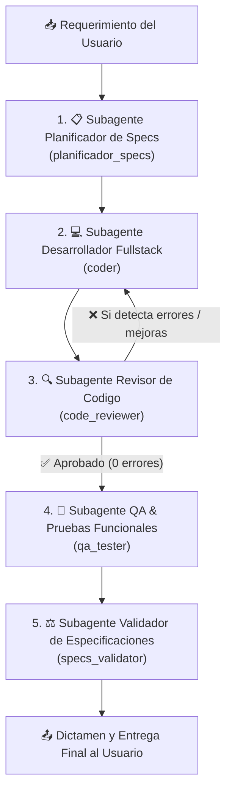

# Flujo de Trabajo y Pipeline de 5 Subagentes (`flujo-5-agentes`)

Este skill estandariza y automatiza el ciclo de desarrollo por etapas mediante la orquestacion de **5 subagentes especializados**. Cada fase es estructurada y coordinada.

---

## Flujo del Pipeline

---

## Protocolo de Ejecucion Paso a Paso

### 1. Subagente Planificador & Disenador de Specs (`planificador_specs`)
- **Tipo / Rol:** `planificador_specs` ("Planificador y Disenador de Specs").
- **Objetivo:** Analizar los requerimientos del usuario, la arquitectura del proyecto y formalizar/actualizar las especificaciones tecnicas en archivos Markdown dedicados (ej. `SPECS_*.md`) y actualizar `README.md`.
- **Entregables:**
  - Archivo de especificacion formal con contratos REST, esquemas de BD, componentes DOM, CSS y casos de prueba.
  - Plan de implementacion estructurado para el Coder.

### 2. Subagente Desarrollador Fullstack (`coder`)
- **Tipo / Rol:** `coder` ("Desarrollador Fullstack").
- **Herramientas:** Requiere herramientas de escritura y ejecucion (`enable_write_tools=True`).
- **Objetivo:** Implementar en codigo todo lo definido en las especificaciones (backend, base de datos MSSQL, frontend HTML/CSS/JS, migraciones o scripts de inicializacion).
- **Ciclo de Retroalimentacion:** Si el Revisor de Codigo le devuelve observaciones o errores, el Coder aplica las correcciones solicitadas y vuelve a entregar el codigo al Revisor.
- **Regla:** Cenerse rigurosamente a las especificaciones aprobadas sin omitir detalles ni introducir desvios.

### 3. Subagente Revisor de Codigo (`code_reviewer`)
- **Tipo / Rol:** `code_reviewer` ("Revisor de Codigo").
- **Objetivo:** Auditar minuciosamente el codigo implementado buscando:
  - Vulnerabilidades de seguridad (consultas SQL sin parametrizar, bypass de RBAC, fugas de tokens).
  - Bugs logicos, referencias nulas/undefined o race conditions asincronas.
  - Consistencia visual, contraste y compatibilidad con modo claro y modo oscuro.
  - Accesibilidad (teclado, ARIA roles, tabindex).
- **Regla de Iteracion:** Si detecta cualquier error, bug, vulnerabilidad o aspecto mejorable:
  1. **NO lo corrige el mismo directamente**.
  2. Documenta detalladamente los hallazgos y **le pasa el error de vuelta al Coder (`coder`)** para que este lo resuelva.
  3. Una vez que el Coder corrige y reenvia el codigo, el Revisor vuelve a auditar.
  4. Solo cuando el codigo este completamente limpio y aprobado (**0 errores**), el Revisor le pasa el flujo al siguiente subagente: **QA Tester (`qa_tester`)**.

### 4. Subagente QA & Pruebas Funcionales (`qa_tester`)
- **Tipo / Rol:** `qa_tester` ("Ingeniero de QA y Pruebas Funcionales").
- **Herramientas:** Requiere herramientas de escritura y ejecucion (`enable_write_tools=True`).
- **Objetivo:** Disenar y ejecutar la bateria completa de pruebas automatizadas funcionales y de integracion (Pytest + Playwright).
- **Criterio de Aceptacion:** **Debe lograr el 100% de pruebas aprobadas (0 fallos)** en toda la suite del proyecto. Si alguna prueba falla, depura y ajusta el codigo o las aserciones hasta obtener el 100% PASS rate.

### 5. Subagente Validador de Especificaciones (`specs_validator`)
- **Tipo / Rol:** `specs_validator` ("Auditor de Cumplimiento de Especificaciones").
- **Objetivo:** Realizar una auditoria punto por punto comparando el codigo implementado contra los requerimientos originales del usuario y las SPECS formalizadas.
- **Regla Fundamental:** **"No puede haber ni mas ni menos"**. Verifica que no falte ningun requerimiento y que no se hayan introducido funciones no solicitadas o desvios de alcance.
- **Entregable:** Matriz de trazabilidad y dictamen formal de certificacion para el usuario.

---

## Plantilla de Invocacion Rapida para el Agente Principal

Cuando el usuario invoque esta skill (ej. `@flujo-5-agentes` o mencionando la skill), el agente orquestador debe:
1. Crear/definir los tipos de subagentes necesarios con `define_subagent` si no existen en la sesion.
2. Invocar secuencialmente cada subagente con `invoke_subagent`.
3. Si `code_reviewer` detecta errores, re-invocar al `coder` con las correcciones necesarias y luego de vuelta a `code_reviewer` hasta obtener aprobacion total.
4. Pasar el contexto y artefactos generados a las siguientes etapas (`qa_tester` y `specs_validator`).
5. Entregar el informe final estructurado al usuario al concluir la certificacion del quinto subagente.
