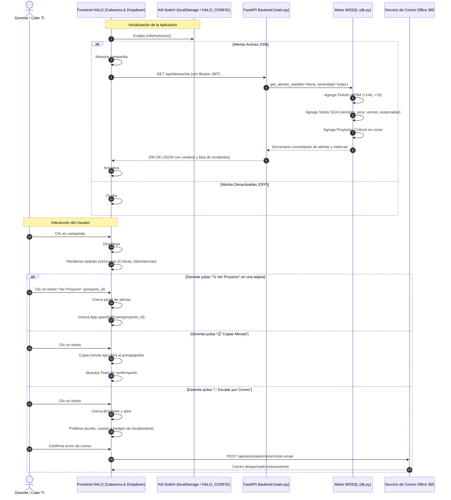
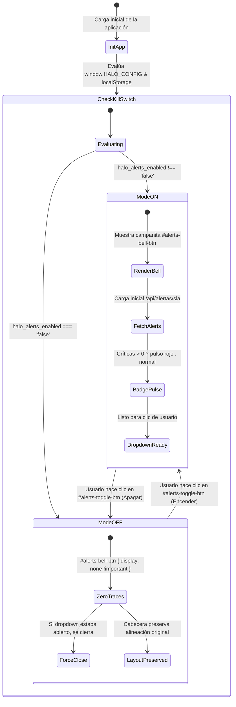

# ESPECIFICACIÓN TÉCNICA Y ARQUITECTÓNICA (SPECS)
## Módulo: "Centro de Alertas Tempranas y Escalamiento Rápido (SLA Warnings) & Kill-Switch" (`app-lti`)

- **Documento:** SPECS-LTI-MOD-015
- **Versión:** 1.0.0
- **Fecha:** 2026-09-23
- **Autor:** Subagente Planificador de Specs (`planificador_specs`)
- **Destinatario:** Subagente Desarrollador (`coder`) / QA Tester
- **Ubicación del Proyecto:** `/home/bobbasystem/Desarrollos/app-lti`
- **Entornos de Despliegue:** Desarrollo (`bobbadeveloper`, localhost:8000) & Producción (`iacdi`, Tailscale 100.82.24.75 / https://200.14.222.162/app-lti/)

---

## CONTROL DE VERSIONES Y REGISTRO DE CAMBIOS

| Versión | Fecha | Autor | Descripción del Cambio |
|---|---|---|---|
| **1.0.0** | 2026-09-23 | Subagente Planificador | Especificación técnica integral de la Funcionalidad 5: Centro de Alertas Tempranas y Escalamiento Rápido (SLA Warnings) en Top Header Institucional Claro HALO. Arquitectura cliente-servidor con endpoint REST `GET /api/alertas/sla`, agregación multivariable en tiempo real en motor MSSQL (`dbo.registrosRF_SD_SM`, `dbo.CT_BACKLOG_OPERACIONES2`, `dbo.Proyectos`), clasificación tripartita de severidad (🔴 Crítica, 🟡 Advertencia, ℹ️ Informativa), panel flotante dropdown/drawer con filtros interactivos, botón de acción rápida `Ver Proyecto` hacia el Drill Down, módulo de Escalamiento Rápido (copia de minuta ejecutiva formateada para comités y prellenado de correo institucional Office 365 hacia jefaturas de soporte), badge reactivo con animación pulsante institucional Claro (`#B52217`), soporte total para Modo Claro y Modo Oscuro, Kill-Switch mandatorio en sub-barra (`🔔 Alertas: ON / OFF`) con política estricta de Cero Rastros y auto-cierre, suite de pruebas automatizadas y plan de implementación paso a paso para el Subagente Coder. |

---

## 1. RESUMEN EJECUTIVO Y OBJETIVOS DEL NEGOCIO

### 1.1. Contexto Operacional y Problemática
En la operación de telecomunicaciones corporativas, conectividad B2B y datacenters de **Claro Chile**, la gestión de proyectos atraviesa múltiples silos y plataformas operacionales especializadas:
1. **Mesa de Ayuda Service Manager HPSM** (`dbo.registrosRF_SD_SM`): Tickets de interacción e incidente asignados a torres técnicas especializadas (`Torre Linux`, `ProvisionConectividadTI`, `ProvisionVirtualizacionTI`, `Torre Windows`, `Networking`, etc.).
2. **Backlog de Operaciones SGA** (`dbo.CT_BACKLOG_OPERACIONES2`): Órdenes de trabajo (Solots) que coordinan la entrega física, enlaces de fibra óptica, altas de equipamiento y configuración de enlaces troncales.
3. **Portal SharePoint / App Líderes TI** (`dbo.Proyectos`): Matriz de proyectos donde el Líder TI y el Project Manager consolidan el avance administrativo y compromisos pactados con el cliente corporativo.

**El Problema Operacional Crítico:**
- Actualmente, las desviaciones de SLA se detectan de forma tardía, reactiva y atomizada.
- Para identificar qué proyectos tienen tickets estancados por más de 14 días o Solots con fecha comprometida vencida, el Gerente de Operaciones y los Líderes TI deben ingresar proyecto por proyecto, revisar manualmente pestañas de decenas de registros o exportar hojas Excel dispersas.
- En la base de datos real del sistema, existen **más de 48 tickets críticos superando ampliamente los 14 días de permanencia en torres técnicas** y **más de 600 Solots SGA vencidas** respecto a su fecha de compromiso pactada.
- No existe un mecanismo unificado y de acceso inmediato en la interfaz principal que alerte en tiempo real al gerente o al líder sobre incidentes fuera de plazo, ni una forma expedita de escalar dichos retrasos a las jefaturas de torre correspondientes.

### 1.2. Solución Propuesta: "Centro de Alertas Tempranas SLA & Escalamiento Rápido"
Implementar un **Centro de Alertas Tempranas y Escalamiento Rápido** ubicado estratégicamente en el Top Navigation Header institucional de la aplicación (`.app-header .user-area`):
1. **Campana Institucional Reactiva (`#alerts-bell-btn`)**:
   - Icono SVG de campanita ubicado en la cabecera institucional, accesible desde cualquier vista o módulo.
   - Badge numérico en tiempo real (`#alerts-badge-count`) que refleja el total de incidentes fuera de SLA.
   - **Animación Pulsante Suave**: Si existen alertas críticas (🔴), el badge emite un pulso suave institucional en rojo Claro (`#B52217`). Si solo existen advertencias (🟡), se exhibe en amarillo ámbar (`#D97706`). Si la operación está al día (0 alertas), se muestra en estado neutro/verde discreto o se oculta.
2. **Panel Flotante Dropdown / Drawer Ejecutivo (`#alerts-dropdown`)**:
   - Panel de diseño premium con sombra difusa, desenfoque de fondo y bordes redondeados (`max-width: 440px`, desplegable bajo la campana).
   - **Cabecera del Panel**: Conteo global, estado general del servicio y botón de cierre rápido (`✕`).
   - **Pestañas / Píldoras de Filtrado**: `[🔴 Críticas (X)]`, `[🟡 Advertencias (Y)]`, `[🌟 Todas (Z)]`.
   - **Filtro por Líder TI**: Selector rápido para consultar alertas de toda la gerencia o acotar exclusivamente a la cartera del usuario conectado.
   - **Listado de Tarjetas de Alerta**:
     * Iconografía diferenciada: `🎫 Ticket HPSM/SD`, `⚡ Solot SGA`, `📁 Proyecto`.
     * Identificador y resumen de la desviación (ej. `SD2093878 - Torre ProvisionVirtualizacionTI (505 días abierto)` o `Solot 17522296 - Instalaciones (Vencida hace 576 días)`).
     * Cliente del proyecto y Líder TI asignado.
     * Botón de acción rápida `🔍 Ver Proyecto` que abre directamente el modal de Drill Down del proyecto en cuestión y cierra el panel.
3. **Escalamiento Rápido en 1 Clic**:
   - **Botón `📋 Copiar Minuta de Alertas`**: Copia al portapapeles una minuta ejecutiva en texto plano estructurado lista para su presentación en el comité diario de operaciones (Daily Ops) o pegado en Teams/WhatsApp corporativo.
   - **Botón `📧 Escalar por Correo`**: Abre el modal integrado de correo institucional (`#email-ticket-modal`), prellenando el asunto corporativo `[HALO ESCALAMIENTO] Alertas Críticas SLA Operacional - <Fecha>` y el cuerpo HTML/texto con la tabla de incidentes en riesgo y destinatarios sugeridos.
4. **Kill-Switch Mandatorio & Política de Cero Rastros**:
   - Botón en la sub-barra de navegación: `🔔 Alertas: ON / OFF` (`#alerts-toggle-btn`).
   - Flag maestro de runtime: `window.HALO_CONFIG.ENABLE_ALERTS = true/false`.
   - Persistencia local: `localStorage.getItem('halo_alerts_enabled')`.
   - Si se encuentra en `OFF`, la campanita y el panel se ocultan con `display: none !important;` sin distorsionar el flexbox del área de usuario de la cabecera. Si el panel estaba abierto al desactivarlo, se cierra de inmediato.

---

## 2. ARQUITECTURA TÉCNICA Y DIAGRAMAS DE FLUJO

### 2.1. Diagrama de Arquitectura y Secuencia de Datos



### 2.2. Diagrama de Estados del Kill-Switch y Política de Cero Rastros



---

## 3. ESPECIFICACIÓN DEL MOTOR DE REGLAS DE SLA Y BASE DE DATOS

### 3.1. Criterios Canónicos de Clasificación de Severidad

| Severidad | Código | Color / Hex | Fuente | Regla Operacional de Detección |
|---|---|---|---|---|
| **🔴 Crítica** | `CRITICAL` | `#B52217` (Claro Red) | Tickets HPSM | `STATUS NOT IN ('Cerrado', 'Resuelto')` AND `dias_abierto > 14` días transcurridos desde `SUBMIT_DATE`. |
| **🔴 Crítica** | `CRITICAL` | `#B52217` (Claro Red) | Solots SGA | `ESTADO_OTP NOT IN (estados_cerrados)` AND `FECHA_COMPROMETIDA < CAST(GETDATE() AS DATE)` (Solot formalmente vencida). |
| **🔴 Crítica** | `CRITICAL` | `#B52217` (Claro Red) | Proyectos SP | `p.Estado <> 'Atendido'` AND múltiples desviaciones críticas acumuladas (>=2 solots vencidas o >=2 tickets >14d). |
| **🟡 Advertencia** | `WARNING` | `#D97706` / `#E68A00` (Amber) | Tickets HPSM | `STATUS NOT IN ('Cerrado', 'Resuelto')` AND `dias_abierto > 7` AND `dias_abierto <= 14`. |
| **🟡 Advertencia** | `WARNING` | `#D97706` / `#E68A00` (Amber) | Solots SGA | `ESTADO_OTP NOT IN (estados_cerrados)` AND `FECHA_COMPROMETIDA >= CAST(GETDATE() AS DATE)` AND `FECHA_COMPROMETIDA <= DATEADD(day, 2, CAST(GETDATE() AS DATE))` (Vence en <= 48 horas). |
| **🟡 Advertencia** | `WARNING` | `#D97706` / `#E68A00` (Amber) | Solots SGA | `ESTADO_OTP NOT IN (estados_cerrados)` AND `FECHA_COMPROMETIDA IS NULL` AND `DATEDIFF(day, b.FECHA_INSERT, GETDATE()) > 10` (Solot estancada sin compromiso pactado tras 10 días de ingreso). |
| **ℹ️ Informativa** | `INFO` | `#0097A9` (HALO Teal) | General | Proyectos en curso sin Líder TI asignado o asignación reciente con hitos próximos programados. |

> [!IMPORTANT]
> **Estados Cerrados Canónicos de Solots en SGA (`dbo.CT_BACKLOG_OPERACIONES2`):**  
> `'Cerrada'`, `'5- Ejecutada'`, `'5- Ejecutada Tareas Pendientes'`, `'Abortado'`, `'En Aborcion'`, `'Eliminada'`, `'Aprobado'`. Cualquier registro que no posea estos estados se considera operacionalmente **abierto** y sujeto a control de SLA.

### 3.2. Consulta SQL Optimizada de Agregación Multivariable (`backend/db.py`)

Para garantizar tiempos de respuesta inferiores a **150 ms** sin sobrecargar el servidor MSSQL de producción:
1. Se emplean directivas de lectura sucia segura `WITH (NOLOCK)`.
2. Se filtran proyectos activos ignorando proyectos de tipo `'Reunión'` y estado `'Atendido'`.
3. Se ejecutan consultas estructuradas para obtener:
   - Resumen estadístico (conteos por severidad y tipo).
   - Lista priorizada de tickets fuera de SLA (ordenados por días de antigüedad descendente).
   - Lista priorizada de Solots fuera de SLA (ordenadas por días de atraso descendente).
   - Resumen de proyectos críticos.

```sql
-- 1. Resumen de conteos globales de SLA
SELECT 
    -- Tickets HPSM
    COUNT(CASE WHEN sd.STATUS NOT IN ('Cerrado', 'Resuelto') 
               AND DATEDIFF(day, TRY_CAST(sd.SUBMIT_DATE AS DATETIME2), GETDATE()) > 14 THEN 1 END) AS tickets_criticos,
    COUNT(CASE WHEN sd.STATUS NOT IN ('Cerrado', 'Resuelto') 
               AND DATEDIFF(day, TRY_CAST(sd.SUBMIT_DATE AS DATETIME2), GETDATE()) > 7 
               AND DATEDIFF(day, TRY_CAST(sd.SUBMIT_DATE AS DATETIME2), GETDATE()) <= 14 THEN 1 END) AS tickets_advertencia,
    -- Solots SGA
    COUNT(CASE WHEN b.ESTADO_OTP NOT IN ('Cerrada', '5- Ejecutada', '5- Ejecutada Tareas Pendientes', 'Abortado', 'En Aborcion', 'Eliminada', 'Aprobado')
               AND b.FECHA_COMPROMETIDA < CAST(GETDATE() AS DATE) THEN 1 END) AS solots_vencidas,
    COUNT(CASE WHEN b.ESTADO_OTP NOT IN ('Cerrada', '5- Ejecutada', '5- Ejecutada Tareas Pendientes', 'Abortado', 'En Aborcion', 'Eliminada', 'Aprobado')
               AND b.FECHA_COMPROMETIDA >= CAST(GETDATE() AS DATE) 
               AND b.FECHA_COMPROMETIDA <= DATEADD(day, 2, CAST(GETDATE() AS DATE)) THEN 1 END) AS solots_proximas_vencer,
    COUNT(CASE WHEN b.ESTADO_OTP NOT IN ('Cerrada', '5- Ejecutada', '5- Ejecutada Tareas Pendientes', 'Abortado', 'En Aborcion', 'Eliminada', 'Aprobado')
               AND b.FECHA_COMPROMETIDA IS NULL 
               AND DATEDIFF(day, b.FECHA_INSERT, GETDATE()) > 10 THEN 1 END) AS solots_sin_compromiso
FROM dbo.Proyectos p WITH (NOLOCK)
LEFT JOIN dbo.registrosRF_SD_SM sd WITH (NOLOCK) 
    ON (sd.ID_Proyecto = p.ID OR sd.Numero_Proyecto_Limpio = p.Numero_Proyecto)
LEFT JOIN dbo.CT_BACKLOG_OPERACIONES2 b WITH (NOLOCK) 
    ON (b.ID_Proyecto = p.ID OR b.Numero_Proyecto_Limpio = p.Numero_Proyecto)
WHERE (p.Tipo_Servicio IS NULL OR p.Tipo_Servicio <> 'Reunión')
  AND p.Estado <> 'Atendido';
```

---

## 4. CONTRATO DE API REST (`backend/main.py` & `backend/db.py`)

### 4.1. Definición del Endpoint REST
- **Ruta:** `GET /api/alertas/sla`
- **Seguridad:** `Depends(require_lti_or_admin)` (Autenticación JWT institucional del Portal de Acceso SSO).
- **Parámetros de Consulta (Query Params):**
  * `lider` (str, opcional): Filtrar exclusivamente por un Líder TI específico (ej: `"Alejandro Aguilar"`).
  * `severidad` (str, default `"todas"`): Opciones permitidas: `"todas"`, `"critica"`, `"advertencia"`.
  * `tipo` (str, default `"todos"`): Opciones: `"todos"`, `"ticket"`, `"solot"`, `"proyecto"`.
  * `limite` (int, default `100`): Máximo de alertas detalladas a retornar en la lista.

### 4.2. Estructura del Payload de Respuesta JSON (200 OK)

```json
{
  "timestamp": "2026-09-23T18:00:00Z",
  "filtros_aplicados": {
    "lider": null,
    "severidad": "todas",
    "tipo": "todos"
  },
  "resumen": {
    "total_alertas": 52,
    "criticas": 48,
    "advertencias": 4,
    "tickets_sla_criticos": 48,
    "tickets_sla_advertencia": 0,
    "solots_vencidas": 4,
    "solots_proximas_vencer": 0,
    "solots_sin_compromiso": 0,
    "proyectos_criticos": 18
  },
  "alertas": [
    {
      "id": "TICKET-SD2093878",
      "tipo": "ticket",
      "severidad": "CRITICAL",
      "icono": "🎫",
      "titulo": "SD2093878",
      "subtitulo": "Upgrade de VDC // 1598268 Cliente Sirantic",
      "proyecto_id": 2035,
      "numero_proyecto": "0001598268",
      "cliente": "Sirantic LTDA",
      "lt_asignado": "Alejandro Aguilar",
      "responsable": "ProvisionVirtualizacionTI",
      "responsable_tipo": "Torre Operativa",
      "asignado_a": "Sin Asignar",
      "dias_fuera_sla": 505,
      "fecha_referencia": "2025-05-06",
      "detalle_sla": "505 días abierto en torre (>14d límite SLA)",
      "badge_color": "red"
    },
    {
      "id": "SOLOT-17522296",
      "tipo": "solot",
      "severidad": "CRITICAL",
      "icono": "⚡",
      "titulo": "Solot 17522296",
      "subtitulo": "Instalacion | Paquete 23.000 minutos | CALLE BENAVENTE 550 PISO 12",
      "proyecto_id": 1954,
      "numero_proyecto": "1594831",
      "cliente": "SOC DE RENTAS INMOBILIARIAS LIMITADA",
      "lt_asignado": "Alejandro Aguilar",
      "responsable": "Instalaciones",
      "responsable_tipo": "Área SGA",
      "asignado_a": "MICHAEL FRED PEREZ ZUNIGA",
      "dias_fuera_sla": 576,
      "fecha_referencia": "2025-02-24",
      "detalle_sla": "Vencida hace 576 días (Compromiso: 2025-02-24)",
      "badge_color": "red"
    }
  ],
  "minuta_escalamiento": {
    "asunto_sugerido": "[HALO ESCALAMIENTO] Alertas Críticas de SLA Operacional - 23/09/2026",
    "texto_plano": "======================================================================\nCLARO HALO — MINUTA EJECUTIVA DE ESCALAMIENTO OPERACIONAL\nFecha: 23/09/2026\n======================================================================\n...",
    "destinatarios_sugeridos": [
      "jefatura.operaciones@clarovtr.cl",
      "soporte.sga@clarovtr.cl"
    ]
  }
}
```

---

## 5. ESPECIFICACIÓN DEL FRONTEND, UI Y COMPONENTES

### 5.1. Estructura HTML de la Campanita y Panel Flotante (`frontend/index.html`)

El botón de campanita y su dropdown se ubican dentro de `<div class="user-area">` en la cabecera principal `.app-header`:

```html
<!-- ========================================================================
     CENTRO DE ALERTAS TEMPRANAS SLA & ESCALAMIENTO RÁPIDO (CAMPANA Y PANEL)
     ======================================================================== -->
<div class="alerts-wrapper" id="alerts-wrapper">
  <!-- Botón Campanita Institucional -->
  <button class="btn-alerts-bell" id="alerts-bell-btn" title="Centro de Alertas Tempranas SLA" aria-label="Centro de Alertas Tempranas SLA" aria-expanded="false" aria-haspopup="true">
    <svg class="alerts-bell-icon" viewBox="0 0 24 24" fill="none" stroke="currentColor" stroke-width="2" stroke-linecap="round" stroke-linejoin="round">
      <path d="M18 8A6 6 0 0 0 6 8c0 7-3 9-3 9h18s-3-2-3-9"></path>
      <path d="M13.73 21a2 2 0 0 1-3.46 0"></path>
    </svg>
    <!-- Badge reactivo numérico -->
    <span class="alerts-badge" id="alerts-badge-count" style="display: none;">0</span>
  </button>

  <!-- Panel Flotante / Dropdown de Alertas SLA -->
  <div class="alerts-dropdown" id="alerts-dropdown" style="display: none;" role="dialog" aria-label="Centro de Alertas Tempranas SLA">
    
    <!-- Cabecera del Panel -->
    <div class="alerts-dropdown-header">
      <div class="alerts-dropdown-title-row">
        <div class="alerts-header-brand">
          <span class="alerts-header-icon">🔔</span>
          <span class="alerts-header-title">Alertas Tempranas SLA</span>
        </div>
        <span class="badge badge-danger alerts-total-pill" id="alerts-dropdown-total-badge">0 Alertas</span>
        <button class="alerts-close-btn" id="alerts-dropdown-close-btn" aria-label="Cerrar panel de alertas">&times;</button>
      </div>
      
      <!-- Sub-resumen de salud rápida -->
      <div class="alerts-status-summary-bar" id="alerts-status-summary-bar">
        <span id="alerts-summary-crit-count" class="summary-crit">🔴 0 Críticas</span>
        <span id="alerts-summary-warn-count" class="summary-warn">🟡 0 Advertencias</span>
      </div>
    </div>

    <!-- Barra de Píldoras de Filtro Rápido en Dropdown -->
    <div class="alerts-filter-bar">
      <button class="alerts-filter-pill active" data-filter="todas" id="alerts-filter-all">🌟 Todas (<span id="alerts-filter-count-all">0</span>)</button>
      <button class="alerts-filter-pill" data-filter="critica" id="alerts-filter-crit">🔴 Críticas (<span id="alerts-filter-count-crit">0</span>)</button>
      <button class="alerts-filter-pill" data-filter="advertencia" id="alerts-filter-warn">🟡 Advertencias (<span id="alerts-filter-count-warn">0</span>)</button>
    </div>

    <!-- Barra de Acciones Ejecutivas de Escalamiento -->
    <div class="alerts-actions-bar">
      <button class="btn btn-sm btn-secondary btn-alerts-action" id="btn-copy-alerts-minuta" title="Copiar minuta ejecutiva con el resumen de alertas al portapapeles">
        <span class="btn-icon">📋</span> Copiar Minuta
      </button>
      <button class="btn btn-sm btn-primary btn-alerts-action" id="btn-escalar-alerts-email" title="Enviar correo de escalamiento a jefaturas de soporte">
        <span class="btn-icon">📧</span> Escalar por Correo
      </button>
    </div>

    <!-- Cuerpo Scrollable de Alertas -->
    <div class="alerts-list-container" id="alerts-list-container">
      <!-- Loading State -->
      <div class="alerts-loading-state" id="alerts-loading-state">
        <div class="spinner-sm"></div>
        <span>Cargando desviaciones operacionales de SLA...</span>
      </div>
      
      <!-- Lista Dinámica Inyectada por JS -->
      <div class="alerts-items-list" id="alerts-items-list" style="display: none;"></div>

      <!-- Empty State -->
      <div class="alerts-empty-state" id="alerts-empty-state" style="display: none;">
        <span class="empty-icon">🎉</span>
        <p class="empty-title">¡Excelente! Operación en Norma</p>
        <p class="empty-desc">No existen tickets ni solots fuera de los límites de SLA en este momento.</p>
      </div>
    </div>

    <!-- Pie del Dropdown -->
    <div class="alerts-dropdown-footer">
      <span class="alerts-footer-info" id="alerts-footer-info">Actualizado en tiempo real</span>
      <button class="btn-alerts-refresh" id="btn-alerts-refresh" title="Refrescar alertas">🔄</button>
    </div>

  </div>
</div>
```

### 5.2. Estructura HTML del Kill-Switch en la Sub-Barra (`frontend/index.html`)

En `<div class="nav-subbar-actions">`, inmediatamente junto a los otros toggles (`Salud`, `Diagnóstico`, `Ficha PDF`, `Timeline`):

```html
<!-- Botón Kill-Switch / Toggle del Centro de Alertas Tempranas -->
<button id="alerts-toggle-btn" class="btn-subbar-toggle" title="Activar o desactivar Centro de Alertas Tempranas SLA" aria-label="Toggle Alertas Tempranas SLA" aria-pressed="true">
  <span class="alerts-toggle-icon">🔔</span>
  <span class="alerts-toggle-label" id="alerts-toggle-label">Alertas: ON</span>
</button>
```

---

## 6. ESTILOS Y EXPERIENCIA VISUAL (`frontend/css/styles.css`)

### 6.1. Definición de Clases CSS para Cabecera, Campanita y Animación Pulsante

```css
/* ==========================================================================
   CENTRO DE ALERTAS TEMPRANAS SLA & ESCALAMIENTO RÁPIDO
   ========================================================================== */

/* Contenedor relativo de campanita en app-header */
.alerts-wrapper {
  position: relative;
  display: inline-flex;
  align-items: center;
}

/* Botón Campanita en Header */
.btn-alerts-bell {
  position: relative;
  display: inline-flex;
  align-items: center;
  justify-content: center;
  width: 36px;
  height: 36px;
  border-radius: var(--radius-full);
  background: rgba(253, 237, 234, 0.12);
  border: 1px solid rgba(253, 237, 234, 0.25);
  color: #FDEDEA;
  cursor: pointer;
  transition: all var(--transition-fast);
  padding: 0;
}

.btn-alerts-bell:hover {
  background: rgba(253, 237, 234, 0.24);
  transform: translateY(-1px);
}

.btn-alerts-bell:active {
  transform: translateY(0);
}

.alerts-bell-icon {
  width: 20px;
  height: 20px;
}

/* Badge reactivo de conteo */
.alerts-badge {
  position: absolute;
  top: -4px;
  right: -5px;
  min-width: 19px;
  height: 19px;
  padding: 0 5px;
  border-radius: 10px;
  background: #B52217;
  color: #ffffff;
  font-size: 0.72rem;
  font-weight: 800;
  display: flex;
  align-items: center;
  justify-content: center;
  border: 2px solid #B52217;
  box-shadow: 0 2px 5px rgba(0, 0, 0, 0.3);
  transition: all var(--transition-fast);
}

/* Badge con alerta crítica (animación pulsante suave) */
.alerts-badge.pulse-red {
  background: #ffffff;
  color: #B52217;
  border-color: #FDEDEA;
  animation: pulse-alerts 2s infinite ease-in-out;
}

.alerts-badge.badge-amber {
  background: #D97706;
  border-color: #D97706;
  color: #ffffff;
}

@keyframes pulse-alerts {
  0% {
    box-shadow: 0 0 0 0 rgba(255, 255, 255, 0.7);
    transform: scale(1);
  }
  50% {
    box-shadow: 0 0 0 6px rgba(255, 255, 255, 0);
    transform: scale(1.08);
  }
  100% {
    box-shadow: 0 0 0 0 rgba(255, 255, 255, 0);
    transform: scale(1);
  }
}

/* Dropdown / Panel Flotante */
.alerts-dropdown {
  position: absolute;
  top: calc(100% + 10px);
  right: 0;
  width: 440px;
  max-width: 92vw;
  background: var(--bg-surface);
  border: 1px solid var(--border-color);
  border-radius: var(--radius-lg);
  box-shadow: 0 16px 36px rgba(0, 0, 0, 0.22);
  z-index: 1050;
  overflow: hidden;
  display: flex;
  flex-direction: column;
  animation: dropdown-fade-in 0.18s ease-out;
}

@keyframes dropdown-fade-in {
  from {
    opacity: 0;
    transform: translateY(-8px);
  }
  to {
    opacity: 1;
    transform: translateY(0);
  }
}

/* Cabecera del Dropdown */
.alerts-dropdown-header {
  padding: 14px 16px 10px 16px;
  background: var(--bg-surface-secondary);
  border-bottom: 1px solid var(--border-color);
}

.alerts-dropdown-title-row {
  display: flex;
  align-items: center;
  justify-content: space-between;
  gap: 8px;
}

.alerts-header-brand {
  display: flex;
  align-items: center;
  gap: 8px;
}

.alerts-header-icon {
  font-size: 1.15rem;
}

.alerts-header-title {
  font-size: 0.95rem;
  font-weight: 700;
  color: var(--text-primary);
}

.alerts-total-pill {
  font-size: 0.75rem;
  padding: 0.2rem 0.6rem;
  border-radius: var(--radius-full);
}

.alerts-close-btn {
  background: transparent;
  border: none;
  font-size: 1.3rem;
  line-height: 1;
  color: var(--text-muted);
  cursor: pointer;
  padding: 0 4px;
  transition: color var(--transition-fast);
}

.alerts-close-btn:hover {
  color: var(--text-primary);
}

.alerts-status-summary-bar {
  display: flex;
  gap: 12px;
  font-size: 0.78rem;
  font-weight: 600;
  margin-top: 6px;
}

.alerts-status-summary-bar .summary-crit {
  color: #B52217;
}

.alerts-status-summary-bar .summary-warn {
  color: #D97706;
}

/* Barra de Filtros Rápidos (Pills) */
.alerts-filter-bar {
  display: flex;
  gap: 6px;
  padding: 8px 16px;
  background: var(--bg-surface);
  border-bottom: 1px solid var(--border-color);
}

.alerts-filter-pill {
  padding: 0.25rem 0.65rem;
  font-size: 0.78rem;
  font-weight: 600;
  border-radius: var(--radius-full);
  border: 1px solid var(--border-color);
  background: var(--bg-surface-secondary);
  color: var(--text-secondary);
  cursor: pointer;
  transition: all var(--transition-fast);
}

.alerts-filter-pill:hover {
  background: var(--bg-surface-tertiary);
  color: var(--text-primary);
}

.alerts-filter-pill.active {
  background: var(--primary);
  color: #ffffff;
  border-color: var(--primary);
}

/* Barra de Acciones Ejecutivas */
.alerts-actions-bar {
  display: flex;
  gap: 8px;
  padding: 8px 16px;
  background: var(--bg-surface-secondary);
  border-bottom: 1px solid var(--border-color);
}

.btn-alerts-action {
  flex: 1;
  display: inline-flex;
  align-items: center;
  justify-content: center;
  gap: 6px;
  font-size: 0.8rem;
  padding: 0.4rem 0.6rem;
}

/* Contenedor de Lista Scrollable */
.alerts-list-container {
  max-height: 380px;
  overflow-y: auto;
  padding: 10px 16px;
  display: flex;
  flex-direction: column;
  gap: 10px;
}

/* Tarjeta individual de Alerta */
.alert-card-item {
  border-radius: var(--radius-md);
  border: 1px solid var(--border-color);
  background: var(--bg-surface);
  padding: 10px 12px;
  transition: all var(--transition-fast);
  display: flex;
  flex-direction: column;
  gap: 6px;
}

.alert-card-item.critica {
  border-left: 4px solid #B52217;
}

.alert-card-item.advertencia {
  border-left: 4px solid #D97706;
}

.alert-card-item:hover {
  border-color: var(--primary);
  box-shadow: 0 4px 12px rgba(0, 0, 0, 0.08);
  transform: translateY(-1px);
}

.alert-card-header {
  display: flex;
  align-items: center;
  justify-content: space-between;
  gap: 8px;
}

.alert-card-type-row {
  display: flex;
  align-items: center;
  gap: 6px;
}

.alert-card-icon {
  font-size: 1.05rem;
}

.alert-card-title {
  font-size: 0.88rem;
  font-weight: 700;
  color: var(--text-primary);
}

.alert-card-sla-badge {
  font-size: 0.74rem;
  font-weight: 700;
  padding: 0.15rem 0.5rem;
  border-radius: var(--radius-sm);
}

.badge-sla-critical {
  background: rgba(181, 34, 23, 0.12);
  color: #B52217;
  border: 1px solid rgba(181, 34, 23, 0.3);
}

.badge-sla-warning {
  background: rgba(217, 119, 6, 0.12);
  color: #D97706;
  border: 1px solid rgba(217, 119, 6, 0.3);
}

.alert-card-subtitulo {
  font-size: 0.8rem;
  color: var(--text-secondary);
  line-height: 1.35;
}

.alert-card-meta-row {
  display: flex;
  flex-wrap: wrap;
  align-items: center;
  justify-content: space-between;
  font-size: 0.74rem;
  color: var(--text-muted);
  border-top: 1px solid var(--border-color);
  padding-top: 6px;
  margin-top: 2px;
}

.alert-card-meta-info {
  display: flex;
  gap: 8px;
}

.alert-card-meta-info strong {
  color: var(--text-secondary);
}

.btn-alert-drilldown {
  display: inline-flex;
  align-items: center;
  gap: 4px;
  padding: 0.2rem 0.55rem;
  font-size: 0.74rem;
  font-weight: 600;
  border-radius: var(--radius-sm);
  background: var(--bg-surface-secondary);
  border: 1px solid var(--border-color);
  color: var(--primary-text);
  cursor: pointer;
  transition: all var(--transition-fast);
}

.btn-alert-drilldown:hover {
  background: var(--primary);
  color: #ffffff;
  border-color: var(--primary);
}

/* Empty State & Loading State */
.alerts-empty-state, .alerts-loading-state {
  display: flex;
  flex-direction: column;
  align-items: center;
  justify-content: center;
  padding: 28px 16px;
  text-align: center;
  gap: 8px;
}

.alerts-empty-state .empty-icon {
  font-size: 2.2rem;
}

.alerts-empty-state .empty-title {
  font-size: 0.92rem;
  font-weight: 700;
  color: var(--text-primary);
  margin: 0;
}

.alerts-empty-state .empty-desc {
  font-size: 0.8rem;
  color: var(--text-secondary);
  margin: 0;
}

/* Pie del Dropdown */
.alerts-dropdown-footer {
  display: flex;
  align-items: center;
  justify-content: space-between;
  padding: 8px 16px;
  background: var(--bg-surface-secondary);
  border-top: 1px solid var(--border-color);
  font-size: 0.74rem;
  color: var(--text-muted);
}

.btn-alerts-refresh {
  background: transparent;
  border: none;
  cursor: pointer;
  font-size: 0.95rem;
  padding: 2px;
  transition: transform 0.2s ease;
}

.btn-alerts-refresh:hover {
  transform: rotate(90deg);
}

/* Soporte Dark Mode */
[data-theme="dark"] .alerts-dropdown {
  box-shadow: 0 16px 40px rgba(0, 0, 0, 0.55);
}

[data-theme="dark"] .badge-sla-critical {
  background: rgba(239, 68, 68, 0.2);
  color: #f87171;
  border-color: rgba(239, 68, 68, 0.4);
}

[data-theme="dark"] .badge-sla-warning {
  background: rgba(245, 158, 11, 0.2);
  color: #fbbf24;
  border-color: rgba(245, 158, 11, 0.4);
}
```

---

## 7. ESPECIFICACIÓN DEL COMPORTAMIENTO JAVASCRIPT (`frontend/js/app.js`)

### 7.1. Inicialización y Feature Flag Global
En el bloque de configuración global al inicio de `frontend/js/app.js`:

```javascript
window.HALO_CONFIG = window.HALO_CONFIG || {};
if (window.HALO_CONFIG.ENABLE_ALERTS === undefined) {
  window.HALO_CONFIG.ENABLE_ALERTS = true;
}
```

### 7.2. Métodos del Kill-Switch de Alertas en el Objeto `App`

```javascript
// --------------------------------------------------------------------------
// CENTRO DE ALERTAS TEMPRANAS SLA & ESCALAMIENTO RÁPIDO (FEATURE 5)
// --------------------------------------------------------------------------
initAlerts() {
  this.applyAlertsState(false);
  if (this.isAlertsActive()) {
    this.fetchAlertsSLA();
  }
},

isAlertsActive() {
  // 1. Configuración maestra en runtime
  if (window.HALO_CONFIG && window.HALO_CONFIG.ENABLE_ALERTS === false) {
    return false;
  }
  // 2. Preferencia del usuario en localStorage
  const pref = localStorage.getItem('halo_alerts_enabled');
  if (pref !== null) {
    return pref === 'true';
  }
  // 3. Fallback por defecto: Habilitado (true)
  return true;
},

toggleAlerts() {
  const current = this.isAlertsActive();
  const next = !current;
  localStorage.setItem('halo_alerts_enabled', next ? 'true' : 'false');
  this.applyAlertsState(true);
  const msg = next ? '🔔 Centro de Alertas activado' : '🔔 Centro de Alertas desactivado';
  this.showToast(msg, 'info');
},

applyAlertsState(triggerFetch = true) {
  const active = this.isAlertsActive();
  const toggleBtn = document.getElementById('alerts-toggle-btn');
  const toggleLabel = document.getElementById('alerts-toggle-label');
  const bellWrapper = document.getElementById('alerts-wrapper');
  const dropdown = document.getElementById('alerts-dropdown');

  if (toggleBtn) {
    toggleBtn.setAttribute('aria-pressed', active ? 'true' : 'false');
    if (active) {
      toggleBtn.classList.remove('is-off');
      toggleBtn.title = 'Desactivar Centro de Alertas Tempranas SLA';
      if (toggleLabel) toggleLabel.textContent = 'Alertas: ON';
    } else {
      toggleBtn.classList.add('is-off');
      toggleBtn.title = 'Activar Centro de Alertas Tempranas SLA';
      if (toggleLabel) toggleLabel.textContent = 'Alertas: OFF';
    }
  }

  // Política estricta de Cero Rastros
  if (bellWrapper) {
    bellWrapper.style.setProperty('display', active ? 'inline-flex' : 'none', 'important');
  }

  // Si se apaga mientras el panel estaba abierto, se cierra inmediatamente
  if (!active && dropdown) {
    dropdown.style.display = 'none';
    const bellBtn = document.getElementById('alerts-bell-btn');
    if (bellBtn) bellBtn.setAttribute('aria-expanded', 'false');
  }

  if (active && triggerFetch) {
    this.fetchAlertsSLA();
  }
},
```

### 7.3. Métodos Operacionales de Consulta y Renderizado

1. `fetchAlertsSLA()`: Llama a `Auth.fetchWithAuth('/api/alertas/sla')`, guarda los datos en `this.alertsData`, actualiza `#alerts-badge-count` y renderiza el contenido en el panel.
2. `toggleAlertsDropdown()`: Abre o cierra el panel flotante `#alerts-dropdown`, actualizando `aria-expanded`.
3. `closeAlertsDropdown()`: Cierra el panel de alertas.
4. `filterAlerts(severity)`: Filtra en memoria entre `'todas'`, `'critica'` o `'advertencia'` y refresca las tarjetas.
5. `copyAlertsMinuta()`: Extrae `this.alertsData.minuta_escalamiento.texto_plano` y lo envía al portapapeles mediante `this.copyTextToClipboard()`.
6. `escalarAlertsEmail()`: Cierra el panel de alertas y abre `#email-ticket-modal` mediante `this.openEmailTicketModal({...})` con el asunto institucional y cuerpo prellenado.
7. `openProjectFromAlert(projectId)`: Cierra el panel flotante y ejecuta `this.openDrillDown(projectId)`.

---

## 8. MATRIZ DE CASOS DE PRUEBA Y VALIDACIÓN AUTOMATIZADA

### 8.1. Pruebas Unitarias de Backend (`tests/test_alertas_sla.py`)

| ID | Caso de Prueba | Método / Endpoint | Entrada / Condición | Resultado Esperado |
|---|---|---|---|---|
| **UT-ALT-001** | Clasificación de Ticket Crítico | `get_alertas_sla()` | Ticket SD con `STATUS = 'Abierto'` y `dias_abierto = 15`. | Clasificado como `CRITICAL`, severidad roja, `dias_fuera_sla = 15`. |
| **UT-ALT-002** | Clasificación de Ticket Advertencia | `get_alertas_sla()` | Ticket SD con `STATUS = 'Asignado'` y `dias_abierto = 10`. | Clasificado como `WARNING`, severidad ámbar, `dias_fuera_sla = 10`. |
| **UT-ALT-003** | Exclusión de Tickets Cerrados | `get_alertas_sla()` | Ticket SD con `STATUS = 'Cerrado'` o `'Resuelto'` y antigüedad 60 días. | No genera alerta. Excluido por regla canónica. |
| **UT-ALT-004** | Clasificación de Solot Vencida | `get_alertas_sla()` | Solot SGA abierta con `FECHA_COMPROMETIDA` en el pasado. | Clasificado como `CRITICAL`, días de atraso calculados correctamente. |
| **UT-ALT-005** | Clasificación de Solot por Vencer | `get_alertas_sla()` | Solot SGA abierta con compromiso mañana (<= 48h). | Clasificado como `WARNING`. |
| **UT-ALT-006** | Solot Estancada sin Compromiso | `get_alertas_sla()` | Solot abierta sin fecha de compromiso y `dias_creacion = 12`. | Clasificado como `WARNING` (estancada). |
| **UT-ALT-007** | Endpoint No Autenticado | `GET /api/alertas/sla` | Petición sin Bearer token. | Retorna HTTP `401 Unauthorized`. |
| **UT-ALT-008** | Endpoint Autenticado con Rol LTI/ADMIN | `GET /api/alertas/sla` | Petición con Bearer JWT válido. | Retorna HTTP `200 OK` con JSON estructurado (`resumen`, `alertas`, `minuta_escalamiento`). |
| **UT-ALT-009** | Filtro por Líder TI | `GET /api/alertas/sla?lider=Alejandro+Aguilar` | Petición con filtro de líder. | Retorna exclusivamente alertas donde `lt_asignado` coincide. |
| **UT-ALT-010** | Generación de Minuta de Escalamiento | `get_alertas_sla()` | Ejecución con datos de prueba. | Texto plano estructurado con membrete Claro HALO y desglose. |

### 8.2. Pruebas Funcionales / E2E & Kill-Switch (`tests/test_functional_alertas_sla.py`)

| ID | Caso de Prueba | Componente / Flujo | Acción / Escenario | Resultado Esperado |
|---|---|---|---|---|
| **FT-ALT-001** | Visibilidad por Defecto (ON) | Cabecera / UI | Carga de app con configuración default. | `#alerts-bell-btn` visible en `.user-area`, `#alerts-toggle-btn` en estado `Alertas: ON`. |
| **FT-ALT-002** | Despliegue de Panel Flotante | Dropdown / UI | Clic en `#alerts-bell-btn`. | `#alerts-dropdown` se hace visible (`display: flex`), `aria-expanded="true"`. |
| **FT-ALT-003** | Cierre por Clic Afuera o Escape | Dropdown / UI | Clic fuera del panel o tecla `Escape`. | Panel se cierra suavemente (`display: none`). |
| **FT-ALT-004** | Filtro Rápido por Píldoras | Filtros en Dropdown | Clic en píldora `🔴 Críticas`. | Solo se visualizan tarjetas con clase `.critica`. |
| **FT-ALT-005** | Acción "Ver Proyecto" | Tarjeta de Alerta | Clic en botón `🔍 Ver Proyecto`. | Se cierra dropdown y se abre el Drill Down con los datos del proyecto. |
| **FT-ALT-006** | Copia de Minuta al Portapapeles | Acción Ejecutiva | Clic en `#btn-copy-alerts-minuta`. | Texto copiado con éxito y Toast de confirmación visible. |
| **FT-ALT-007** | Escalamiento por Correo | Modal Correo | Clic en `#btn-escalar-alerts-email`. | Se despliega `#email-ticket-modal` prellenado con asunto de escalamiento. |
| **FT-ALT-008** | Kill-Switch: Apagado y Cero Rastros | Sub-barra / Kill-Switch | Clic en `#alerts-toggle-btn` (pasa a OFF). | Campanita y panel desaparecen (`display: none !important`). Flexbox intacto. Persiste en `localStorage`. |
| **FT-ALT-009** | Kill-Switch: Auto-cierre de Panel | Sub-barra / Kill-Switch | Desactivar toggle mientras panel está abierto. | Panel se cierra de inmediato sin artefactos residuales. |
| **FT-ALT-010** | Kill-Switch: Reactivación (ON) | Sub-barra / Kill-Switch | Clic nuevamente en `#alerts-toggle-btn`. | Campanita reaparece, consulta la API y actualiza el badge reactivo. |

---

## 9. PLAN DE IMPLEMENTACIÓN PASO A PASO (PARA SUBAGENTE CODER)

1. **Fase 1: Motor Backend y Consultas MSSQL (`backend/db.py`)**:
   - Implementar función `get_alertas_sla(lider=None, severidad='todas', tipo='todos', limite=100)`.
   - Implementar generador de minuta y plantilla de correo `generar_minuta_escalamiento_sla(resumen, alertas)`.
   - Probar consultas en consola Python asegurando compatibilidad con tipos `Decimal` y `datetime`.
2. **Fase 2: Endpoint FastAPI (`backend/main.py`)**:
   - Registrar ruta `GET /api/alertas/sla` protegida con `Depends(require_lti_or_admin)`.
   - Manejo de excepciones y validación de parámetros de query.
3. **Fase 3: Marcado HTML (`frontend/index.html`)**:
   - Agregar el bloque `#alerts-wrapper`, botón `#alerts-bell-btn`, badge `#alerts-badge-count` y panel flotante `#alerts-dropdown` en `.user-area`.
   - Agregar el botón Kill-Switch `#alerts-toggle-btn` en `.nav-subbar-actions`.
4. **Fase 4: Estilos CSS Institucionales (`frontend/css/styles.css`)**:
   - Incorporar estilos para la campanita, badge reactivo con pulso CSS (`@keyframes pulse-alerts`), panel flotante dropdown, tarjetas de alerta (`.alert-card-item`), filtros y soporte Dark Mode.
5. **Fase 5: Lógica en Frontend (`frontend/js/app.js`)**:
   - Inicializar `window.HALO_CONFIG.ENABLE_ALERTS = true`.
   - Implementar métodos `initAlerts()`, `isAlertsActive()`, `toggleAlerts()`, `applyAlertsState()`.
   - Implementar `fetchAlertsSLA()`, `renderAlerts()`, `filterAlerts()`, `copyAlertsMinuta()`, `escalarAlertsEmail()`, `openProjectFromAlert()`.
   - Registrar event listeners para clic en campanita, clic afuera (click-outside) y tecla `Escape`.
6. **Fase 6: Suite de Pruebas Automatizadas (`tests/`)**:
   - Crear `tests/test_alertas_sla.py` (pruebas unitarias de cálculo, filtros y contrato de API).
   - Crear `tests/test_functional_alertas_sla.py` (pruebas funcionales del Kill-Switch, dropdown, Cero Rastros y acciones).
   - Ejecutar suite con `pytest` y asegurar 100% de tests aprobados sin regresiones.
7. **Fase 7: Documentación y Cierre**:
   - Actualizar `README.md` y `PENDIENTES_PROXIMA_SESION.md`.
