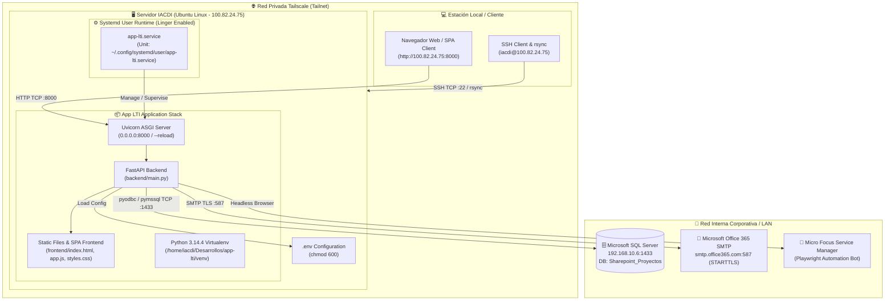

# ESPECIFICACIÓN TÉCNICA Y DE DESPLIEGUE (SPECS)
## Módulo: Despliegue, Configuración de Servicio Systemd y Entorno de Desarrollo en Servidor IACDI vía Tailscale (`app-lti`)

- **Documento:** SPECS-LTI-DEP-008
- **Versión:** 1.0.0
- **Fecha:** 2026-09-08
- **Autor:** Subagente Planificador & Diseñador de Specs (`planificador_specs`)
- **Destinatario:** Subagente Codificador & Implementador (`coder`) / Subagente QA (`tester`)
- **Ubicación del Proyecto Local:** `/home/bobbasystem/Desarrollos/app-lti`
- **Ubicación del Proyecto Remoto (IACDI):** `/home/iacdi/Desarrollos/app-lti`

---

## CONTROL DE VERSIONES Y REGISTRO DE CAMBIOS

| Versión | Fecha | Autor | Descripción del Cambio |
|---|---|---|---|
| **1.0.0** | 2026-09-08 | Subagente Planificador | Versión inicial de especificación técnica de despliegue en servidor `iacdi` (Ubuntu Linux, Python 3.14.4, IP Tailscale `100.82.24.75`, puerto 8000, enlace MSSQL `192.168.10.6:1433`, servicio systemd de usuario con Linger habilitado, sincronización rsync y modo desarrollo continuo con hot reload). |

---

## 1. RESUMEN EJECUTIVO Y OBJETIVOS

### 1.1. Contexto del Requerimiento
Se requiere la publicación oficial y parametrización de la plataforma **App LTI** dentro del servidor remoto institucional `iacdi`. El servidor cuenta con conectividad nativa a la red de bases de datos de la organización (`192.168.10.6:1433`), acceso seguro por SSH y presencia en la red privada de malla **Tailscale** bajo la dirección IP `100.82.24.75`.

El servidor `iacdi` cumplirá una doble función estratégica:
1. **Host de Ejecución y Publicación Interna:** Permitir a los Líderes Técnicos (LTI), Project Managers (PM) y Administradores conectarse de forma segura a través de Tailscale (`http://100.82.24.75:8000`) para operar la plataforma en tiempo real.
2. **Entorno de Desarrollo Continuo y Nuevas Funcionalidades:** Establecer un flujo de despliegue ágil y seguro (hot-reload con Uvicorn, scripts de sincronización `rsync`, persistencia con `systemd --user` y `linger`), permitiendo codificar, probar e incorporar nuevos módulos sin interrumpir la operación ni depender de accesos VPN corporativos rígidos.

### 1.2. Objetivos Principales de la Especificación
1. **Estandarizar la Estructura Remota:** Desplegar el código fuente completo en `/home/iacdi/Desarrollos/app-lti` bajo el usuario `iacdi`.
2. **Aislamiento y Dependencias:** Configurar un entorno virtual Python dedicado (`venv`) con Python 3.14.4 y todas las dependencias requeridas en `requirements.txt`.
3. **Persistencia y Gobernanza mediante Systemd:** Implementar un servicio de usuario systemd (`app-lti.service`) con arranque automático, reintentos defensivos (`Restart=always`), carga de variables de entorno (`.env`) y soporte de linger para mantenerse activo tras el cierre de sesiones SSH.
4. **Integración con Base de Datos:** Configurar la conexión hacia el motor Microsoft SQL Server `192.168.10.6:1433` (`Sharepoint_Proyectos`) y asegurar la ejecución idempotente del seed de usuarios (`backend.seed_users`).
5. **Estrategia de Desarrollo y Despliegue:** Proveer scripts automatizados de sincronización local-remota (`deploy_to_iacdi.sh`), un script de inicio adaptativo (`run.sh`) y soporte de recarga en caliente (`--reload`).
6. **Plan de Pruebas y Validación:** Definir una batería completa de casos de prueba de aceptación técnica (conectividad, servicio, base de datos, API, UI y persistencia).

---

## 2. ARQUITECTURA DE RED Y TOPOLOGÍA



### 2.1. Parámetros de Red y Conectividad

| Componente | Dirección / Host | Puerto | Protocolo | Propósito |
|---|---|---|---|---|
| **Servidor IACDI (Tailscale)** | `100.82.24.75` | `8000` | HTTP (TCP) | Acceso web a la interfaz SPA y endpoints REST de la API. |
| **Servidor IACDI (SSH)** | `100.82.24.75` / `iacdi` | `22` | SSH (TCP) | Administración remota, sincronización rsync y desarrollo. |
| **Base de Datos MSSQL** | `192.168.10.6` | `1433` | TDS / MSSQL | Conexión a base de datos `Sharepoint_Proyectos` (Tablas `Proyectos`, `App_Usuarios`, `CT_BACKLOG_OPERACIONES2`, `registrosRF_SD_SM`, `registrosSM_RFC`). |
| **Servidor SMTP (Office 365)** | `smtp.office365.com` | `587` | SMTP + STARTTLS | Envío de notificaciones por correo de tickets y peticiones. |
| **Escucha de Uvicorn** | `0.0.0.0` | `8000` | HTTP | Permite atender peticiones tanto locales (`127.0.0.1`) como de la interfaz Tailscale (`100.82.24.75`). |

---

## 3. ESTRUCTURA DE ARCHIVOS Y DIRECTORIOS EN EL SERVIDOR `IACDI`

El árbol de directorios en el servidor remoto se organiza de forma canónica y limpia bajo el home del usuario `iacdi`:

```text
/home/iacdi/
├── .config/
│   └── systemd/
│       └── user/
│           └── app-lti.service               # Unidad de servicio systemd a nivel de usuario
└── Desarrollos/
    └── app-lti/                              # Raíz del proyecto
        ├── .env                              # Archivo de credenciales reales (permisos 600)
        ├── .env.example                      # Plantilla de variables de entorno
        ├── .gitignore                        # Reglas de exclusión para Git
        ├── README.md                         # Documentación de operaciones y arquitectura
        ├── SPECS_*.md                        # Especificaciones técnicas
        ├── requirements.txt                  # Lista de dependencias Python
        ├── run.sh                            # Script adaptativo de arranque local/servidor
        ├── deploy_to_iacdi.sh                # Script de sincronización desde estación local
        ├── venv/                             # Entorno virtual Python 3.14.4
        │   ├── bin/
        │   │   ├── python3
        │   │   ├── uvicorn
        │   │   └── pip
        │   └── lib/
        ├── backend/                          # Capa Backend FastAPI
        │   ├── __init__.py
        │   ├── main.py                       # App FastAPI, CORS, rutas y estáticos
        │   ├── config.py                     # Lector de configuración y variables .env
        │   ├── db.py                         # Conector pymssql, queries y CRUD
        │   ├── auth.py                       # JWT token handling y hashing bcrypt
        │   ├── seed_users.py                 # Poblador y sincronizador de usuarios
        │   ├── email_service.py              # Servicio de correo Office 365 SMTP
        │   └── ticket_automation.py          # Automatización Playwright Service Manager
        ├── frontend/                         # Capa Frontend SPA Vanilla
        │   ├── index.html                    # Single Page Application principal
        │   ├── css/
        │   │   └── styles.css                # Estilos, temas, modales y dropzone
        │   └── js/
        │       ├── app.js                    # Lógica UI, CRUD, streaming y drilldown
        │       └── auth.js                   # Gestión de tokens JWT y fetch autenticado
        └── csv/
            └── Listado_Permisos_Usuarios.xlsx # Archivo de referencia de usuarios
```

---

## 4. CONFIGURACIÓN DE VARIABLES DE ENTORNO (`.env`)

En el servidor remoto `/home/iacdi/Desarrollos/app-lti/.env` se debe configurar el archivo con permisos restringidos (`chmod 600`):

```ini
# ==============================================================================
# CONFIGURACIÓN DEL SERVIDOR DE CORREO (OFFICE 365 SMTP)
# ==============================================================================
SMTP_HOST=smtp.office365.com
SMTP_PORT=587
SMTP_USER=alejandro.aguilarm@clarovtr.cl
SMTP_PASS=TuPasswordDeOffice365OAppPassword
SMTP_FROM=alejandro.aguilarm@clarovtr.cl
SMTP_TIMEOUT=30
SMTP_DEFAULT_RECIPIENT=alejandro.aguilarm@clarovtr.cl

# ==============================================================================
# CONFIGURACIÓN GENERAL Y BASE DE DATOS (MSSQL)
# ==============================================================================
DB_SERVER=192.168.10.6
DB_PORT=1433
DB_USER=sa
DB_PASSWORD=
DB_NAME=Sharepoint_Proyectos
JWT_SECRET=app-lti-super-secret-key-2026-claro
```

### 4.1. Reglas de Seguridad para `.env`
1. **Permisos de archivo:** `chmod 600 /home/iacdi/Desarrollos/app-lti/.env` (solo lectura y escritura para el usuario `iacdi`).
2. **Exclusión en Git:** Confirmar que `.env` esté presente en `.gitignore`.
3. **Exclusión en Sync:** El script de sincronización `deploy_to_iacdi.sh` **no debe sobrescribir** el `.env` del servidor remoto.

---

## 5. ENTORNO VIRTUAL PYTHON 3.14 Y DEPENDENCIAS

### 5.1. Creación del Entorno Virtual en `iacdi`
En el servidor `iacdi`, se inicializa el entorno virtual con Python 3.14.4:

```bash
cd /home/iacdi/Desarrollos/app-lti
python3 -m venv venv
```

### 5.2. Instalación de Dependencias
Se instalan y actualizan los paquetes desde `requirements.txt`:

```bash
/home/iacdi/Desarrollos/app-lti/venv/bin/pip install --upgrade pip
/home/iacdi/Desarrollos/app-lti/venv/bin/pip install -r requirements.txt
```

### 5.3. Tabla de Dependencias (`requirements.txt`)

| Paquete | Versión Mínima | Justificación Técnica |
|---|---|---|
| `fastapi` | `>=0.110.0` | Framework web asíncrono para la API REST y servidor de SPA. |
| `uvicorn` | `>=0.28.0` | Servidor ASGI de alto rendimiento con soporte para `--reload`. |
| `pymssql` | `>=2.2.0` | Driver nativo C-TDS para conexión directa a SQL Server `192.168.10.6`. |
| `pyjwt` | `>=2.8.0` | Generación y validación de tokens JWT (`HS256`). |
| `bcrypt` | `>=4.1.0` | Hashing seguro de contraseñas de usuarios. |
| `python-multipart`| `>=0.0.9` | Soporte para `multipart/form-data` en subida de adjuntos SMTP y login. |
| `pydantic` | `>=2.6.0` | Validación estricta de esquemas de datos y peticiones API. |
| `playwright` | `>=1.50.0` | Automatización de navegador para interacción con Service Manager. |

---

## 6. INICIALIZACIÓN Y POBLADO DE BASE DE DATOS

El sistema cuenta con un inicializador de base de datos (`backend.seed_users`) que:
1. Verifica y crea la tabla `dbo.App_Usuarios` si no existe.
2. Sincroniza idempotentemente los **38 usuarios canónicos** (31 PMs, 4 LTIs, 2 ADMINs y 1 superadmin raíz `admin`).
3. Asigna la contraseña inicial por defecto `Lti2026!`.

### 6.1. Ejecución Manual de Inicialización:
```bash
cd /home/iacdi/Desarrollos/app-lti
PYTHONPATH=/home/iacdi/Desarrollos/app-lti /home/iacdi/Desarrollos/app-lti/venv/bin/python3 -m backend.seed_users
```

> [!NOTE]
> La aplicación también ejecuta `seed_default_users()` automáticamente en el evento `lifespan` de FastAPI durante el arranque, garantizando que ante cualquier actualización de esquema la base de datos quede lista.

---

## 7. DEFINICIÓN DEL SERVICIO SYSTEMD DE USUARIO (`app-lti.service`)

Para garantizar la disponibilidad continua de la aplicación, su ejecución en segundo plano y su reinicio automático ante fallos o reboots del servidor, se utiliza el gestor **Systemd User Units**.

### 7.1. Archivo de Unidad: `~/.config/systemd/user/app-lti.service`

```ini
[Unit]
Description=App LTI - Portal de Seguimiento Líderes TI (Uvicorn FastAPI)
After=network.target

[Service]
Type=simple
WorkingDirectory=/home/iacdi/Desarrollos/app-lti
ExecStart=/home/iacdi/Desarrollos/app-lti/venv/bin/uvicorn backend.main:app --host 0.0.0.0 --port 8000 --reload
Restart=always
RestartSec=5s
Environment=PYTHONPATH=/home/iacdi/Desarrollos/app-lti
EnvironmentFile=/home/iacdi/Desarrollos/app-lti/.env
StandardOutput=journal
StandardError=journal

[Install]
WantedBy=default.target
```

### 7.2. Desglose Técnico de Directivas

| Directiva | Valor | Justificación Técnica |
|---|---|---|
| `WorkingDirectory` | `/home/iacdi/Desarrollos/app-lti` | Establece el directorio de trabajo para la resolución de rutas relativas de backend, frontend y `.env`. |
| `ExecStart` | `.../venv/bin/uvicorn backend.main:app --host 0.0.0.0 --port 8000 --reload` | Ejecuta Uvicorn apuntando a la app FastAPI. El parámetro `--host 0.0.0.0` expone el servicio a la IP Tailscale (`100.82.24.75`). El flag `--reload` permite que cualquier cambio en código fuente se aplique inmediatamente. |
| `Restart` | `always` | Reinicia automáticamente el proceso ante fallos inesperados, excepciones no capturadas o cierres del proceso. |
| `RestartSec` | `5s` | Espera 5 segundos antes de reiniciar para evitar sobrecarga en caso de fallos recurrentes. |
| `EnvironmentFile` | `/home/iacdi/Desarrollos/app-lti/.env` | Inyecta las variables de entorno de BD, JWT y SMTP directamente al proceso. |
| `WantedBy` | `default.target` | Permite que el servicio inicie automáticamente al arrancar la sesión de usuario de systemd. |

### 7.3. Habilitación de Linger (Persistencia sin Sesión SSH)
Por defecto, los servicios `systemd --user` se detienen cuando el usuario cierra su sesión SSH. Para evitar esto y permitir que el servicio corra permanentemente incluso tras desconectarse o tras un reinicio de la máquina, se activa **Linger**:

```bash
loginctl enable-linger iacdi
```

*Verificación de Linger:*
```bash
loginctl show-user iacdi --property=Linger
# Debe retornar: Linger=yes
```

### 7.4. Comandos de Control del Servicio

```bash
# 1. Recargar configuración de systemd tras crear o modificar el servicio
systemctl --user daemon-reload

# 2. Habilitar arranque automático del servicio al iniciar el sistema
systemctl --user enable app-lti.service

# 3. Iniciar el servicio
systemctl --user start app-lti.service

# 4. Consultar estado detallado del servicio
systemctl --user status app-lti.service

# 5. Reiniciar el servicio
systemctl --user restart app-lti.service

# 6. Detener el servicio
systemctl --user stop app-lti.service

# 7. Monitorear logs en tiempo real (seguimiento activo)
journalctl --user -u app-lti -f -n 100
```

---

## 8. ESTRATEGIA DE SINCRONIZACIÓN Y DESARROLLO CONTINUO

Para facilitar el desarrollo iterativo continuo desde la máquina local (`bobbasystem`) hacia el servidor remoto (`iacdi`), se definen dos herramientas esenciales:

### 8.1. Script de Inicio Adaptativo (`run.sh`)
El script `run.sh` se adapta automáticamente para funcionar tanto en la estación local como en el servidor `iacdi`, detectando el entorno virtual disponible en el directorio del proyecto (`./venv`) antes de recurrir a rutas globales o al Python del sistema.

```bash
#!/usr/bin/env bash
# ==============================================================================
# Script de inicio para App LTI (Servidor Web y API FastAPI)
# Compatible con Entorno Local (bobbasystem) y Servidor Remoto (iacdi)
# ==============================================================================

set -e

DIR="$(cd "$(dirname "${BASH_SOURCE[0]}")" && pwd)"

# 1. Prioridad: Entorno virtual local del proyecto
if [ -f "$DIR/venv/bin/python3" ] && [ -f "$DIR/venv/bin/uvicorn" ]; then
    VENV_PYTHON="$DIR/venv/bin/python3"
    VENV_UVICORN="$DIR/venv/bin/uvicorn"
# 2. Fallback: Entorno virtual de desarrollo bobbasystem
elif [ -f "/home/bobbasystem/Desarrollos/Carga Data SM/venv/bin/python3" ]; then
    VENV_PYTHON="/home/bobbasystem/Desarrollos/Carga Data SM/venv/bin/python3"
    VENV_UVICORN="/home/bobbasystem/Desarrollos/Carga Data SM/venv/bin/uvicorn"
# 3. Fallback: Python y Uvicorn del sistema
else
    echo "[INFO] Usando python3 y uvicorn del sistema..."
    VENV_PYTHON="python3"
    VENV_UVICORN="uvicorn"
fi

echo "=================================================="
echo "Iniciando App LTI - Portal de Líderes TI"
echo "Directorio : $DIR"
echo "Python     : $VENV_PYTHON"
echo "Uvicorn    : $VENV_UVICORN"
echo "=================================================="

# Poblar usuarios y tablas si es necesario
echo "[MSSQL] Verificando tablas de autenticación y usuarios..."
PYTHONPATH="$DIR" "$VENV_PYTHON" -m backend.seed_users

# Iniciar servidor Uvicorn
PORT=8000
echo "[WEB] Servidor disponible en: http://0.0.0.0:$PORT"
echo "Presione Ctrl+C para detener el servidor."

PYTHONPATH="$DIR" "$VENV_UVICORN" backend.main:app --host 0.0.0.0 --port "$PORT" --reload
```

### 8.2. Script de Sincronización Remota (`deploy_to_iacdi.sh`)
Ubicado en la raíz del proyecto local, permite transferir rápidamente los cambios de código fuente hacia el servidor `iacdi` mediante `rsync` a través de Tailscale/SSH:

```bash
#!/usr/bin/env bash
# ==============================================================================
# Script de Sincronización y Despliegue hacia Servidor IACDI vía Tailscale/SSH
# ==============================================================================

set -e

REMOTE_HOST="iacdi"
REMOTE_IP="100.82.24.75"
REMOTE_USER="iacdi"
REMOTE_DIR="/home/iacdi/Desarrollos/app-lti"

LOCAL_DIR="$(cd "$(dirname "${BASH_SOURCE[0]}")" && pwd)"

echo "=================================================="
echo "Sincronizando App LTI hacia Servidor IACDI"
echo "Destino: $REMOTE_USER@$REMOTE_HOST ($REMOTE_IP):$REMOTE_DIR"
echo "=================================================="

# Sincronización con rsync excluyendo venv, git, cache y .env remoto
rsync -avz --progress \
    --exclude 'venv/' \
    --exclude '.git/' \
    --exclude '__pycache__/' \
    --exclude '*.pyc' \
    --exclude '.pytest_cache/' \
    --exclude '.env' \
    --exclude '.DS_Store' \
    "$LOCAL_DIR/" "$REMOTE_HOST:$REMOTE_DIR/"

echo ""
echo "[INFO] Código sincronizado exitosamente."
echo "[INFO] Si el servicio app-lti.service está corriendo con --reload, los cambios ya están activos."
echo "[INFO] Para verificar logs remotos: ssh $REMOTE_HOST 'journalctl --user -u app-lti -n 20 --no-pager'"
echo "=================================================="
```

---

## 9. MATRIZ DE PRUEBAS Y CRITERIOS DE ACEPTACIÓN

| ID Prueba | Módulo / Componente | Descripción de la Prueba | Pasos de Ejecución | Resultado Esperado | Criterio de Aceptación |
|---|---|---|---|---|---|
| **TC-DEP-01** | Red & Tailscale | Conectividad TCP al puerto 8000 en IP Tailscale. | Ejecutar `curl -I http://100.82.24.75:8000` desde una máquina conectada a Tailscale. | HTTP/1.1 200 OK y respuesta del servidor Uvicorn. | **PASSED:** El puerto 8000 responde y sirve contenido sin timeouts. |
| **TC-DEP-02** | Base de Datos MSSQL | Conectividad TCP y autenticación contra `192.168.10.6:1433`. | Ejecutar script de prueba de conexión o `seed_users.py`. | Conexión exitosa, sin errores de socket ni timeouts. | **PASSED:** Consulta SQL retorna resultados de `Sharepoint_Proyectos`. |
| **TC-DEP-03** | Seed de Usuarios | Poblado de los 38 usuarios iniciales en `dbo.App_Usuarios`. | Ejecutar `PYTHONPATH=. venv/bin/python3 -m backend.seed_users`. | Mensaje `[SEED] Sincronización de usuarios completada: N insertados, M actualizados.` | **PASSED:** 38 cuentas creadas con sus respectivos roles (PM, LTI, ADMIN). |
| **TC-DEP-04** | Servicio Systemd | Configuración y arranque del servicio de usuario. | Ejecutar `systemctl --user start app-lti` y verificar `systemctl --user status app-lti`. | Estado `Active: active (running)` y logs limpios en journal. | **PASSED:** Proceso corriendo bajo PID asignado. |
| **TC-DEP-05** | Persistencia Linger | Verificación de permanencia del servicio tras cierre de SSH. | Iniciar servicio, salir de sesión SSH (`exit`), esperar 30s y reconectar o hacer curl. | El servicio sigue activo ininterrumpidamente (`Active: active (running)`). | **PASSED:** `loginctl show-user iacdi` confirma `Linger=yes`. |
| **TC-DEP-06** | Acceso Web SPA | Carga de interfaz gráfica y estilos en navegador. | Abrir `http://100.82.24.75:8000` en navegador web. | Renderizado completo de la pantalla de login con temas claro/oscuro. | **PASSED:** HTML, JS y CSS cargan con código 200/304 sin errores de consola. |
| **TC-DEP-07** | Autenticación JWT | Inicio de sesión con perfiles PM, LTI y ADMIN. | Ingresar credenciales (`admin` / `Lti2026!`, `jbarrera`, `calbornoz`). | Generación de token JWT, almacenamiento en `localStorage` y redirección a dashboard según rol. | **PASSED:** Token emitido y validado en `/api/auth/me`. |
| **TC-DEP-08** | API Proyectos & KPIs | Consulta de proyectos, KPIs y drilldown. | Navegar por la tabla de proyectos, aplicar filtros de estado y abrir drilldown modal. | Endpoints `/api/proyectos`, `/api/dashboard-kpis`, `/api/solots` responden en < 500ms. | **PASSED:** Datos reales de MSSQL visualizados en frontend. |
| **TC-DEP-09** | Hot-Reload en Desarrollo | Actualización en caliente al modificar archivos. | Modificar un archivo en `backend/` o `frontend/` y guardar. | Uvicorn detecta el cambio (`Reloading...`) y reinicia el worker en < 2s sin tirar el servicio. | **PASSED:** Cambios reflejados inmediatamente sin intervención manual. |
| **TC-DEP-10** | Resiliencia Auto-Restart | Recuperación automática ante terminación de proceso. | Ejecutar `pkill -9 -f uvicorn` sobre el proceso de la app. | Systemd detecta la caída y reinicia el servicio automáticamente tras 5s. | **PASSED:** Estado vuelve a `active (running)` automáticamente. |

---

## 10. GUÍA RÁPIDA DE OPERACIONES Y CHEATSHEET DE COMANDOS

### 10.1. Comandos de Administración del Servicio en `iacdi`

```bash
# Conexión SSH directa al servidor
ssh iacdi@100.82.24.75   # o simplemente 'ssh iacdi' si está en ~/.ssh/config

# Ir al directorio del proyecto
cd /home/iacdi/Desarrollos/app-lti

# Estado del servicio
systemctl --user status app-lti.service

# Reiniciar servicio
systemctl --user restart app-lti.service

# Ver logs en vivo
journalctl --user -u app-lti -f

# Ver últimas 50 líneas de log
journalctl --user -u app-lti -n 50 --no-pager
```

### 10.2. Comandos de Sincronización desde Máquina Local

```bash
# Desde /home/bobbasystem/Desarrollos/app-lti
chmod +x deploy_to_iacdi.sh
./deploy_to_iacdi.sh
```

---

## 11. CHECKLIST PARA EL SUBAGENTE CODER

- [ ] Crear el script de sincronización local `deploy_to_iacdi.sh` con permisos de ejecución (`chmod +x`).
- [ ] Actualizar `run.sh` con detección adaptativa de entornos virtuales (`venv/bin/python3` prioritario).
- [ ] Generar el archivo de unidad systemd de usuario `app-lti.service` listo para su instalación en `~/.config/systemd/user/`.
- [ ] Actualizar la documentación `README.md` incorporando las instrucciones de despliegue, arquitectura Tailscale y comandos systemd.
- [ ] Ejecutar el despliegue inicial hacia el servidor `iacdi` (creación de venv, instalación de dependencias, configuración de .env, habilitación de linger y activación de `app-lti.service`).
- [ ] Verificar la correcta ejecución del servicio y reportar el estado al Subagente QA/Tester.
