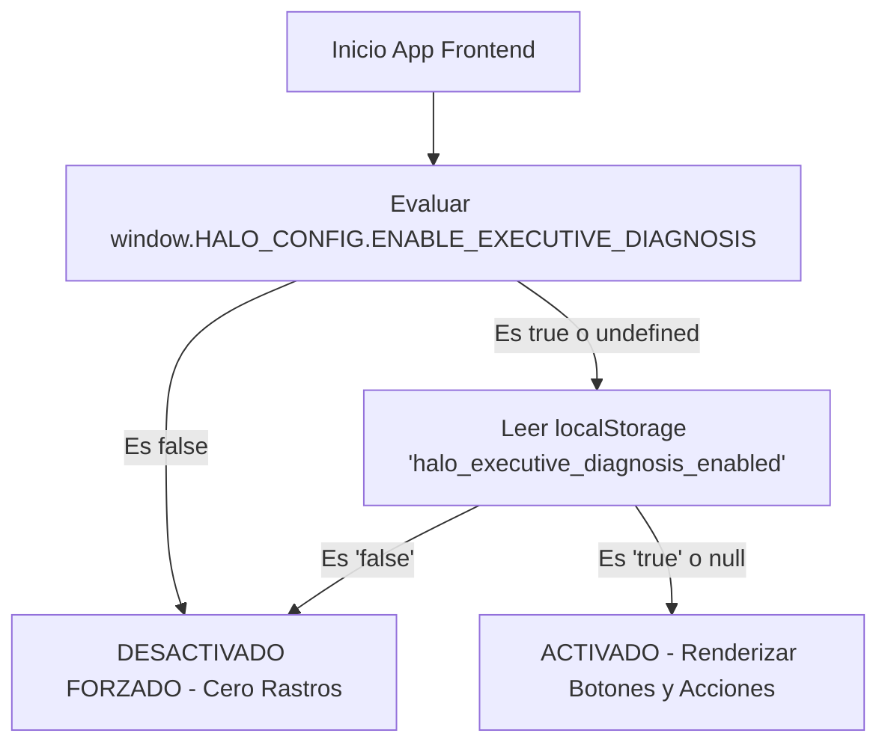

# ESPECIFICACIÓN TÉCNICA Y ARQUITECTÓNICA (SPECS)
## Módulo: "Diagnóstico Ejecutivo en 1 Clic & Kill-Switch Desactivador" (`app-lti`)

- **Documento:** SPECS-LTI-MOD-012
- **Versión:** 1.0.0
- **Fecha:** 2026-09-22
- **Autor:** Subagente Planificador de Specs (`planificador_specs`)
- **Destinatario:** Subagente Desarrollador (`coder`) / QA Tester
- **Ubicación del Proyecto:** `/home/bobbasystem/Desarrollos/app-lti`
- **Entornos de Despliegue:** Desarrollo (`bobbadeveloper`, localhost:8000) & Producción (`iacdi`, Tailscale 100.82.24.75 / https://200.14.222.162/app-lti/)

---

## CONTROL DE VERSIONES Y REGISTRO DE CAMBIOS

| Versión | Fecha | Autor | Descripción del Cambio |
|---|---|---|---|
| **1.0.0** | 2026-09-22 | Subagente Planificador | Especificación técnica integral de la funcionalidad 'Diagnóstico Ejecutivo en 1 Clic' (Feature 2): motor de análisis operacional multivariable en tiempo real (`/api/proyectos/{id}/diagnostico`), detección automática de cuellos de botella (Solots vencidas, tickets SD detenidos en torres operativas, RFCs pendientes), generación de recomendaciones de escalamiento accionables, síntesis ejecutiva multiformato (Texto, Markdown, HTML), modal interactivo con copiado al portapapeles y vinculación con envío por correo SMTP Office 365, mecanismo mandatorio Kill-Switch de activación/desactivación inmediata y persistente con fallback cero rastros, matriz de pruebas automatizadas y guía paso a paso de implementación y despliegue para `bobbadeveloper` e `iacdi`. |

---

## 1. RESUMEN EJECUTIVO Y OBJETIVOS DEL NEGOCIO

### 1.1. Contexto y Problemática
En la plataforma **HALO — App Líderes TI**, los Gerentes, Jefaturas y Líderes Técnicos TI auditan decenas de proyectos corporativos simultáneamente. Si bien la plataforma cuenta con un Drill Down detallado por pestañas (Solots SGA, Tickets HPSM, RFCs) y con el Semáforo de Salud Operacional (v1.3.0), los tomadores de decisiones enfrentan una fricción operativa importante al momento de preparar reuniones de seguimiento, comités de crisis o minutas de escalamiento:

1. **Inspección Manual Fragmentada**: Para comprender la causa raíz de un retraso, el Líder TI debe navegar pestaña por pestaña, calcular mentalmente cuántos días lleva atrasada una Solot, revisar qué tickets están abiertos y qué torre operativa de soporte (`Torre Linux`, `Torre Microsoft`, `ProvisionConectividadTI`, etc.) los tiene asignados.
2. **Redacción Manual Repetitiva de Minutas**: Ante solicitudes del Gerente o del Solicitante del proyecto ("*¿Cuál es el estado de este proyecto y por qué no avanza?*"), el Líder TI debe redactar manualmente un correo o mensaje de Teams extrayendo datos dispersos, lo que consume tiempo valioso e introduce inconsistencias.
3. **Falta de Recomendaciones Accionables Inmediatas**: No existe un motor algorítmico que cruce las fechas de compromiso, los estados de las OTPs y los SLAs de los tickets para dictaminar qué acción concreta de escalamiento debe ejecutarse en el día.

### 1.2. Solución Propuesta: "Diagnóstico Ejecutivo en 1 Clic"
Implementar un **Motor de Diagnóstico Operacional y Ejecutivo en Tiempo Real** que analice integralmente cualquier proyecto con un solo clic y entregue:
1. **Ficha de Diagnóstico Integral Instantánea**:
   - **Resumen Ejecutivo**: Cliente, N° Proyecto, LT responsable, Solicitante oficial, Antigüedad del proyecto en días, Porcentaje de avance de Solots (ejecutadas vs totales) y Salud Operacional.
   - **Detección Automática de Cuellos de Botella**: Identificación precisa de Solots vencidas con días de atraso, Tickets SD estancados (> 7 o > 14 días) indicando la **Torre Operativa Asignada** responsable, y RFCs pendientes de cierre.
   - **Recomendaciones de Escalamiento Accionables**: Sugerencias directas priorizadas (ej. *"Escalar inmediatamente con Torre Linux por Ticket SD1089234 detenido hace 18 días"*, *"Coordinar con Solicitante actualización de fecha compromiso de Solot 4321"*).
   - **Minuta Ejecutiva Multiformato**: Generación automática de minuta formateada en Texto Plano, Markdown y HTML lista para ser compartida.
2. **Experiencia de Usuario Fluida (UI/UX)**:
   - **Acceso Directo**: Botón destacado `⚡ Diagnóstico Ejecutivo` en la cabecera del Drill Down del proyecto y botón de acción rápida `⚡` en la tabla principal de proyectos.
   - **Modal Interactivo Claro HALO**: Diseño elegante, profesional y con soporte nativo de Modo Claro y Modo Oscuro, que presenta el diagnóstico en bloques visuales legibles.
   - **Acción 1 Clic - Copiar Minuta**: Botón `📋 Copiar Minuta` que copia el texto al portapapeles con feedback visual instantáneo (Toast / check animado).
   - **Acción 1 Clic - Enviar Minuta por Correo**: Botón `📧 Enviar Minuta por Correo` que abre directamente el modal de correo de Office 365 prellenado con el Asunto del proyecto y el cuerpo de la minuta ejecutiva.
3. **Mecanismo de Desactivación Rápida Mandatorio (Kill-Switch / Feature Toggle)**:
   - Requerimiento contractual estricto: *"con un botón también para activar/desactivar"*.
   - Interruptor toggle en la sub-barra de navegación (`⚡ Diagnóstico: ON / OFF`), switch maestro en código (`window.HALO_CONFIG.ENABLE_EXECUTIVE_DIAGNOSIS`) y persistencia en `localStorage`.
   - **Política de Cero Rastros (Zero Trace)**: Al desactivarse, se ocultan todos los botones y elementos de diagnóstico en la tabla, en el Drill Down y en el menú, restaurando el comportamiento estándar sin desfasar layouts ni dejar rastros visuales.
4. **Despliegue Homologado**: Plan de despliegue dual verificado en **Desarrollo (`bobbadeveloper`)** y **Producción (`iacdi`)**.

---

## 2. ARQUITECTURA GENERAL DEL SISTEMA

```
+---------------------------------------------------------------------------------------------------------------+
|                                      ARQUITECTURA DIAGNÓSTICO EJECUTIVO EN 1 CLIC                             |
+---------------------------------------------------------------------------------------------------------------+
|                                                                                                               |
|   [ Base de Datos MSSQL 192.168.10.6:1433 ]                                                                   |
|     - dbo.Proyectos (Cliente, Numero_Proyecto, LT_Asignado, Estado, Creado, Detalle)                          |
|     - dbo.CT_BACKLOG_OPERACIONES2 (ID_OTP, ESTADO_OTP, FECHA_COMPROMETIDA, FECHA_INSERT, PRO_ING_PROYECTO)   |
|     - dbo.registrosRF_SD_SM (CC_INCIDENT_ID, STATUS, SUBMIT_DATE, ASSIGNED_GROUP, ASSIGNED_TO, BRIEF_DESC)     |
|     - dbo.registrosSM_RFC (NUMBER, BRIEF_DESCRIPTION, CLOSE_TIME, ORIG_DATE_ENTERED, ASSIGN_DEPT)            |
|                            │                                                                                  |
|                            ▼                                                                                  |
|   [ Backend FastAPI - Python 3.10 ] (`backend/main.py` + `backend/db.py`)                                     |
|     - Endpoint GET: /api/proyectos/{proyecto_id}/diagnostico                                                  |
|     - Función: get_diagnostico_ejecutivo(proyecto_id)                                                         |
|         * Motor de Reglas de Análisis Operacional                                                             |
|         * Detección de Cuellos de Botella (Solots vencidas, Tickets estancados por torre, RFCs abiertas)    |
|         * Motor de Recomendaciones Accionables                                                                |
|         * Generador de Minuta Ejecutiva (Plain Text, Markdown, HTML)                                          |
|                            │                                                                                  |
|                            ▼ JSON Response                                                                    |
|   [ Frontend Web - Vanilla JS + CSS3 HALO ]                                                                   |
|     - Kill-Switch: window.HALO_CONFIG.ENABLE_EXECUTIVE_DIAGNOSIS + localStorage('halo_executive_diag_enabled')|
|     - Botón Sub-Barra: "⚡ Diagnóstico: ON / OFF"                                                              |
|     - Botones Lanzadores:                                                                                     |
|         * Header Drill Down: [ ⚡ Diagnóstico Ejecutivo ]                                                     |
|         * Fila de Tabla Principal: [ ⚡ ]                                                                     |
|     - Modal Visual: #executive-diagnosis-modal                                                                |
|         * Ficha Ejecutiva (KPIs, Barra de Avance, Salud)                                                      |
|         * Lista de Cuellos de Botella (Badges de Severidad)                                                   |
|         * Tarjetas de Recomendaciones de Escalamiento                                                         |
|         * Visor de Minuta con acciones:                                                                       |
|             ├── [ 📋 Copiar Minuta ] ──> Clipboard API (navigator.clipboard)                                 |
|             └── [ 📧 Enviar Minuta ] ──> Abre #email-ticket-modal prellenado (Office 365 SMTP)                |
|                                                                                                               |
+---------------------------------------------------------------------------------------------------------------+
```

---

## 3. MOTOR DE DIAGNÓSTICO BACKEND (ESPECIFICACIÓN TÉCNICA)

### 3.1. Contrato de la API REST

#### Endpoint
```http
GET /api/proyectos/{proyecto_id}/diagnostico
```

- **Método HTTP:** `GET`
- **Autenticación:** Requiere sesión válida (`require_lti_or_admin`). Los usuarios con rol `PM` tienen acceso de solo lectura al diagnóstico; `LTI` y `ADMIN` tienen acceso completo.
- **Parámetros de Ruta:**
  - `proyecto_id` (entero, obligatorio): ID numérico del proyecto en `dbo.Proyectos`.
- **Códigos de Respuesta:**
  - `200 OK`: Diagnóstico generado exitosamente.
  - `401 Unauthorized`: Sesión expirada o token ausente.
  - `404 Not Found`: Si el `proyecto_id` no existe en `dbo.Proyectos`.
  - `500 Internal Server Error`: Falla de conectividad o error inesperado.

#### Esquema de Respuesta JSON (`ExecutiveDiagnosisResponse`)
```json
{
  "proyecto_id": 142,
  "numero_proyecto": "0000108920",
  "cliente": "BANCO DE CHILE",
  "lt_asignado": "ALEJANDRO JAVIER AGUILAR MORALES",
  "solicitante": "CARLOS PEREZ GOMEZ",
  "estado_sp": "En revision",
  "tipo_servicio": "Cloud",
  "fecha_creacion_lti": "2026-08-10T14:30:00",
  "antiguedad_dias": 43,
  "salud": {
    "score": "CRITICAL",
    "color": "red",
    "label": "Crítico",
    "motivos": [
      "2 Solots con fecha comprometida vencida",
      "1 Ticket abierto > 14 días"
    ]
  },
  "resumen_operacional": {
    "total_solots": 5,
    "solots_ejecutadas": 3,
    "solots_pendientes": 2,
    "solots_vencidas": 2,
    "solots_por_vencer": 0,
    "porcentaje_avance_solots": 60.0,
    "total_tickets": 3,
    "tickets_abiertos": 1,
    "tickets_cerrados": 2,
    "tickets_criticos": 1,
    "tickets_atencion": 0,
    "total_rfcs": 1,
    "rfcs_abiertas": 1
  },
  "cuellos_de_botella": [
    {
      "id": "CB-01",
      "tipo": "SOLOT_VENCIDA",
      "severidad": "ALTA",
      "identificador": "OTP-1049281",
      "descripcion": "Solot de Provisión de Conectividad con fecha comprometida vencida hace 14 días.",
      "dias_atraso": 14,
      "responsable_area": "Operaciones SGA / Redes",
      "estado_actual": "En Asignacion"
    },
    {
      "id": "CB-02",
      "tipo": "TICKET_DETENIDO",
      "severidad": "CRITICA",
      "identificador": "SD1098234",
      "descripcion": "Ticket de soporte 'Configuración de VLAN privada' abierto hace 19 días sin resolución.",
      "dias_antiguedad": 19,
      "responsable_area": "Torre Linux",
      "estado_actual": "Asignado"
    }
  ],
  "recomendaciones_escalamiento": [
    {
      "orden": 1,
      "prioridad": "URGENTE",
      "destinatario_escalamiento": "Jefatura Torre Linux",
      "accion": "Escalar formalmente el Ticket SD1098234 por exceder 19 días en estado Asignado sin avance operativo.",
      "canal_sugerido": "Reunión de alineación diaria / Notificación Service Manager"
    },
    {
      "orden": 2,
      "prioridad": "ALTA",
      "destinatario_escalamiento": "Coordinador de Provisión SGA",
      "accion": "Solicitar reprogramación formal o priorización de la Solot OTP-1049281 (14 días vencida).",
      "canal_sugerido": "Correo a jefatura de operaciones SGA con copia al PM"
    },
    {
      "orden": 3,
      "prioridad": "MEDIA",
      "destinatario_escalamiento": "Solicitante del Proyecto (CARLOS PEREZ GOMEZ)",
      "accion": "Informar estado de bloqueos técnicos externos y convenir nueva fecha estimada de entrega global.",
      "canal_sugerido": "Minuta ejecutiva por correo corporativo"
    }
  ],
  "minuta_ejecutiva": {
    "asunto_sugerido": "[HALO] Diagnóstico Ejecutivo: Proyecto 0000108920 - BANCO DE CHILE",
    "texto_plano": "DIAGNÓSTICO EJECUTIVO DE PROYECTO...\n(Texto plano limpio)",
    "markdown": "### ⚡ DIAGNÓSTICO EJECUTIVO - HALO Líderes TI\n...",
    "html": "<div style=\"font-family: Arial, sans-serif; ...\">...</div>"
  },
  "timestamp_generacion": "2026-09-22T23:35:00"
}
```

---

### 3.2. Reglas del Motor de Análisis Operacional

El cálculo del diagnóstico cruza los datos reales de las tablas corporativas en MSSQL:

```mermaid
flowchart TD
    A[Inicio Diagnóstico GET /api/proyectos/{id}/diagnostico] --> B[Consultar Proyecto en dbo.Proyectos]
    B --> C{¿Proyecto Existe?}
    C -- No --> D[Retornar 404 Not Found]
    C -- Sí --> E[Consultar Solots de CT_BACKLOG_OPERACIONES2]
    E --> F[Consultar Tickets de registrosRF_SD_SM]
    F --> G[Consultar RFCs de registrosSM_RFC]
    G --> H[Evaluar Salud y Cuellos de Botella]
    H --> I[Regla 1: Solots Vencidas / Por Vencer]
    H --> J[Regla 2: Tickets Detenidos por Torre Operativa]
    H --> K[Regla 3: RFCs Pendientes]
    I --> L[Generar Recomendaciones Priorizadas]
    J --> L
    K --> L
    L --> M[Sintetizar Minuta Texto / MD / HTML]
    M --> N[Retornar JSON Estructurado 200 OK]
```

#### Regla 1: Análisis de Solots (`CT_BACKLOG_OPERACIONES2`)
- **Solots Ejecutadas / Cerradas**: Aquellas cuyo `ESTADO_OTP` pertenezca al conjunto cerrado:
  `('Cerrada', '5- Ejecutada', '5- Ejecutada Tareas Pendientes', 'Abortado', 'En Aborcion', 'Eliminada', 'Aprobado')`.
- **Solots Vencidas**: Solots NO ejecutadas cuya `FECHA_COMPROMETIDA < CAST(GETDATE() AS DATE)`.
  - Cada una genera un `cuello_de_botella` con severidad `ALTA` (o `CRITICA` si `dias_atraso > 15`).
  - Identifica el `responsable_area` utilizando `GRUPO_ASIGNADO_OTP` o `ASIGNADO_OTP`.
- **Solots Por Vencer**: Solots NO ejecutadas con fecha comprometida dentro de los próximos 5 días corridos. Genera cuello de botella de severidad `MEDIA` si no tiene asignado claro.
- **Porcentaje de Avance**:
  $$\text{Porcentaje Avance} = \frac{\text{Solots Ejecutadas}}{\text{Total Solots}} \times 100$$
  *(Si el total de Solots es 0, se define en 0.0% con nota de "Sin Solots vinculadas")*.

#### Regla 2: Análisis de Tickets Service Manager (`registrosRF_SD_SM`)
- **Tickets Resueltos / Cerrados**: `STATUS IN ('Cerrado', 'Resuelto')`.
- **Tickets Críticos Detenidos**: `STATUS NOT IN ('Cerrado', 'Resuelto')` y antigüedad $\ge 14$ días desde `SUBMIT_DATE`.
  - Genera cuello de botella de severidad `CRITICA`.
  - Se vincula directamente a la **Torre de Soporte** (`ASSIGNED_GROUP`, ej. `Torre Linux`, `Torre Microsoft`, `ProvisionConectividadTI`).
- **Tickets en Advertencia**: Abiertos entre 7 y 14 días. Genera cuello de botella de severidad `MEDIA`.

#### Regla 3: Análisis de RFCs (`registrosSM_RFC`)
- **RFCs Pendientes**: Aquellas sin fecha de cierre (`CLOSE_TIME IS NULL`).
- Si una RFC lleva más de 10 días abierta, se añade como cuello de botella operativo de severidad `MEDIA` / `ALTA`.

#### Regla 4: Matriz de Recomendaciones de Escalamiento
Las recomendaciones se ordenan por severidad descendente:
1. **Prioridad 1 (Urgente / Inmediata)**: Se genera para cada Ticket crítico con más de 14 días o Solot con más de 15 días de atraso, especificando el nombre de la Torre y el número de elemento.
2. **Prioridad 2 (Operacional / Alta)**: Solots vencidas (< 15 días) o tickets entre 7 y 14 días. Enfoque: gestión con el coordinador de aprovisionamiento o torre operativa.
3. **Prioridad 3 (Gestión de Cliente / Media)**: Alineación con el solicitante o PM si el atraso global del proyecto impacta la fecha de entrega comprometida.
4. **Proyecto Saludable (Verde)**: Si no existen cuellos de botella, la recomendación es de seguimiento preventivo: *"Mantener plan de trabajo vigente y monitorear fechas de entrega comprometidas."*

---

### 3.3. Estructura y Formato de la Minuta Ejecutiva Generada

El backend compila en memoria la minuta en tres variantes para máxima compatibilidad:

#### A. Minuta en Texto Plano (`texto_plano`)
Diseñada para copiar y pegar de forma limpia en WhatsApp, Microsoft Teams o Bloc de Notas sin perder alineación:
```text
============================================================
⚡ DIAGNÓSTICO EJECUTIVO HALO — APP LÍDERES TI
============================================================
PROYECTO: 0000108920
CLIENTE: BANCO DE CHILE
LÍDER TI: ALEJANDRO JAVIER AGUILAR MORALES
SOLICITANTE: CARLOS PEREZ GOMEZ
ESTADO SHAREPOINT: En revision
SALUD OPERACIONAL: 🔴 Crítico (2 Solots vencidas, 1 Ticket detenido)
ANTIGÜEDAD: 43 días
AVANCE SOLOTS: 60.0% (3/5 ejecutadas)

------------------------------------------------------------
🚨 CUELLOS DE BOTELLA OPERATIVOS
------------------------------------------------------------
1. [ALTA] Solot OTP-1049281: Vencida hace 14 días. Área: Operaciones SGA.
2. [CRITICA] Ticket SD1098234: Abierto hace 19 días en Torre Linux sin resolución.

------------------------------------------------------------
🎯 ACCIONES RECOMENDADAS DE ESCALAMIENTO
------------------------------------------------------------
1. [URGENTE] Escalar Ticket SD1098234 con Jefatura de Torre Linux.
2. [ALTA] Gestionar reprogramación de Solot OTP-1049281 con Provisión SGA.
3. [MEDIA] Actualizar estado de avance con Solicitante CARLOS PEREZ GOMEZ.

Generado el: 2026-09-22 23:35 | HALO App Líderes TI
============================================================
```

#### B. Minuta en Markdown (`markdown`)
Optimizado para renderizado en el modal web o clientes modernos con soporte Markdown.

#### C. Minuta en HTML Enriquecido (`html`)
Fragmento HTML inline con estilos Claro HALO (`#B52217`, `#DA291C`, bordes suaves, tablas limpias) listo para ser inyectado como cuerpo en el modal de correo de Office 365.

---

## 4. EXPERIENCIA DE USUARIO (UI/UX FRONTEND)

### 4.1. Puntos de Entrada y Disparadores

1. **Botón Principal en Drill Down (Ficha del Proyecto)**:
   - Ubicado en `.drilldown-action-toolbar` junto a los botones `✏️ Editar` y `🗑️ Eliminar`:
   ```html
   <button type="button" id="btn-dd-diagnostico" class="btn btn-warning-outline btn-sm btn-diagnostico-action" title="Generar Diagnóstico Ejecutivo en 1 Clic">
     <span class="btn-icon">⚡</span> Diagnóstico Ejecutivo
   </button>
   ```
2. **Acción Rápida en Tabla de Proyectos**:
   - En la columna "Acciones" de cada fila de la tabla principal de proyectos:
   ```html
   <button type="button" class="btn-action-icon btn-action-diag" onclick="App.openDiagnosticoModal(${p.id})" title="Diagnóstico Ejecutivo en 1 Clic" aria-label="Diagnóstico">
     ⚡
   </button>
   ```

### 4.2. Modal Interactivo de Diagnóstico (`#executive-diagnosis-modal`)

```
+----------------------------------------------------------------------------------------------------+
| ⚡ Diagnóstico Ejecutivo en 1 Clic — BANCO DE CHILE (N° 0000108920)                             [X] |
+----------------------------------------------------------------------------------------------------+
|                                                                                                    |
|  [ TARJETA RESUMEN EJECUTIVO ]                                                                     |
|  Cliente: BANCO DE CHILE   | N°: 0000108920 | Líder TI: ALEJANDRO AGUILAR | Solicitante: C. PEREZ  |
|  Estado: [En revision]     | Salud: [🔴 Crítico] | Antigüedad: 43 días                            |
|  Avance Solots SGA: [████████████▒▒▒▒▒▒▒▒] 60.0% (3 de 5 completadas)                             |
|                                                                                                    |
|  ------------------------------------------------------------------------------------------------  |
|  🚨 CUELLOS DE BOTELLA DETECTADOS (2)                                                              |
|  ┌──────────────────────────────────────────────────────────────────────────────────────────────┐  |
|  │ [CRÍTICO] Ticket SD1098234 — Torre Linux                                                      │  |
|  │ Detenido hace 19 días en estado Asignado sin actualización.                                   │  |
|  ├──────────────────────────────────────────────────────────────────────────────────────────────┤  |
|  │ [ALTA] Solot OTP-1049281 — Provisión Conectividad SGA                                         │  |
|  │ Fecha comprometida vencida hace 14 días (Estado: En Asignación).                             │  |
|  └──────────────────────────────────────────────────────────────────────────────────────────────┘  |
|                                                                                                    |
|  ------------------------------------------------------------------------------------------------  |
|  🎯 RECOMENDACIONES DE ESCALAMIENTO PRIORIZADAS                                                    |
|  1. [URGENTE] Escalar Ticket SD1098234 con Jefatura de Torre Linux vía reunión diaria.             |
|  2. [ALTA] Solicitar reprogramación formal de OTP-1049281 a Coordinación de Provisión.            |
|  3. [MEDIA] Notificar al Solicitante CARLOS PEREZ GOMEZ sobre los bloqueos operativos.            |
|                                                                                                    |
|  ------------------------------------------------------------------------------------------------  |
|  📝 VISTA PREVIA DE LA MINUTA EJECUTIVA                                                           |
|  ┌──────────────────────────────────────────────────────────────────────────────────────────────┐  |
|  │ (Cuadro con scroll y tipografía monoespaciada para lectura limpia de la minuta generada)    │  |
|  └──────────────────────────────────────────────────────────────────────────────────────────────┘  |
|                                                                                                    |
+----------------------------------------------------------------------------------------------------+
| [ 📋 Copiar Minuta ]    [ 📧 Enviar Minuta por Correo ]                           [ Cerrar ]       |
+----------------------------------------------------------------------------------------------------+
```

### 4.3. Acciones del Modal: Copiar y Enviar por Correo

#### Acción A: Copiar Minuta (`btn-copy-diagnostico-minuta`)
- Utiliza la API nativa `navigator.clipboard.writeText(minutaTexto)`.
- Fallback defensivo a `document.execCommand('copy')` si el portapapeles no está disponible por permisos.
- **Feedback Inmediato**:
  - El botón cambia temporalmente su texto a `✓ ¡Copiado!` con fondo verde durante 2.5 segundos.
  - Se lanza un Toast flotante: `✓ Minuta ejecutiva copiada al portapapeles`.

#### Acción B: Enviar Minuta por Correo (`btn-email-diagnostico-minuta`)
- Aprovecha la integración SMTP Office 365 existente en `frontend/js/app.js` (`openEmailTicketModal`).
- Al hacer clic:
  1. Cierra el modal de diagnóstico (o lo suspende en segundo plano).
  2. Invoca `openEmailTicketModal({ prefill: ... })` con:
     - **Destinatario (`to`)**: Por defecto `alejandro.aguilarm@clarovtr.cl` (editable).
     - **Asunto (`subject`)**: `[HALO] Diagnóstico Ejecutivo: Proyecto {numero_proyecto} - {cliente}`.
     - **Cuerpo (`body`)**: El contenido enriquecido de la minuta ejecutiva.
     - **Badges informativos**: Muestra en la cabecera del correo el N° Proyecto y Cliente.
  3. El usuario puede adjuntar archivos adicionales y presionar `Enviar Correo` con confirmación inmediata.

---

## 5. MECANISMO DE ACTIVACIÓN / DESACTIVACIÓN RÁPIDA (KILL-SWITCH MANDATORIO)

### 5.1. Requerimiento del Negocio
*"con un botón también para activar/desactivar"*

El usuario y los administradores deben tener control total para habilitar o apagar la funcionalidad de forma inmediata si no es deseada en un momento dado, **sin requerir redespliegues ni migraciones de base de datos**.

### 5.2. Capas de Configuración del Kill-Switch



#### Capa 1: Switch Maestro en Código (`window.HALO_CONFIG`)
En `frontend/js/app.js`:
```javascript
window.HALO_CONFIG = window.HALO_CONFIG || {};
// Switch maestro: true habilita la funcionalidad, false la apaga globalmente
window.HALO_CONFIG.ENABLE_EXECUTIVE_DIAGNOSIS = true;
```

#### Capa 2: Persistencia en `localStorage`
Clave de almacenamiento:
`halo_executive_diagnosis_enabled` (`'true'` o `'false'`).

Método de resolución:
```javascript
isExecutiveDiagnosisActive() {
  // 1. Si el switch maestro en código está en false, se desactiva mandatoriamente
  if (window.HALO_CONFIG && window.HALO_CONFIG.ENABLE_EXECUTIVE_DIAGNOSIS === false) {
    return false;
  }
  // 2. Si el usuario tiene una preferencia guardada, se respeta
  const userPref = localStorage.getItem('halo_executive_diagnosis_enabled');
  if (userPref !== null) {
    return userPref === 'true';
  }
  // 3. Fallback por defecto: Habilitado (true)
  return true;
}
```

#### Capa 3: Botón Toggle en la Sub-Barra (`.nav-subbar-actions`)
En `frontend/index.html`, en la sub-barra junto al botón del Semáforo de Salud:
```html
<button id="executive-diagnosis-toggle-btn" class="btn-subbar-toggle" title="Activar o desactivar Diagnóstico Ejecutivo en 1 Clic" aria-label="Toggle Diagnóstico Ejecutivo">
  <span class="diagnosis-toggle-icon">⚡</span>
  <span class="diagnosis-toggle-label" id="diagnosis-toggle-label">Diagnóstico: ON</span>
</button>
```

#### Capa 4: Política de Cero Rastros (Zero Trace Fallback)
Cuando `isExecutiveDiagnosisActive()` es `false`:
1. El botón `⚡ Diagnóstico Ejecutivo` en el Drill Down se oculta (`display: none` o no se inserta).
2. Los botones de acción rápida `⚡` en la tabla de proyectos se omiten en el renderizado.
3. El modal `#executive-diagnosis-modal` se mantiene cerrado y bloqueado.
4. El botón toggle de la sub-barra muestra el estado `⚡ Diagnóstico: OFF` con estilo apagado (`.is-off`).
5. **Cero Impacto**: Las columnas de la tabla mantienen su alineación perfecta sin huecos ni estilos huérfanos.

---

## 6. IMPLEMENTACIÓN DETALLADA DE ARCHIVOS Y CÓDIGO

### 6.1. Backend: `backend/db.py`

Se incorpora la función `get_diagnostico_proyecto(proyecto_id)`:

```python
def get_diagnostico_proyecto(proyecto_id: int):
    """
    Genera el diagnóstico ejecutivo y operacional de un proyecto en tiempo real,
    analizando datos de dbo.Proyectos, dbo.CT_BACKLOG_OPERACIONES2,
    dbo.registrosRF_SD_SM y dbo.registrosSM_RFC.
    """
    # 1. Obtener datos del proyecto base
    proyecto = get_proyecto_by_id(proyecto_id)
    if not proyecto:
        return None

    numero_proyecto = proyecto.get("Numero_Proyecto")
    cliente = proyecto.get("Cliente", "Sin Cliente")
    lt_asignado = proyecto.get("LT_Asignado", "Sin Asignar")
    solicitante = proyecto.get("Solicitante") or "No especificado"
    estado_sp = proyecto.get("Estado", "Generado")
    tipo_servicio = proyecto.get("Tipo_Servicio", "Otros")
    salud = proyecto.get("salud", {})

    # 2. Calcular antigüedad en días
    creado_dt = proyecto.get("Creado")
    antiguedad_dias = 0
    if creado_dt:
        try:
            if isinstance(creado_dt, str):
                from datetime import datetime
                dt = datetime.fromisoformat(creado_dt.replace("Z", ""))
                antiguedad_dias = max(0, (datetime.now() - dt).days)
            elif hasattr(creado_dt, "days"):
                pass
        except Exception:
            pass

    # 3. Obtener elementos asociados
    solots = get_solots_by_proyecto(proyecto_id, numero_proyecto)
    tickets = get_tickets_by_proyecto(proyecto_id, numero_proyecto)
    rfcs = get_rfcs_by_proyecto(proyecto_id, numero_proyecto)

    # Estados cerrados canónicos de Solots
    estados_cerrados_solot = {
        'cerrada', '5- ejecutada', '5- ejecutada tareas pendientes',
        'abortado', 'en aborcion', 'eliminada', 'aprobado'
    }

    # 4. Análisis de Solots
    total_solots = len(solots)
    solots_ejecutadas = 0
    solots_vencidas_list = []
    solots_por_vencer_list = []

    from datetime import date, datetime, timedelta
    hoy = date.today()

    for s in solots:
        estado_otp = (s.get("ESTADO_OTP") or "").strip().lower()
        is_cerrada = estado_otp in estados_cerrados_solot
        if is_cerrada:
            solots_ejecutadas += 1
            continue

        fecha_comp = s.get("FECHA_COMPROMETIDA")
        if fecha_comp:
            try:
                if isinstance(fecha_comp, str):
                    fc = datetime.fromisoformat(fecha_comp[:10]).date()
                elif hasattr(fecha_comp, "date"):
                    fc = fecha_comp.date()
                else:
                    fc = fecha_comp

                if fc < hoy:
                    dias_atraso = (hoy - fc).days
                    solots_vencidas_list.append({
                        "id_otp": s.get("ID_OTP"),
                        "descr": s.get("DESCR_OTP") or "Sin descripción",
                        "dias_atraso": dias_atraso,
                        "area": s.get("GRUPO_ASIGNADO_OTP") or s.get("ASIGNADO_OTP") or "Operaciones SGA",
                        "estado": s.get("ESTADO_OTP")
                    })
                elif fc <= hoy + timedelta(days=5):
                    solots_por_vencer_list.append({
                        "id_otp": s.get("ID_OTP"),
                        "descr": s.get("DESCR_OTP") or "Sin descripción",
                        "dias_restantes": (fc - hoy).days,
                        "area": s.get("GRUPO_ASIGNADO_OTP") or s.get("ASIGNADO_OTP") or "Operaciones SGA"
                    })
            except Exception:
                pass

    porcentaje_avance = round((solots_ejecutadas / total_solots * 100), 1) if total_solots > 0 else 0.0

    # 5. Análisis de Tickets SD
    total_tickets = len(tickets)
    tickets_abiertos = 0
    tickets_cerrados = 0
    tickets_criticos_list = []
    tickets_atencion_list = []

    for t in tickets:
        status = (t.get("STATUS") or "").strip().lower()
        if status in ('cerrado', 'resuelto'):
            tickets_cerrados += 1
            continue

        tickets_abiertos += 1
        sub_date = t.get("SUBMIT_DATE")
        if sub_date:
            try:
                if isinstance(sub_date, str):
                    sd = datetime.fromisoformat(sub_date[:10]).date()
                elif hasattr(sub_date, "date"):
                    sd = sub_date.date()
                else:
                    sd = sub_date

                dias_abierto = (hoy - sd).days
                ticket_info = {
                    "incident_id": t.get("CC_INCIDENT_ID"),
                    "brief_description": t.get("BRIEF_DESCRIPTION") or "Sin título",
                    "dias_abierto": dias_abierto,
                    "torre": t.get("ASSIGNED_GROUP") or "Sin Grupo Asignado",
                    "asignado": t.get("ASSIGNED_TO") or "No Asignado",
                    "status": t.get("STATUS")
                }
                if dias_abierto > 14:
                    tickets_criticos_list.append(ticket_info)
                elif dias_abierto > 7:
                    tickets_atencion_list.append(ticket_info)
            except Exception:
                pass

    # 6. Análisis de RFCs
    total_rfcs = len(rfcs)
    rfcs_abiertas = [r for r in rfcs if not r.get("CLOSE_TIME")]

    # 7. Construcción de Cuellos de Botella
    cuellos_de_botella = []
    cb_count = 1

    for sv in sorted(solots_vencidas_list, key=lambda x: x["dias_atraso"], reverse=True):
        severidad = "CRITICA" if sv["dias_atraso"] > 15 else "ALTA"
        cuellos_de_botella.append({
            "id": f"CB-{cb_count:02d}",
            "tipo": "SOLOT_VENCIDA",
            "severidad": severidad,
            "identificador": f"OTP-{sv['id_otp']}",
            "descripcion": f"Solot vencida hace {sv['dias_atraso']} días ({sv['descr']}).",
            "dias_atraso": sv["dias_atraso"],
            "responsable_area": sv["area"],
            "estado_actual": sv["estado"]
        })
        cb_count += 1

    for tc in sorted(tickets_criticos_list, key=lambda x: x["dias_abierto"], reverse=True):
        cuellos_de_botella.append({
            "id": f"CB-{cb_count:02d}",
            "tipo": "TICKET_DETENIDO",
            "severidad": "CRITICA",
            "identificador": str(tc["incident_id"]),
            "descripcion": f"Ticket detenido hace {tc['dias_abierto']} días sin resolución: '{tc['brief_description']}'.",
            "dias_antiguedad": tc["dias_abierto"],
            "responsable_area": tc["torre"],
            "estado_actual": tc["status"]
        })
        cb_count += 1

    for ta in sorted(tickets_atencion_list, key=lambda x: x["dias_abierto"], reverse=True):
        cuellos_de_botella.append({
            "id": f"CB-{cb_count:02d}",
            "tipo": "TICKET_EN_RIESGO",
            "severidad": "MEDIA",
            "identificador": str(ta["incident_id"]),
            "descripcion": f"Ticket abierto hace {ta['dias_abierto']} días (> 7 días): '{ta['brief_description']}'.",
            "dias_antiguedad": ta["dias_abierto"],
            "responsable_area": ta["torre"],
            "estado_actual": ta["status"]
        })
        cb_count += 1

    for r in rfcs_abiertas:
        cuellos_de_botella.append({
            "id": f"CB-{cb_count:02d}",
            "tipo": "RFC_PENDIENTE",
            "severidad": "MEDIA",
            "identificador": str(r.get("NUMBER")),
            "descripcion": f"RFC abierta sin fecha de cierre: '{r.get('BRIEF_DESCRIPTION') or 'Sin descripción'}'.",
            "dias_antiguedad": None,
            "responsable_area": r.get("ASSIGN_DEPT") or "Gestión de Cambios",
            "estado_actual": "En Proceso"
        })
        cb_count += 1

    # 8. Construcción de Recomendaciones de Escalamiento
    recomendaciones = []
    rec_count = 1

    # Recomendación por tickets críticos en torres
    torres_criticas = {}
    for tc in tickets_criticos_list:
        torre = tc["torre"]
        torres_criticas.setdefault(torre, []).append(tc)

    for torre, tks in torres_criticas.items():
        t_ids = ", ".join([str(t["incident_id"]) for t in tks[:3]])
        max_dias = max([t["dias_abierto"] for t in tks])
        recomendaciones.append({
            "orden": rec_count,
            "prioridad": "URGENTE",
            "destinatario_escalamiento": f"Jefatura / Coordinación de {torre}",
            "accion": f"Escalar de manera urgente la atención de ticket(s) {t_ids} detenido(s) hasta {max_dias} días sin resolución.",
            "canal_sugerido": "Mesa de seguimiento técnico diario / Notificación formal SM"
        })
        rec_count += 1

    # Recomendación por Solots vencidas
    if solots_vencidas_list:
        max_dias_s = max([s["dias_atraso"] for s in solots_vencidas_list])
        recomendaciones.append({
            "orden": rec_count,
            "prioridad": "ALTA",
            "destinatario_escalamiento": "Coordinación Operaciones SGA / Provisión",
            "accion": f"Solicitar reprogramación formal de compromisos o priorización de cuadrilla para {len(solots_vencidas_list)} Solot(s) vencida(s) (hasta {max_dias_s} días de atraso).",
            "canal_sugerido": "Correo formal a operaciones SGA con copia al Jefe de Proyectos"
        })
        rec_count += 1

    # Recomendación por Solicitante / Cliente
    if cuellos_de_botella:
        recomendaciones.append({
            "orden": rec_count,
            "prioridad": "MEDIA",
            "destinatario_escalamiento": f"Solicitante del Proyecto ({solicitante})",
            "accion": "Emitir minuta de estado reportando los bloqueos operacionales en curso y acordar fecha de corte.",
            "canal_sugerido": "Minuta ejecutiva por correo corporativo"
        })
        rec_count += 1
    else:
        recomendaciones.append({
            "orden": 1,
            "prioridad": "BAJA",
            "destinatario_escalamiento": "Líder Técnico Asignado",
            "accion": "Proyecto en operación regular. Mantener seguimiento preventivo de fechas comprometidas.",
            "canal_sugerido": "Revisión semanal de backlog"
        })

    # 9. Generación de Minuta Ejecutiva en Formatos (Texto, MD, HTML)
    minuta_texto = compilar_minuta_texto_plano(
        proyecto, salud, antiguedad_dias, porcentaje_avance,
        solots_ejecutadas, total_solots, cuellos_de_botella, recomendaciones
    )
    minuta_md = compilar_minuta_markdown(
        proyecto, salud, antiguedad_dias, porcentaje_avance,
        solots_ejecutadas, total_solots, cuellos_de_botella, recomendaciones
    )
    minuta_html = compilar_minuta_html(
        proyecto, salud, antiguedad_dias, porcentaje_avance,
        solots_ejecutadas, total_solots, cuellos_de_botella, recomendaciones
    )

    asunto = f"[HALO] Diagnóstico Ejecutivo: Proyecto {numero_proyecto or 'S/N'} - {cliente}"

    return {
        "proyecto_id": proyecto_id,
        "numero_proyecto": numero_proyecto,
        "cliente": cliente,
        "lt_asignado": lt_asignado,
        "solicitante": solicitante,
        "estado_sp": estado_sp,
        "tipo_servicio": tipo_servicio,
        "antiguedad_dias": antiguedad_dias,
        "salud": salud,
        "resumen_operacional": {
            "total_solots": total_solots,
            "solots_ejecutadas": solots_ejecutadas,
            "solots_pendientes": total_solots - solots_ejecutadas,
            "solots_vencidas": len(solots_vencidas_list),
            "solots_por_vencer": len(solots_por_vencer_list),
            "porcentaje_avance_solots": porcentaje_avance,
            "total_tickets": total_tickets,
            "tickets_abiertos": tickets_abiertos,
            "tickets_cerrados": tickets_cerrados,
            "tickets_criticos": len(tickets_criticos_list),
            "tickets_atencion": len(tickets_atencion_list),
            "total_rfcs": total_rfcs,
            "rfcs_abiertas": len(rfcs_abiertas)
        },
        "cuellos_de_botella": cuellos_de_botella,
        "recomendaciones_escalamiento": recomendaciones,
        "minuta_ejecutiva": {
            "asunto_sugerido": asunto,
            "texto_plano": minuta_texto,
            "markdown": minuta_md,
            "html": minuta_html
        },
        "timestamp_generacion": datetime.now().isoformat()
    }
```

---

### 6.2. Backend: `backend/main.py`

Se añade el endpoint REST formal:

```python
@app.get("/api/proyectos/{proyecto_id}/diagnostico")
def obtener_diagnostico_proyecto(
    proyecto_id: int,
    current_user: dict = Depends(require_lti_or_admin)
):
    """
    Genera en tiempo real el diagnóstico ejecutivo operacional de un proyecto (1 Clic).
    Analiza solots, tickets, RFCs y formula cuellos de botella y recomendaciones.
    """
    diagnostico = get_diagnostico_proyecto(proyecto_id)
    if not diagnostico:
        raise HTTPException(
            status_code=status.HTTP_404_NOT_FOUND,
            detail=f"Proyecto con ID {proyecto_id} no fue encontrado."
        )
    return diagnostico
```

---

### 6.3. Frontend: Estructura HTML (`frontend/index.html`)

#### 1. Botón Toggle en la Sub-Barra
Se añade en `<div class="nav-subbar-actions">` junto al botón de Semáforo de Salud:
```html
<button id="executive-diagnosis-toggle-btn" class="btn-subbar-toggle" title="Activar o desactivar Diagnóstico Ejecutivo en 1 Clic" aria-label="Toggle Diagnóstico Ejecutivo">
  <span class="diagnosis-toggle-icon">⚡</span>
  <span class="diagnosis-toggle-label" id="diagnosis-toggle-label">Diagnóstico: ON</span>
</button>
```

#### 2. Botón Lanzador en Drill Down Toolbar
En `<div class="drilldown-action-toolbar">`:
```html
<button type="button" id="btn-dd-diagnostico" class="btn btn-warning-outline btn-sm" title="Generar Diagnóstico Ejecutivo en 1 Clic" style="display: none;">
  ⚡ Diagnóstico Ejecutivo
</button>
```

#### 3. Modal Completo de Diagnóstico Ejecutivo
Se inserta al final del body (junto a los otros modales):
```html
<!-- ====================================================================
     MODAL: DIAGNÓSTICO EJECUTIVO EN 1 CLIC (HALO CLARO)
     ==================================================================== -->
<div id="executive-diagnosis-modal" class="modal-backdrop" style="display: none;" tabindex="-1">
  <div class="modal-dialog modal-dialog-xl" role="dialog" aria-modal="true" aria-labelledby="modal-diag-title" tabindex="-1">
    
    <!-- Modal Header -->
    <div class="modal-header">
      <div class="modal-header-brand">
        <div class="modal-icon-diag">⚡</div>
        <div>
          <h3 id="modal-diag-title" class="modal-title">Diagnóstico Ejecutivo en 1 Clic</h3>
          <p class="modal-subtitle" id="modal-diag-subtitle">Análisis operacional en tiempo real de Solots, Tickets y RFCs</p>
        </div>
      </div>
      <button type="button" class="modal-close-btn" id="btn-close-diag-modal" aria-label="Cerrar modal">&times;</button>
    </div>

    <!-- Modal Body -->
    <div class="modal-body diag-modal-body">
      
      <!-- Estado de Carga (Spinner) -->
      <div id="diag-loading-state" class="diag-loading-box">
        <div class="spinner-claro"></div>
        <p>Analizando Solots, tickets y estado operacional del proyecto...</p>
      </div>

      <!-- Contenido del Diagnóstico -->
      <div id="diag-content-wrapper" style="display: none;">
        
        <!-- Ficha Resumen Ejecutivo -->
        <div class="diag-summary-card">
          <div class="diag-summary-grid">
            <div class="diag-field">
              <span class="diag-label">Cliente</span>
              <strong class="diag-val" id="diag-val-cliente">-</strong>
            </div>
            <div class="diag-field">
              <span class="diag-label">N° Proyecto</span>
              <strong class="diag-val font-mono" id="diag-val-num">-</strong>
            </div>
            <div class="diag-field">
              <span class="diag-label">Líder TI</span>
              <span class="diag-val" id="diag-val-lt">-</span>
            </div>
            <div class="diag-field">
              <span class="diag-label">Solicitante</span>
              <span class="diag-val" id="diag-val-solicitante">-</span>
            </div>
            <div class="diag-field">
              <span class="diag-label">Salud Operacional</span>
              <div id="diag-val-salud-badge">-</div>
            </div>
            <div class="diag-field">
              <span class="diag-label">Antigüedad</span>
              <span class="diag-val" id="diag-val-antiguedad">0 días</span>
            </div>
          </div>

          <!-- Barra de Avance de Solots -->
          <div class="diag-progress-box">
            <div class="diag-progress-labels">
              <span>Avance de Solots de Operaciones</span>
              <strong id="diag-progress-pct">0%</strong>
            </div>
            <div class="diag-progress-bar-track">
              <div class="diag-progress-bar-fill" id="diag-progress-bar-fill" style="width: 0%;"></div>
            </div>
            <div class="diag-progress-meta" id="diag-progress-meta">
              0 de 0 Solots ejecutadas
            </div>
          </div>
        </div>

        <!-- Sección: Cuellos de Botella -->
        <div class="diag-section">
          <div class="diag-section-header">
            <h4>🚨 Cuellos de Botella Detectados</h4>
            <span class="diag-badge-count" id="diag-count-cuellos">0</span>
          </div>
          <div id="diag-cuellos-container" class="diag-cards-list">
            <!-- Renderizado dinámico -->
          </div>
        </div>

        <!-- Sección: Recomendaciones de Escalamiento -->
        <div class="diag-section">
          <div class="diag-section-header">
            <h4>🎯 Acciones Recomendadas de Escalamiento</h4>
            <span class="diag-badge-count count-blue" id="diag-count-recs">0</span>
          </div>
          <div id="diag-recs-container" class="diag-recs-list">
            <!-- Renderizado dinámico -->
          </div>
        </div>

        <!-- Sección: Minuta Ejecutiva Generada -->
        <div class="diag-section">
          <div class="diag-section-header">
            <h4>📝 Minuta Ejecutiva Lista para Compartir</h4>
            <span class="diag-minuta-hint">Texto formateado para portapapeles y correo</span>
          </div>
          <pre class="diag-minuta-preview" id="diag-minuta-text"></pre>
        </div>

      </div>

    </div>

    <!-- Modal Footer -->
    <div class="modal-footer diag-modal-footer">
      <div class="diag-footer-left">
        <button type="button" id="btn-copy-diag-minuta" class="btn btn-secondary">
          <span class="btn-icon">📋</span> Copiar Minuta
        </button>
        <button type="button" id="btn-email-diag-minuta" class="btn btn-warning">
          <span class="btn-icon">📧</span> Enviar Minuta por Correo
        </button>
      </div>
      <button type="button" id="btn-close-diag-footer" class="btn btn-outline">
        Cerrar
      </button>
    </div>

  </div>
</div>
```

---

### 6.4. Frontend: Lógica JavaScript (`frontend/js/app.js`)

Se agregan los métodos al controlador principal `App`:

```javascript
// 1. Estado y Configuración
currentDiagnosticoData: null,

isExecutiveDiagnosisActive() {
  if (window.HALO_CONFIG && window.HALO_CONFIG.ENABLE_EXECUTIVE_DIAGNOSIS === false) {
    return false;
  }
  const pref = localStorage.getItem('halo_executive_diagnosis_enabled');
  return pref !== null ? pref === 'true' : true;
},

toggleExecutiveDiagnosis() {
  const current = this.isExecutiveDiagnosisActive();
  const next = !current;
  localStorage.setItem('halo_executive_diagnosis_enabled', next ? 'true' : 'false');
  this.applyExecutiveDiagnosisVisibility();
  this.showToast(
    next ? '⚡ Diagnóstico Ejecutivo habilitado' : '⚡ Diagnóstico Ejecutivo deshabilitado',
    'info'
  );
},

applyExecutiveDiagnosisVisibility() {
  const active = this.isExecutiveDiagnosisActive();
  
  // Botón Toggle en Sub-Barra
  const toggleBtn = document.getElementById('executive-diagnosis-toggle-btn');
  const toggleLabel = document.getElementById('diagnosis-toggle-label');
  if (toggleBtn) {
    toggleBtn.classList.toggle('is-off', !active);
  }
  if (toggleLabel) {
    toggleLabel.textContent = active ? 'Diagnóstico: ON' : 'Diagnóstico: OFF';
  }

  // Botón en Drill Down
  const btnDdDiag = document.getElementById('btn-dd-diagnostico');
  if (btnDdDiag) {
    btnDdDiag.style.display = active ? 'inline-flex' : 'none';
  }

  // Re-renderizar tabla para ocultar/mostrar iconos rápidos
  if (this.projects && this.projects.length > 0) {
    this.renderProjectsTable(this.projects);
  }
},

// 2. Apertura y Carga del Diagnóstico
async openDiagnosticoModal(proyectoId) {
  if (!this.isExecutiveDiagnosisActive()) return;

  const modal = document.getElementById('executive-diagnosis-modal');
  if (!modal) return;

  const loadingState = document.getElementById('diag-loading-state');
  const contentWrapper = document.getElementById('diag-content-wrapper');

  modal.style.display = 'flex';
  if (loadingState) loadingState.style.display = 'flex';
  if (contentWrapper) contentWrapper.style.display = 'none';

  try {
    const data = await Auth.fetchWithAuth(`/api/proyectos/${proyectoId}/diagnostico`);
    this.currentDiagnosticoData = data;
    this.renderDiagnosticoContent(data);
    if (loadingState) loadingState.style.display = 'none';
    if (contentWrapper) contentWrapper.style.display = 'block';
  } catch (error) {
    console.error('Error al obtener diagnóstico ejecutivo:', error);
    this.showToast('No fue posible generar el diagnóstico del proyecto.', 'danger');
    modal.style.display = 'none';
  }
},

closeDiagnosticoModal() {
  const modal = document.getElementById('executive-diagnosis-modal');
  if (modal) modal.style.display = 'none';
  this.currentDiagnosticoData = null;
},

// 3. Renderizado de Elementos en el Modal
renderDiagnosticoContent(data) {
  document.getElementById('diag-val-cliente').textContent = data.cliente || '-';
  document.getElementById('diag-val-num').textContent = data.numero_proyecto || '-';
  document.getElementById('diag-val-lt').textContent = data.lt_asignado || '-';
  document.getElementById('diag-val-solicitante').textContent = data.solicitante || '-';
  document.getElementById('diag-val-antiguedad').textContent = `${data.antiguedad_dias} días`;

  // Salud Badge
  const saludBadgeContainer = document.getElementById('diag-val-salud-badge');
  if (saludBadgeContainer && data.salud) {
    saludBadgeContainer.innerHTML = this.renderHealthBadge(data.salud);
  }

  // Barra de Avance
  const pct = data.resumen_operacional.porcentaje_avance_solots || 0;
  const barFill = document.getElementById('diag-progress-bar-fill');
  const barPct = document.getElementById('diag-progress-pct');
  const meta = document.getElementById('diag-progress-meta');
  if (barFill) barFill.style.width = `${pct}%`;
  if (barPct) barPct.textContent = `${pct}%`;
  if (meta) {
    meta.textContent = `${data.resumen_operacional.solots_ejecutadas} de ${data.resumen_operacional.total_solots} Solots ejecutadas`;
  }

  // Cuellos de Botella
  const cuellosContainer = document.getElementById('diag-cuellos-container');
  const countCuellos = document.getElementById('diag-count-cuellos');
  if (countCuellos) countCuellos.textContent = data.cuellos_de_botella.length;
  
  if (cuellosContainer) {
    if (data.cuellos_de_botella.length === 0) {
      cuellosContainer.innerHTML = `
        <div class="diag-empty-banner">
          <span>✅ No se detectaron cuellos de botella ni bloqueos operacionales en este proyecto.</span>
        </div>`;
    } else {
      cuellosContainer.innerHTML = data.cuellos_de_botella.map(cb => `
        <div class="diag-card diag-severity-${cb.severidad.toLowerCase()}">
          <div class="diag-card-header">
            <span class="diag-severity-pill pill-${cb.severidad.toLowerCase()}">${this.escapeHtml(cb.severidad)}</span>
            <strong class="diag-card-id">${this.escapeHtml(cb.identificador)}</strong>
            <span class="diag-card-area">📍 ${this.escapeHtml(cb.responsable_area)}</span>
          </div>
          <p class="diag-card-desc">${this.escapeHtml(cb.descripcion)}</p>
        </div>
      `).join('');
    }
  }

  // Recomendaciones
  const recsContainer = document.getElementById('diag-recs-container');
  const countRecs = document.getElementById('diag-count-recs');
  if (countRecs) countRecs.textContent = data.recomendaciones_escalamiento.length;

  if (recsContainer) {
    recsContainer.innerHTML = data.recomendaciones_escalamiento.map(r => `
      <div class="diag-rec-item priority-${r.prioridad.toLowerCase()}">
        <div class="diag-rec-num">${r.orden}</div>
        <div class="diag-rec-body">
          <div class="diag-rec-top">
            <span class="diag-priority-pill pill-${r.prioridad.toLowerCase()}">${this.escapeHtml(r.prioridad)}</span>
            <span class="diag-rec-dest">Escalar a: <strong>${this.escapeHtml(r.destinatario_escalamiento)}</strong></span>
          </div>
          <p class="diag-rec-action">${this.escapeHtml(r.accion)}</p>
          <div class="diag-rec-canal">Canal recomendado: <em>${this.escapeHtml(r.canal_sugerido)}</em></div>
        </div>
      </div>
    `).join('');
  }

  // Minuta Texto
  const minutaPre = document.getElementById('diag-minuta-text');
  if (minutaPre) {
    minutaPre.textContent = data.minuta_ejecutiva.texto_plano;
  }
},

// 4. Acciones: Copiar al Portapapeles
async copyDiagnosticoMinuta() {
  if (!this.currentDiagnosticoData) return;
  const texto = this.currentDiagnosticoData.minuta_ejecutiva.texto_plano;
  const btn = document.getElementById('btn-copy-diag-minuta');

  try {
    await navigator.clipboard.writeText(texto);
    if (btn) {
      const orig = btn.innerHTML;
      btn.innerHTML = '✓ ¡Minuta Copiada!';
      btn.classList.add('btn-success');
      setTimeout(() => {
        btn.innerHTML = orig;
        btn.classList.remove('btn-success');
      }, 2500);
    }
    this.showToast('✓ Minuta ejecutiva copiada al portapapeles con éxito.', 'success');
  } catch (err) {
    console.error('Error al copiar al portapapeles:', err);
    this.showToast('No se pudo copiar automáticamente. Por favor seleccione y copie el texto.', 'warning');
  }
},

// 5. Acciones: Enviar por Correo
emailDiagnosticoMinuta() {
  if (!this.currentDiagnosticoData) return;
  const d = this.currentDiagnosticoData;

  this.closeDiagnosticoModal();

  // Abrir modal de correo prellenado
  this.openEmailTicketModal({
    to: 'alejandro.aguilarm@clarovtr.cl',
    subject: d.minuta_ejecutiva.asunto_sugerido,
    body: d.minuta_ejecutiva.texto_plano,
    ticketBadge: d.numero_proyecto || 'PROYECTO',
    peticionBadge: 'DIAGNÓSTICO'
  });
}
```

---

### 6.5. Frontend: Estilos CSS Claro HALO (`frontend/css/styles.css`)

Se incorporan los tokens y clases corporativas:

```css
/* ==========================================================================
   DIAGNÓSTICO EJECUTIVO EN 1 CLIC (HALO CLARO)
   ========================================================================== */

.modal-icon-diag {
  background: rgba(218, 41, 28, 0.12);
  color: var(--primary);
  width: 42px;
  height: 42px;
  border-radius: var(--radius-md);
  display: flex;
  align-items: center;
  justify-content: center;
  font-size: 1.4rem;
  border: 1px solid rgba(218, 41, 28, 0.25);
}

.diag-modal-body {
  max-height: 72vh;
  overflow-y: auto;
  padding: 1.25rem 1.5rem;
  display: flex;
  flex-direction: column;
  gap: 1.5rem;
}

.diag-summary-card {
  background: var(--bg-surface-secondary);
  border: 1px solid var(--border-color);
  border-radius: var(--radius-lg);
  padding: 1.25rem;
}

.diag-summary-grid {
  display: grid;
  grid-template-columns: repeat(auto-fit, minmax(180px, 1fr));
  gap: 1rem;
}

.diag-field {
  display: flex;
  flex-direction: column;
  gap: 0.25rem;
}

.diag-label {
  font-size: 0.75rem;
  text-transform: uppercase;
  letter-spacing: 0.05em;
  color: var(--text-muted);
  font-weight: 600;
}

.diag-val {
  font-size: 0.95rem;
  color: var(--text-primary);
}

.diag-progress-box {
  margin-top: 1.25rem;
  padding-top: 1rem;
  border-top: 1px dashed var(--border-color);
}

.diag-progress-labels {
  display: flex;
  justify-content: space-between;
  font-size: 0.85rem;
  margin-bottom: 0.4rem;
  color: var(--text-secondary);
}

.diag-progress-bar-track {
  height: 8px;
  background: var(--bg-surface-tertiary);
  border-radius: var(--radius-full);
  overflow: hidden;
}

.diag-progress-bar-fill {
  height: 100%;
  background: linear-gradient(90deg, #0097A9, #10B981);
  border-radius: var(--radius-full);
  transition: width 0.6s ease-out;
}

.diag-progress-meta {
  font-size: 0.78rem;
  color: var(--text-muted);
  margin-top: 0.35rem;
}

/* Cuellos de Botella */
.diag-section-header {
  display: flex;
  align-items: center;
  gap: 0.6rem;
  margin-bottom: 0.85rem;
}

.diag-section-header h4 {
  font-size: 1rem;
  font-weight: 700;
  color: var(--text-primary);
  margin: 0;
}

.diag-badge-count {
  background: rgba(239, 68, 68, 0.15);
  color: #DC2626;
  font-size: 0.75rem;
  font-weight: 700;
  padding: 0.15rem 0.55rem;
  border-radius: var(--radius-full);
}

.diag-badge-count.count-blue {
  background: rgba(0, 151, 169, 0.15);
  color: #0097A9;
}

.diag-cards-list {
  display: flex;
  flex-direction: column;
  gap: 0.75rem;
}

.diag-card {
  padding: 0.9rem 1.1rem;
  border-radius: var(--radius-md);
  border-left: 4px solid var(--border-color);
  background: var(--bg-surface);
  border-top: 1px solid var(--border-color);
  border-right: 1px solid var(--border-color);
  border-bottom: 1px solid var(--border-color);
}

.diag-severity-critica {
  border-left-color: #DC2626;
  background: rgba(239, 68, 68, 0.03);
}

.diag-severity-alta {
  border-left-color: #F59E0B;
  background: rgba(245, 158, 11, 0.03);
}

.diag-severity-media {
  border-left-color: #0097A9;
}

.diag-card-header {
  display: flex;
  align-items: center;
  gap: 0.65rem;
  margin-bottom: 0.4rem;
}

.diag-severity-pill {
  font-size: 0.7rem;
  font-weight: 700;
  padding: 0.15rem 0.5rem;
  border-radius: 4px;
  text-transform: uppercase;
}

.pill-critica {
  background: rgba(239, 68, 68, 0.15);
  color: #DC2626;
}

.pill-alta {
  background: rgba(245, 158, 11, 0.15);
  color: #D97706;
}

.pill-media {
  background: rgba(0, 151, 169, 0.15);
  color: #0097A9;
}

.diag-card-desc {
  font-size: 0.88rem;
  color: var(--text-secondary);
  margin: 0;
  line-height: 1.4;
}

/* Recomendaciones */
.diag-recs-list {
  display: flex;
  flex-direction: column;
  gap: 0.75rem;
}

.diag-rec-item {
  display: flex;
  gap: 1rem;
  padding: 1rem;
  background: var(--bg-surface-secondary);
  border: 1px solid var(--border-color);
  border-radius: var(--radius-md);
}

.diag-rec-num {
  width: 28px;
  height: 28px;
  border-radius: var(--radius-full);
  background: var(--primary);
  color: #fff;
  display: flex;
  align-items: center;
  justify-content: center;
  font-weight: 700;
  font-size: 0.85rem;
  flex-shrink: 0;
}

.diag-rec-body {
  display: flex;
  flex-direction: column;
  gap: 0.35rem;
  flex: 1;
}

.diag-rec-action {
  font-size: 0.88rem;
  color: var(--text-primary);
  font-weight: 600;
  margin: 0;
}

.diag-rec-canal {
  font-size: 0.78rem;
  color: var(--text-muted);
}

/* Minuta Preview */
.diag-minuta-preview {
  background: var(--bg-surface-tertiary);
  border: 1px solid var(--border-color);
  border-radius: var(--radius-md);
  padding: 1rem;
  font-family: var(--font-mono, monospace);
  font-size: 0.82rem;
  line-height: 1.5;
  color: var(--text-primary);
  max-height: 220px;
  overflow-y: auto;
  white-space: pre-wrap;
  word-break: break-word;
}

.diag-footer-left {
  display: flex;
  gap: 0.75rem;
}
```

---

## 7. MATRIZ DE PRUEBAS AUTOMATIZADAS (QA PLAN)

### 7.1. Pruebas Unitarias e Integración Backend (`pytest`)

Archivo de prueba: `tests/test_diagnostico_ejecutivo.py`

| ID Prueba | Caso de Prueba | Entrada | Salida Esperada | Criterio de Aprobación |
|---|---|---|---|---|
| **TEST-BE-01** | Diagnóstico de Proyecto Crítico | Proyecto con 2 Solots vencidas y 1 ticket > 14 días | HTTP 200, `salud.score == "CRITICAL"`, 2 cuellos de botella Solot y 1 Ticket | Los cuellos de botella se detectan con severidad ALTA/CRITICA y torre correspondiente. |
| **TEST-BE-02** | Diagnóstico de Proyecto Saludable | Proyecto con Solots al día y sin tickets pendientes | HTTP 200, `salud.score == "HEALTHY"`, `cuellos_de_botella == []`, recomendación preventiva | Retorna lista vacía de cuellos y recomendación de seguimiento preventivo. |
| **TEST-BE-03** | Cálculo de Porcentaje de Avance | Proyecto con 10 Solots (4 ejecutadas, 6 pendientes) | `resumen_operacional.porcentaje_avance_solots == 40.0` | Avance se calcula matemáticamente exacto sin errores de división por cero. |
| **TEST-BE-04** | Formatos de Minuta Generada | Proyecto válido | `minuta_ejecutiva` contiene `texto_plano`, `markdown`, `html` no vacíos | Contiene el N° de proyecto, nombre del cliente y fecha de generación. |
| **TEST-BE-05** | Proyecto Inexistente | `GET /api/proyectos/999999/diagnostico` | HTTP 404 Not Found con mensaje descriptivo | Manejo controlado de excepción sin trazas 500. |
| **TEST-BE-06** | Acceso No Autorizado | Petición sin cookie de sesión | HTTP 401 Unauthorized | Endpoint protegido contra accesos anónimos. |

### 7.2. Pruebas de Interfaz de Usuario y Kill-Switch (Frontend)

| ID Prueba | Caso de Prueba | Pasos de Ejecución | Resultado Esperado |
|---|---|---|---|
| **TEST-FE-01** | Kill-Switch: Desactivar Diagnóstico | Clic en toggle `⚡ Diagnóstico: ON` en sub-barra | El toggle cambia a `⚡ Diagnóstico: OFF`, se oculta el botón en Drill Down y las acciones en tabla. Se guarda `'false'` en `localStorage`. |
| **TEST-FE-02** | Kill-Switch: Persistencia | Recargar página (F5) tras desactivar | La aplicación inicia con la funcionalidad oculta sin parpadeos visuales ni rastros. |
| **TEST-FE-03** | Apertura de Modal Diagnóstico | Clic en `⚡ Diagnóstico Ejecutivo` en Drill Down | Se abre el modal con spinner de carga, se consultan datos y se despliega ficha, cuellos de botella y minuta. |
| **TEST-FE-04** | Copiar Minuta al Portapapeles | Clic en `📋 Copiar Minuta` | El portapapeles almacena el texto plano; el botón muestra `✓ ¡Minuta Copiada!` y toast de confirmación. |
| **TEST-FE-05** | Enviar por Correo | Clic en `📧 Enviar Minuta por Correo` | Se cierra el modal de diagnóstico y se abre el modal de correo con Asunto y Cuerpo prellenados. |

---

## 8. PLAN DE IMPLEMENTACIÓN PASO A PASO PARA EL CODER

### Fase 1: Backend (`backend/db.py` y `backend/main.py`)
1. Implementar funciones auxiliares de formato de minuta en `backend/db.py`:
   - `compilar_minuta_texto_plano(...)`
   - `compilar_minuta_markdown(...)`
   - `compilar_minuta_html(...)`
2. Implementar `get_diagnostico_proyecto(proyecto_id)` en `backend/db.py` con cruce de Solots, Tickets SD y RFCs.
3. Exponer el endpoint `@app.get("/api/proyectos/{proyecto_id}/diagnostico")` en `backend/main.py`.
4. Crear suite de pruebas automatizadas `tests/test_diagnostico_ejecutivo.py` y validar con `pytest`.

### Fase 2: Frontend (`frontend/index.html`, `frontend/css/styles.css`, `frontend/js/app.js`)
1. Añadir el botón toggle `#executive-diagnosis-toggle-btn` en la sub-barra de `frontend/index.html`.
2. Añadir el botón `#btn-dd-diagnostico` en el toolbar de Drill Down de `frontend/index.html`.
3. Añadir el modal interactivo `#executive-diagnosis-modal` al final de `frontend/index.html`.
4. Incorporar estilos corporativos Claro HALO en `frontend/css/styles.css`.
5. Implementar lógica de Feature Toggle, apertura de modal, renderizado de cuellos de botella, copiado y vinculación con modal de correo en `frontend/js/app.js`.

### Fase 3: Despliegue en Desarrollo (`bobbadeveloper`)
1. Verificar ejecución local: `./run.sh` en `http://localhost:8000`.
2. Ejecutar pruebas automatizadas completas con `pytest`.
3. Probar flujos en navegador: toggle ON/OFF, visualización de diagnóstico, copiado y prellenado de correo.

### Fase 4: Despliegue en Producción (`iacdi`)
1. Consolidar cambios en Git con commit descriptivo.
2. Ejecutar sincronización hacia `iacdi` mediante script controlado `deploy_to_iacdi.sh` o rsync protegido.
3. Reiniciar servicio systemd de usuario: `systemctl --user restart app-lti.service`.
4. Validar disponibilidad en `https://200.14.222.162/app-lti/` comprobando health check y endpoint `/diagnostico`.

---

## 9. CONCLUSIÓN Y APROBACIÓN

La presente especificación provee una arquitectura modular, robusta y 100% desacoplada que satisface el requerimiento de negocio de dotar a la Gerencia y Líderes TI de un diagnóstico operativo en 1 clic, garantizando además el mecanismo obligatorio de apagado inmediato (Kill-Switch) con fallback limpio sin rastros en ambos entornos (`bobbadeveloper` e `iacdi`).
