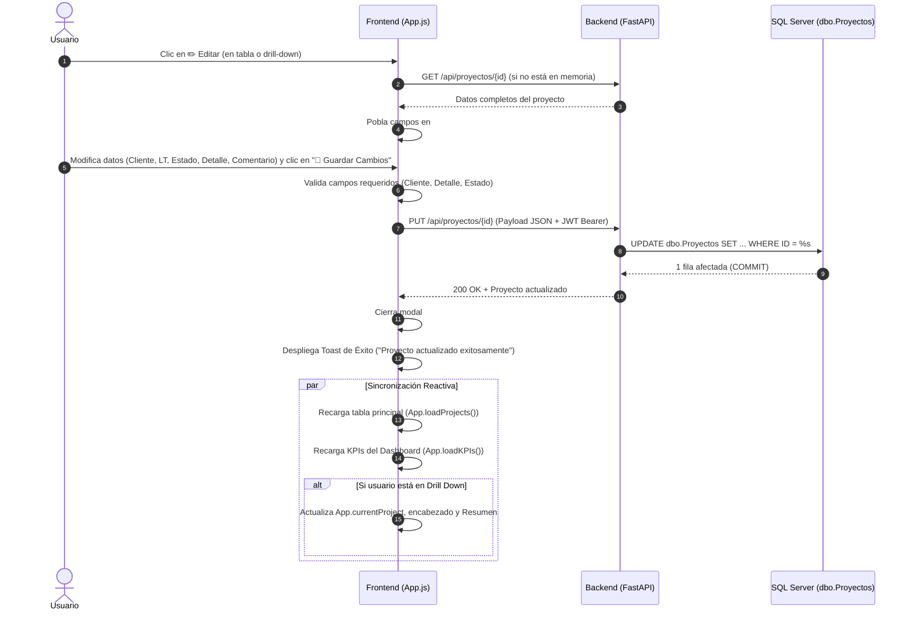
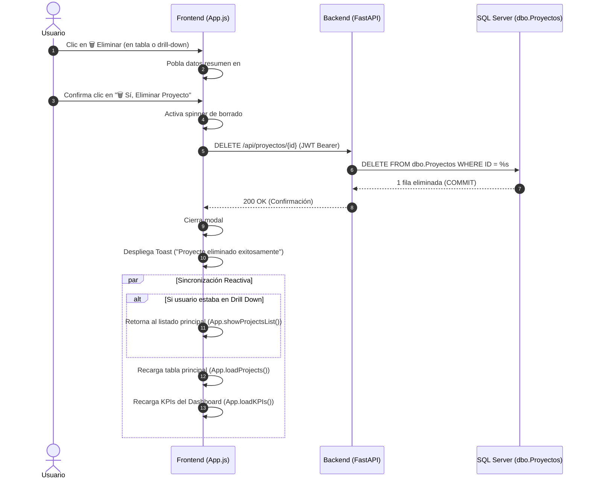

# ESPECIFICACIÓN TÉCNICA Y FUNCIONAL (SPECS)
## Módulo: "Edición y Eliminación de Proyectos" — Portal de Seguimiento Líderes TI (`app-lti`)

- **Documento:** SPECS-LTI-MOD-005
- **Versión:** 1.0.0
- **Fecha:** 2026-08-25
- **Autor:** Subagente 1 (Planificador & Arquitecto de Software)
- **Destinatario:** Subagente 2 (Codificador & Implementador)
- **Ubicación del Proyecto:** `/home/bobbasystem/Desarrollos/app-lti`

---

## CONTROL DE VERSIONES Y REGISTRO DE CAMBIOS

| Versión | Fecha | Autor | Descripción del Cambio |
|---|---|---|---|
| **1.0.0** | 2026-08-25 | Subagente 1 | Versión inicial de especificación técnica y funcional completa para las funcionalidades de **Edición** (`PUT /api/proyectos/{id}`) y **Eliminación** (`DELETE /api/proyectos/{id}`) de proyectos desde el módulo "Seguimiento de Proyectos" (tabla principal y vista drill-down), modales interactivos (`#edit-project-modal`, `#delete-project-modal`), sincronización reactiva de KPIs/filtros/tabla, seguridad JWT y matriz de pruebas automatizadas. |

---

## 1. RESUMEN EJECUTIVO Y OBJETIVOS

El portal `app-lti` (FastAPI + MSSQL + Vanilla JS / CSS3) permite a los Líderes Técnicos (LTI) y Administradores gestionar y auditar el ciclo de vida de los proyectos asignados, vinculando la información de Microsoft SQL Server (`dbo.Proyectos`) con el Backlog de Solots de Operaciones (`dbo.CT_BACKLOG_OPERACIONES2`), Tickets de Incidentes Service Manager (`dbo.registrosRF_SD_SM`) y RFCs (`dbo.registrosSM_RFC`).

### 1.1. Objetivos Principales del Requerimiento

1. **Edición Integral de Proyectos:**
   - Habilitar la acción ✏️ **Editar** tanto en la columna de acciones de la tabla principal de proyectos como en el encabezado de la vista de detalle (**Drill Down**).
   - Proveer un modal de edición (`#edit-project-modal`) con campos interactivos: `Cliente`, `LT Asignado`, `Estado` (`Generado`, `En revision`, `Atendido`), `Tipo de Servicio`, `Detalle` y `Comentario`.
   - Proteger los identificadores clave (`ID`, `Numero_Proyecto` y `Fecha de Creación / Creado`) en modo de solo lectura para preservar la trazabilidad histórica y la consistencia con SGA/HPSM.
   - Exponer el endpoint backend `PUT /api/proyectos/{id}` con validaciones estrictas, sanitización, manejo de concurrencia y persistencia atómica en MSSQL.

2. **Eliminación Segura y Destructiva de Proyectos:**
   - Habilitar la acción 🗑️ **Eliminar** en la tabla principal y en el encabezado de la vista Drill Down.
   - Proveer un modal de confirmación destructiva (`#delete-project-modal`) que detalle el N° de Proyecto, Cliente, LT Asignado y Estado, requiriendo confirmación explícita del usuario para evitar borrados accidentales.
   - Exponer el endpoint backend `DELETE /api/proyectos/{id}` con validación de existencia, rollback seguro y confirmación estructurada.

3. **Sincronización Reactiva en Frontend (Sin Recarga de Página):**
   - Tras cualquier operación exitosa (edición o eliminación), actualizar de manera reactiva e inmediata:
     * La tabla principal de proyectos (`App.loadProjects()`).
     * La métrica y contadores de los KPIs del Dashboard (`App.loadKPIs()`).
     * Los filtros activos y contadores de insignias.
     * Si la edición ocurre dentro de la vista Drill Down: refrescar en vivo el encabezado y la pestaña de Resumen (`App.renderSummaryTab()`).
     * Si la eliminación ocurre dentro del Drill Down: retornar automáticamente a la lista principal (`App.showProjectsList()`).
   - Mostrar notificaciones Toast (`App.showToast()`) informando el resultado de la operación.

4. **Seguridad, Auditoría y Permisos:**
   - Todos los endpoints (`PUT` y `DELETE`) deben estar protegidos mediante autenticación JWT (`Depends(get_current_user)`).

---

## 2. ARQUITECTURA DE DATOS & OPERACIONES SQL (MSSQL)

### 2.1. Estructura de la Tabla `dbo.Proyectos`

| Columna | Tipo de Dato MSSQL | Nullable | Editable en Formulario | Reglas de Actualización / Protección |
|---|---|---|---|---|
| `ID` | `numeric(18,0)` | NO (PK) | ❌ **NO (Solo Lectura)** | Clave Primaria. Inmutable. Utilizada en la cláusula `WHERE ID = %s`. |
| `Numero_Proyecto` | `varchar(50)` | SÍ | ❌ **NO (Solo Lectura)** | Código de proyecto vinculado a SGA/HPSM. Inmutable para preservar relaciones. |
| `Creado` | `datetime` | SÍ | ❌ **NO (Solo Lectura)** | Timestamp de creación original de la solicitud. Inmutable. |
| `Solicitante` | `varchar(50)` | SÍ | ❌ **NO (Solo Lectura)** | Nombre del solicitante original. Se muestra como referencia informativa. |
| `Cliente` | `varchar(100)` | SÍ | ✅ **SÍ (Obligatorio)** | Nombre / Razón Social del Cliente. Longitud máxima: 100 caracteres. No puede estar vacío. |
| `LT_Asignado` | `varchar(50)` | SÍ | ✅ **SÍ (Opcional)** | Líder Técnico Asignado. Dropdown con líderes activos o `NULL` / Sin asignar. |
| `Estado` | `nvarchar(MAX)` | SÍ | ✅ **SÍ (Obligatorio)** | Estados permitidos: `'Generado'`, `'En revision'`, `'Atendido'`. |
| `Tipo_Servicio` | `varchar(30)` | SÍ | ✅ **SÍ (Opcional)** | Clasificación de servicio: `'Otros'`, `'Cloud Empresarial'`, `'Hosting Virtual'`, etc. |
| `Detalle` | `nvarchar(MAX)` | SÍ | ✅ **SÍ (Obligatorio)** | Descripción técnica, requerimientos, alcance o notas técnicas del proyecto. |
| `Comentario` | `nvarchar(MAX)` | SÍ | ✅ **SÍ (Opcional)** | Notas de cierre, resolución o seguimiento interno. Relevante al pasar a `'Atendido'`. |

---

### 2.2. Sentencia SQL Parametrizada de Actualización (`UPDATE`)

```sql
UPDATE dbo.Proyectos
SET 
    Cliente = %s,
    LT_Asignado = %s,
    Estado = %s,
    Detalle = %s,
    Tipo_Servicio = %s,
    Comentario = %s
WHERE ID = %s;
```

#### Manejo de Parámetros y Tipos en Python (`backend/db.py`):
```python
def update_proyecto(
    proyecto_id: int,
    cliente: str,
    lt_asignado: Optional[str],
    estado: str,
    detalle: str,
    tipo_servicio: Optional[str] = "Otros",
    comentario: Optional[str] = None
) -> dict:
    conn = get_db_connection()
    try:
        with conn.cursor() as cursor:
            # 1. Verificar existencia del proyecto
            cursor.execute("SELECT ID FROM dbo.Proyectos WHERE ID = %s", (proyecto_id,))
            if not cursor.fetchone():
                return {"success": False, "error": "not_found", "message": f"Proyecto ID {proyecto_id} no encontrado"}

            # 2. Ejecutar UPDATE parametrizado
            sql_update = """
                UPDATE dbo.Proyectos
                SET 
                    Cliente = %s,
                    LT_Asignado = %s,
                    Estado = %s,
                    Detalle = %s,
                    Tipo_Servicio = %s,
                    Comentario = %s
                WHERE ID = %s
            """
            cursor.execute(sql_update, (
                cliente.strip()[:100],
                (lt_asignado.strip()[:50] if lt_asignado and lt_asignado.strip() else None),
                estado.strip(),
                detalle.strip(),
                (tipo_servicio.strip()[:30] if tipo_servicio and tipo_servicio.strip() else "Otros"),
                (comentario.strip() if comentario and comentario.strip() else None),
                proyecto_id
            ))
            conn.commit()

            # 3. Retornar el registro actualizado enriquecido
            return {
                "success": True,
                "data": get_proyecto_by_id(proyecto_id)
            }
    except Exception as e:
        try:
            conn.rollback()
        except Exception:
            pass
        return {"success": False, "error": "db_error", "message": str(e)}
    finally:
        conn.close()
```

---

### 2.3. Sentencia SQL Parametrizada de Eliminación (`DELETE`)

```sql
DELETE FROM dbo.Proyectos WHERE ID = %s;
```

#### Consideración de Integridad Referencial:
- La tabla `dbo.Proyectos` es la entidad principal de seguimiento en `app-lti`.
- Las tablas complementarias (`dbo.CT_BACKLOG_OPERACIONES2`, `dbo.registrosRF_SD_SM`, `dbo.registrosSM_RFC`) provienen de procesos de sincronización externa (SGA / Micro Focus SM).
- Al eliminar un registro de `dbo.Proyectos`, se elimina el proyecto de la lista de seguimiento del portal LTI. Las consultas que realizan `LEFT JOIN` hacia las tablas de Solots/Tickets/RFCs dejarán de listar el proyecto en el seguimiento de Líderes TI.

#### Implementación en Python (`backend/db.py`):
```python
def delete_proyecto(proyecto_id: int) -> dict:
    conn = get_db_connection()
    try:
        with conn.cursor() as cursor:
            # 1. Verificar existencia y capturar datos antes de borrar
            cursor.execute("SELECT ID, Numero_Proyecto, Cliente FROM dbo.Proyectos WHERE ID = %s", (proyecto_id,))
            existing = cursor.fetchone()
            if not existing:
                return {"success": False, "error": "not_found", "message": f"Proyecto ID {proyecto_id} no encontrado"}

            # 2. Ejecutar DELETE
            cursor.execute("DELETE FROM dbo.Proyectos WHERE ID = %s", (proyecto_id,))
            deleted_count = cursor.rowcount
            conn.commit()

            return {
                "success": True,
                "id": proyecto_id,
                "numero_proyecto": existing.get("Numero_Proyecto"),
                "cliente": existing.get("Cliente"),
                "deleted_count": deleted_count
            }
    except Exception as e:
        try:
            conn.rollback()
        except Exception:
            pass
        return {"success": False, "error": "db_error", "message": str(e)}
    finally:
        conn.close()
```

---

## 3. ESPECIFICACIÓN DE ENDPOINTS BACKEND (FastAPI)

### 3.1. Esquemas Pydantic (`backend/main.py`)

```python
class ProyectoUpdateRequest(BaseModel):
    cliente: str
    lt_asignado: Optional[str] = None
    estado: str
    detalle: str
    tipo_servicio: Optional[str] = "Otros"
    comentario: Optional[str] = None
```

---

### 3.2. Endpoint: `PUT /api/proyectos/{proyecto_id}`

Permite la edición de los datos operativos y de seguimiento de un proyecto existente.

- **Método HTTP:** `PUT`
- **Ruta:** `/api/proyectos/{proyecto_id}`
- **Parámetros de Ruta:**
  - `proyecto_id` (`int`, obligatorio): ID numérico del proyecto en `dbo.Proyectos`.
- **Headers Requeridos:**
  - `Authorization: Bearer <JWT_TOKEN>`
  - `Content-Type: application/json`
- **Cuerpo de la Solicitud (JSON):**
```json
{
  "cliente": "MUNICIPALIDAD DE QUINTA NORMAL",
  "lt_asignado": "Alejandro Aguilar",
  "estado": "En revision",
  "tipo_servicio": "Cloud Empresarial",
  "detalle": "Actualización de alcance técnico: Se añaden 2 nuevos enlaces redundantes.",
  "comentario": "Revisión realizada con el área de operaciones y preventa."
}
```

#### Validaciones del Endpoint:
1. **Autenticación:** Requiere token JWT válido (`current_user = Depends(get_current_user)`).
2. **Campos Obligatorios:** `cliente`, `estado` y `detalle` no pueden ser vacíos ni contener únicamente espacios en blanco (`400 Bad Request`).
3. **Estados Válidos:** El valor de `estado` debe pertenecer al conjunto permitido: `['Generado', 'En revision', 'Atendido']` (`400 Bad Request` si no coincide).
4. **Existencia:** Si el `proyecto_id` no existe en la base de datos, retornar `404 Not Found`.

#### Respuestas HTTP:

- **200 OK (Éxito):**
```json
{
  "message": "Proyecto actualizado exitosamente",
  "data": {
    "ID": 2535,
    "Cliente": "MUNICIPALIDAD DE QUINTA NORMAL",
    "Numero_Proyecto": "0001614294",
    "LT_Asignado": "Alejandro Aguilar",
    "Estado": "En revision",
    "Detalle": "Actualización de alcance técnico: Se añaden 2 nuevos enlaces redundantes.",
    "Comentario": "Revisión realizada con el área de operaciones y preventa.",
    "Tipo_Servicio": "Cloud Empresarial",
    "Creado": "2026-08-24 18:58:00",
    "Solicitante": "ALEJANDRO AGUILAR",
    "total_solots": 4,
    "total_tickets": 1,
    "total_rfcs": 0
  }
}
```

- **400 Bad Request (Validación fallida):**
```json
{
  "detail": "Los campos 'cliente', 'estado' y 'detalle' son obligatorios"
}
```

- **404 Not Found (Proyecto inexistente):**
```json
{
  "detail": "Proyecto no encontrado"
}
```

- **401 Unauthorized (Sin token o token inválido):**
```json
{
  "detail": "Could not validate credentials"
}
```

---

### 3.3. Endpoint: `DELETE /api/proyectos/{proyecto_id}`

Permite la eliminación física de un registro de proyecto desde `dbo.Proyectos`.

- **Método HTTP:** `DELETE`
- **Ruta:** `/api/proyectos/{proyecto_id}`
- **Parámetros de Ruta:**
  - `proyecto_id` (`int`, obligatorio): ID del proyecto a eliminar.
- **Headers Requeridos:**
  - `Authorization: Bearer <JWT_TOKEN>`

#### Validaciones del Endpoint:
1. **Autenticación:** Requiere token JWT válido (`current_user = Depends(get_current_user)`).
2. **Existencia:** Si el `proyecto_id` no existe, responder `404 Not Found`.

#### Respuestas HTTP:

- **200 OK (Éxito):**
```json
{
  "message": "Proyecto eliminado exitosamente",
  "id": 2535,
  "numero_proyecto": "0001614294",
  "cliente": "ILUSTRE MUNICIPALIDAD DE QUINTA NORMAL"
}
```

- **404 Not Found:**
```json
{
  "detail": "Proyecto no encontrado"
}
```

- **401 Unauthorized:**
```json
{
  "detail": "Could not validate credentials"
}
```

---

## 4. ESPECIFICACIÓN FRONTEND UI/UX (HTML5, CSS3, JAVASCRIPT)

### 4.1. Acciones en la Tabla Principal (`#projects-table`)

En la tabla del módulo **Seguimiento de Proyectos**, la columna de encabezado `<th>Acciones</th>` contendrá una celda por fila con 3 botones de acción compactos:

```html
<td class="col-action-cell">
  <div class="action-buttons-group">
    <!-- 1. Ver Detalle (Drill Down) -->
    <button type="button" class="btn-action-icon btn-action-view" onclick="App.drillDownById(${p.ID})" title="Ver detalle completo (Drill Down)" aria-label="Ver Detalle">
      🔍
    </button>
    <!-- 2. Editar Proyecto -->
    <button type="button" class="btn-action-icon btn-action-edit" onclick="App.openEditProjectModal(${p.ID})" title="Editar proyecto" aria-label="Editar Proyecto">
      ✏️
    </button>
    <!-- 3. Eliminar Proyecto -->
    <button type="button" class="btn-action-icon btn-action-delete" onclick="App.openDeleteProjectModal(${p.ID})" title="Eliminar proyecto" aria-label="Eliminar Proyecto">
      🗑️
    </button>
  </div>
</td>
```

---

### 4.2. Acciones en la Vista de Detalle (Drill Down Header)

En la sección `#project-drilldown-section`, dentro de `.drilldown-title-row`, se incorporará una barra de herramientas de acciones (`.drilldown-action-toolbar`):

```html
<div class="drilldown-title-row">
  <div>
    <h2 class="drilldown-title" id="dd-client-title">Nombre del Cliente</h2>
    <div style="display: flex; gap: 1rem; align-items: center; margin-top: 0.4rem; font-size: 0.9rem; color: var(--text-secondary);">
      <span>N° Proyecto: <strong style="font-family: monospace; color: var(--primary);" id="dd-proj-num">00000</strong></span>
      <span>•</span>
      <span>Líder TI: <strong id="dd-lt-assigned">-</strong></span>
    </div>
  </div>

  <div style="display: flex; align-items: center; gap: 0.75rem; flex-wrap: wrap;">
    <div id="dd-status">
      <span class="badge badge-success">Atendido</span>
    </div>
    
    <!-- Botones de Acción en Drill Down -->
    <div class="drilldown-action-toolbar">
      <button type="button" id="btn-dd-edit-project" class="btn btn-secondary btn-sm" title="Editar este proyecto">
        ✏️ Editar
      </button>
      <button type="button" id="btn-dd-delete-project" class="btn btn-danger-outline btn-sm" title="Eliminar este proyecto">
        🗑️ Eliminar
      </button>
    </div>
  </div>
</div>
```

---

### 4.3. Modal de Edición de Proyecto (`#edit-project-modal`)

Modal con formulario completo para actualizar las propiedades del proyecto seleccionado.

```html
<!-- MODAL DE EDICIÓN DE PROYECTO -->
<div id="edit-project-modal" class="modal-backdrop" style="display: none;">
  <div class="modal-dialog modal-dialog-lg" role="dialog" aria-modal="true" aria-labelledby="modal-edit-project-title">
    
    <!-- Encabezado del Modal -->
    <div class="modal-header">
      <div class="modal-header-brand">
        <div class="modal-icon-edit">✏️</div>
        <div>
          <h3 id="modal-edit-project-title" class="modal-title">Editar Proyecto</h3>
          <p class="modal-subtitle">Modificación de datos operativos y estado en dbo.Proyectos</p>
        </div>
      </div>
      <button type="button" class="modal-close-btn" id="btn-close-edit-modal-icon" aria-label="Cerrar modal">&times;</button>
    </div>

    <!-- Banner de Alerta de Error en Edición (Oculto por defecto) -->
    <div id="edit-project-error-alert" class="solicitud-alert-banner alert-danger" style="display: none; margin: 1rem 1.5rem 0 1.5rem;">
      <div class="alert-icon">❌</div>
      <div class="alert-content">
        <div class="alert-title">No se pudo guardar la modificación</div>
        <div class="alert-description" id="edit-project-error-desc">Verifica que los campos requeridos no estén vacíos.</div>
      </div>
    </div>

    <!-- Cuerpo del Modal -->
    <div class="modal-body">
      <form id="edit-project-form" onsubmit="event.preventDefault();">
        <input type="hidden" id="edit-project-id">

        <div class="solicitud-form-grid">
          
          <!-- Fila 1: N° Proyecto (Protegido) y Fecha Solicitud (Protegida) -->
          <div class="form-group">
            <label class="form-label" for="edit-project-nro">
              N° de Proyecto
              <span class="badge-locked">🔒 Protegido</span>
            </label>
            <div class="input-with-icon">
              <span class="input-icon">🔢</span>
              <input type="text" id="edit-project-nro" class="form-input input-readonly" disabled readonly>
            </div>
            <span class="form-help-text">Identificador inmutable para preservar vínculos con Backlog SGA.</span>
          </div>

          <div class="form-group">
            <label class="form-label" for="edit-project-fecha">
              Fecha de Solicitud LTI
              <span class="badge-locked">🔒 Protegido</span>
            </label>
            <div class="input-with-icon">
              <span class="input-icon">📅</span>
              <input type="text" id="edit-project-fecha" class="form-input input-readonly" disabled readonly>
            </div>
            <span class="form-help-text">Fecha original de ingreso del requerimiento.</span>
          </div>

          <!-- Fila 2: Cliente (Editable) y LT Asignado (Editable) -->
          <div class="form-group">
            <label class="form-label" for="edit-project-cliente">
              Cliente <span class="form-required">*</span>
            </label>
            <div class="input-with-icon">
              <span class="input-icon">🏢</span>
              <input type="text" id="edit-project-cliente" class="form-input" placeholder="Razón Social o Nombre del Cliente" required>
            </div>
            <span class="form-help-text">Nombre de la empresa o cliente asociado.</span>
          </div>

          <div class="form-group">
            <label class="form-label" for="edit-project-lt-asignado">
              LT Asignado
            </label>
            <div class="input-with-icon">
              <span class="input-icon">👤</span>
              <select id="edit-project-lt-asignado" class="form-select">
                <option value="">— Sin Asignar —</option>
                <!-- Opciones pobladas dinámicamente con App.lideresList -->
              </select>
            </div>
            <span class="form-help-text">Líder Técnico responsable de la atención.</span>
          </div>

          <!-- Fila 3: Estado (Editable) y Tipo de Servicio (Editable) -->
          <div class="form-group">
            <label class="form-label" for="edit-project-estado">
              Estado del Proyecto <span class="form-required">*</span>
            </label>
            <div class="input-with-icon">
              <span class="input-icon">📊</span>
              <select id="edit-project-estado" class="form-select" required>
                <option value="Generado">Generado (En Curso / Asignado)</option>
                <option value="En revision">En revision (Evaluación Técnica)</option>
                <option value="Atendido">Atendido (Completado / Finalizado)</option>
              </select>
            </div>
            <span class="form-help-text">Etapa actual en el ciclo de vida del proyecto.</span>
          </div>

          <div class="form-group">
            <label class="form-label" for="edit-project-tipo-servicio">
              Tipo de Servicio
            </label>
            <div class="input-with-icon">
              <span class="input-icon">⚙️</span>
              <select id="edit-project-tipo-servicio" class="form-select">
                <option value="Otros">Otros</option>
                <option value="Cloud Empresarial">Cloud Empresarial</option>
                <option value="Cloud Regional (O365/Google))">Cloud Regional (O365/Google)</option>
                <option value="Colabora (3C-2R-100D)">Colabora (3C-2R-100D)</option>
                <option value="Hosting Virtual">Hosting Virtual</option>
                <option value="Virtual Datacenter (VDC)">Virtual Datacenter (VDC)</option>
              </select>
            </div>
            <span class="form-help-text">Clasificación técnica del servicio.</span>
          </div>

          <!-- Fila 4: Detalle del Proyecto (Ancho Completo) -->
          <div class="form-group full-width">
            <label class="form-label" for="edit-project-detalle">
              Detalle del Requerimiento / Proyecto <span class="form-required">*</span>
            </label>
            <textarea id="edit-project-detalle" class="form-textarea" rows="4" placeholder="Descripción detallada de tareas, topología, requerimientos y alcance..." required></textarea>
          </div>

          <!-- Fila 5: Comentarios de Cierre / Seguimiento (Ancho Completo) -->
          <div class="form-group full-width">
            <label class="form-label" for="edit-project-comentario">
              Comentarios de Cierre / Observaciones
            </label>
            <textarea id="edit-project-comentario" class="form-textarea" rows="3" placeholder="Ingresa notas de cierre, resolución técnica, números de ticket o detalles para entrega..."></textarea>
            <span class="form-help-text">Recomendado al cambiar el estado a 'Atendido'.</span>
          </div>

        </div>
      </form>
    </div>

    <!-- Pie del Modal -->
    <div class="modal-footer" style="display: flex; justify-content: flex-end; gap: 0.75rem;">
      <button type="button" id="btn-cancel-edit-modal" class="btn btn-secondary">
        Cancelar
      </button>
      <button type="button" id="btn-save-edit-modal" class="btn btn-primary btn-execute">
        <span id="edit-modal-spinner" class="spinner-inline" style="display: none;"></span>
        <span id="edit-modal-btn-icon">💾</span>
        <span id="edit-modal-btn-text">Guardar Cambios</span>
      </button>
    </div>

  </div>
</div>
```

---

### 4.4. Modal Destructivo de Confirmación de Eliminación (`#delete-project-modal`)

```html
<!-- MODAL DE CONFIRMACIÓN DE ELIMINACIÓN -->
<div id="delete-project-modal" class="modal-backdrop" style="display: none;">
  <div class="modal-dialog modal-dialog-sm" role="dialog" aria-modal="true" aria-labelledby="modal-delete-project-title">
    
    <!-- Encabezado Destructivo -->
    <div class="modal-header">
      <div class="modal-header-brand">
        <div class="modal-icon-danger">🗑️</div>
        <div>
          <h3 id="modal-delete-project-title" class="modal-title" style="color: var(--status-danger-text);">¿Eliminar Proyecto?</h3>
          <p class="modal-subtitle">Esta acción es irreversible</p>
        </div>
      </div>
      <button type="button" class="modal-close-btn" id="btn-close-delete-modal-icon" aria-label="Cerrar">&times;</button>
    </div>

    <!-- Cuerpo del Modal -->
    <div class="modal-body">
      <p class="modal-description" style="font-size: 0.95rem; margin-bottom: 1rem;">
        ¿Estás seguro de que deseas eliminar permanentemente este proyecto de la base de datos?
      </p>

      <!-- Tarjeta Resumen del Proyecto a Eliminar -->
      <div class="modal-summary-box" style="border-left: 4px solid var(--status-danger-text); background-color: var(--bg-surface-secondary);">
        <input type="hidden" id="delete-project-id">
        <div class="modal-summary-row">
          <span class="modal-summary-label">N° Proyecto:</span>
          <span id="modal-delete-nro" class="modal-summary-val" style="font-family: monospace; font-weight: 700; color: var(--primary);">-</span>
        </div>
        <div class="modal-summary-row">
          <span class="modal-summary-label">Cliente:</span>
          <span id="modal-delete-cliente" class="modal-summary-val" style="font-weight: 600;">-</span>
        </div>
        <div class="modal-summary-row">
          <span class="modal-summary-label">LT Asignado:</span>
          <span id="modal-delete-lt" class="modal-summary-val">-</span>
        </div>
        <div class="modal-summary-row">
          <span class="modal-summary-label">Estado:</span>
          <span id="modal-delete-estado" class="modal-summary-val">-</span>
        </div>
      </div>

      <div class="solicitud-alert-banner alert-warning" style="margin-top: 1rem; padding: 0.75rem;">
        <div class="alert-icon" style="font-size: 1.2rem;">⚠️</div>
        <div class="alert-content" style="font-size: 0.85rem;">
          El registro será eliminado de <code>dbo.Proyectos</code>. Esta operación no se puede deshacer.
        </div>
      </div>
    </div>

    <!-- Pie del Modal -->
    <div class="modal-footer" style="display: flex; justify-content: flex-end; gap: 0.75rem;">
      <button type="button" id="btn-cancel-delete-modal" class="btn btn-secondary">
        Cancelar
      </button>
      <button type="button" id="btn-confirm-delete-modal" class="btn btn-danger btn-execute">
        <span id="delete-modal-spinner" class="spinner-inline" style="display: none;"></span>
        <span id="delete-modal-btn-icon">🗑️</span>
        <span id="delete-modal-btn-text">Sí, Eliminar Proyecto</span>
      </button>
    </div>

  </div>
</div>
```

---

### 4.5. Estilos CSS Requeridos (`frontend/css/styles.css`)

```css
/* ==========================================================================
   NUEVOS ESTILOS: ACCIONES DE TABLA, MODAL DE EDICIÓN Y ELIMINACIÓN
   ========================================================================== */

/* Grupo de botones de acción en la tabla */
.action-buttons-group {
  display: inline-flex;
  align-items: center;
  gap: 0.35rem;
}

.btn-action-icon {
  display: inline-flex;
  align-items: center;
  justify-content: center;
  width: 32px;
  height: 32px;
  border-radius: var(--radius-sm);
  background-color: var(--bg-surface-secondary);
  border: 1px solid var(--border-color);
  font-size: 0.95rem;
  cursor: pointer;
  transition: all var(--transition-fast);
  box-shadow: var(--shadow-sm);
  user-select: none;
}

.btn-action-icon:hover {
  transform: translateY(-1px) scale(1.08);
  box-shadow: var(--shadow-md);
}

.btn-action-icon:active {
  transform: scale(0.95);
}

.btn-action-view:hover {
  background-color: var(--primary-light);
  border-color: var(--primary);
  color: var(--primary);
}

.btn-action-edit:hover {
  background-color: rgba(245, 158, 11, 0.15);
  border-color: #f59e0b;
}

.btn-action-delete:hover {
  background-color: var(--status-danger-bg);
  border-color: var(--status-danger-border);
}

/* Barra de herramientas en encabezado de Drill Down */
.drilldown-action-toolbar {
  display: flex;
  align-items: center;
  gap: 0.5rem;
}

/* Botón Danger Destructivo */
.btn-danger {
  background-color: #dc2626;
  color: #ffffff;
  border: 1px solid #b91c1c;
}

.btn-danger:hover {
  background-color: #b91c1c;
  border-color: #991b1b;
  box-shadow: 0 4px 10px rgba(220, 38, 38, 0.3);
}

.btn-danger:active {
  background-color: #991b1b;
}

.btn-danger-outline {
  background-color: transparent;
  color: var(--status-danger-text);
  border: 1px solid var(--status-danger-border);
}

.btn-danger-outline:hover {
  background-color: var(--status-danger-bg);
  border-color: var(--status-danger-text);
}

/* Iconos de cabecera de modal */
.modal-icon-edit {
  width: 44px;
  height: 44px;
  border-radius: var(--radius-md);
  background-color: rgba(245, 158, 11, 0.15);
  color: #d97706;
  display: flex;
  align-items: center;
  justify-content: center;
  font-size: 1.4rem;
}

.modal-icon-danger {
  width: 44px;
  height: 44px;
  border-radius: var(--radius-md);
  background-color: var(--status-danger-bg);
  color: var(--status-danger-text);
  display: flex;
  align-items: center;
  justify-content: center;
  font-size: 1.4rem;
}

/* Tamaño de diálogos modales */
.modal-dialog-lg {
  max-width: 720px;
  width: 95%;
}

.modal-dialog-sm {
  max-width: 480px;
  width: 95%;
}

/* Estilo para campos readonly protegidos */
.input-readonly {
  background-color: var(--bg-surface-tertiary) !important;
  color: var(--text-secondary) !important;
  cursor: not-allowed !important;
  font-family: monospace;
  font-weight: 600;
}
```

---

## 5. MÁQUINA DE ESTADOS Y SINCRONIZACIÓN REACTIVA (FRONTEND)

### 5.1. Diagrama de Flujo: Edición de Proyecto



---

### 5.2. Diagrama de Flujo: Eliminación de Proyecto



---

### 5.3. Métodos JavaScript a Implementar en `frontend/js/app.js`

```javascript
// ============================================================================
// FUNCIONALIDAD DE EDICIÓN Y ELIMINACIÓN DE PROYECTOS (App LTI)
// ============================================================================

// 1. Abrir Modal de Edición
async openEditProjectModal(projectId) {
  try {
    const res = await Auth.fetchWithAuth(`/api/proyectos/${projectId}`);
    if (!res.ok) throw new Error('No se pudo obtener la información del proyecto');
    const project = await res.json();

    // Llenar campos del modal
    document.getElementById('edit-project-id').value = project.ID;
    document.getElementById('edit-project-nro').value = this.formatNumeroProyecto(project.Numero_Proyecto);
    document.getElementById('edit-project-fecha').value = this.formatDateDMY(project.Creado);
    document.getElementById('edit-project-cliente').value = project.Cliente || '';
    document.getElementById('edit-project-detalle').value = project.Detalle || '';
    document.getElementById('edit-project-comentario').value = project.Comentario || '';
    
    // Poblar select de líderes
    const ltSelect = document.getElementById('edit-project-lt-asignado');
    ltSelect.innerHTML = '<option value="">— Sin Asignar —</option>';
    this.lideresList.forEach(lt => {
      const opt = document.createElement('option');
      opt.value = lt;
      opt.textContent = lt;
      if (project.LT_Asignado === lt) opt.selected = true;
      ltSelect.appendChild(opt);
    });

    // Seleccionar Estado
    const estadoSelect = document.getElementById('edit-project-estado');
    if (estadoSelect) {
      estadoSelect.value = project.Estado || 'Generado';
    }

    // Seleccionar Tipo de Servicio
    const tipoSelect = document.getElementById('edit-project-tipo-servicio');
    if (tipoSelect) {
      tipoSelect.value = project.Tipo_Servicio || 'Otros';
    }

    // Ocultar banner de error previo
    document.getElementById('edit-project-error-alert').style.display = 'none';

    // Mostrar modal
    document.getElementById('edit-project-modal').style.display = 'flex';
  } catch (err) {
    this.showToast(`Error: ${err.message}`, 'danger');
  }
},

// 2. Cerrar Modal de Edición
closeEditProjectModal() {
  const modal = document.getElementById('edit-project-modal');
  if (modal) modal.style.display = 'none';
},

// 3. Guardar Edición
async submitEditProjectForm() {
  const projectId = document.getElementById('edit-project-id').value;
  const cliente = document.getElementById('edit-project-cliente').value.trim();
  const ltAsignado = document.getElementById('edit-project-lt-asignado').value;
  const estado = document.getElementById('edit-project-estado').value;
  const tipoServicio = document.getElementById('edit-project-tipo-servicio').value;
  const detalle = document.getElementById('edit-project-detalle').value.trim();
  const comentario = document.getElementById('edit-project-comentario').value.trim();
  const errAlert = document.getElementById('edit-project-error-alert');
  const errDesc = document.getElementById('edit-project-error-desc');
  const btn = document.getElementById('btn-save-edit-modal');
  const spinner = document.getElementById('edit-modal-spinner');

  if (!cliente || !estado || !detalle) {
    errAlert.style.display = 'flex';
    errDesc.textContent = 'Cliente, Estado y Detalle son obligatorios.';
    return;
  }

  errAlert.style.display = 'none';
  btn.disabled = true;
  if (spinner) spinner.style.display = 'inline-block';

  try {
    const res = await Auth.fetchWithAuth(`/api/proyectos/${projectId}`, {
      method: 'PUT',
      headers: { 'Content-Type': 'application/json' },
      body: JSON.stringify({
        cliente: cliente,
        lt_asignado: ltAsignado || null,
        estado: estado,
        tipo_servicio: tipoServicio || 'Otros',
        detalle: detalle,
        comentario: comentario || null
      })
    });

    const result = await res.json();
    if (!res.ok) {
      throw new Error(result.detail || 'Error al guardar modificaciones');
    }

    this.closeEditProjectModal();
    this.showToast('Proyecto actualizado exitosamente', 'success');

    // Sincronización Reactiva
    await Promise.all([
      this.loadProjects(),
      this.loadKPIs()
    ]);

    // Si está en Drill Down, refrescar vista en vivo
    if (this.currentProject && this.currentProject.ID == projectId) {
      this.currentProject = result.data;
      document.getElementById('dd-client-title').textContent = result.data.Cliente || 'Sin Título';
      document.getElementById('dd-lt-assigned').textContent = result.data.LT_Asignado || 'No asignado';
      document.getElementById('dd-status').innerHTML = this.renderStatusBadge(result.data.Estado);
      this.renderSummaryTab(result.data);
    }
  } catch (err) {
    errAlert.style.display = 'flex';
    errDesc.textContent = err.message;
  } finally {
    btn.disabled = false;
    if (spinner) spinner.style.display = 'none';
  }
},

// 4. Abrir Modal de Confirmación de Eliminación
async openDeleteProjectModal(projectId) {
  try {
    const res = await Auth.fetchWithAuth(`/api/proyectos/${projectId}`);
    if (!res.ok) throw new Error('No se encontró el proyecto a eliminar');
    const project = await res.json();

    document.getElementById('delete-project-id').value = project.ID;
    document.getElementById('modal-delete-nro').textContent = this.formatNumeroProyecto(project.Numero_Proyecto);
    document.getElementById('modal-delete-cliente').textContent = project.Cliente || 'Sin título';
    document.getElementById('modal-delete-lt').textContent = project.LT_Asignado || 'Sin Asignar';
    document.getElementById('modal-delete-estado').innerHTML = this.renderStatusBadge(project.Estado);

    document.getElementById('delete-project-modal').style.display = 'flex';
  } catch (err) {
    this.showToast(`Error: ${err.message}`, 'danger');
  }
},

// 5. Cerrar Modal de Eliminación
closeDeleteProjectModal() {
  const modal = document.getElementById('delete-project-modal');
  if (modal) modal.style.display = 'none';
},

// 6. Confirmar Eliminación
async confirmDeleteProject() {
  const projectId = document.getElementById('delete-project-id').value;
  const btn = document.getElementById('btn-confirm-delete-modal');
  const spinner = document.getElementById('delete-modal-spinner');

  btn.disabled = true;
  if (spinner) spinner.style.display = 'inline-block';

  try {
    const res = await Auth.fetchWithAuth(`/api/proyectos/${projectId}`, {
      method: 'DELETE'
    });

    const result = await res.json();
    if (!res.ok) {
      throw new Error(result.detail || 'Error al eliminar el proyecto');
    }

    this.closeDeleteProjectModal();
    this.showToast('Proyecto eliminado exitosamente', 'success');

    // Si estaba en Drill Down del proyecto eliminado, volver al listado
    if (this.currentProject && this.currentProject.ID == projectId) {
      this.showProjectsList();
    }

    // Sincronización reactiva
    await Promise.all([
      this.loadProjects(),
      this.loadKPIs()
    ]);
  } catch (err) {
    alert(`Error al eliminar: ${err.message}`);
  } finally {
    btn.disabled = false;
    if (spinner) spinner.style.display = 'none';
  }
},

// 7. Componente Toast Universal
showToast(message, type = 'info') {
  const existing = document.querySelector('.alert-toast');
  if (existing) existing.remove();

  const toast = document.createElement('div');
  toast.className = 'alert-toast';
  const icon = type === 'success' ? '✅' : (type === 'danger' ? '❌' : 'ℹ️');
  toast.innerHTML = `
    <span style="font-size: 1.2rem;">${icon}</span>
    <span style="font-weight: 500; font-size: 0.9rem;">${this.escapeHtml(message)}</span>
  `;
  document.body.appendChild(toast);

  setTimeout(() => {
    toast.style.transition = 'opacity 0.3s ease, transform 0.3s ease';
    toast.style.opacity = '0';
    toast.style.transform = 'translateY(20px)';
    setTimeout(() => toast.remove(), 300);
  }, 3500);
}
```

---

## 6. MANEJO DE CASOS DE BORDE Y RESILIENCIA

1. **Eliminación Concurrente:** Si un usuario intenta editar un proyecto que fue eliminado por otro usuario en simultáneo, el endpoint `PUT` devolverá `404 Not Found`. El frontend capturará este código, informará al usuario mediante Toast y refrescará la lista automáticamente.
2. **Caracteres Especiales y XSS:** Todo texto renderizado en modales o tablas debe pasar por la función `this.escapeHtml()` para prevenir inyecciones HTML.
3. **Manejo de Valores Nulos:** Si `LT_Asignado` o `Comentario` se envían vacíos, se persistirán como `NULL` en SQL Server en lugar de cadenas de espacios en blanco.
4. **Protección de Teclado (Accesibilidad):** Al presionar la tecla `Escape`, cualquier modal activo (`#edit-project-modal` o `#delete-project-modal`) se cerrará de forma segura.
5. **Cierre de Modales por Clic en Backdrop:** Clic fuera del diálogo del modal cerrará la ventana emergente.

---

## 7. MATRIZ DE PRUEBAS AUTOMATIZADAS (QA & PYTEST)

### 7.1. Casos de Prueba de Backend (API Tests)

| ID | Endpoint | Método | Escenario | Código Esperado |
|---|---|---|---|---|
| **API-01** | `/api/proyectos/{id}` | `PUT` | Edición válida con todos los campos | `200 OK` |
| **API-02** | `/api/proyectos/{id}` | `PUT` | Intento de edición con campos requeridos vacíos | `400 Bad Request` |
| **API-03** | `/api/proyectos/{id}` | `PUT` | Intento de edición con estado no permitido | `400 Bad Request` |
| **API-04** | `/api/proyectos/{id}` | `PUT` | Edición de ID inexistente (ej: 999999) | `404 Not Found` |
| **API-05** | `/api/proyectos/{id}` | `PUT` | Petición sin token JWT | `401 Unauthorized` |
| **API-06** | `/api/proyectos/{id}` | `DELETE` | Eliminación exitosa de proyecto existente | `200 OK` |
| **API-07** | `/api/proyectos/{id}` | `DELETE` | Eliminación de ID inexistente | `404 Not Found` |
| **API-08** | `/api/proyectos/{id}` | `DELETE` | Petición sin token JWT | `401 Unauthorized` |

---

### 7.2. Casos de Prueba E2E Frontend (Playwright)

| ID | Nombre de Caso de Prueba | Pasos de Verificación |
|---|---|---|
| **E2E-01** | Renderizado de Botones de Acción | Verificar que cada fila de la tabla contenga los 3 botones: 🔍 Ver, ✏️ Editar, 🗑️ Eliminar con estilos y tooltips correctos. |
| **E2E-02** | Apertura y Poblado de Modal de Edición | Clic en ✏️ en la tabla -> Validar apertura de `#edit-project-modal`, verificación de campos protegidos (`#edit-project-nro` disabled) y valores precargados. |
| **E2E-03** | Flujo Completo de Edición y Persistencia | Modificar Cliente, LT Asignado, Estado a `'En revision'`, Detalle y Comentario -> Clic en "Guardar Cambios" -> Verificar cierre de modal, Toast de éxito, actualización de la fila en la tabla y persistencia en MSSQL. |
| **E2E-04** | Edición desde Vista Drill Down | Entrar a Drill Down -> Clic en botón "✏️ Editar" de la barra de título -> Editar campos y guardar -> Verificar actualización en vivo del encabezado y de la pestaña Resumen sin recargar la página. |
| **E2E-05** | Apertura de Modal de Confirmación Destructiva | Clic en 🗑️ en la tabla -> Verificar apertura de `#delete-project-modal` con N° Proyecto, Cliente y advertencia de irreversibilidad. |
| **E2E-06** | Cancelación de Eliminación | Clic en "Cancelar" o en la `×` del modal -> Verificar que el modal se cierre y el registro persista en la tabla y en la BD. |
| **E2E-07** | Confirmación de Eliminación y Sincronización | Clic en "Sí, Eliminar Proyecto" -> Verificar eliminación física en MSSQL, desaparición del registro en la tabla y actualización de los contadores KPI. |
| **E2E-08** | Eliminación desde Drill Down | Entrar a Drill Down -> Clic en "🗑️ Eliminar" -> Confirmar -> Verificar retorno automático a la lista principal de proyectos y desaparición del registro. |
| **E2E-09** | Validación de Modo Claro / Modo Oscuro | Alternar temas con `#theme-toggle-btn` -> Validar contraste, colores y legibilidad de ambos modales y los nuevos botones de acción. |

---

## 8. CHECKLIST DE ENTREGA PARA EL SUBAGENTE 2 (CODIFICADOR)

- [ ] **Backend (`backend/db.py`):** Implementar funciones `update_proyecto()` y `delete_proyecto()`.
- [ ] **Backend (`backend/main.py`):** Crear esquema `ProyectoUpdateRequest` y exponer endpoints `PUT /api/proyectos/{proyecto_id}` y `DELETE /api/proyectos/{proyecto_id}` con protección JWT.
- [ ] **Frontend (`frontend/index.html`):**
  - Agregar botones de acción en la cabecera de Drill Down (`.drilldown-action-toolbar`).
  - Agregar marcado HTML del `#edit-project-modal`.
  - Agregar marcado HTML del `#delete-project-modal`.
- [ ] **Frontend (`frontend/css/styles.css`):**
  - Agregar reglas CSS para `.action-buttons-group`, `.btn-action-icon`, `.btn-action-view`, `.btn-action-edit`, `.btn-action-delete`, `.btn-danger`, `.btn-danger-outline`, `.modal-icon-edit`, `.modal-icon-danger` y `.input-readonly`.
  - Asegurar soporte de variables en temas claro y oscuro.
- [ ] **Frontend (`frontend/js/app.js`):**
  - Actualizar `renderProjectsTable()` con los 3 botones de acción.
  - Implementar métodos de apertura, cierre y envío para `#edit-project-modal` y `#delete-project-modal`.
  - Implementar método `showToast()`.
  - Enlazar eventos de botones en `bindEvents()`.
  - Asegurar sincronización reactiva de KPIs y tabla tras cada operación.
- [ ] **Batería de Pruebas (`tests/`):**
  - Implementar suite automatizada de pruebas API y E2E Playwright en `tests/test_functional_edit_delete_proyectos.py`.
