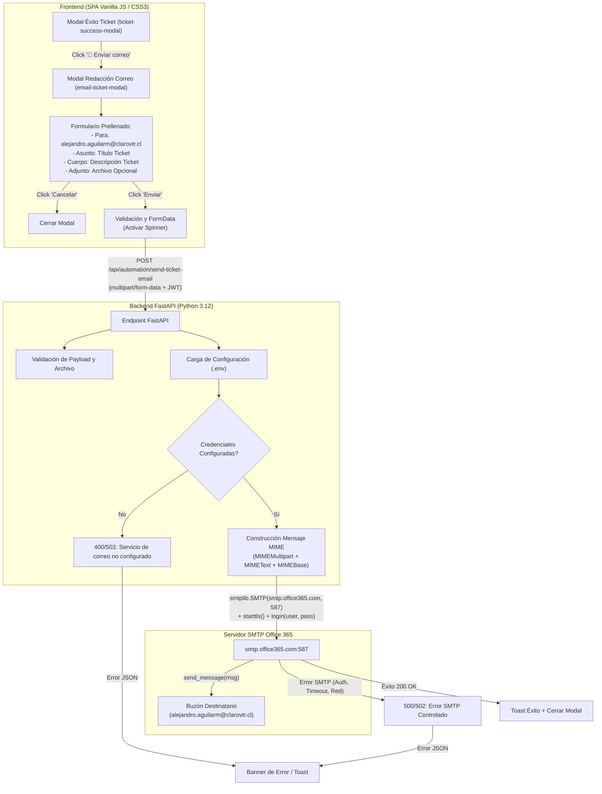
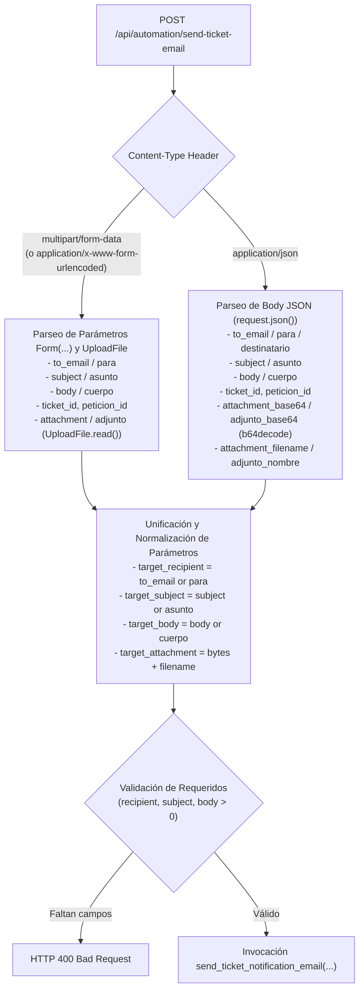
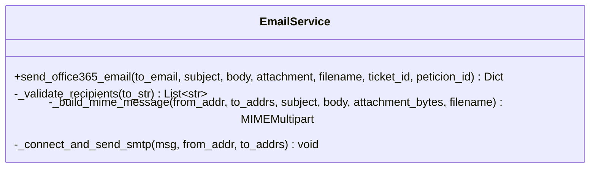

# ESPECIFICACIÓN TÉCNICA Y FUNCIONAL (SPECS)
## Módulo: "Envío Automatizado de Correo para Tickets y Peticiones Creadas (Office 365 SMTP)" — Portal App LTI (`app-lti`)

- **Documento:** SPECS-LTI-MOD-008
- **Versión:** 1.1.0
- **Fecha:** 2026-08-28
- **Autor:** Subagente Planificador & Diseñador de Specs
- **Destinatario:** Subagente Implementador (Coder) & Equipo de Desarrollo
- **Ubicación del Proyecto:** `/home/bobbasystem/Desarrollos/app-lti`

---

## CONTROL DE VERSIONES Y REGISTRO DE CAMBIOS

| Versión | Fecha | Autor | Descripción del Cambio |
|---|---|---|---|
| **1.0.0** | 2026-08-28 | Subagente Planificador | Especificación técnica formal para la incorporación del flujo de notificación por correo electrónico tras la creación exitosa de Tickets (SD) y Peticiones en Micro Focus Service Manager. Incluye nuevo botón en modal de éxito, nuevo popup modal de redacción con prellenado editable (Para, Asunto, Cuerpo, Adjunto opcional), integración SMTP Office 365 (`smtp.office365.com:587`, STARTTLS), parametrización segura vía variables de entorno (`.env`), contrato REST `multipart/form-data` y gestión integral de errores y estados de carga. |
| **1.1.0** | 2026-08-28 | Subagente Planificador | **Corrección de Causa Raíz y Robustecimiento Dual (JSON & Multipart)**:<br>1. **Fix `frontend/js/auth.js` (`Auth.fetchWithAuth`)**: Detección dinámica de `FormData` para omitir la inyección forzada de `'Content-Type': 'application/json'`, permitiendo al navegador generar nativamente `'multipart/form-data; boundary=...'`.<br>2. **Robustecimiento `backend/main.py` (`POST /api/automation/send-ticket-email`)**: Soporte dual transparente para payloads `multipart/form-data`, `application/x-www-form-urlencoded` y `application/json` (incluyendo adjuntos en base64 y alias `to_email`/`para`, `subject`/`asunto`, `body`/`cuerpo`).<br>3. **Verificación de `frontend/js/app.js`**: Aseguramiento del envío de `FormData` con parámetros bidireccionales y manejo de excepciones en la UI.<br>4. **Ampliación de Suite de Pruebas**: Nuevos tests de integración para verificar peticiones JSON, `multipart/form-data` y fallback de compatibilidad. |

---

## 1. RESUMEN EJECUTIVO Y OBJETIVOS DE NEGOCIO

### 1.1. Contexto Operativo
Una vez que el usuario ejecuta la automatización desatendida en Micro Focus Service Manager a través del portal **App LTI**, el sistema genera exitosamente una **Interacción (SD)** y una **Petición Relacionada**, mostrando un popup modal de confirmación con los identificadores generados.

Para agilizar el flujo de trabajo de los Líderes Técnicos (LTI), es imprescindible permitir que, inmediatamente después de visualizar el popup de éxito, el usuario pueda notificar formalmente por correo electrónico el detalle de la solicitud creada a los involucrados (por defecto `alejandro.aguilarm@clarovtr.cl`), con la posibilidad de editar los datos y adjuntar documentación o evidencias de soporte.

### 1.2. Requerimientos Funcionales Clave
1. **Acceso desde el Popup de Éxito:**
   - En el modal existente de confirmación (`ticket-success-modal`), incorporar un botón de acción destacado **"📧 Enviar correo"**.
2. **Despliegue del Modal de Redacción:**
   - Al pulsar el botón, desplegar un popup modal (`email-ticket-modal`) con la misma animación de transición que el popup de generación de tickets (`modal-backdrop` + `@keyframes modalFadeIn`).
   - El formulario debe presentarse listo para ser enviado con los siguientes campos:
     * **Para (`to_email`):** Prellenado con `alejandro.aguilarm@clarovtr.cl` (editable, obligatorio).
     * **Asunto (`subject`):** Prellenado con lo colocado en el campo **"Título"** del generador de Ticket (editable, obligatorio).
     * **Cuerpo (`body`):** Prellenado con lo colocado en el campo **"Descripción"** del generador de Ticket (editable, obligatorio).
     * **Adjunto (`attachment`):** Campo selector de archivos para adjuntar documentación o capturas si el usuario lo requiere (opcional).
3. **Acciones del Modal:**
   - Botón **"Enviar"**: Despacha el correo vía protocolo SMTP Office 365, mostrando feedback visual de carga (spinner) y deshabilitando clicks repetidos.
   - Botón **"Cancelar"**: Cancela el envío y cierra el formulario/modal de correo.
4. **Infraestructura de Transporte SMTP:**
   - Envío mediante servidor estándar de **Office 365**:
     * Servidor (`SMTP_HOST`): `smtp.office365.com`
     * Puerto (`SMTP_PORT`): `587`
     * Seguridad: Negociación `STARTTLS` obligatoria.
     * Autenticación: `LOGIN` / credenciales Office 365.
5. **Seguridad y Parametrización:**
   - Credenciales y configuración parametrizadas en variables de entorno / archivo `.env` (`SMTP_HOST`, `SMTP_PORT`, `SMTP_USER`, `SMTP_PASS`, `SMTP_FROM`, `SMTP_TIMEOUT`).
6. **Resiliencia y Manejo de Fallas:**
   - Si las credenciales no están configuradas o el envío falla (por credenciales inválidas, rechazo de destinatario, caída de red o timeout), el sistema debe responder con mensajes de error claros y controlados en la interfaz sin colapsar la aplicación ni degradar la experiencia de usuario.

---

## 2. ARQUITECTURA GENERAL DEL SISTEMA



---

## 3. CONFIGURACIÓN Y VARIABLES DE ENTORNO (`.env`)

### 3.1. Especificación de Parámetros de Entorno

| Variable | Tipo | Valor por Defecto | Obligatorio | Descripción |
|---|---|---|---|---|
| `SMTP_HOST` | String | `smtp.office365.com` | Sí | Nombre de host del servidor SMTP de Microsoft 365. |
| `SMTP_PORT` | Integer | `587` | Sí | Puerto estándar para SMTP con STARTTLS. |
| `SMTP_USER` | String | `""` (Vacío) | Sí (para envío) | Cuenta de correo / UPN para autenticación en Office 365 (ej. `alejandro.aguilar@clarovtr.cl` o buzón de servicio). |
| `SMTP_PASS` | String | `""` (Vacío) | Sí (para envío) | Contraseña de la cuenta o contraseña de aplicación (App Password) si MFA está activo. |
| `SMTP_FROM` | String | `""` (Vacío) | No | Dirección del remitente que figurará en la cabecera `From:`. Si no se define, se utiliza el valor de `SMTP_USER`. |
| `SMTP_TIMEOUT` | Integer | `30` | No | Tiempo máximo de espera en segundos para la conexión y envío SMTP antes de abortar por timeout. |
| `SMTP_DEFAULT_RECIPIENT` | String | `alejandro.aguilarm@clarovtr.cl` | No | Correo destinatario prellenado por defecto en la UI. |

### 3.2. Estructura de Archivo `.env` (o `.env.example`)

```ini
# ==============================================================================
# CONFIGURACIÓN DEL SERVIDOR DE CORREO (OFFICE 365 SMTP)
# ==============================================================================
SMTP_HOST=smtp.office365.com
SMTP_PORT=587
SMTP_USER=alejandro.aguilarm@clarovtr.cl
SMTP_PASS=TuPasswordDeOffice365OAppPassword
SMTP_FROM=alejandro.aguilarm@clarovtr.cl
SMTP_TIMEOUT=30
SMTP_DEFAULT_RECIPIENT=alejandro.aguilarm@clarovtr.cl

# ==============================================================================
# CONFIGURACIÓN GENERAL Y BASE DE DATOS
# ==============================================================================
DB_SERVER=192.168.10.6
DB_PORT=1433
DB_USER=sa
DB_PASSWORD=
DB_NAME=Sharepoint_Proyectos
JWT_SECRET=app-lti-super-secret-key-2026-claro
```

### 3.3. Actualización de `backend/config.py`
El módulo `backend/config.py` debe ser actualizado para:
1. Cargar las variables del archivo `.env` ubicado en la raíz del proyecto (`BASE_DIR/.env`) de manera automática si existe.
2. Exponer un diccionario `SMTP_CONFIG` con valores por defecto defensivos.

```python
def load_env_file():
    """Lee el archivo .env si existe en la raíz y actualiza os.environ."""
    env_path = os.path.join(BASE_DIR, '.env')
    if os.path.exists(env_path):
        with open(env_path, 'r', encoding='utf-8') as f:
            for line in f:
                line = line.strip()
                if line and not line.startswith('#') and '=' in line:
                    k, v = line.split('=', 1)
                    k = k.strip()
                    v = v.strip().strip("'\"")
                    if k not in os.environ:
                        os.environ[k] = v

load_env_file()

SMTP_CONFIG = {
    'host': os.getenv('SMTP_HOST', 'smtp.office365.com'),
    'port': int(os.getenv('SMTP_PORT', '587')),
    'user': os.getenv('SMTP_USER', ''),
    'password': os.getenv('SMTP_PASS', ''),
    'from_email': os.getenv('SMTP_FROM', os.getenv('SMTP_USER', '')),
    'timeout': int(os.getenv('SMTP_TIMEOUT', '30')),
    'default_recipient': os.getenv('SMTP_DEFAULT_RECIPIENT', 'alejandro.aguilarm@clarovtr.cl'),
}
```

---

## 4. CONTRATO DE LA API REST (BACKEND)

### 4.1. Endpoint de Envío de Correo

- **Ruta:** `POST /api/automation/send-ticket-email`
- **Autenticación Requerida:** Bearer JWT Token (`current_user: dict = Depends(get_current_user)`).
- **Content-Type:** `multipart/form-data`

#### Parámetros del Formulario (`Form` / `File`):

| Parámetro | Tipo | Requerido | Descripción |
|---|---|---|---|
| `to_email` | `str` (Form) | **Sí** | Dirección o direcciones de correo destinatarias (separadas por coma o punto y coma). |
| `subject` | `str` (Form) | **Sí** | Asunto del mensaje. |
| `body` | `str` (Form) | **Sí** | Cuerpo del mensaje en texto plano o HTML básico. |
| `attachment` | `UploadFile` (File) | No (Opcional) | Archivo binario adjunto (captura, PDF, Excel, etc.). Tamaño máx: 15MB. |
| `ticket_id` | `str` (Form) | No (Opcional) | Identificador de la Interacción (SD) para trazabilidad. |
| `peticion_id` | `str` (Form) | No (Opcional) | Identificador de la Petición para trazabilidad. |

#### Respuestas HTTP:

##### Caso 1: Envío Exitoso (200 OK)
```json
{
  "success": true,
  "message": "Correo enviado exitosamente a alejandro.aguilarm@clarovtr.cl",
  "data": {
    "recipients": ["alejandro.aguilarm@clarovtr.cl"],
    "subject": "Creacion test automatizacion",
    "ticket_id": "SD0123456",
    "peticion_id": "PET0098765",
    "has_attachment": true,
    "attachment_name": "evidencia_aprobacion.pdf",
    "sent_at": "2026-08-28T14:45:00Z"
  }
}
```

##### Caso 2: Falta Configuración SMTP en Servidor (400 Bad Request / 503 Service Unavailable)
```json
{
  "detail": "El servicio de correo no está configurado. Por favor, configure las variables SMTP_USER y SMTP_PASS en el archivo .env del servidor."
}
```

##### Caso 3: Error de Autenticación SMTP en Office 365 (502 Bad Gateway / 500 Internal Error)
```json
{
  "detail": "Fallo de autenticación con el servidor SMTP de Office 365 (smtp.office365.com). Verifique usuario y contraseña."
}
```

##### Caso 4: Error de Timeout o Conexión de Red (504 Gateway Timeout)
```json
{
  "detail": "Tiempo de espera agotado al conectar con el servidor SMTP de Office 365 (timeout de 30s)."
}
```

##### Caso 5: Archivo Adjunto Excede Límite (413 Payload Too Large)
```json
{
  "detail": "El archivo adjunto supera el tamaño máximo permitido de 15 MB."
}
```

---

### 4.2. Soporte Dual de Contratos REST (`multipart/form-data` & `application/json`)

Para garantizar máxima resiliencia tanto en navegadores modernos como en clientes REST programáticos, el endpoint `POST /api/automation/send-ticket-email` debe implementar detección e ingesta dual inteligente del `Content-Type` entrante:



#### 4.2.1. Estructura de Payload JSON (`application/json`):
```json
{
  "to_email": "alejandro.aguilarm@clarovtr.cl",
  "subject": "Notificación Ticket SD0123456",
  "body": "Cuerpo del mensaje con los detalles del ticket...",
  "ticket_id": "SD0123456",
  "peticion_id": "PET0098765",
  "attachment_base64": "JVBERi0xLjQKJcTl8uXr...",
  "attachment_filename": "evidencia.pdf"
}
```

#### 4.2.2. Alias de Compatibilidad Aceptados:
- **Destinatario**: `to_email`, `para`, `destinatario`
- **Asunto**: `subject`, `asunto`, `titulo`
- **Cuerpo**: `body`, `cuerpo`, `descripcion`
- **Adjunto Binario**: `attachment`, `adjunto` (en `multipart/form-data`)
- **Adjunto Base64**: `attachment_base64`, `adjunto_base64` (en `application/json`)
- **Nombre de Adjunto**: `attachment_filename`, `adjunto_nombre`, `filename`

---

## 5. DISEÑO DE MÓDULOS BACKEND

### 5.1. Módulo `backend/email_service.py`
Se debe crear un nuevo módulo especializado `backend/email_service.py` encargado de:
1. Validar direcciones de correo destinatarias mediante expresiones regulares o parsing RFC.
2. Ensamblar mensajes MIME multiparte (`MIMEMultipart`, `MIMEText`, `MIMEBase`).
3. Procesar y codificar archivos adjuntos en base64 con sus cabeceras `Content-Disposition`.
4. Gestionar el ciclo de vida de la conexión `smtplib.SMTP`:
   - Conexión con `timeout`.
   - `ehlo()`.
   - `starttls()`.
   - `ehlo()`.
   - `login(user, password)`.
   - `send_message(msg)`.
   - `quit()`.
5. Capturar y mapear de manera amigable todas las excepciones (`SMTPAuthenticationError`, `SMTPConnectError`, `SMTPRecipientsRefused`, `SMTPServerDisconnected`, `socket.timeout`, `Exception`).

#### Diagrama de Clases / Funciones:


### 5.2. Código de Referencia para `backend/email_service.py`

```python
import os
import smtplib
import socket
import logging
from email.mime.multipart import MIMEMultipart
from email.mime.text import MIMEText
from email.mime.base import MIMEBase
from email import encoders
from email.utils import formatdate
from typing import Optional, List, Dict, Any

from .config import SMTP_CONFIG

logger = logging.getLogger("email_service")

MAX_ATTACHMENT_SIZE_BYTES = 15 * 1024 * 1024  # 15 MB


def parse_and_validate_recipients(to_str: str) -> List[str]:
    """Separa y limpia los correos recibidos separados por coma o punto y coma."""
    if not to_str:
        return []
    cleaned = []
    # Separar por comas o punto y coma
    raw_list = to_str.replace(';', ',').split(',')
    for item in raw_list:
        email = item.strip()
        if email and '@' in email and '.' in email:
            cleaned.append(email)
    return cleaned


def send_ticket_notification_email(
    to_email: str,
    subject: str,
    body: str,
    attachment_bytes: Optional[bytes] = None,
    attachment_filename: Optional[str] = None,
    ticket_id: Optional[str] = None,
    peticion_id: Optional[str] = None,
) -> Dict[str, Any]:
    """
    Envía un correo electrónico a través de SMTP Office 365 con STARTTLS y soporte para adjuntos.
    Retorna un diccionario de resultado o lanza excepciones controladas.
    """
    smtp_host = SMTP_CONFIG.get('host', 'smtp.office365.com')
    smtp_port = SMTP_CONFIG.get('port', 587)
    smtp_user = SMTP_CONFIG.get('user', '')
    smtp_pass = SMTP_CONFIG.get('password', '')
    smtp_from = SMTP_CONFIG.get('from_email') or smtp_user
    smtp_timeout = SMTP_CONFIG.get('timeout', 30)

    # 1. Validar configuración
    if not smtp_user or not smtp_pass:
        raise ValueError(
            "El servicio de correo no está configurado. Verifique que las variables "
            "SMTP_USER y SMTP_PASS estén definidas en el archivo .env del servidor."
        )

    # 2. Validar destinatarios
    recipients = parse_and_validate_recipients(to_email)
    if not recipients:
        raise ValueError(f"La dirección de destinatario ingresada no es válida: '{to_email}'")

    if not subject.strip():
        raise ValueError("El asunto del correo no puede estar vacío.")

    if not body.strip():
        raise ValueError("El cuerpo del correo no puede estar vacío.")

    # 3. Validar tamaño de adjunto
    if attachment_bytes and len(attachment_bytes) > MAX_ATTACHMENT_SIZE_BYTES:
        raise ValueError(
            f"El archivo adjunto supera el tamaño máximo permitido de "
            f"{MAX_ATTACHMENT_SIZE_BYTES // (1024 * 1024)} MB."
        )

    # 4. Construir Mensaje MIME
    msg = MIMEMultipart()
    msg['From'] = smtp_from
    msg['To'] = ", ".join(recipients)
    msg['Date'] = formatdate(localtime=True)
    msg['Subject'] = subject

    # Cuerpo del correo
    msg.attach(MIMEText(body, 'plain', 'utf-8'))

    # Adjuntar archivo si existe
    has_attachment = False
    safe_filename = None
    if attachment_bytes and attachment_filename:
        has_attachment = True
        safe_filename = os.path.basename(attachment_filename)
        part = MIMEBase('application', 'octet-stream')
        part.set_payload(attachment_bytes)
        encoders.encode_base64(part)
        part.add_header(
            'Content-Disposition',
            f'attachment; filename="{safe_filename}"'
        )
        msg.attach(part)

    # 5. Conexión y Envío SMTP Office 365 con STARTTLS
    server = None
    try:
        logger.info(f"Conectando a servidor SMTP {smtp_host}:{smtp_port} (timeout={smtp_timeout}s)...")
        server = smtplib.SMTP(smtp_host, smtp_port, timeout=smtp_timeout)
        server.ehlo()

        logger.info("Iniciando negociación STARTTLS...")
        server.starttls()
        server.ehlo()

        logger.info(f"Autenticando usuario SMTP '{smtp_user}'...")
        server.login(smtp_user, smtp_pass)

        logger.info(f"Enviando correo a {recipients}...")
        server.sendmail(smtp_from, recipients, msg.as_string())
        logger.info("¡Correo enviado exitosamente!")

        return {
            "success": True,
            "message": f"Correo enviado exitosamente a {', '.join(recipients)}",
            "recipients": recipients,
            "subject": subject,
            "ticket_id": ticket_id,
            "peticion_id": peticion_id,
            "has_attachment": has_attachment,
            "attachment_name": safe_filename,
        }

    except smtplib.SMTPAuthenticationError as e:
        logger.error(f"Error de autenticación SMTP: {e}")
        raise PermissionError(
            f"Fallo de autenticación con Office 365 ({smtp_user}). "
            "Verifique usuario y contraseña en el archivo .env."
        ) from e
    except smtplib.SMTPRecipientsRefused as e:
        logger.error(f"Destinatario rechazado por el servidor: {e}")
        raise ValueError(f"El servidor SMTP rechazó los destinatarios: {e}") from e
    except (socket.timeout, smtplib.SMTPConnectError, smtplib.SMTPServerDisconnected) as e:
        logger.error(f"Error de conexión SMTP / Timeout: {e}")
        raise ConnectionError(
            f"No se pudo establecer conexión con el servidor SMTP ({smtp_host}:{smtp_port}). "
            f"Detalle: {e}"
        ) from e
    except Exception as e:
        logger.error(f"Error inesperado al enviar correo: {e}")
        raise RuntimeError(f"Ocurrió un error inesperado al enviar el correo: {e}") from e
    finally:
        if server:
            try:
                server.quit()
            except Exception:
                pass
```

---

## 6. ESPECIFICACIÓN DE LA INTERFAZ DE USUARIO (FRONTEND)

### 6.1. Modificación del Modal de Éxito (`ticket-success-modal`)

En el footer de `ticket-success-modal` (`frontend/index.html`), se debe actualizar la barra de botones para incorporar el botón **"📧 Enviar correo"**:

```html
<div class="modal-footer modal-footer-ticket-success" style="display: flex; justify-content: space-between; align-items: center; flex-wrap: wrap; gap: 0.75rem;">
  <div style="display: flex; gap: 0.5rem; flex-wrap: wrap;">
    <button type="button" id="btn-copy-both-ids" class="btn btn-secondary" title="Copiar resumen completo con ambos IDs">
      📋 Copiar Resumen Completo
    </button>
    <button type="button" id="btn-open-email-modal" class="btn btn-warning btn-email-action" title="Enviar detalle del ticket por correo electrónico">
      📧 Enviar correo
    </button>
  </div>
  <button type="button" id="btn-close-success-modal" class="btn btn-primary">
    Aceptar y Cerrar
  </button>
</div>
```

---

### 6.2. Nuevo Componente DOM: Modal de Envío de Correo (`email-ticket-modal`)

En `frontend/index.html`, inmediatamente después de `ticket-success-modal`, agregar el modal de redacción de correo:

```html
<!-- ====================================================================
     MODAL / POPUP: ENVIAR DETALLE DEL TICKET POR CORREO (OFFICE 365)
     ==================================================================== -->
<div id="email-ticket-modal" class="modal-backdrop" style="display: none;" tabindex="-1">
  <div class="modal-dialog modal-dialog-lg" role="dialog" aria-modal="true" aria-labelledby="modal-email-title" tabindex="-1">
    <div class="modal-header">
      <div class="modal-header-brand">
        <div class="modal-icon-email" style="background: rgba(245, 158, 11, 0.15); color: #d97706; width: 40px; height: 40px; border-radius: 10px; display: flex; align-items: center; justify-content: center; font-size: 1.35rem;">
          📧
        </div>
        <div>
          <h3 id="modal-email-title" class="modal-title">Enviar Detalle por Correo</h3>
          <p class="modal-subtitle">Notificación de Ticket y Petición vía Office 365 SMTP</p>
        </div>
      </div>
      <button type="button" class="modal-close-btn" id="btn-close-email-modal-icon" aria-label="Cerrar modal">&times;</button>
    </div>

    <!-- Banner de Alerta de Error (Oculto por defecto) -->
    <div id="email-error-alert" class="solicitud-alert-banner alert-danger" style="display: none; margin: 1rem 1.5rem 0 1.5rem;">
      <div class="alert-icon">❌</div>
      <div class="alert-content">
        <div class="alert-title" id="email-error-title">No se pudo enviar el correo</div>
        <div class="alert-description" id="email-error-desc">Verifica la configuración del servidor.</div>
      </div>
    </div>

    <!-- Banner Informativo de IDs Asociados -->
    <div class="email-ticket-badge-banner" style="margin: 1rem 1.5rem 0 1.5rem; padding: 0.65rem 1rem; background: var(--bg-surface-secondary); border-radius: var(--radius-md); border: 1px solid var(--border-color); display: flex; align-items: center; justify-content: space-between; flex-wrap: wrap; gap: 0.5rem;">
      <div style="display: flex; align-items: center; gap: 0.5rem; font-size: 0.85rem;">
        <span style="font-weight: 600; color: var(--text-secondary);">Tickets Relacionados:</span>
        <span id="email-badge-ticket-id" class="badge badge-primary" style="font-family: var(--font-mono); font-weight: 700;">SD0000000</span>
        <span id="email-badge-peticion-id" class="badge badge-accent" style="font-family: var(--font-mono); font-weight: 700;">PET0000000</span>
      </div>
      <span style="font-size: 0.78rem; color: var(--text-muted);">Configuración: smtp.office365.com:587</span>
    </div>

    <div class="modal-body">
      <form id="email-ticket-form" onsubmit="event.preventDefault();">
        <div class="email-form-grid" style="display: flex; flex-direction: column; gap: 1rem;">
          
          <!-- Campo 1: Para (Destinatario) -->
          <div class="form-group">
            <label class="form-label" for="email-to">
              Para (Destinatario) <span class="form-required">*</span>
            </label>
            <div class="input-with-icon">
              <span class="input-icon">👤</span>
              <input type="text" id="email-to" class="form-input" value="alejandro.aguilarm@clarovtr.cl" placeholder="correo@clarovtr.cl" required>
            </div>
            <span class="form-help-text">Puedes especificar múltiples destinatarios separados por comas.</span>
          </div>

          <!-- Campo 2: Asunto -->
          <div class="form-group">
            <label class="form-label" for="email-subject">
              Asunto <span class="form-required">*</span>
            </label>
            <div class="input-with-icon">
              <span class="input-icon">📝</span>
              <input type="text" id="email-subject" class="form-input" placeholder="Asunto del correo" required>
            </div>
          </div>

          <!-- Campo 3: Cuerpo del Correo -->
          <div class="form-group">
            <label class="form-label" for="email-body">
              Cuerpo del Correo <span class="form-required">*</span>
            </label>
            <textarea id="email-body" class="form-textarea" rows="6" placeholder="Detalle del requerimiento o mensaje..." required></textarea>
            <span class="form-help-text">Texto que describe la solicitud y detalles del ticket.</span>
          </div>

          <!-- Campo 4: Archivo Adjunto (Opcional) -->
          <div class="form-group">
            <label class="form-label" for="email-attachment">
              Adjunto <span style="font-size: 0.78rem; color: var(--text-muted); font-weight: normal;">(Opcional, máx. 15 MB)</span>
            </label>
            <div class="file-attachment-box" id="file-attachment-dropzone" style="border: 2px dashed var(--border-color); border-radius: var(--radius-md); padding: 1rem; text-align: center; background: var(--bg-surface-secondary); cursor: pointer; transition: all 0.2s ease;">
              <input type="file" id="email-attachment" class="file-input-hidden" style="display: none;">
              
              <!-- Estado sin archivo -->
              <div id="attachment-empty-state">
                <div style="font-size: 1.5rem; margin-bottom: 0.35rem;">📎</div>
                <div style="font-size: 0.88rem; font-weight: 600; color: var(--primary);">Haz clic para seleccionar un archivo</div>
                <div style="font-size: 0.78rem; color: var(--text-muted); margin-top: 0.2rem;">Formatos soportados: PDF, PNG, JPG, XLSX, DOCX, ZIP (Máx. 15MB)</div>
              </div>

              <!-- Estado con archivo seleccionado -->
              <div id="attachment-selected-state" style="display: none; align-items: center; justify-content: space-between; padding: 0.5rem 0.75rem; background: var(--bg-surface); border-radius: var(--radius-sm); border: 1px solid var(--border-color);">
                <div style="display: flex; align-items: center; gap: 0.65rem; text-align: left; overflow: hidden;">
                  <span style="font-size: 1.3rem;">📄</span>
                  <div style="overflow: hidden;">
                    <div id="attachment-filename" style="font-weight: 600; font-size: 0.88rem; text-overflow: ellipsis; white-space: nowrap; overflow: hidden;">archivo.pdf</div>
                    <div id="attachment-filesize" style="font-size: 0.75rem; color: var(--text-muted);">0 KB</div>
                  </div>
                </div>
                <button type="button" id="btn-remove-attachment" class="btn btn-secondary btn-sm" style="color: var(--status-danger-text); padding: 0.25rem 0.6rem;" title="Quitar archivo adjunto">
                  ✖ Quitar
                </button>
              </div>

            </div>
          </div>

        </div>
      </form>
    </div>

    <div class="modal-footer" style="display: flex; justify-content: flex-end; gap: 0.75rem;">
      <button type="button" id="btn-cancel-email-modal" class="btn btn-secondary">
        Cancelar
      </button>
      <button type="button" id="btn-send-email-submit" class="btn btn-primary btn-execute">
        <span id="email-send-spinner" class="spinner-inline" style="display: none;"></span>
        <span id="email-send-icon">✉️</span>
        <span id="email-send-text">Enviar</span>
      </button>
    </div>
  </div>
</div>
```

---

### 6.3. Estilos CSS (`frontend/css/styles.css`)

Agregar las siguientes reglas de diseño para soportar el modal de correo y el dropzone de archivos:

```css
/* Botón de Enviar Correo en Modal de Éxito */
.btn-warning.btn-email-action {
  background-color: #f59e0b;
  color: #ffffff;
  border: 1px solid #d97706;
  font-weight: 600;
  transition: all 0.2s ease;
}

.btn-warning.btn-email-action:hover {
  background-color: #d97706;
  border-color: #b45309;
  transform: translateY(-1px);
  box-shadow: 0 4px 8px rgba(245, 158, 11, 0.25);
}

/* Modal de Envío de Correo */
.modal-icon-email {
  transition: transform 0.2s ease;
}

.modal-dialog:hover .modal-icon-email {
  transform: scale(1.05);
}

.file-attachment-box:hover {
  border-color: var(--primary);
  background-color: var(--bg-hover);
}

.file-attachment-box.dragover {
  border-color: var(--primary);
  background-color: rgba(37, 99, 235, 0.08);
}
```

---

### 6.4. Lógica de Controlador Frontend (`frontend/js/app.js`)

Se deben implementar y enlazar los siguientes métodos dentro del objeto `App`:

1. **Estado en `App`:**
   - `lastTicketFormData`: Guarda el payload utilizado al ejecutar la automatización (`contacto`, `titulo`, `descripcion`, `area`, `subarea`, `detalle`, `grupo`, etc.).
   - `selectedEmailFile`: Objeto `File` seleccionado por el usuario (o `null`).
   - `isEmailSending`: Booleano para evitar dobles envíos.

2. **Método `openEmailTicketModal()`:**
   - Prellenar `#email-to` con `alejandro.aguilarm@clarovtr.cl`.
   - Prellenar `#email-subject` con `this.lastTicketFormData?.titulo || document.getElementById('ticket-titulo')?.value || 'Creacion test automatizacion'`.
   - Prellenar `#email-body` con `this.lastTicketFormData?.descripcion || document.getElementById('ticket-descripcion')?.value || 'Prueba test automatización'`.
   - Actualizar los badges `#email-badge-ticket-id` y `#email-badge-peticion-id` con `this.lastGeneratedTicketId` y `this.lastGeneratedPeticionId`.
   - Limpiar el estado del archivo adjunto (`this.clearEmailAttachment()`).
   - Ocultar banner de error `#email-error-alert`.
   - Mostrar `#email-ticket-modal` con `display = 'flex'`.
   - Foco en `#email-to`.

3. **Método `closeEmailTicketModal()`:**
   - Ocultar `#email-ticket-modal` (`display = 'none'`).
   - Restablecer botones y spinners a estado inactivo.

4. **Método `handleEmailFileSelect(file)`:**
   - Validar que el archivo no supere los 15MB (`file.size > 15 * 1024 * 1024`). Si supera, emitir alerta y descartar.
   - Guardar en `this.selectedEmailFile = file`.
   - Mostrar `#attachment-selected-state` con nombre y tamaño formateado (`(file.size / 1024).toFixed(1) + ' KB'`).
   - Ocultar `#attachment-empty-state`.

5. **Método `clearEmailAttachment()`:**
   - `this.selectedEmailFile = null`.
   - Resetear input `#email-attachment`.
   - Mostrar `#attachment-empty-state` y ocultar `#attachment-selected-state`.

6. **Método `submitSendTicketEmail()`:**
   - Validar campos: `#email-to`, `#email-subject`, `#email-body`.
   - Activar spinner `#email-send-spinner`, deshabilitar botones.
   - Construir `FormData` con `to_email`, `subject`, `body`, `ticket_id`, `peticion_id` y `attachment` (si existe).
   - Ejecutar `Auth.fetchWithAuth('/api/automation/send-ticket-email', { method: 'POST', body: formData })`.
   - Si la respuesta es exitosa (200 OK):
     * Mostrar notificación Toast de éxito: `✓ Correo enviado exitosamente a {destinatario}`.
     * Cerrar `#email-ticket-modal`.
   - Si la respuesta falla:
      * Extraer `detail` de la respuesta JSON.
      * Mostrar banner `#email-error-alert` con el mensaje claro de error sin colapsar la UI.
      * Restablecer botón de envío para permitir reintento.

---

### 6.5. Módulo de Autenticación y Despacho HTTP (`frontend/js/auth.js`)

#### 6.5.1. Causa Raíz Identificada del Incidente
En versiones previas, la función central de despacho autenticado `Auth.fetchWithAuth(url, options)` inyectaba de manera incondicional la cabecera `'Content-Type': 'application/json'`:

```javascript
// Comportamiento defectuoso anterior:
const headers = {
  'Content-Type': 'application/json',
  ...(options.headers || {})
};
```

Cuando un componente frontend (como `submitSendTicketEmail()`) envía un payload empaquetado en un objeto `FormData` (necesario para la transferencia de archivos adjuntos y campos form), la presencia de una cabecera explícita `'Content-Type': 'application/json'` anula la capacidad del navegador para establecer automáticamente la cabecera `multipart/form-data; boundary=----WebKitFormBoundary...`.

Como consecuencia, el servidor FastAPI / Starlette recibía la petición marcada como JSON pero con cuerpo multipart binario sin boundary reconocido, impidiendo que el motor de inyección de dependencias `Form(...)` y `File(...)` extrajera los campos. Esto provocaba que `to_email` y `para` se evaluaran como `None`, arrojando inmediatamente `HTTP 400 Bad Request: La dirección de destinatario es requerida.` a pesar de que el usuario había completado el campo en la interfaz.

#### 6.5.2. Especificación Canónica de Corrección en `Auth.fetchWithAuth`
1. **Detección Dinámica de `FormData`:** Verificar de forma segura si `options.body` es una instancia de `FormData`.
2. **Omisión de `Content-Type` por Defecto:** Si el cuerpo es `FormData`, no aplicar `'Content-Type': 'application/json'`.
3. **Limpieza Defensiva:** Si `options.headers` no define explícitamente un `Content-Type`, asegurar la eliminación de la clave `Content-Type` para que la API `fetch` nativa delegue al motor del navegador la creación del multipart con su boundary único.
4. **Preservación de Autenticación:** Mantener la inyección segura del token `Authorization: Bearer <token>` y el control de deslogueo en respuestas `401 Unauthorized`.

```javascript
/**
 * Realiza una petición fetch autenticada con token JWT.
 * Gestiona de forma inteligente Content-Type para JSON vs FormData.
 */
async fetchWithAuth(url, options = {}) {
  const token = this.getToken();
  const isFormData = typeof FormData !== 'undefined' && options.body instanceof FormData;

  const headers = {
    ...(isFormData ? {} : { 'Content-Type': 'application/json' }),
    ...(options.headers || {})
  };

  // Si es FormData y no se pasó un Content-Type explícito en options.headers,
  // eliminarlo para que el navegador genere automáticamente 'multipart/form-data; boundary=...'
  if (isFormData && (!options.headers || !options.headers['Content-Type'])) {
    delete headers['Content-Type'];
  }

  if (token) {
    headers['Authorization'] = `Bearer ${token}`;
  }

  const response = await fetch(url, { ...options, headers });

  if (response.status === 401) {
    this.logout();
    throw new Error('Sesión expirada');
  }

  return response;
}
```

---

## 7. MANEJO DEFENSIVO DE ERRORES Y CASOS BORDE

| Escenario | Causa Raíz Posible | Comportamiento del Backend | Respuesta al Usuario en UI | Mitigación Arquitectónica |
|---|---|---|---|---|
| **Error: "La dirección de destinatario es requerida" con campo lleno** | Inyección involuntaria de `'Content-Type': 'application/json'` en `FormData` vía `fetchWithAuth` | FastAPI no parseaba campos Form y arrojaba HTTP 400 | Modal mostraba alerta roja impidiendo el envío | **Fix v1.1.0:** `auth.js` omite `Content-Type` en `FormData` y `main.py` soporta dualidad JSON/Multipart. |
| **Variables SMTP no configuradas en `.env`** | `SMTP_USER` o `SMTP_PASS` vacíos | Retorna HTTP 400 con `{"detail": "El servicio de correo no está configurado..."}` | Banner rojo en el modal informando que falta configuración en el archivo `.env`. | Validación previa antes de intentar conexión socket. |
| **Credenciales Inválidas / MFA activo** | Clave incorrecta o cuenta requiere contraseña de aplicación | Captura `SMTPAuthenticationError` y retorna HTTP 502/401 con mensaje descriptivo | Alerta: "Fallo de autenticación con Office 365. Verifique usuario y contraseña." | Logging seguro sin imprimir contraseñas. |
| **Servidor Inaccesible / Timeout** | Firewall, puerto 587 bloqueado, corte de red | Captura `socket.timeout` / `SMTPConnectError` y retorna HTTP 504 | Alerta: "Tiempo de espera agotado al conectar con smtp.office365.com (30s)." | Timeout explícito de 30s configurable vía `.env`. |
| **Destinatario mal formateado** | Formato de correo inválido (ej. `alejandro@`) | Validación regex previa en backend retorna HTTP 400 | Alerta: "La dirección de destinatario ingresada no es válida." | Normalización y sanitización RFC previa. |
| **Archivo adjunto > 15 MB** | Archivo pesado cargado por el usuario | Validación en cliente y en endpoint FastAPI retorna HTTP 413 | Alerta: "El archivo adjunto supera el tamaño máximo de 15 MB." | Doble validación en cliente (JS) y backend (FastAPI). |
| **Múltiples destinatarios** | Usuario escribe `usr1@claro.cl, usr2@claro.cl` | Backend hace split por coma/punto y coma y envía a lista `recipients` | Toast de confirmación con la lista de correos notificados. | Parser unificado de delimitadores `;` y `,`. |
| **Payload enviado como JSON puro (API / Test)** | Cliente REST despacha JSON en lugar de FormData | Backend detecta `application/json`, extrae body JSON y decodifica adjunto base64 | Respuesta HTTP 200 OK idéntica | Endpoint dual en `backend/main.py`. |
| **Cierre accidental del modal** | Usuario pulsa Escape o backdrop | Cierra el modal sin enviar y preserva el estado del modal de éxito | Cierre suave sin pérdida de datos del ticket. | Event listeners controlados en `frontend/js/app.js`. |

---

## 8. PLAN DE IMPLEMENTACIÓN DETALLADO PARA EL SUBAGENTE CODER (v1.1.0)

### 🎯 Objetivos de la Intervención
Resolver de forma definitiva el fallo en el envío de correos desde la interfaz web, asegurando interoperabilidad completa entre el frontend (`FormData`), clientes JSON y el servidor FastAPI.

---

### 📋 Paso 1: Corrección en `frontend/js/auth.js`
1. Localizar la función `fetchWithAuth(url, options = {})`.
2. Incorporar la detección de `FormData`:
   ```javascript
   const isFormData = typeof FormData !== 'undefined' && options.body instanceof FormData;
   ```
3. Construir `headers` condicionando `'Content-Type': 'application/json'` exclusivamente a cuando **no** sea `FormData`.
4. Si es `FormData` y `options.headers` no especificó un `Content-Type` explícito, eliminar `headers['Content-Type']` para garantizar que el navegador defina el boundary multipart.
5. Preservar `Authorization: Bearer <token>` y el manejo de error 401.

---

### 📋 Paso 2: Robustecimiento Dual en `backend/main.py`
1. En `backend/main.py`, importar `Request` desde `fastapi`.
2. Actualizar la firma y cuerpo del endpoint `POST /api/automation/send-ticket-email`:
   ```python
   @app.post("/api/automation/send-ticket-email")
   @app.post("/api/automation/send-ticket-email/", include_in_schema=False)
   async def send_ticket_email(
       request: Request,
       to_email: Optional[str] = Form(None),
       para: Optional[str] = Form(None),
       subject: Optional[str] = Form(None),
       asunto: Optional[str] = Form(None),
       body: Optional[str] = Form(None),
       cuerpo: Optional[str] = Form(None),
       ticket_id: Optional[str] = Form(None),
       peticion_id: Optional[str] = Form(None),
       attachment: Optional[UploadFile] = File(None),
       adjunto: Optional[UploadFile] = File(None),
       current_user: dict = Depends(get_current_user)
   ):
   ```
3. Implementar lógica dual:
   - Detectar si `request.headers.get("content-type", "").lower().startswith("application/json")`.
   - Si es JSON:
     * Parsear `json_data = await request.json()`.
     * Extraer `target_recipient` de `to_email`, `para` o `destinatario`.
     * Extraer `target_subject` de `subject`, `asunto` o `titulo`.
     * Extraer `target_body` de `body`, `cuerpo` o `descripcion`.
     * Extraer `ticket_id` y `peticion_id`.
     * Si contiene `attachment_base64` o `adjunto_base64`:
       - Decodificar usando `base64.b64decode()`.
       - Extraer nombre desde `attachment_filename`, `adjunto_nombre` o por defecto `adjunto.dat`.
   - Si es Form / Multipart:
     * Extraer `target_recipient = to_email or para`.
     * Extraer `target_subject = subject or asunto`.
     * Extraer `target_body = body or cuerpo`.
     * Procesar `file_upload = attachment or adjunto` leyendo `await file_upload.read()`.
4. Validar campos requeridos y despachar `send_ticket_notification_email(...)` con el mismo bloque defensivo de excepciones (`PermissionError`, `ConnectionError`, `ValueError`, `HTTPException`).

---

### 📋 Paso 3: Verificación de `frontend/js/app.js` y Servidor
1. Revisar `submitSendTicketEmail()` en `frontend/js/app.js`:
   - Verificar que los nombres de campos en `FormData` coincidan (`to_email`, `para`, `subject`, `asunto`, `body`, `cuerpo`, `ticket_id`, `peticion_id`, `attachment`, `adjunto`).
   - Verificar que no se inyecte `headers: { 'Content-Type': 'multipart/form-data' }` manualmente (el navegador debe hacerlo solo).
2. Asegurar que las notificaciones de error y de éxito (Toast) continúen sincronizadas.

---

### 📋 Paso 4: Pruebas Automatizadas en `tests/test_email_service.py`
1. Agregar casos de prueba de integración:
   - `test_api_send_email_json_payload`: Petición POST con `Content-Type: application/json` con campos requeridos.
   - `test_api_send_email_json_with_base64_attachment`: Petición POST JSON con archivo codificado en Base64.
   - `test_api_send_email_multipart_form_data`: Petición POST con `FormData` multipart estándar.
   - `test_api_send_email_alias_fields_support`: Petición con campos en español (`para`, `asunto`, `cuerpo`, `adjunto`).
2. Ejecutar la suite con `pytest tests/test_email_service.py` y verificar 100% de tests aprobados sin regresiones.

---

## 9. MATRIZ DE CASOS DE PRUEBA ACTUALIZADA (QA CRITERIA)

| ID | Caso de Prueba | Entrada / Acción | Resultado Esperado |
|---|---|---|---|
| **TC-01** | Visualización del botón "Enviar correo" | Completar flujo de ticket y visualizar modal de éxito | El botón "📧 Enviar correo" se muestra claramente visible en el footer del popup de éxito. |
| **TC-02** | Apertura de modal de redacción | Click en "📧 Enviar correo" | Se abre `#email-ticket-modal` con animación suave. Campo Para prellenado con `alejandro.aguilarm@clarovtr.cl`, Asunto prellenado con el título del ticket y Cuerpo con la descripción. |
| **TC-03** | Edición de campos | Modificar Para, Asunto y Cuerpo | Los inputs permiten edición fluida sin restricciones. |
| **TC-04** | Carga de archivo adjunto | Seleccionar archivo PDF de 2MB | El dropzone muestra el nombre del archivo y tamaño en KB, con botón para quitar adjunto. |
| **TC-05** | Validación de archivo > 15MB | Seleccionar archivo de 20MB | Se descarta el archivo y se notifica al usuario el límite de 15MB. |
| **TC-06** | Envío sin credenciales configuradas | Enviar con `.env` sin `SMTP_USER` | Respuesta HTTP 400 controlada; la UI muestra banner de error descriptivo sin caerse. |
| **TC-07** | Envío exitoso con SMTP configurado | Enviar con credenciales válidas Office 365 | Conexión STARTTLS exitosa, HTTP 200 OK, Toast verde de confirmación y cierre del modal. |
| **TC-08** | Cancelación del envío | Click en botón "Cancelar" o tecla Escape | Cierra el modal de correo limpiamente y retorna al estado previo. |
| **TC-09** | **Envío vía `FormData` con `fetchWithAuth` (Bug Fix)** | Enviar correo con y sin adjunto desde la UI web | `fetchWithAuth` no envía `Content-Type: application/json`. El navegador envía `multipart/form-data; boundary=...`. FastAPI procesa correctamente `to_email` sin arrojar error 400 de destinatario. |
| **TC-10** | **Envío vía JSON Payload (Soporte Dual)** | `POST /api/automation/send-ticket-email` con `{"to_email": "...", "subject": "...", "body": "..."}` | FastAPI detecta JSON, extrae campos y despacha el correo exitosamente (200 OK). |
| **TC-11** | **Envío JSON con Adjunto Base64** | `POST /api/automation/send-ticket-email` con `attachment_base64` y `attachment_filename` | FastAPI decodifica base64 a bytes y adjunta el archivo al mensaje MIME correctamente. |
| **TC-12** | **Soporte de Alias en Español** | Petición con `para`, `asunto`, `cuerpo`, `adjunto` | El backend resuelve los alias sin requerir los nombres en inglés. |

