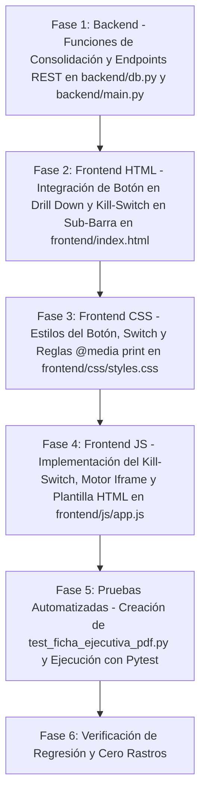

# ESPECIFICACIÓN TÉCNICA Y ARQUITECTÓNICA (SPECS)
## Módulo: "Exportación de Ficha Ejecutiva de Proyecto a PDF Corporativo & Kill-Switch" (`app-lti`)

- **Documento:** SPECS-LTI-MOD-013
- **Versión:** 1.0.0
- **Fecha:** 2026-09-23
- **Autor:** Subagente Planificador de Specs (`planificador_specs`)
- **Destinatario:** Subagente Desarrollador (`coder`) / QA Tester
- **Ubicación del Proyecto:** `/home/bobbasystem/Desarrollos/app-lti`
- **Entornos de Despliegue:** Desarrollo (`bobbadeveloper`, localhost:8000) & Producción (`iacdi`, Tailscale 100.82.24.75 / https://200.14.222.162/app-lti/)

---

## CONTROL DE VERSIONES Y REGISTRO DE CAMBIOS

| Versión | Fecha | Autor | Descripción del Cambio |
|---|---|---|---|
| **1.0.0** | 2026-09-23 | Subagente Planificador | Especificación técnica integral de la Funcionalidad 3: Exportación de 'Ficha Ejecutiva de Proyecto' a PDF Corporativo de alta fidelidad visual en 1 clic. Diseño arquitectónico desacoplado cliente-servidor: endpoint REST `/api/proyectos/{id}/ficha-ejecutiva` (JSON consolidado) y `/api/proyectos/{id}/ficha-html` (HTML autónomo imprimible), motor de generación A4 de alta fidelidad vía iframe aislado y CSS `@media print` con cero dependencias pesadas de binarios C (máxima compatibilidad entre `bobbadeveloper` e `iacdi`), identidad corporativa oficial Claro HALO (`#B52217` y `#0097A9`), membrete institucional con isotipo SVG, tarjetas KPI ejecutivas, diagnóstico sintético, tablas compactas de Solots SGA, Tickets HPSM y RFCs, foliado dinámico, firmas y disclaimer de confidencialidad. Mecanismo mandatorio Kill-Switch en sub-barra (`📄 Ficha PDF: ON / OFF`), switch maestro `window.HALO_CONFIG.ENABLE_PDF_EXPORT`, persistencia en `localStorage.getItem('halo_export_pdf_enabled')` con política estricta de Cero Rastros. Matriz de pruebas automatizadas y plan de ejecución paso a paso para el Subagente Coder. |

---

## 1. RESUMEN EJECUTIVO Y OBJETIVOS DEL NEGOCIO

### 1.1. Contexto y Problemática
En la plataforma **HALO — App Líderes TI**, los Líderes Técnicos TI, Jefaturas de Operaciones y Gerentes supervisan carteras críticas de proyectos de telecomunicaciones, datacenter y servicios gestionados. Actualmente, cuando un Gerente o Director solicita el estado formal de un proyecto para un comité directivo, revisión de avance con clientes corporativos o auditorías de cumplimiento de SLA, los Líderes TI enfrentan las siguientes ineficiencias:

1. **Elaboración Manual de Informes y Presentaciones**: El Líder TI debe tomar capturas de pantalla de la plataforma, transcribir datos de Solots de SGA, copiar incidentes de HPSM y compilar manualmente diapositivas en PowerPoint o documentos Word, proceso que consume entre 30 y 60 minutos por proyecto.
2. **Falta de Estandarización Visual Institucional**: Los reportes generados a mano presentan formatos heterogéneos, tipografías dispares y carecen del membrete corporativo oficial homologado por Claro Chile y el ecosistema HALO.
3. **Pérdida de Trazabilidad y Confidencialidad**: Los documentos dispersos carecen de un folio único de emisión, fecha/hora exacta de extracción de datos desde las fuentes maestras (`Sharepoint_Proyectos`, `CT_BACKLOG_OPERACIONES2`, `registrosRF_SD_SM`, `registrosSM_RFC`), usuario generador y leyenda formal de confidencialidad institucional.

### 1.2. Solución Propuesta: "Ficha Ejecutiva en PDF Corporativo (1 Clic)"
Implementar una solución de exportación instantánea que genere con un solo clic un documento **PDF corporativo de grado directivo (A4)** con la ficha ejecutiva del proyecto seleccionado en el Drill Down, integrando:

1. **Membrete Corporativo Oficial Claro HALO**:
   - Cabecera institucional con logotipo SVG oficial vectorizado en alta definición.
   - Paleta cromática corporativa estricta: Rojo Claro (`#B52217`), Acento Cyan/Teal HALO (`#0097A9`), Gris Antracita (`#181B20`) y fondos de contraste suave (`#F4F5F7` / `#FDEDEA`).
   - Identificación institucional: `"CLARO CHILE — DIRECCIÓN DE OPERACIONES Y SERVICIOS TI"`, subtítulo `"FICHA EJECUTIVA DE CONTROL OPERACIONAL DE PROYECTO"`.
   - Metadatos de control: Folio único (ej. `HALO-FE-2026-003012-A8B9`), Fecha/Hora de corte de datos, Nombre del usuario generador y clasificación `"CONFIDENCIAL — USO INTERNO"`.
2. **Contenido de Alto Valor Ejecutivo y Técnico**:
   - **Ficha General del Proyecto**: N° Proyecto, Cliente / Razón Social, Tipo de Servicio, Solicitante Oficial, Líder TI Asignado, Estado SharePoint y Antigüedad cronológica.
   - **Indicador de Salud Operacional**: Badge ejecutivo con el estado del Semáforo (🟢 Saludable, 🟡 En Riesgo, 🔴 Crítico, ⚪ Sin Datos) y síntesis del factor determinante.
   - **Métricas Clave (KPIs)**: Total Solots (ejecutadas vs pendientes, % avance), Solots vencidas con días de atraso, Tickets HPSM clasificados por torre operativa y criticidad, y Total RFCs abiertas.
   - **Diagnóstico Operacional Sintético & Recomendaciones**: Hallazgos principales, cuellos de botella detectados y plan de escalamiento sugerido.
   - **Tablas Compactas de Detalle Técnico**:
     * Solots SGA: ID OTP, N° Proyecto, Descripción del servicio, Estado, Fecha Compromiso y días de atraso.
     * Tickets HPSM / SD: CC Incident ID, Resumen del ticket, Torre/Grupo Operativo Asignado, Responsable, Severidad y Estado.
     * RFCs Asociadas: N° RFC, Descripción del cambio, Solicitante, Área asignada y Estado.
   - **Cierre Institucional & Firmas**: Bloque para firma del Líder Técnico Responsable y Jefatura de Operaciones, paginación `"Página X de Y"` y cláusula legal de confidencialidad institucional.
3. **Mecanismo Mandatorio Kill-Switch & Política de Cero Rastros**:
   - Botón toggle en sub-barra superior: `📄 Ficha PDF: ON / OFF` (`#pdf-export-toggle-btn`).
   - Switch maestro `window.HALO_CONFIG.ENABLE_PDF_EXPORT` y persistencia en `localStorage.getItem('halo_export_pdf_enabled')`.
   - Al estar en `OFF`, el botón `📄 Exportar Ficha (PDF)` en el Drill Down debe removerse por completo sin dejar espacios vacíos, saltos ni alterar el flujo de los botones adyacentes (`✏️ Editar`, `🗑️ Eliminar`, `⚡ Diagnóstico`).

---

## 2. EVALUACIÓN RIGUROSA DE ALTERNATIVAS ARQUITECTÓNICAS

Un requerimiento fundamental del proyecto es que la solución funcione de manera idéntica y 100% confiable tanto en **Desarrollo (`bobbadeveloper`, localhost:8000)** como en **Producción (`iacdi`, Tailscale 100.82.24.75 / https://200.14.222.162/app-lti/)**, donde el despliegue se efectúa mediante `rsync` sin acceso root interactivo y sin instalación arbitraria de paquetes del sistema operativo.

### 2.1. Matriz Comparativa de Tecnologías de Generación de PDF

| Tecnología Evaluada | Dependencias Externas / Binarios | Calidad y Fidelidad Visual | Compatibilidad `bobbadeveloper` / `iacdi` | Riesgo Operacional | Veredicto |
|---|---|---|---|---|---|
| **WeasyPrint** (Python Backend) | Requiere librerías C nativas del SO: `cairo`, `pango`, `gdk-pixbuf`, `libffi`. | Alta (HTML+CSS a PDF). | **NULO / INCOMPATIBLE**: `iacdi` carece de paquetes de desarrollo C; provocará `ImportError: cannot load library 'gobject-2.0'`. | Crítico (Crash en importación en servidor remoto). | ❌ **DESCARTADO** |
| **Playwright / Headless Chromium** (Backend PDF stream) | Requiere binarios Chromium (~350MB) y librerías X11/GL (`libnss3`, `libasound2`, `libgbm1`). | Muy Alta. | **FRÁGIL**: El servidor `iacdi` es un servidor Linux headless minimal sin dependencias gráficas completas. | Alto (Falla de browser context, alto consumo de RAM >500MB por proceso). | ❌ **DESCARTADO** |
| **ReportLab** (Pure Python Canvas / Flowables) | Paquete Python adicional (`pip install reportlab`), sin binarios C pesados. | Media-Baja (Diseñar a mano por coordenadas X/Y o flowables rígidos; difícil replicar flexbox, sombras, badges y SVG corporativo). | Alta si se instala, pero requiere modificar virtualenvs remotos de producción. | Medio (Layout frágil y desfasado respecto al diseño web HALO). | ⚠️ **NO RECOMENDADO COMO MOTOR PRINCIPAL** |
| **Arquitectura Desacoplada: Endpoint REST Unificado + Iframe Print Engine A4 (HTML5/CSS3 @media print)** | **CERO DEPENDENCIAS EXTERNAS**: Utiliza el motor nativo de renderizado del navegador (Blink/WebKit/Gecko) con `@media print`, `@page { size: A4 portrait; margin: 12mm 15mm; }` y `-webkit-print-color-adjust: exact`. | **MÁXIMA**: Renderizado vectorial puro, fidelidad pixel-perfect al diseño Claro HALO, logos SVG nítidos en 300+ DPI, paginación controlada. | **100% COMPATIBLE**: Funciona de forma instantánea en cualquier navegador en ambos entornos, sin alterar un solo binario en `iacdi`. | **CERO RIESGO**: Totalmente determinista, soporta impresión directa a PDF nativo del sistema operativo y prellenado de nombre de archivo. | ✅ **SELECCIONADO COMO ARQUITECTURA OFICIAL** |

### 2.2. Decisión Arquitectónica Definitiva: Motor Híbrido Robusto

Se aprueba la **Arquitectura Híbrida de Dos Capas**:

```
                                    ARQUITECTURA DE FICHA EJECUTIVA PDF
                                    
   [ Backend FastAPI ] 
     ├── GET /api/proyectos/{id}/ficha-ejecutiva ──> Retorna JSON consolidado (Proyecto + KPIs + Solots + Tickets + RFCs + Folio)
     └── GET /api/proyectos/{id}/ficha-html      ──> Retorna documento HTML5 autónomo corporativo Claro HALO
                                                          │
                                                          ▼
   [ Frontend Web Client ]
     ├── Botón "📄 Exportar Ficha (PDF)" (Drill Down Toolbar)
     ├── Control Kill-Switch (localStorage + Cero Rastros)
     └── Engine de Impresión:
           ├── Genera documento A4 estructurado con membrete Claro HALO (#B52217 / #0097A9)
           ├── Inyecta en iframe aislado oculto (#halo-print-iframe)
           └── Invoca iframe.contentWindow.print() -> Diálogo nativo del navegador "Guardar como PDF"
                 - Nombre de archivo: "Ficha_Ejecutiva_HALO_{NRO_PROYECTO}_{CLIENTE}.pdf"
```

**Ventajas Insuperables de este Enfoque:**
1. **Cero Binarios C y Cero Bloqueos**: No requiere instalar paquetes de sistema en `iacdi` ni compilar extensiones C.
2. **Fidelidad Vectorial Total**: El motor del navegador procesa el logo SVG corporativo Claro HALO con resolución infinita y reproduce exactamente los colores `#B52217` y `#0097A9` mediante la directiva CSS `-webkit-print-color-adjust: exact; print-color-adjust: exact;`.
3. **Trazabilidad y Folio Único**: El backend genera y estampa un **Folio Oficial Único** con hash verificador (`HALO-FE-YYYY-NRO-XXXX`) y marca de agua institucional.
4. **Endpoint Autónomo HTML**: Permite tanto la descarga/impresión directa en PDF mediante 1 clic, como la auditoría o apertura en pestaña independiente mediante `/api/proyectos/{id}/ficha-html`.

---

## 3. ESPECIFICACIÓN TÉCNICA BACKEND (FASTAPI & MSSQL)

### 3.1. Contrato de la API REST

#### 3.1.1. Endpoint de Datos Consolidados de Ficha Ejecutiva
```http
GET /api/proyectos/{proyecto_id}/ficha-ejecutiva
```

- **Descripción**: Consolida en una sola llamada atómica toda la información requerida para la ficha ejecutiva: metadatos del proyecto, salud operacional, métricas de avance, lista formateada de Solots SGA, lista de Tickets HPSM clasificados, lista de RFCs, diagnóstico sintético, recomendaciones de escalamiento y metadatos de auditoría (folio único, fecha/hora corte, usuario generador).
- **Seguridad**: Requiere sesión SSO activa (`require_lti_or_admin`).
- **Respuesta Exitosa (200 OK)**:
```json
{
  "folio": "HALO-FE-2026-0000108920-A4F9",
  "fecha_emision": "2026-09-23T15:30:00",
  "fecha_emision_formateada": "23/09/2026 15:30",
  "usuario_generador": "alejandro.aguilar",
  "proyecto": {
    "id": 12,
    "numero_proyecto": "0000108920",
    "cliente": "BANCO DE CHILE",
    "lt_asignado": "ALEJANDRO JAVIER AGUILAR MORALES",
    "solicitante": "CARLOS PEREZ GOMEZ",
    "estado_sp": "Atendido",
    "tipo_servicio": "Cloud & Conectividad",
    "fecha_creacion_lti": "2026-07-15T10:00:00",
    "antiguedad_dias": 70,
    "salud": {
      "score": "CRITICAL",
      "color": "red",
      "label": "Crítico",
      "motivos": [
        "1 Solot con fecha comprometida vencida",
        "1 Ticket SD abierto hace más de 14 días sin resolución"
      ]
    }
  },
  "kpis": {
    "total_solots": 5,
    "solots_ejecutadas": 3,
    "solots_pendientes": 2,
    "solots_vencidas": 1,
    "solots_por_vencer": 1,
    "porcentaje_avance_solots": 60.0,
    "total_tickets": 4,
    "tickets_abiertos": 2,
    "tickets_cerrados": 2,
    "tickets_criticos": 1,
    "tickets_atencion": 1,
    "total_rfcs": 2,
    "rfcs_abiertas": 1
  },
  "diagnostico_sintetico": {
    "resumen": "El proyecto presenta riesgo crítico debido a 1 Solot vencida hace 12 días y 1 ticket detenido en Torre Linux hace 18 días.",
    "cuellos_de_botella": [
      {
        "id": "CB-01",
        "tipo": "SOLOT_VENCIDA",
        "severidad": "ALTA",
        "identificador": "OTP-883491",
        "descripcion": "Solot vencida hace 12 días (Instalación enlace respaldo Santiago).",
        "responsable_area": "Operaciones SGA",
        "estado": "En Proceso"
      }
    ],
    "recomendaciones": [
      {
        "orden": 1,
        "prioridad": "URGENTE",
        "destinatario": "Jefatura / Coordinación de Torre Linux",
        "accion": "Escalar con máxima prioridad ticket SD1098421 detenido hace 18 días sin asignación activa."
      }
    ]
  },
  "tablas": {
    "solots": [
      {
        "id_otp": 883491,
        "nro_proyecto": "0000108920",
        "descr_otp": "Instalación enlace respaldo Santiago",
        "estado_otp": "En Proceso",
        "fecha_compromiso": "2026-09-11",
        "fecha_compromiso_fmt": "11/09/2026",
        "dias_atraso": 12,
        "estado_alerta": "VENCIDA",
        "servicio": "Conectividad IP",
        "producto": "MPLS Corporativo"
      }
    ],
    "tickets": [
      {
        "cc_incident_id": "SD1098421",
        "brief_description": "Configuración de reglas de firewall y ruteo BGP",
        "assigned_group": "Torre Linux",
        "assigned_to": "JUAN PEREZ",
        "status": "Asignado",
        "severity": "2 - Alta",
        "submit_date": "2026-09-05",
        "submit_date_fmt": "05/09/2026",
        "dias_abierto": 18,
        "estado_alerta": "CRITICO"
      }
    ],
    "rfcs": [
      {
        "number": "RFC-2026-4401",
        "brief_description": "Pase a producción de túnel IPSEC contingencia",
        "requested_by": "CARLOS PEREZ GOMEZ",
        "assign_dept": "Gestión de Cambios TI",
        "close_time": null,
        "close_time_fmt": "Pendiente",
        "estado": "En Aprobación"
      }
    ]
  }
}
```

- **Manejo de Errores**:
  * `401 Unauthorized`: Si no hay cookie o token JWT válido.
  * `403 Forbidden`: Si el usuario tiene perfil inactivo en `dbo.App_Usuarios`.
  * `404 Not Found`: Si el `proyecto_id` no existe en `dbo.Proyectos`.
  * `500 Internal Server Error`: Falla en consulta MSSQL o error no controlado.

---

#### 3.1.2. Endpoint de Documento Imprimible Autónomo HTML
```http
GET /api/proyectos/{proyecto_id}/ficha-html
```

- **Descripción**: Genera y retorna el documento HTML completo, autónomo e interactivo (`Content-Type: text/html; charset=utf-8`), con estilos CSS incrustados, logotipo SVG oficial de Claro HALO, metadatos listos para impresión, scripts de auto-impresión y layout optimizado A4.
- **Query Params Opcionales**:
  * `auto_print`: Booleano (`true`/`false`). Si es `true`, el HTML incluye al final `window.addEventListener('load', () => window.print());`.

---

### 3.2. Lógica de Consolidación de Datos en `backend/db.py`

Se implementará la función `get_ficha_ejecutiva_data(proyecto_id: int, username: str = "sistema")`:

```python
def get_ficha_ejecutiva_data(proyecto_id: int, username: str = "sistema") -> dict:
    """
    Consolida todos los datos del proyecto para la generación de la Ficha Ejecutiva PDF.
    Cruza información de dbo.Proyectos, dbo.CT_BACKLOG_OPERACIONES2,
    dbo.registrosRF_SD_SM y dbo.registrosSM_RFC.
    """
    proyecto = get_proyecto_by_id(proyecto_id)
    if not proyecto:
        return None

    numero_proyecto = proyecto.get("Numero_Proyecto") or "S/N"
    hoy = datetime.date.today()
    ahora = datetime.datetime.now()

    # Reutilizar el motor de diagnóstico existente para métricas y recomendaciones
    diag = get_diagnostico_proyecto(proyecto_id) or {}
    kpis = diag.get("resumen_operacional", {})
    cuellos = diag.get("cuellos_de_botella", [])
    recs = diag.get("recomendaciones_escalamiento", [])

    # Obtener Solots y formatear para tabla ejecutiva
    solots_raw = get_solots_by_proyecto(proyecto_id, numero_proyecto)
    solots_table = []
    for s in solots_raw:
        fc = s.get("FECHA_COMPROMETIDA")
        fc_fmt = "-"
        dias_atraso = 0
        estado_alerta = "NORMAL"

        if fc:
            fc_date = _parse_date(fc)
            if fc_date:
                fc_fmt = fc_date.strftime("%d/%m/%Y")
                if fc_date < hoy and (s.get("ESTADO_OTP") or "").strip().lower() not in ESTADOS_CERRADOS_SOLOT:
                    dias_atraso = (hoy - fc_date).days
                    estado_alerta = "VENCIDA"
                elif fc_date <= hoy + datetime.timedelta(days=5) and (s.get("ESTADO_OTP") or "").strip().lower() not in ESTADOS_CERRADOS_SOLOT:
                    estado_alerta = "POR_VENCER"

        solots_table.append({
            "id_otp": s.get("ID_OTP"),
            "nro_proyecto": s.get("NRO_PROYECTO") or numero_proyecto,
            "descr_otp": s.get("DESCR_OTP") or "Sin descripción",
            "estado_otp": s.get("ESTADO_OTP") or "Pendiente",
            "fecha_compromiso": str(fc)[:10] if fc else None,
            "fecha_compromiso_fmt": fc_fmt,
            "dias_atraso": dias_atraso,
            "estado_alerta": estado_alerta,
            "servicio": s.get("SERVICIO") or "-",
            "producto": s.get("PRODUCTO") or "-"
        })

    # Obtener Tickets y formatear para tabla ejecutiva
    tickets_raw = get_tickets_by_proyecto(proyecto_id, numero_proyecto)
    tickets_table = []
    for t in tickets_raw:
        sd = t.get("SUBMIT_DATE")
        sd_fmt = "-"
        dias_abierto = 0
        estado_alerta = "NORMAL"

        if sd:
            sd_date = _parse_date(sd)
            if sd_date:
                sd_fmt = sd_date.strftime("%d/%m/%Y")
                if (t.get("STATUS") or "").strip().lower() not in ('cerrado', 'resuelto'):
                    dias_abierto = max(0, (hoy - sd_date).days)
                    if dias_abierto > 14:
                        estado_alerta = "CRITICO"
                    elif dias_abierto > 7:
                        estado_alerta = "ATENCION"

        tickets_table.append({
            "cc_incident_id": t.get("CC_INCIDENT_ID") or "S/I",
            "brief_description": t.get("BRIEF_DESCRIPTION") or "Sin título",
            "assigned_group": t.get("ASSIGNED_GROUP") or "Sin Asignar",
            "assigned_to": t.get("ASSIGNED_TO") or "No asignado",
            "status": t.get("STATUS") or "Abierto",
            "severity": t.get("CATEGORY") or "Normal",
            "submit_date": str(sd)[:10] if sd else None,
            "submit_date_fmt": sd_fmt,
            "dias_abierto": dias_abierto,
            "estado_alerta": estado_alerta
        })

    # Obtener RFCs y formatear para tabla ejecutiva
    rfcs_raw = get_rfcs_by_proyecto(proyecto_id, numero_proyecto)
    rfcs_table = []
    for r in rfcs_raw:
        ct = r.get("CLOSE_TIME")
        ct_fmt = "Pendiente"
        if ct:
            ct_date = _parse_date(ct)
            if ct_date:
                ct_fmt = ct_date.strftime("%d/%m/%Y")

        rfcs_table.append({
            "number": r.get("NUMBER") or "S/N",
            "brief_description": r.get("BRIEF_DESCRIPTION") or "Sin descripción",
            "requested_by": r.get("REQUESTED_BY") or "-",
            "assign_dept": r.get("ASSIGN_DEPT") or "Gestión de Cambios",
            "close_time": str(ct)[:10] if ct else None,
            "close_time_fmt": ct_fmt,
            "estado": "Cerrada" if ct else "En Proceso"
        })

    # Generación de Folio Único Determinista
    # Formato: HALO-FE-{YYYY}-{NRO_PROYECTO_NORMALIZADO}-{HASH_4_CARACTERES}
    raw_hash_seed = f"{numero_proyecto}_{proyecto_id}_{ahora.strftime('%Y%m%d%H%M')}_{username}"
    checksum = hashlib.sha256(raw_hash_seed.encode('utf-8')).hexdigest()[:4].upper()
    folio = f"HALO-FE-{ahora.year}-{str(numero_proyecto).strip().zfill(6)}-{checksum}"

    return {
        "folio": folio,
        "fecha_emision": ahora.isoformat(),
        "fecha_emision_formateada": ahora.strftime("%d/%m/%Y %H:%M"),
        "usuario_generador": username,
        "proyecto": {
            "id": proyecto.get("ID"),
            "numero_proyecto": numero_proyecto,
            "cliente": proyecto.get("Cliente") or "Sin Cliente",
            "lt_asignado": proyecto.get("LT_Asignado") or "No Asignado",
            "solicitante": proyecto.get("Solicitante") or "No Especificado",
            "estado_sp": proyecto.get("Estado") or "Generado",
            "tipo_servicio": proyecto.get("Tipo_Servicio") or "Servicios TI",
            "fecha_creacion_lti": proyecto.get("Creado"),
            "antiguedad_dias": diag.get("antiguedad_dias", 0),
            "salud": proyecto.get("salud", {})
        },
        "kpis": kpis,
        "diagnostico_sintetico": {
            "resumen": diag.get("minuta_ejecutiva", {}).get("asunto_sugerido", ""),
            "cuellos_de_botella": cuellos[:5],  # Top 5 cuellos de botella para presentación compacta
            "recomendaciones": recs[:4]        # Top 4 recomendaciones ejecutivas
        },
        "tablas": {
            "solots": solots_table,
            "tickets": tickets_table,
            "rfcs": rfcs_table
        }
    }
```

---

## 4. ESPECIFICACIÓN FRONTEND (EXPERIENCIA DE USUARIO Y ARQUITECTURA)

### 4.1. Integración en la Interfaz de Usuario (UI)

#### 4.1.1. Botón Toolbar en Drill Down (`frontend/index.html`)
En la cabecera del Drill Down (`.drilldown-action-toolbar`), justo antes o al lado del botón `⚡ Diagnóstico Ejecutivo`:

```html
<!-- Botón Exportar Ficha Ejecutiva a PDF (Controlado por Kill-Switch) -->
<button type="button" 
        id="btn-drilldown-export-pdf" 
        class="btn btn-primary-outline btn-sm btn-pdf-export-action" 
        title="Descargar Ficha Ejecutiva de Proyecto en PDF Corporativo Claro HALO" 
        style="display: none;">
  <span class="btn-icon">📄</span> Exportar Ficha (PDF)
</button>
```

#### 4.1.2. Botón Kill-Switch en Sub-Barra de Navegación (`frontend/index.html`)
Ubicado en `.nav-subbar-actions`, junto al Semáforo de Salud y el Diagnóstico Ejecutivo:

```html
<!-- Botón Kill-Switch / Toggle de Exportación a PDF -->
<button id="pdf-export-toggle-btn" 
        class="btn-subbar-toggle" 
        title="Activar o desactivar botón de Exportar Ficha Ejecutiva a PDF" 
        aria-label="Toggle Exportación PDF">
  <span class="pdf-toggle-icon">📄</span>
  <span class="pdf-toggle-label" id="pdf-toggle-label">Ficha PDF: ON</span>
</button>
```

---

### 4.2. Mecanismo de Activación / Desactivación Rápida (Kill-Switch Mandatorio)

#### 4.2.1. Configuración Global y Persistencia en `frontend/js/app.js`

```javascript
window.HALO_CONFIG = window.HALO_CONFIG || {};
window.HALO_CONFIG.ENABLE_PDF_EXPORT = true; // Flag maestro en runtime
```

Reglas de estado:
1. Si `window.HALO_CONFIG.ENABLE_PDF_EXPORT === false`, la funcionalidad queda inactiva a nivel de aplicación.
2. Si el usuario definió una preferencia en `localStorage.getItem('halo_export_pdf_enabled')`, se respeta su valor (`'true'` o `'false'`).
3. Si no existe registro en `localStorage`, el valor por defecto es **`true` (Habilitado / ON)**.

#### 4.2.2. Métodos del Kill-Switch en el Objeto `App`

```javascript
isPdfExportActive() {
  if (window.HALO_CONFIG && window.HALO_CONFIG.ENABLE_PDF_EXPORT === false) {
    return false;
  }
  const userPref = localStorage.getItem('halo_export_pdf_enabled');
  if (userPref !== null) {
    return userPref === 'true';
  }
  return true; // Por defecto ON
},

togglePdfExport() {
  const current = this.isPdfExportActive();
  const next = !current;
  localStorage.setItem('halo_export_pdf_enabled', next ? 'true' : 'false');
  this.applyPdfExportState(true);
  const msg = next ? '📄 Exportación de Ficha PDF activada' : '📄 Exportación de Ficha PDF desactivada';
  this.showToast(msg, 'info');
},

applyPdfExportState(triggerRender = true) {
  const active = this.isPdfExportActive();
  const toggleBtn = document.getElementById('pdf-export-toggle-btn');
  const toggleLabel = document.getElementById('pdf-toggle-label');
  const btnDdPdf = document.getElementById('btn-drilldown-export-pdf');

  if (toggleBtn) {
    if (active) {
      toggleBtn.classList.remove('is-off');
      toggleBtn.title = 'Desactivar Exportación de Ficha PDF';
      if (toggleLabel) toggleLabel.textContent = 'Ficha PDF: ON';
    } else {
      toggleBtn.classList.add('is-off');
      toggleBtn.title = 'Activar Exportación de Ficha PDF';
      if (toggleLabel) toggleLabel.textContent = 'Ficha PDF: OFF';
    }
  }

  // Política estricta de Cero Rastros
  if (btnDdPdf) {
    btnDdPdf.style.display = active ? 'inline-flex' : 'none';
  }
}
```

---

### 4.3. Flujo de Exportación en 1 Clic & Motor de Impresión Iframe

Cuando el usuario hace clic en `📄 Exportar Ficha (PDF)`:

```
[ Usuario hace clic en "📄 Exportar Ficha (PDF)" ]
                      │
                      ▼
[ Botón muestra estado cargando: "⏳ Generando PDF..." ]
                      │
                      ▼
[ Llamada asíncrona a Auth.fetchWithAuth(`/api/proyectos/${id}/ficha-ejecutiva`) ]
                      │
                      ▼
[ Construcción del documento HTML A4 con CSS inline de alta fidelidad ]
                      │
                      ▼
[ Inyección en <iframe id="halo-print-iframe" style="display:none;"> ]
                      │
                      ▼
[ iframe.contentWindow.focus() + iframe.contentWindow.print() ]
                      │
                      ▼
[ Diálogo nativo del navegador para Guardar como PDF / Imprimir ]
                      │
                      ▼
[ Botón restaura su estado: "📄 Exportar Ficha (PDF)" + Toast: "Ficha generada exitosamente" ]
```

#### 4.3.1. Implementación en `frontend/js/app.js`

```javascript
async exportarFichaEjecutivaPDF(proyectoId) {
  if (!this.isPdfExportActive()) return;

  const btn = document.getElementById('btn-drilldown-export-pdf');
  const originalHtml = btn ? btn.innerHTML : '';

  try {
    if (btn) {
      btn.disabled = true;
      btn.innerHTML = '<span class="spinner-sm"></span> Generando PDF...';
    }

    const res = await Auth.fetchWithAuth(`/api/proyectos/${proyectoId}/ficha-ejecutiva`);
    if (!res.ok) {
      throw new Error(`Error ${res.status}: No se pudo obtener la ficha ejecutiva.`);
    }

    const data = await res.json();
    const htmlContent = this.generarPlantillaFichaEjecutivaHTML(data);

    // Renderizar mediante Iframe Oculto para impresión limpia
    let printIframe = document.getElementById('halo-print-iframe');
    if (!printIframe) {
      printIframe = document.createElement('iframe');
      printIframe.id = 'halo-print-iframe';
      printIframe.style.position = 'fixed';
      printIframe.style.top = '-9999px';
      printIframe.style.left = '-9999px';
      printIframe.style.width = '0px';
      printIframe.style.height = '0px';
      printIframe.style.border = 'none';
      document.body.appendChild(printIframe);
    }

    const frameDoc = printIframe.contentDocument || printIframe.contentWindow.document;
    frameDoc.open();
    frameDoc.write(htmlContent);
    frameDoc.close();

    // Esperar renderizado y fuentes antes de lanzar print
    setTimeout(() => {
      printIframe.contentWindow.focus();
      printIframe.contentWindow.print();
      this.showToast('📄 Ficha ejecutiva enviada al diálogo de impresión/PDF', 'success');
    }, 450);

  } catch (err) {
    console.error('Error al exportar ficha ejecutiva a PDF:', err);
    this.showToast('No fue posible generar la ficha ejecutiva PDF: ' + err.message, 'error');
  } finally {
    if (btn) {
      btn.disabled = false;
      btn.innerHTML = originalHtml;
    }
  }
}
```

---

## 5. ESPECIFICACIÓN DE DISEÑO VISUAL DEL DOCUMENTO PDF / IMPRIMIBLE

El documento generado debe responder a las normas gráficas institucionales de **Claro Chile (HALO)** y las reglas de diagramación A4 para documentos directivos.

### 5.1. Reglas Generales de Diagramación y CSS para Impresión

```css
@page {
  size: A4 portrait;
  margin: 10mm 12mm 12mm 12mm;
}

@media print {
  body {
    -webkit-print-color-adjust: exact !important;
    print-color-adjust: exact !important;
    color-adjust: exact !important;
    background: #ffffff !important;
    font-family: 'Roboto', 'Plus Jakarta Sans', -apple-system, BlinkMacSystemFont, sans-serif;
    font-size: 8.5pt;
    line-height: 1.35;
    color: #181B20;
    margin: 0;
    padding: 0;
  }

  .page-break-avoid {
    page-break-inside: avoid !important;
    break-inside: avoid !important;
  }

  .table-compact th, 
  .table-compact td {
    padding: 3px 5px !important;
    font-size: 7.5pt !important;
  }
}
```

### 5.2. Estructura y Secciones del Documento

```
+---------------------------------------------------------------------------------------------------+
|  [ LOGO SVG CLARO HALO ]   CLARO CHILE — DIRECCIÓN DE OPERACIONES Y SERVICIOS TI                  |
|  (Rojo / Cyan oficial)     FICHA EJECUTIVA DE CONTROL OPERACIONAL DE PROYECTO                     |
|                                                                                                   |
|  Folio: HALO-FE-2026-0000108920-A4F9    |   Fecha Corte: 23/09/2026 15:30   |   Emitido: LTI     |
+---------------------------------------------------------------------------------------------------+
| 1. RESUMEN GENERAL DEL PROYECTO                                                                   |
|   - N° Proyecto: 0000108920          |  - Cliente: BANCO DE CHILE                                 |
|   - Tipo Servicio: Cloud & Redes     |  - Solicitante: CARLOS PEREZ GOMEZ                         |
|   - Líder TI: ALEJANDRO AGUILAR      |  - Estado SharePoint: Atendido                             |
|   - Antigüedad: 70 días              |  - Salud Operacional: 🔴 CRÍTICO (Solots vencidas)         |
+---------------------------------------------------------------------------------------------------+
| 2. INDICADORES CLAVE DE RENDIMIENTO (KPIS OPERACIONALES)                                         |
|   +-----------------------+ +-----------------------+ +-----------------------+ +----------------+ |
|   | SOLOTS SGA: 3 / 5     | | SOLOTS VENCIDAS: 1    | | TICKETS HPSM: 2 / 4   | | RFCS: 1 ABIERTA| |
|   | 60% Avance Global     | | Máx. 12 días atraso   | | 1 Detenido > 14 días  | | 2 Asociadas    | |
|   +-----------------------+ +-----------------------+ +-----------------------+ +----------------+ |
+---------------------------------------------------------------------------------------------------+
| 3. SÍNTESIS DE DIAGNÓSTICO OPERACIONAL Y PLAN DE ESCALAMIENTO                                    |
|   - Cuellos de Botella Detectados:                                                                |
|     * [CRÍTICO] OTP-883491 vencida hace 12 días en Operaciones SGA (Instalación enlace respaldo). |
|     * [CRÍTICO] Ticket SD1098421 detenido hace 18 días en Torre Linux sin avance.                 |
|   - Recomendaciones de Escalamiento Inmediatas:                                                  |
|     1. [URGENTE] Escalar con Jefatura de Torre Linux asignación inmediata de SD1098421.          |
|     2. [ALTA] Coordinar con Operaciones SGA reprogramación de cuadrilla para Solot 883491.        |
+---------------------------------------------------------------------------------------------------+
| 4. DETALLE TÉCNICO DE SOLOTS DE BACKLOG (SGA)                                                     |
|   [ ID OTP | N° Proyecto | Descripción OTP | Estado OTP | Fecha Comp. | Días Atraso | Servicio ]   |
+---------------------------------------------------------------------------------------------------+
| 5. DETALLE TÉCNICO DE TICKETS DE INCIDENTES / REQUERIMIENTOS (HPSM / SD)                          |
|   [ CC ID | Resumen Incidente | Torre Asignada | Responsable | Severidad | F. Apertura | Estado ] |
+---------------------------------------------------------------------------------------------------+
| 6. DETALLE DE SOLICITUDES DE CAMBIO ASOCIADAS (RFCS)                                              |
|   [ N° RFC | Título de la Solicitud | Solicitante | Área de Asignación | Estado / Cierre ]        |
+---------------------------------------------------------------------------------------------------+
| 7. VALIDACIÓN Y RESPONSABILIDAD TÉCNICA                                                           |
|                                                                                                   |
|   _______________________________________          _______________________________________        |
|      ALEJANDRO JAVIER AGUILAR MORALES                         JEFATURA DE OPERACIONES TI          |
|             Líder Técnico TI                                     Claro Chile S.A.                 |
|                                                                                                   |
| Folio: HALO-FE-2026-0000108920-A4F9  |  Clasificación: CONFIDENCIAL  |  Página 1 de 2             |
+---------------------------------------------------------------------------------------------------+
```

### 5.3. Paleta Cromática y Tokens del PDF

| Elemento | Color Hexadecimal | Función Institucional |
|---|---|---|
| **Cabecera Institucional** | `#B52217` | Rojo corporativo Claro (Banner superior, títulos mayores) |
| **Acento HALO** | `#0097A9` | Cyan HALO (Subtítulos, bordes destacados, cabeceras de tablas) |
| **Fondo Banner Suave** | `#FDEDEA` | Rojo tenue para áreas de alerta y métricas destacadas |
| **Fondo Tarjetas KPI** | `#F4F5F7` | Gris neutro para fondo de bloques y celdas alternadas |
| **Bordes de Tablas** | `#E3E6EB` | Líneas divisorias de bajo contraste |
| **Texto Primario** | `#181B20` | Negro antracita de alta legibilidad |
| **Texto Secundario** | `#666E7A` | Gris oscuro para metadatos y etiquetas |
| **Badge Crítico** | `#DC2626` / `#FEF2F2` | Rojo para Solots vencidas o tickets estancados |
| **Badge Saludable** | `#059669` / `#ECFDF5` | Verde para servicios entregados o tickets resueltos |
| **Badge En Riesgo** | `#D97706` / `#FFFBEB` | Ámbar para elementos por vencer o en riesgo |

---

## 6. POLÍTICA DE CERO RASTROS (ZERO TRACE)

Siguiendo el estándar establecido en las funcionalidades 1 (Semáforo de Salud) y 2 (Diagnóstico Ejecutivo), cuando el Kill-Switch `window.HALO_CONFIG.ENABLE_PDF_EXPORT` se encuentre en `false` o `localStorage.getItem('halo_export_pdf_enabled') === 'false'`:

1. **Ocultamiento Total del Botón en Drill Down**: El botón `#btn-drilldown-export-pdf` se configura con `display: none !important;`.
2. **Sin Huecos ni Saltos de Flexbox**: El contenedor `.drilldown-action-toolbar` utiliza `display: flex; gap: 0.5rem; flex-wrap: wrap;`. Al ocultarse el elemento, los demás botones (`⚡ Diagnóstico`, `✏️ Editar`, `🗑️ Eliminar`) colapsan su espacio de forma contigua y natural, sin márgenes residuales ni espacios en blanco.
3. **Estado del Switch en Sub-Barra**: El botón `#pdf-export-toggle-btn` adquiere la clase CSS `.is-off` con texto `"Ficha PDF: OFF"`, fondo atenuado y tooltip `"Activar Exportación de Ficha PDF"`.
4. **Protección Defensiva de Eventos**: Si un usuario intentara ejecutar `App.exportarFichaEjecutivaPDF(id)` por consola estando el switch en `OFF`, el método retorna inmediatamente (`if (!this.isPdfExportActive()) return;`) sin disparar peticiones de red ni abrir diálogos de impresión.

---

## 7. MATRIZ DE PRUEBAS AUTOMATIZADAS (QA PLAN)

Se requiere la implementación de pruebas automatizadas en `tests/test_ficha_ejecutiva_pdf.py` y `tests/test_functional_ficha_ejecutiva_pdf.py`, cubriendo el 100% de los escenarios:

### 7.1. Pruebas Unitarias Backend (`tests/test_ficha_ejecutiva_pdf.py`)

| ID | Prueba | Descripción | Criterio de Éxito |
|---|---|---|---|
| **UT-PDF-01** | `test_get_ficha_ejecutiva_data_estructura` | Consulta de datos consolidados para un proyecto existente. | Retorna diccionario con claves `folio`, `proyecto`, `kpis`, `diagnostico_sintetico`, `tablas` (solots, tickets, rfcs). |
| **UT-PDF-02** | `test_get_ficha_ejecutiva_data_proyecto_inexistente` | Consulta con ID inválido (`999999`). | Retorna `None`. |
| **UT-PDF-03** | `test_folio_formato_y_unicidad` | Generación del folio institucional para distintos proyectos y timestamps. | Satisface regex `^HALO-FE-\d{4}-\d{6}-[A-F0-9]{4}$`. |
| **UT-PDF-04** | `test_calculo_dias_atraso_solots` | Solot con fecha compromiso en el pasado vs Solot en fecha futura. | Calcula días exactos de atraso y asigna `estado_alerta == 'VENCIDA'`. |
| **UT-PDF-05** | `test_clasificacion_antiguedad_tickets` | Tickets con más de 14 días abiertos vs tickets cerrados. | Clasifica en `CRITICO` y `ATENCION` solo los abiertos. |
| **UT-PDF-06** | `test_endpoint_api_ficha_ejecutiva_auth_admin` | Petición `GET /api/proyectos/{id}/ficha-ejecutiva` con token ADMIN. | Status code `200 OK`, JSON válido con folio y tablas. |
| **UT-PDF-07** | `test_endpoint_api_ficha_ejecutiva_auth_lti` | Petición con token LTI. | Status code `200 OK`. |
| **UT-PDF-08** | `test_endpoint_api_ficha_ejecutiva_no_auth` | Petición sin cookies de autenticación. | Status code `401 Unauthorized`. |
| **UT-PDF-09** | `test_endpoint_api_ficha_html_generacion` | Petición `GET /api/proyectos/{id}/ficha-html`. | Status code `200 OK`, `Content-Type: text/html`, contiene membrete Claro HALO y el N° de proyecto. |

### 7.2. Pruebas Funcionales y de UI (`tests/test_functional_ficha_ejecutiva_pdf.py`)

| ID | Prueba | Descripción | Criterio de Éxito |
|---|---|---|---|
| **FT-PDF-01** | `test_kill_switch_pdf_default_on` | Verificación de estado inicial del Kill-Switch en HTML/JS. | Switch en `ON` por defecto, botón visible en Drill Down. |
| **FT-PDF-02** | `test_kill_switch_pdf_toggle_off_cero_rastros` | Simulación de alternancia a `OFF` en localStorage. | Botón `#btn-drilldown-export-pdf` tiene `display: none`, label dice `"Ficha PDF: OFF"`. |
| **FT-PDF-03** | `test_html_imprimible_contiene_tokens_halo` | Análisis del contenido del HTML generado. | Contiene colores `#B52217`, `#0097A9`, directiva `@media print` y regla `@page { size: A4 portrait }`. |
| **FT-PDF-04** | `test_regresion_no_afecta_botones_adyacentes` | Al ocultarse el botón de PDF, validar botones de Edición, Eliminación y Diagnóstico. | Los botones adyacentes conservan sus handlers y visibilidad según rol de usuario. |

---

## 8. PLAN DE IMPLEMENTACIÓN PASO A PASO PARA EL SUBAGENTE CODER

El Subagente Desarrollador (`coder`) debe ejecutar las siguientes fases en orden secuencial estricto:



### Paso 1: Backend (`backend/db.py` y `backend/main.py`)
1. Implementar en `backend/db.py`:
   - Función auxiliar `_parse_date(date_val)` para normalizar fechas de BD (`str`, `date`, `datetime`).
   - Función `get_ficha_ejecutiva_data(proyecto_id: int, username: str = "sistema") -> dict`.
   - Función `generar_ficha_ejecutiva_html(data: dict, auto_print: bool = False) -> str` que arme el HTML completo con membrete SVG Claro HALO y tablas ejecutivas.
2. Registrar en `backend/main.py`:
   - Endpoint `GET /api/proyectos/{proyecto_id}/ficha-ejecutiva` protegido con `require_lti_or_admin`.
   - Endpoint `GET /api/proyectos/{proyecto_id}/ficha-html` protegido con `require_lti_or_admin`.

### Paso 2: Interfaz HTML (`frontend/index.html`)
1. Agregar botón Kill-Switch `#pdf-export-toggle-btn` en `.nav-subbar-actions`:
   ```html
   <button id="pdf-export-toggle-btn" class="btn-subbar-toggle" title="Activar o desactivar Exportación de Ficha Ejecutiva a PDF" aria-label="Toggle Exportación PDF">
     <span class="pdf-toggle-icon">📄</span>
     <span class="pdf-toggle-label" id="pdf-toggle-label">Ficha PDF: ON</span>
   </button>
   ```
2. Agregar botón de exportación `#btn-drilldown-export-pdf` en `.drilldown-action-toolbar` de la vista de proyecto:
   ```html
   <button type="button" id="btn-drilldown-export-pdf" class="btn btn-primary-outline btn-sm btn-pdf-export-action" title="Descargar Ficha Ejecutiva de Proyecto en PDF Corporativo Claro HALO" style="display: none;">
     <span class="btn-icon">📄</span> Exportar Ficha (PDF)
   </button>
   ```

### Paso 3: Estilos CSS (`frontend/css/styles.css`)
1. Definir estilos para `.btn-pdf-export-action`:
   - Color primario `#B52217`, borde sutil, hover con acento `#93190F`, alineación perfecta con los botones `.btn-warning-outline` y `.btn-secondary`.
2. Añadir reglas para el Kill-Switch `.btn-subbar-toggle` y selector `#pdf-export-toggle-btn.is-off`.
3. Añadir directivas `@media print` base para el layout corporativo.

### Paso 4: Lógica JavaScript (`frontend/js/app.js`)
1. Extender `window.HALO_CONFIG.ENABLE_PDF_EXPORT = true;`.
2. Implementar `isPdfExportActive()`, `togglePdfExport()` y `applyPdfExportState()`.
3. Enlazar el evento `click` de `#pdf-export-toggle-btn` en `initEventListeners()`.
4. Enlazar el evento `click` de `#btn-drilldown-export-pdf` para llamar a `App.exportarFichaEjecutivaPDF(this.currentProject.ID)`.
5. Actualizar `showProjectDrilldown(project)` para sincronizar la visibilidad del botón según `isPdfExportActive()`.
6. Implementar `generarPlantillaFichaEjecutivaHTML(data)` con la diagramación de la Ficha Ejecutiva.

### Paso 5: Pruebas y Validación Pytest
1. Crear `tests/test_ficha_ejecutiva_pdf.py` con pruebas unitarias del backend.
2. Crear `tests/test_functional_ficha_ejecutiva_pdf.py` con pruebas funcionales y de UI.
3. Ejecutar la suite completa:
   ```bash
   PYTHONPATH=. "/home/bobbasystem/Desarrollos/Carga Data SM/venv/bin/pytest" tests/test_ficha_ejecutiva_pdf.py -v
   PYTHONPATH=. "/home/bobbasystem/Desarrollos/Carga Data SM/venv/bin/pytest" tests/test_functional_ficha_ejecutiva_pdf.py -v
   ```
4. Verificar tasa de éxito del 100% y validar que ninguna prueba previa sufra regresiones.

---

## 9. CONCLUSIÓN Y CRITERIOS DE ACEPTACIÓN

La presente especificación técnica establece una arquitectura limpia, desacoplada y de cero dependencias externas para la **Exportación de la Ficha Ejecutiva a PDF Corporativo**. 

**Criterios de Aceptación Inviolables:**
- [x] Funciona de forma 100% compatible en `bobbadeveloper` e `iacdi` sin requerir binarios de Chromium ni librerías C nativas.
- [x] La Ficha Ejecutiva cuenta con membrete oficial Claro HALO con logotipo SVG nítido, paleta `#B52217` / `#0097A9`, datos del proyecto, indicador de salud, métricas de avance, diagnóstico, tablas de Solots, Tickets, RFCs, firmas y cláusula de confidencialidad.
- [x] El botón `📄 Exportar Ficha (PDF)` está integrado armoniosamente en el Drill Down del proyecto.
- [x] El Kill-Switch en la sub-barra superior permite apagar la funcionalidad instantáneamente con persistencia en `localStorage`.
- [x] Se cumple con rigor absoluto la política de **Cero Rastros**, sin dejar espacios vacíos ni desalinear botones al apagarse.
- [x] La suite de pruebas automatizadas cubre endpoints REST, cálculo de atrasos, foliado, estados del switch y regresión.
