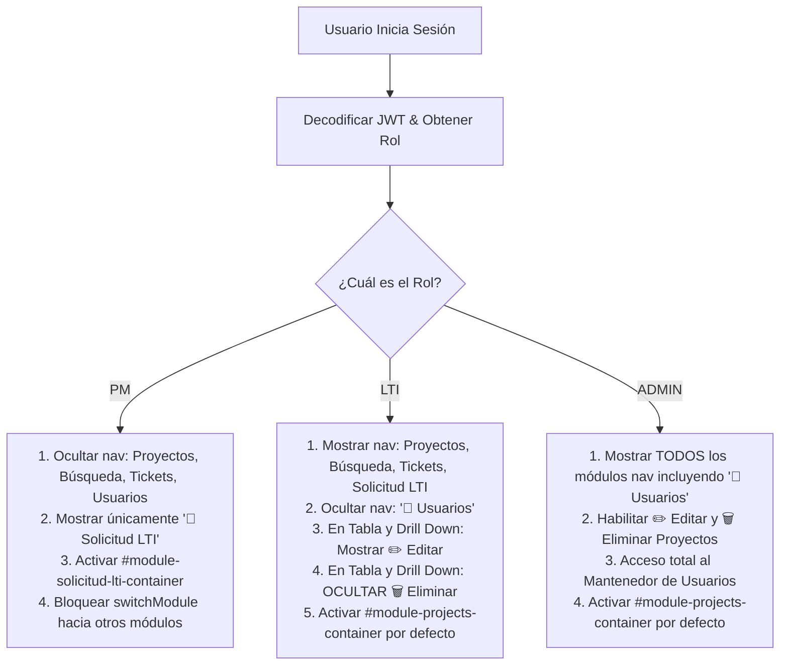

# ESPECIFICACIÓN TÉCNICA Y FUNCIONAL (SPECS)
## Módulo: "Gestión de Usuarios, Control de Acceso Basado en Roles (RBAC) y Mantenedor de Usuarios" — Portal App LTI (`app-lti`)

- **Documento:** SPECS-LTI-MOD-006
- **Versión:** 1.0.0
- **Fecha:** 2026-08-26
- **Autor:** Subagente Planificador & Arquitecto de Software
- **Destinatario:** Subagente Implementador & Equipo de Desarrollo
- **Ubicación del Proyecto:** `/home/bobbasystem/Desarrollos/app-lti`

---

## CONTROL DE VERSIONES Y REGISTRO DE CAMBIOS

| Versión | Fecha | Autor | Descripción del Cambio |
|---|---|---|---|
| **1.0.0** | 2026-08-26 | Subagente Planificador | Especificación técnica, arquitectónica y funcional completa para el poblado masivo de usuarios desde `csv/Listado_Permisos_Usuarios.xlsx`, definición del modelo RBAC (PM, LTI, ADMIN), restricción estricta de eliminación de proyectos (exclusivo ADMIN), nuevo módulo frontend **"Usuarios"** (`#module-usuarios-container`), modales CRUD (Crear, Editar, Resetear Password, Bloquear/Desbloquear, Eliminar) y contratos REST `/api/usuarios`. |

---

## 1. RESUMEN EJECUTIVO Y OBJETIVOS

El sistema **App LTI** evoluciona de un modelo de acceso básico con un solo rol operativo a un modelo de **Control de Acceso Basado en Roles (RBAC - Role-Based Access Control)** con tres perfiles bien diferenciados:
1. **PM (Project Manager):** Rol orientado al ingreso y registro de solicitudes de servicio técnico.
2. **LTI (Líder Técnico de Integración / Líder TI):** Rol operativo para la gestión y seguimiento integral 360° de proyectos asignados, Solots, Tickets Service Manager y RFCs.
3. **ADMIN (Administrador del Sistema):** Rol con control total de gobernanza, mantenedor de usuarios y permisos destructivos.

### 1.1. Objetivos Principales del Requerimiento

1. **Poblado y Migración Masiva de Usuarios desde Excel (`csv/Listado_Permisos_Usuarios.xlsx`):**
   - Extraer sistemáticamente los 37 registros contenidos en la planilla oficial de usuarios.
   - Generar credenciales normalizadas (username determinista sin caracteres especiales ni tildes, contraseña inicial unificada `Lti2026!` hasheada con `bcrypt`).
   - Mapear correctamente los roles (`PM`, `LTI`, `ADMIN`) y vincular la asignación de Líder TI (`lt_asignado`) para los perfiles que corresponda.
   - Preservar al superusuario administrador `admin`.

2. **Estructura y Migración de la Tabla `dbo.App_Usuarios` en MSSQL:**
   - Crear o migrar la tabla para incluir las columnas: `id`, `username`, `password_hash`, `nombre_completo`, `lt_asignado`, `rol`, `activo`, `created_at`, `updated_at`.
   - Garantizar idempotencia en la inicialización y migración (`seed_users.py` y `db.py`).

3. **Matriz Estricta de Control de Acceso Basado en Roles (RBAC):**
   - **ROL PM:** Único acceso permitido al módulo **'Solicitud LTI'**. Los demás módulos (`Seguimiento Proyectos`, `Búsqueda Directa`, `Generador de Tickets`, `Usuarios`) deben estar **ocultos en UI** y **bloqueados en Backend (HTTP 403)**. Al iniciar sesión, la vista por defecto es automáticamente 'Solicitud LTI'.
   - **ROL LTI:** Acceso a todos los módulos operativos (`Seguimiento Proyectos`, `Búsqueda Directa`, `Generador de Tickets`, `Solicitud LTI`). En 'Seguimiento Proyectos' puede visualizar, filtrar, hacer Drill Down y **EDITAR** proyectos. **NO DEBE PODER ELIMINAR PROYECTOS** (el botón/modal de eliminación debe estar oculto en frontend y protegido en backend con **HTTP 403 Forbidden**). No tiene acceso al mantenedor de usuarios.
   - **ROL ADMIN:** Acceso total e irrestricto a todos los módulos, incluyendo la **eliminación de proyectos** y el **Mantenedor de Usuarios**.

4. **Nuevo Módulo "Mantenedor de Usuarios" (`👥 Usuarios`):**
   - Vista exclusiva para usuarios con rol `ADMIN`.
   - Interfaz moderna y accesible con tipografía del sistema (`Plus Jakarta Sans` y `Roboto`), buscador en vivo, filtros por rol y estado, tabla responsiva con badges y acciones rápidas.
   - Funcionalidades completas mediante modales interactivos:
     * **➕ Crear Usuario:** Formulario con validación en vivo.
     * **✏️ Editar Usuario:** Modificación de nombre, rol, LT asignado y estado.
     * **🔑 Resetear Contraseña:** Restablecimiento rápido a la clave por defecto (`Lti2026!`) o ingreso de clave manual.
     * **🔒 / 🔓 Bloquear / Desbloquear:** Toggle directo del estado activo (un usuario inactivo no puede iniciar sesión).
     * **🗑️ Eliminar Usuario:** Modal destructivo con validación para evitar auto-eliminación o borrado del superadmin raíz.

5. **Contratos de API REST Seguros (`/api/usuarios`):**
   - Endpoints backend completamente documentados y tipados con Pydantic y FastAPI.
   - Autenticación JWT y validación obligatoria de rol `ADMIN` en cada endpoint administrativo.

---

## 2. NÓMINA DE USUARIOS Y ESTRATEGIA DE POBLADO (SEED)

### 2.1. Análisis del Archivo `csv/Listado_Permisos_Usuarios.xlsx`

El archivo Excel oficial contiene 37 registros de personal distribuidos en las siguientes categorías:
- **31 Project Managers (PM)**
- **4 Líderes Técnicos (LTI)**
- **2 Administradores (ADMIN)**

### 2.2. Reglas de Normalización y Generación de Usernames

Para asegurar consistencia institucional, unicidad y compatibilidad con sistemas Unix/Web:
1. **Regla de Formato:** Se toma la **primera letra del primer nombre** seguida del **primer apellido** en minúsculas, omitiendo tildes, diéresis, espacios y caracteres especiales (ASCII 7-bit).
2. **Ejemplos:**
   - `Albornoz Pacheco Cesar Augusto` &rarr; Nombre: *Cesar*, Apellido: *Albornoz* &rarr; `calbornoz`
   - `Díaz Urzúa Francisco Javier` &rarr; Nombre: *Francisco*, Apellido: *Diaz* &rarr; `fdiaz`
   - `Jose Gregorio Laboren Alvarez` &rarr; Nombre: *Jose*, Apellido: *Laboren* &rarr; `jlaboren`
3. **Unicidad:** En el caso de apellidos compartidos, la inicial del primer nombre resuelve la colisión sin duplicados (ej. `jcastillo` para Jaime Castillo, `mcastillo` para Maribel Castillo, `pcastillo` para Pablo Castillo; `operez` para Oswaldo Perez, `jperez` para Jessica Perez).
4. **Contraseña Inicial por Defecto:** `Lti2026!` (hasheada mediante `bcrypt.hashpw` con salt seguro).
5. **Estado Inicial:** `activo = 1` (True).

### 2.3. Tabla Maestra de Mapeo de Usuarios

| # | Nombre Completo en Planilla | Rol Asignado | Username Generado | LT Asignado (`lt_asignado`) | Contraseña Inicial |
|---|---|---|---|---|---|
| **1** | Albornoz Pacheco Cesar Augusto | `PM` | `calbornoz` | *NULL* | `Lti2026!` |
| **2** | Cardozo Garces Grace Alejandra | `PM` | `gcardozo` | *NULL* | `Lti2026!` |
| **3** | Castillo Calderon Jaime Carmelo | `PM` | `jcastillo` | *NULL* | `Lti2026!` |
| **4** | Castillo Meulén Maribel | `PM` | `mcastillo` | *NULL* | `Lti2026!` |
| **5** | Catalan Maldonado Paola Constanza | `PM` | `pcatalan` | *NULL* | `Lti2026!` |
| **6** | Cordova Concha Katherine Johana | `PM` | `kcordova` | *NULL* | `Lti2026!` |
| **7** | Curutchet Villegas Paulina Fernanda | `PM` | `pcurutchet` | *NULL* | `Lti2026!` |
| **8** | Díaz Urzúa Francisco Javier | `PM` | `fdiaz` | *NULL* | `Lti2026!` |
| **9** | Fuentes Riquelme Marcelo Antonio | `PM` | `mfuentes` | *NULL* | `Lti2026!` |
| **10** | Gonzalez Valenzuela Rodrigo Nolasco | `PM` | `rgonzalez` | *NULL* | `Lti2026!` |
| **11** | Gutierrez Sánchez Adrián Omar | `PM` | `agutierrez` | *NULL* | `Lti2026!` |
| **12** | Herrera Quiroz Fernando Adolfo | `PM` | `fherrera` | *NULL* | `Lti2026!` |
| **13** | Inayado Figueroa Paulina Alejandra | `PM` | `pinayado` | *NULL* | `Lti2026!` |
| **14** | Jose Gregorio Laboren Alvarez | `PM` | `jlaboren` | *NULL* | `Lti2026!` |
| **15** | Lagos Alvarez Rolando Pedro | `PM` | `rlagos` | *NULL* | `Lti2026!` |
| **16** | Lillo Bolivar Victoria Del Carmen | `PM` | `vlillo` | *NULL* | `Lti2026!` |
| **17** | Loubies Cordova Karina | `PM` | `kloubies` | *NULL* | `Lti2026!` |
| **18** | Perez Cerezo Oswaldo Vicente | `PM` | `operez` | *NULL* | `Lti2026!` |
| **19** | Perez Ojeda Jessica Walleska | `PM` | `jperez` | *NULL* | `Lti2026!` |
| **20** | Pincheira Medina Luis Eduardo | `PM` | `lpincheira` | *NULL* | `Lti2026!` |
| **21** | Pozo Galvez Gustavo Andres | `PM` | `gpozo` | *NULL* | `Lti2026!` |
| **22** | Reyes Sanhueza Elizabeth Valeska | `PM` | `ereyes` | *NULL* | `Lti2026!` |
| **23** | Riquelme Tobar Rodolfo Andres | `PM` | `rriquelme` | *NULL* | `Lti2026!` |
| **24** | Rodriguez Loyola Daniel Alexis | `PM` | `drodriguez` | *NULL* | `Lti2026!` |
| **25** | Romero Aguilar Richard Josue | `PM` | `rromero` | *NULL* | `Lti2026!` |
| **26** | Saavedra Sepulveda Jorge Antonio | `PM` | `jsaavedra` | *NULL* | `Lti2026!` |
| **27** | San Juan Gonzalez Davis Alfredo | `PM` | `dsanjuan` | *NULL* | `Lti2026!` |
| **28** | Takahashi Griffith Pablo Antonio | `PM` | `ptakahashi` | *NULL* | `Lti2026!` |
| **29** | Torreblanca Villalon Renato | `PM` | `rtorreblanca` | *NULL* | `Lti2026!` |
| **30** | Ulloa Alvarado Francisco Javier | `PM` | `fulloa` | *NULL* | `Lti2026!` |
| **31** | Villar Mohor Pablo Andrés | `PM` | `pvillar` | *NULL* | `Lti2026!` |
| **32** | Aguilar Morales Alejandro Javier | `ADMIN` | `aaguilar` | `Alejandro Aguilar` | `Lti2026!` |
| **33** | Castillo Campos Pablo Ignacio | `ADMIN` | `pcastillo` | *NULL* | `Lti2026!` |
| **34** | Barrera Ramos Juan Francisco | `LTI` | `jbarrera` | `Juan Barrera` | `Lti2026!` |
| **35** | Paredez Saez Samuel Jacob | `LTI` | `sparedes` | `Samuel Paredes` | `Lti2026!` |
| **36** | Ortiz Virolde Solange Angélica | `LTI` | `sortiz` | `Solange Ortiz` | `Lti2026!` |
| **37** | Sandoval Cadiz Erwin Patricio | `LTI` | `esandoval` | `Erwin Sandoval` | `Lti2026!` |
| **38** | Administrador Raíz del Sistema | `ADMIN` | `admin` | *NULL* | `Lti2026!` |

> [!NOTE]
> La lista oficial de Líderes TI en el sistema comprende a: `Alejandro Aguilar`, `Erwin Sandoval`, `Juan Barrera`, `Samuel Paredes` y `Solange Ortiz`. Los usuarios de rol `LTI` y el usuario admin `aaguilar` tienen su campo `lt_asignado` alineado con dicha lista canónica para que los filtros automáticos y KPIs funcionen de forma inmediata al iniciar sesión.

---

## 3. ARQUITECTURA DE DATOS & MODELO EN MSSQL

### 3.1. DDL de la Tabla `dbo.App_Usuarios`

```sql
-- Creación de la tabla dbo.App_Usuarios si no existe
IF NOT EXISTS (SELECT * FROM INFORMATION_SCHEMA.TABLES WHERE TABLE_NAME = 'App_Usuarios')
BEGIN
    CREATE TABLE dbo.App_Usuarios (
        id INT IDENTITY(1,1) PRIMARY KEY,
        username VARCHAR(100) NOT NULL UNIQUE,
        password_hash VARCHAR(255) NOT NULL,
        nombre_completo VARCHAR(150) NOT NULL,
        lt_asignado VARCHAR(150) NULL,
        rol VARCHAR(50) NOT NULL DEFAULT 'PM',
        activo BIT NOT NULL DEFAULT 1,
        created_at DATETIME NOT NULL DEFAULT GETDATE(),
        updated_at DATETIME NOT NULL DEFAULT GETDATE()
    );
END
ELSE
BEGIN
    -- Migración incremental si faltan columnas (ej. updated_at o rol)
    IF NOT EXISTS (SELECT * FROM INFORMATION_SCHEMA.COLUMNS WHERE TABLE_NAME = 'App_Usuarios' AND COLUMN_NAME = 'updated_at')
    BEGIN
        ALTER TABLE dbo.App_Usuarios ADD updated_at DATETIME NOT NULL DEFAULT GETDATE();
    END
END;
```

### 3.2. Diccionario de Datos

| Campo | Tipo MSSQL | Nullable | Default | Restricciones / Reglas |
|---|---|---|---|---|
| `id` | `INT` | NO | `IDENTITY(1,1)` | Clave Primaria Autoincremental. |
| `username` | `VARCHAR(100)` | NO | N/A | Único (`UNIQUE`), sin espacios, en minúsculas. Inmutable tras la creación. |
| `password_hash` | `VARCHAR(255)` | NO | N/A | Hash `bcrypt` generado con salt de factor 12. |
| `nombre_completo` | `VARCHAR(150)` | NO | N/A | Nombre y apellidos del usuario. Obligatorio. |
| `lt_asignado` | `VARCHAR(150)` | SÍ | `NULL` | Nombre canónico del Líder TI asignado (solo aplica a `LTI` y `ADMIN`). |
| `rol` | `VARCHAR(50)` | NO | `'PM'` | Valores válidos: `'PM'`, `'LTI'`, `'ADMIN'`. |
| `activo` | `BIT` | NO | `1` | `1` = Activo (puede loguear), `0` = Bloqueado/Inactivo (acceso revocado). |
| `created_at` | `DATETIME` | NO | `GETDATE()` | Marca temporal de creación. |
| `updated_at` | `DATETIME` | NO | `GETDATE()` | Marca temporal de última modificación. |

### 3.3. Consultas SQL Parametrizadas (`backend/db.py`)

#### a) Listar Usuarios con Filtros Dinámicos
```sql
SELECT id, username, nombre_completo, lt_asignado, rol, activo, created_at, updated_at
FROM dbo.App_Usuarios
WHERE (
    %s IS NULL OR 
    username LIKE %s OR 
    nombre_completo LIKE %s OR 
    lt_asignado LIKE %s
)
AND (%s IS NULL OR rol = %s)
AND (%s IS NULL OR activo = %s)
ORDER BY nombre_completo ASC;
```

#### b) Obtener Usuario por ID
```sql
SELECT id, username, nombre_completo, lt_asignado, rol, activo, created_at, updated_at
FROM dbo.App_Usuarios
WHERE id = %s;
```

#### c) Insertar Nuevo Usuario
```sql
INSERT INTO dbo.App_Usuarios (username, password_hash, nombre_completo, lt_asignado, rol, activo, created_at, updated_at)
VALUES (%s, %s, %s, %s, %s, %s, GETDATE(), GETDATE());
SELECT SCOPE_IDENTITY() AS id;
```

#### d) Modificar Usuario
```sql
UPDATE dbo.App_Usuarios
SET nombre_completo = %s,
    lt_asignado = %s,
    rol = %s,
    activo = %s,
    updated_at = GETDATE()
WHERE id = %s;
```

#### e) Resetear Contraseña
```sql
UPDATE dbo.App_Usuarios
SET password_hash = %s,
    updated_at = GETDATE()
WHERE id = %s;
```

#### f) Alternar Estado (Toggle Status)
```sql
UPDATE dbo.App_Usuarios
SET activo = CASE WHEN activo = 1 THEN 0 ELSE 1 END,
    updated_at = GETDATE()
WHERE id = %s;
```

#### g) Eliminar Usuario
```sql
DELETE FROM dbo.App_Usuarios
WHERE id = %s;
```

---

## 4. MATRIZ DE CONTROL DE ACCESO BASADO EN ROLES (RBAC)

### 4.1. Matriz Comparativa de Capacidades por Perfil

| Módulo / Capacidad Funcional | Ruta / Endpoint API | Rol PM | Rol LTI | Rol ADMIN |
|---|---|:---:|:---:|:---:|
| **Login & Perfil Propio** | `POST /api/auth/login`, `GET /api/auth/me` | ✅ | ✅ | ✅ |
| **Cambio de Clave Personal** | `POST /api/auth/change-password` | ✅ | ✅ | ✅ |
| **Módulo "Solicitud LTI" (UI)** | `#module-solicitud-lti-container` | ✅ | ✅ | ✅ |
| **Crear Solicitud LTI** | `POST /api/solicitudes/crear` | ✅ | ✅ | ✅ |
| **Catálogos / Autocomplete Solicitud** | `GET /api/solicitudes/*` | ✅ | ✅ | ✅ |
| **Módulo "Seguimiento Proyectos" (UI)** | `#module-projects-container` | ❌ *(Oculto)* | ✅ | ✅ |
| **Consultar Proyectos & KPIs** | `GET /api/proyectos`, `GET /api/kpis` | ❌ *(HTTP 403)* | ✅ | ✅ |
| **Drill Down (Solots, Tickets, RFCs)** | `GET /api/proyectos/{id}/*` | ❌ *(HTTP 403)* | ✅ | ✅ |
| **Editar Proyecto** | `PUT /api/proyectos/{id}` | ❌ *(HTTP 403)* | ✅ | ✅ |
| **Eliminar Proyecto** | `DELETE /api/proyectos/{id}` | ❌ *(HTTP 403)* | ❌ **(HTTP 403 - Bloqueado)** | ✅ **(Permitido)** |
| **Módulo "Búsqueda Directa" (UI)** | `#module-direct-search-container` | ❌ *(Oculto)* | ✅ | ✅ |
| **Búsqueda Directa en Tablas** | `GET /api/search/direct` | ❌ *(HTTP 403)* | ✅ | ✅ |
| **Módulo "Generador de Tickets" (UI)**| `#module-tickets-container` | ❌ *(Oculto)* | ✅ | ✅ |
| **Automatización Tickets SM** | `POST /api/automation/create-ticket` | ❌ *(HTTP 403)* | ✅ | ✅ |
| **Módulo "Usuarios" (UI)** | `#module-usuarios-container` | ❌ *(Oculto)* | ❌ *(Oculto)* | ✅ |
| **Gestión de Usuarios (CRUD API)** | `/api/usuarios/*` | ❌ *(HTTP 403)* | ❌ *(HTTP 403)* | ✅ |

### 4.2. Reglas de Comportamiento en Frontend según Rol



> [!IMPORTANT]
> **Regla de Oro de Seguridad:** La seguridad nunca debe residir exclusivamente en el frontend. Todos los endpoints backend deben validar las dependencias de autorización `require_admin` o `require_lti_or_admin`. Si un usuario LTI manipula el DOM para mostrar el botón de eliminar e intenta ejecutar `DELETE /api/proyectos/123`, el servidor FastAPI retornará inmediatamente `HTTP 403 Forbidden`.

---

## 5. DISEÑO DETALLADO DE LA API REST (`backend/`)

### 5.1. Esquemas de Validación Pydantic

```python
from pydantic import BaseModel, Field
from typing import Optional, List
import datetime

class UserBase(BaseModel):
    nombre_completo: str = Field(..., min_length=3, max_length=150)
    lt_asignado: Optional[str] = Field(None, max_length=150)
    rol: str = Field(..., pattern="^(PM|LTI|ADMIN)$")
    activo: bool = True

class UserCreateRequest(UserBase):
    username: str = Field(..., min_length=3, max_length=100, pattern="^[a-z0-9_.-]+$")
    password: str = Field(..., min_length=6, max_length=100)

class UserUpdateRequest(UserBase):
    pass

class UserResetPasswordRequest(BaseModel):
    new_password: Optional[str] = Field(None, min_length=6, max_length=100)

class UserResponse(BaseModel):
    id: int
    username: str
    nombre_completo: str
    lt_asignado: Optional[str]
    rol: str
    activo: bool
    created_at: Optional[datetime.datetime]
    updated_at: Optional[datetime.datetime]
```

### 5.2. Dependencias de Seguridad RBAC (`backend/auth.py`)

```python
def require_roles(allowed_roles: List[str]):
    def role_checker(current_user: dict = Depends(get_current_user)):
        user_role = current_user.get("rol", "").upper()
        if user_role not in allowed_roles:
            raise HTTPException(
                status_code=status.HTTP_403_FORBIDDEN,
                detail=f"Permiso denegado. Se requiere uno de los siguientes roles: {', '.join(allowed_roles)}"
            )
        return current_user
    return role_checker

require_admin = require_roles(["ADMIN"])
require_lti_or_admin = require_roles(["LTI", "ADMIN"])
```

### 5.3. Especificación de Endpoints

#### 1. `GET /api/usuarios`
- **Descripción:** Obtiene el listado completo de usuarios registrados en el sistema con soporte de filtros.
- **Permisos:** Requiere rol `ADMIN`.
- **Query Parameters:**
  - `search` *(opcional, string)*: Búsqueda por coincidencia en `username`, `nombre_completo` o `lt_asignado`.
  - `rol` *(opcional, string)*: Filtro por `PM`, `LTI` o `ADMIN`.
  - `activo` *(opcional, boolean)*: `true` (activos) o `false` (inactivos).
- **Respuestas:**
  - `200 OK`: Lista de objetos `UserResponse`.
  - `401 Unauthorized`: Token inválido o expirado.
  - `403 Forbidden`: Usuario no es `ADMIN`.

```json
[
  {
    "id": 1,
    "username": "aaguilar",
    "nombre_completo": "Aguilar Morales Alejandro Javier",
    "lt_asignado": "Alejandro Aguilar",
    "rol": "ADMIN",
    "activo": true,
    "created_at": "2026-08-26T10:00:00",
    "updated_at": "2026-08-26T10:00:00"
  },
  {
    "id": 34,
    "username": "jbarrera",
    "nombre_completo": "Barrera Ramos Juan Francisco",
    "lt_asignado": "Juan Barrera",
    "rol": "LTI",
    "activo": true,
    "created_at": "2026-08-26T10:00:00",
    "updated_at": "2026-08-26T10:00:00"
  },
  {
    "id": 2,
    "username": "calbornoz",
    "nombre_completo": "Albornoz Pacheco Cesar Augusto",
    "lt_asignado": null,
    "rol": "PM",
    "activo": true,
    "created_at": "2026-08-26T10:00:00",
    "updated_at": "2026-08-26T10:00:00"
  }
]
```

---

#### 2. `GET /api/usuarios/{user_id}`
- **Descripción:** Obtiene los datos detallados de un usuario por su ID.
- **Permisos:** Requiere rol `ADMIN`.
- **Respuestas:**
  - `200 OK`: Objeto `UserResponse`.
  - `404 Not Found`: Usuario no encontrado.

---

#### 3. `POST /api/usuarios`
- **Descripción:** Crea un nuevo usuario en la base de datos `dbo.App_Usuarios`. Hashea la contraseña con `bcrypt`.
- **Permisos:** Requiere rol `ADMIN`.
- **Request Body:**
```json
{
  "username": "nusuario",
  "password": "Lti2026!NuevoPassword",
  "nombre_completo": "Nuevo Usuario Operativo",
  "lt_asignado": "Erwin Sandoval",
  "rol": "LTI",
  "activo": true
}
```
- **Respuestas:**
  - `201 Created`: Objeto creado.
  - `400 Bad Request`: Datos inválidos o faltantes.
  - `409 Conflict`: El `username` ya se encuentra registrado.

---

#### 4. `PUT /api/usuarios/{user_id}`
- **Descripción:** Modifica los atributos de un usuario existente (`nombre_completo`, `lt_asignado`, `rol`, `activo`). El campo `username` permanece protegido e inmutable.
- **Permisos:** Requiere rol `ADMIN`.
- **Request Body:**
```json
{
  "nombre_completo": "Alejandro Javier Aguilar Morales",
  "lt_asignado": "Alejandro Aguilar",
  "rol": "ADMIN",
  "activo": true
}
```
- **Respuestas:**
  - `200 OK`: Usuario modificado exitosamente.
  - `404 Not Found`: Usuario no existe.

---

#### 5. `POST /api/usuarios/{user_id}/reset-password`
- **Descripción:** Restablece la contraseña de un usuario a un nuevo valor provisto o al valor por defecto institucional (`Lti2026!`).
- **Permisos:** Requiere rol `ADMIN`.
- **Request Body:**
```json
{
  "new_password": "Lti2026!"
}
```
*(Si `new_password` es `null` o cadena vacía, el backend aplica automáticamente `Lti2026!`)*.
- **Respuestas:**
  - `200 OK`: `{"message": "Contraseña restablecida exitosamente", "default_used": true}`.
  - `404 Not Found`: Usuario no existe.

---

#### 6. `PATCH /api/usuarios/{user_id}/toggle-status`
- **Descripción:** Alterna de forma atómica el estado `activo` (`1` &harr; `0`).
- **Permisos:** Requiere rol `ADMIN`.
- **Validaciones Especiales:** No se permite desactivar la cuenta `admin` raíz ni la propia cuenta del administrador en sesión.
- **Respuestas:**
  - `200 OK`: `{"message": "Estado de usuario modificado", "id": 1, "activo": false}`.
  - `400 Bad Request`: Intento de auto-bloqueo o bloqueo de cuenta protegida.
  - `404 Not Found`: Usuario no existe.

---

#### 7. `DELETE /api/usuarios/{user_id}`
- **Descripción:** Elimina físicamente el registro del usuario de `dbo.App_Usuarios`.
- **Permisos:** Requiere rol `ADMIN`.
- **Validaciones Especiales:**
  - No se permite eliminar la cuenta `admin` raíz (`username === 'admin'`).
  - No se permite que el administrador se auto-elimine a sí mismo (`user_id === current_user['id']`).
- **Respuestas:**
  - `200 OK`: `{"message": "Usuario eliminado exitosamente", "id": 10, "username": "calbornoz"}`.
  - `400 Bad Request`: Intento de eliminar usuario protegido o auto-eliminación.
  - `404 Not Found`: Usuario no encontrado.

---

#### 8. Actualización de `DELETE /api/proyectos/{proyecto_id}`
- **Endpoint:** `DELETE /api/proyectos/{proyecto_id}`
- **Cambio de Seguridad:** Cambiar la dependencia de `current_user: dict = Depends(get_current_user)` a `current_user: dict = Depends(require_admin)`.
- **Comportamiento:** Si un usuario con rol `LTI` o `PM` invoca esta ruta, recibe `HTTP 403 Forbidden` (`detail: "Permiso denegado. Solo los administradores pueden eliminar proyectos."`).

---

## 6. DISEÑO DE LA INTERFAZ DE USUARIO (FRONTEND UI/UX)

### 6.1. Integración en la Barra de Navegación Superior (`frontend/index.html`)

En el elemento `<nav class="nav-modules">`:
```html
<nav class="nav-modules" style="margin-left: 1.5rem;">
  <button id="nav-btn-projects" class="nav-module-btn active" title="Seguimiento de Proyectos y Drill Down">
    📊 Seguimiento Proyectos
  </button>
  <button id="nav-btn-direct-search" class="nav-module-btn" title="Búsqueda directa en tablas completas">
    🔎 Búsqueda Directa en Tablas
  </button>
  <button id="nav-btn-tickets" class="nav-module-btn" title="Generador Automatizado de Tickets en Service Manager">
    🤖 Generador de Tickets
  </button>
  <button id="nav-btn-solicitud-lti" class="nav-module-btn" title="Ingreso de Nueva Solicitud LTI">
    📝 Solicitud LTI
  </button>
  <!-- Nuevo botón exclusivo para Administradores -->
  <button id="nav-btn-usuarios" class="nav-module-btn" title="Gestión y Mantenedor de Usuarios del Sistema" style="display: none;">
    👥 Usuarios
  </button>
</nav>
```

### 6.2. Estructura del Contenedor `#module-usuarios-container`

```html
<div id="module-usuarios-container" class="module-container" style="display: none;">
  <section class="usuarios-section">
    
    <!-- Encabezado del Módulo -->
    <div class="usuarios-header-card">
      <div class="usuarios-header-info">
        <div class="usuarios-header-icon">👥</div>
        <div>
          <h2 class="usuarios-title">Mantenedor de Usuarios y Permisos</h2>
          <p class="usuarios-subtitle">Gestión centralizada de cuentas, roles (PM, LTI, ADMIN), contraseñas y accesos al sistema</p>
        </div>
      </div>
      <div class="usuarios-header-actions">
        <button type="button" id="btn-create-user-open" class="btn btn-primary">
          ➕ Nuevo Usuario
        </button>
      </div>
    </div>

    <!-- Barra de Filtros y Búsqueda -->
    <div class="usuarios-filter-card">
      <div class="usuarios-filter-grid">
        
        <!-- Búsqueda en Vivo -->
        <div class="filter-group-item search-grow">
          <label class="form-label" for="usuarios-search-input">Buscar Usuario</label>
          <div class="input-with-icon">
            <span class="input-icon">🔍</span>
            <input type="text" id="usuarios-search-input" class="form-input" placeholder="Buscar por nombre, username o líder asignado...">
          </div>
        </div>

        <!-- Filtro por Rol -->
        <div class="filter-group-item">
          <label class="form-label" for="usuarios-filter-rol">Filtrar por Rol</label>
          <div class="input-with-icon">
            <span class="input-icon">🛡️</span>
            <select id="usuarios-filter-rol" class="form-select">
              <option value="">— Todos los Roles —</option>
              <option value="PM">PM (Project Manager)</option>
              <option value="LTI">LTI (Líder Técnico)</option>
              <option value="ADMIN">ADMIN (Administrador)</option>
            </select>
          </div>
        </div>

        <!-- Filtro por Estado -->
        <div class="filter-group-item">
          <label class="form-label" for="usuarios-filter-estado">Filtrar por Estado</label>
          <div class="input-with-icon">
            <span class="input-icon">🚦</span>
            <select id="usuarios-filter-estado" class="form-select">
              <option value="">— Todos los Estados —</option>
              <option value="1">Activo</option>
              <option value="0">Bloqueado / Inactivo</option>
            </select>
          </div>
        </div>

        <!-- Botón Limpiar Filtros -->
        <div class="filter-group-item align-end">
          <button type="button" id="btn-usuarios-reset-filters" class="btn btn-secondary" title="Restablecer Filtros">
            🔄 Limpiar
          </button>
        </div>

      </div>

      <!-- Barra de Estado y Conteo -->
      <div class="usuarios-summary-bar">
        <span class="text-muted">Total de usuarios:</span>
        <span id="usuarios-count-badge" class="badge badge-info">0</span>
      </div>
    </div>

    <!-- Tabla Principal de Usuarios -->
    <div class="table-card">
      <div class="table-responsive">
        <table class="data-table" id="usuarios-table">
          <thead>
            <tr>
              <th style="width: 60px;">ID</th>
              <th>Usuario</th>
              <th>Nombre Completo</th>
              <th style="width: 120px;">Rol</th>
              <th>LT Asignado</th>
              <th style="width: 110px;">Estado</th>
              <th style="width: 130px;">Creado</th>
              <th style="width: 170px; text-align: center;">Acciones</th>
            </tr>
          </thead>
          <tbody id="usuarios-table-body">
            <!-- Filas renderizadas dinámicamente por JavaScript -->
          </tbody>
        </table>
      </div>
    </div>

  </section>
</div>
```

### 6.3. Modales del Mantenedor de Usuarios

#### 1. Modal Crear Usuario (`#create-user-modal`)
- **ID:** `create-user-modal`
- **Campos del Formulario:**
  - `Nombre Completo` (*): Input texto obligatorio.
  - `Usuario (Username)` (*): Input texto obligatorio, validación en tiempo real (solo minúsculas, números, guiones y puntos).
  - `Rol` (*): Select obligatorio (`PM`, `LTI`, `ADMIN`).
  - `LT Asignado`: Select con opciones pobladas dinámicamente desde la lista oficial de Líderes TI. Se habilita preferentemente si el rol es `LTI` o `ADMIN`.
  - `Contraseña` (*): Input password con valor sugerido por defecto `Lti2026!` y botón para alternar visibilidad (👁️).
  - `Estado Inicial`: Switch o checkbox "Activo (permitir inicio de sesión)".
- **Acciones:** `Cancelar` y `💾 Crear Usuario`.

#### 2. Modal Modificar Usuario (`#edit-user-modal`)
- **ID:** `edit-user-modal`
- **Campos del Formulario:**
  - `ID`: Hidden.
  - `Usuario (Username)`: Input de solo lectura con badge `🔒 Protegido`.
  - `Nombre Completo` (*): Input texto editable.
  - `Rol` (*): Select editable (`PM`, `LTI`, `ADMIN`).
  - `LT Asignado`: Select editable.
  - `Estado`: Select o switch (Activo / Inactivo).
- **Acciones:** `Cancelar` y `💾 Guardar Cambios`.

#### 3. Modal Resetear Contraseña (`#reset-user-password-modal`)
- **ID:** `reset-user-password-modal`
- **Elementos:**
  - Resumen visual del usuario seleccionado (Nombre, Username, Rol).
  - Botón de acción rápida: **"⚡ Restablecer a Clave por Defecto (Lti2026!)"**.
  - Opcional: Campo de texto para ingresar una contraseña manual personalizada (mínimo 6 caracteres).
- **Acciones:** `Cancelar` y `🔑 Confirmar Restablecimiento`.

#### 4. Modal de Confirmación de Eliminación (`#delete-user-modal`)
- **ID:** `delete-user-modal`
- **Diseño:** Modal destructivo con encabezado en rojo (`🗑️ ¿Eliminar Usuario?`).
- **Tarjeta de Resumen:** Muestra ID, Username, Nombre Completo y Rol del usuario que será borrado.
- **Alerta:** Advertencia explícita de que la eliminación de `dbo.App_Usuarios` es permanente.
- **Acciones:** `Cancelar` y `🗑️ Sí, Eliminar Usuario` (con spinner de carga `delete-user-spinner`).

### 6.4. Estilos CSS del Mantenedor (`frontend/css/styles.css`)

El mantenedor reutiliza las variables CSS de diseño existentes (`--bg-surface`, `--primary`, `--text-primary`, etc.) garantizando soporte perfecto en **Modo Claro** y **Modo Oscuro**:

- **Badges de Rol:**
  - `badge-role-admin`: Fondo morado/púrpura suave (`rgba(139, 92, 246, 0.15)`), texto púrpura fuerte (`#7c3aed`), borde `#c4b5fd`.
  - `badge-role-lti`: Fondo azul (`rgba(37, 99, 235, 0.12)`), texto azul (`#2563eb`), borde `#93c5fd`.
  - `badge-role-pm`: Fondo esmeralda/verde (`rgba(16, 185, 129, 0.12)`), texto verde (`#059669`), borde `#6ee7b7`.
- **Badges de Estado:**
  - `badge-status-active`: Verde (`badge-success`).
  - `badge-status-blocked`: Rojo/Gris (`badge-danger`).
- **Botones de Acción en Fila:**
  - `.btn-action-user-edit`: ✏️ Editar (Azul).
  - `.btn-action-user-key`: 🔑 Reset Clave (Ámbar/Naranja).
  - `.btn-action-user-toggle`: 🔒 / 🔓 Bloquear/Desbloquear (Gris/Azul).
  - `.btn-action-user-delete`: 🗑️ Eliminar (Rojo).

---

## 7. CONTROLADORES EN FRONTEND (`frontend/js/app.js` & `frontend/js/auth.js`)

### 7.1. Lógica de Inicialización según Rol en `App.showAppView()`

```javascript
showAppView() {
  document.getElementById('auth-view').style.display = 'none';
  document.getElementById('app-view').style.display = 'block';

  const user = Auth.getUser();
  if (user) {
    // 1. Actualizar Nombre y Rol en Header
    const userDisplay = document.getElementById('user-display-name');
    if (userDisplay) userDisplay.textContent = user.nombre_completo || user.username;

    const userRole = document.getElementById('user-role-badge');
    if (userRole) {
      userRole.textContent = user.rol === 'ADMIN' ? 'Administrador' : (user.rol === 'LTI' ? 'Líder TI' : 'PM');
      userRole.className = `badge ${user.rol === 'ADMIN' ? 'badge-danger' : (user.rol === 'LTI' ? 'badge-info' : 'badge-success')}`;
    }

    // 2. Aplicar Restricciones RBAC de Navegación
    this.applyRBACRules(user.rol);
  }

  // 3. Determinar Módulo Inicial
  let initialModule = 'projects';
  if (user && user.rol === 'PM') {
    initialModule = 'solicitud-lti';
  }
  this.switchModule(initialModule);
}
```

### 7.2. Método `App.applyRBACRules(rol)`

```javascript
applyRBACRules(rol) {
  const navProjects = document.getElementById('nav-btn-projects');
  const navDirectSearch = document.getElementById('nav-btn-direct-search');
  const navTickets = document.getElementById('nav-btn-tickets');
  const navSolicitud = document.getElementById('nav-btn-solicitud-lti');
  const navUsuarios = document.getElementById('nav-btn-usuarios');

  if (rol === 'PM') {
    // PM: Solo Solicitud LTI
    if (navProjects) navProjects.style.display = 'none';
    if (navDirectSearch) navDirectSearch.style.display = 'none';
    if (navTickets) navTickets.style.display = 'none';
    if (navSolicitud) navSolicitud.style.display = 'inline-flex';
    if (navUsuarios) navUsuarios.style.display = 'none';
  } else if (rol === 'LTI') {
    // LTI: Todos los módulos operativos, sin Mantenedor de Usuarios
    if (navProjects) navProjects.style.display = 'inline-flex';
    if (navDirectSearch) navDirectSearch.style.display = 'inline-flex';
    if (navTickets) navTickets.style.display = 'inline-flex';
    if (navSolicitud) navSolicitud.style.display = 'inline-flex';
    if (navUsuarios) navUsuarios.style.display = 'none';
  } else if (rol === 'ADMIN') {
    // ADMIN: Todos los módulos activos
    if (navProjects) navProjects.style.display = 'inline-flex';
    if (navDirectSearch) navDirectSearch.style.display = 'inline-flex';
    if (navTickets) navTickets.style.display = 'inline-flex';
    if (navSolicitud) navSolicitud.style.display = 'inline-flex';
    if (navUsuarios) navUsuarios.style.display = 'inline-flex';
  }
}
```

### 7.3. Protección en Renderizado de Tabla y Drill Down de Proyectos

En `App.renderProjectsTable(proyectos)`:
```javascript
const user = Auth.getUser();
const isAdmin = user && user.rol === 'ADMIN';

// El botón de eliminar solo se renderiza para administradores
const deleteButtonHtml = isAdmin
  ? `<button type="button" class="btn-action-icon btn-action-delete" onclick="App.openDeleteProjectModal(${p.ID})" title="Eliminar proyecto" aria-label="Eliminar Proyecto">🗑️</button>`
  : '';
```

En la vista Drill Down (`#project-drilldown-section`):
```javascript
const btnDdDelete = document.getElementById('btn-dd-delete-project');
if (btnDdDelete) {
  btnDdDelete.style.display = (user && user.rol === 'ADMIN') ? 'inline-flex' : 'none';
}
```

---

## 8. SCRIPT DE MIGRACIÓN Y POBLADO (`backend/seed_users.py`)

El script debe ejecutarse de forma segura en el inicio del backend (`on_startup`) o manualmente vía CLI:
1. Asegura la existencia de la tabla `dbo.App_Usuarios` con la columna `updated_at`.
2. Lee el archivo `csv/Listado_Permisos_Usuarios.xlsx`.
3. Normaliza nombres, genera usernames únicos y hashea contraseñas con `bcrypt`.
4. Inserta o actualiza mediante lógica de `MERGE` / `IF NOT EXISTS` los 37 usuarios del Excel más el superusuario `admin`.
5. Reporta estadísticas claras por consola.

---

## 9. CRITERIOS DE ACEPTACIÓN & MATRIZ DE PRUEBAS

### 9.1. Criterios de Aceptación (DoD - Definition of Done)

1. **Poblado de Base de Datos:**
   - La tabla `dbo.App_Usuarios` contiene los 38 usuarios (31 PM, 4 LTI, 2 ADMIN del Excel + 1 superadmin `admin`).
   - Todas las contraseñas iniciales corresponden a `Lti2026!` debidamente encriptadas con `bcrypt`.

2. **Control de Acceso RBAC - PM:**
   - Al loguear con un usuario PM (ej. `calbornoz`), solo visualiza el módulo `📝 Solicitud LTI`.
   - Si intenta hacer petición HTTP a `/api/proyectos`, `/api/kpis` o `/api/usuarios`, el servidor retorna `403 Forbidden`.

3. **Control de Acceso RBAC - LTI:**
   - Al loguear con un usuario LTI (ej. `esandoval`), visualiza los módulos operativos (`Seguimiento Proyectos`, `Búsqueda Directa`, `Generador de Tickets`, `Solicitud LTI`).
   - El botón `👥 Usuarios` no aparece en la barra de navegación.
   - En la tabla de proyectos y en el Drill Down, puede ver y editar proyectos, pero **no aparece el botón 🗑️ Eliminar**.
   - Si invoca directamente `DELETE /api/proyectos/{id}`, el backend responde con `403 Forbidden`.

4. **Control de Acceso RBAC - ADMIN:**
   - Al loguear con un usuario ADMIN (ej. `admin` o `aaguilar`), tiene acceso total a todos los módulos.
   - Puede eliminar proyectos y acceder al mantenedor de usuarios.

5. **Mantenedor de Usuarios:**
   - Búsqueda en vivo y filtros por rol y estado funcionan de forma fluida y reactiva.
   - Creación de nuevo usuario valida unicidad de username y complejidad mínima de clave.
   - Edición de usuario permite cambiar nombre, rol, líder técnico y estado sin alterar el username.
   - Reset de clave permite volver a `Lti2026!` con un solo clic.
   - Bloqueo/Desbloqueo actualiza inmediatamente el estado; un usuario bloqueado recibe `401 Unauthorized` al intentar loguear.
   - Eliminación de usuario previene el borrado de la cuenta `admin` raíz o la propia sesión.

### 9.2. Casos de Prueba Automatizados (`tests/test_usuarios_rbac.py`)

| Test ID | Caso de Prueba | Entrada / Acción | Resultado Esperado |
|---|---|---|---|
| `TC-RBAC-01` | Login exitoso de usuario PM | User: `calbornoz`, Pass: `Lti2026!` | `200 OK`, token con `rol: "PM"`. |
| `TC-RBAC-02` | Acceso denegado a PM en `/api/proyectos` | Bearer Token de `calbornoz` | `403 Forbidden` (`detail: "Permiso denegado..."`). |
| `TC-RBAC-03` | Creación de Solicitud LTI por PM | Payload válido en `POST /api/solicitudes/crear` | `201 Created`, `Solicitante` registrado con nombre de PM. |
| `TC-RBAC-04` | Acceso exitoso de LTI a Proyectos | User: `esandoval`, `GET /api/proyectos` | `200 OK`, listado de proyectos. |
| `TC-RBAC-05` | Intento de eliminación de proyecto por LTI | `DELETE /api/proyectos/1` con token LTI | `403 Forbidden` (`detail: "Solo los administradores..."`). |
| `TC-RBAC-06` | Eliminación de proyecto por ADMIN | `DELETE /api/proyectos/1` con token ADMIN | `200 OK`, proyecto eliminado. |
| `TC-RBAC-07` | Listar usuarios por ADMIN | `GET /api/usuarios` con token ADMIN | `200 OK`, lista de 38 usuarios. |
| `TC-RBAC-08` | Intento de listar usuarios por LTI | `GET /api/usuarios` con token LTI | `403 Forbidden`. |
| `TC-RBAC-09` | Crear nuevo usuario vía API | `POST /api/usuarios` con datos válidos | `201 Created`, usuario persistido en MSSQL. |
| `TC-RBAC-10` | Error por username duplicado | `POST /api/usuarios` con `username: "admin"` | `409 Conflict`. |
| `TC-RBAC-11` | Reset de contraseña | `POST /api/usuarios/{id}/reset-password` | `200 OK`, nuevo hash verificado. |
| `TC-RBAC-12` | Toggle de estado (Bloqueo) | `PATCH /api/usuarios/{id}/toggle-status` | `200 OK`, usuario pasa a `activo = 0`. Login posterior falla con `401`. |
| `TC-RBAC-13` | Protección contra auto-eliminación | `DELETE /api/usuarios/{admin_id}` | `400 Bad Request` impidiendo auto-borrado. |

---

## 10. PLAN DE IMPLEMENTACIÓN PASO A PASO

```
[FASE 1: Base de Datos & Poblado Masivo]
  ├── Actualizar migración DDL en backend/db.py (dbo.App_Usuarios con updated_at).
  ├── Implementar lógica robusta de seed en backend/seed_users.py leyendo csv/Listado_Permisos_Usuarios.xlsx.
  └── Ejecutar seed y verificar los 38 usuarios en MSSQL.

[FASE 2: Backend RBAC & API Mantenedor de Usuarios]
  ├── Crear helpers de RBAC require_admin y require_lti_or_admin en backend/auth.py.
  ├── Implementar funciones CRUD en backend/db.py (get_usuarios, create_usuario, update_usuario, reset_password, toggle_status, delete_usuario).
  ├── Proteger DELETE /api/proyectos/{id} exclusivamente para ADMIN.
  ├── Proteger endpoints operativos (/api/proyectos, /api/kpis, /api/automation) para LTI y ADMIN.
  └── Exponer rutas REST /api/usuarios en backend/main.py.

[FASE 3: Frontend UI & Módulo de Usuarios]
  ├── Agregar botón '👥 Usuarios' en nav de frontend/index.html.
  ├── Crear contenedor #module-usuarios-container con buscador, filtros y tabla responsiva.
  ├── Agregar los 4 modales del mantenedor (#create-user-modal, #edit-user-modal, #reset-user-password-modal, #delete-user-modal).
  └── Incorporar estilos CSS para badges de rol y componentes en frontend/css/styles.css.

[FASE 4: Lógica de Aplicación en JavaScript]
  ├── Implementar switchModule y applyRBACRules en frontend/js/app.js.
  ├── Condicionar renderizado de botones de eliminación (tabla y drilldown) según rol ADMIN.
  └── Implementar funciones de carga, filtrado y modales del Mantenedor de Usuarios.

[FASE 5: Pruebas Automatizadas & Validación Integral]
  ├── Crear y ejecutar suite de tests pytest para RBAC y mantenedor.
  └── Validar flujo completo en navegador para PM, LTI y ADMIN.
```
