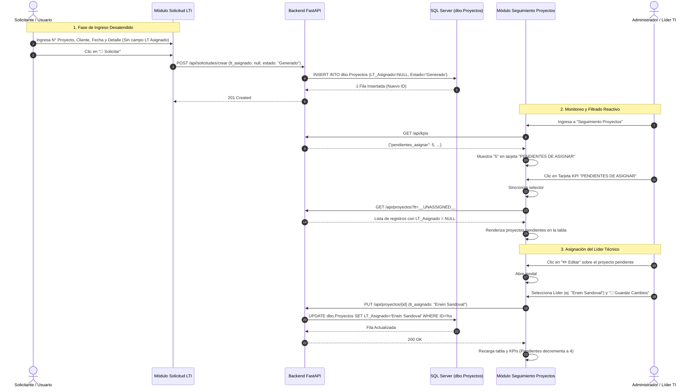

# ESPECIFICACIÓN TÉCNICA Y ARQUITECTÓNICA (SPECS)
## Módulo: "Seguimiento de Proyectos, Filtro de Líderes TI, KPIs Interactivos y Tipografía Uniforme" (`app-lti`)

- **Documento:** SPECS-LTI-MOD-006
- **Versión:** 1.0.0
- **Fecha:** 2026-08-26
- **Autor:** Subagente 1 (Planificador & Arquitecto de Software)
- **Destinatario:** Subagente 2 (Codificador & Implementador)
- **Ubicación del Proyecto:** `/home/bobbasystem/Desarrollos/app-lti`

---

## CONTROL DE VERSIONES Y REGISTRO DE CAMBIOS

| Versión | Fecha | Autor | Descripción del Cambio |
|---|---|---|---|
| **1.0.0** | 2026-08-26 | Subagente 1 | Versión inicial de especificación técnica completa que cubre los 5 requerimientos de evolución del sistema:<br>1. **Estandarización de Tipografía Uniforme** en toda la app (igualando fuentes de Seguimiento, tablas, modales y KPIs a Solicitud LTI).<br>2. **Filtro Líderes TI con opción 'Sin asignar'** (`#filter-lt`) y lógica SQL para registros con `LT_Asignado` nulo o vacío.<br>3. **Restricción estricta y orden alfabético** del catálogo de Líderes TI (exclusivamente 5 líderes activos: Alejandro Aguilar, Erwin Sandoval, Juan Barrera, Samuel Paredes, Solange Ortiz).<br>4. **Nueva tarjeta KPI interactiva/clicable 'Pendientes de Asignar'** con conteo en tiempo real, hover/feedback y filtrado sincronizado onClick.<br>5. **Desacople del campo 'LT Asignado' en Solicitud LTI** e integración end-to-end con la bandeja de pendientes. |

---

## 1. RESUMEN EJECUTIVO Y OBJETIVOS

El portal `app-lti` es un sistema corporativo integral (FastAPI + Microsoft SQL Server + Vanilla JS / CSS3) diseñado para el control de ciclo de vida de proyectos y la auditoría técnica de Solots SGA, Tickets Service Manager y RFCs.

Este documento de especificaciones técnicas establece el diseño arquitectónico, contratos de datos, cambios en el DOM, reglas CSS, lógica JavaScript, controladores backend y casos de prueba requeridos para:

1. **Tipografía Homogénea:** Erradicar discrepancias visuales entre módulos, forzando una única familia tipográfica de alto rendimiento y legibilidad (`Roboto` / `Plus Jakarta Sans` / fuentes del sistema) en toda la interfaz (tablas, modales, métricas, controles, encabezados y formularios), garantizando idéntica fidelidad en modo claro y modo oscuro.
2. **Filtro Líderes TI con Estado 'Sin asignar':** Permitir a los usuarios auditar de manera inmediata los proyectos que aún no han sido asignados a ningún Líder Técnico (`LT_Asignado IS NULL OR LTRIM(RTRIM(LT_Asignado)) = ''`).
3. **Catálogo Oficial y Ordenado de Líderes:** Restringir el selector de líderes exclusivamente a los 5 Líderes Técnicos activos, ordenados de forma ascendente estricta:
   * **Alejandro Aguilar**
   * **Erwin Sandoval**
   * **Juan Barrera**
   * **Samuel Paredes**
   * **Solange Ortiz**
4. **Métrica y Tarjeta KPI 'Pendientes de Asignar' Clicable:** Incorporar una sexta tarjeta KPI en el Dashboard de Seguimiento que no solo cuantifique en tiempo real las solicitudes huérfanas de líder, sino que actúe como control interactivo reactivo (cursor pointer, hover, estado seleccionado y evento click que sincroniza `#filter-lt` con `'Sin asignar'` y filtra la tabla principal).
5. **Alineación con Solicitud LTI:** Sincronizar el flujo de creación inicial donde el solicitante no asigna líder técnico, garantizando que todo nuevo requerimiento alimente la métrica de pendientes y pueda ser asignado posteriormente mediante el modal de edición de proyectos.

---

## 2. ARQUITECTURA DE DATOS & OPERACIONES SQL (MSSQL)

### 2.1. Lógica de Filtrado por Líder Técnico en `dbo.Proyectos`

Para satisfacer el filtrado por líder técnico, considerando tanto los líderes específicos, la opción de todos los líderes y la nueva opción "Sin asignar":

```sql
-- Caso A: Filtrar por opción "Sin asignar" (__UNASSIGNED__)
SELECT p.ID, p.Cliente, p.Numero_Proyecto, p.LT_Asignado, p.Estado, p.Detalle, p.Comentario, p.Tipo_Servicio, p.Creado
FROM dbo.Proyectos p WITH (NOLOCK)
WHERE (p.Tipo_Servicio IS NULL OR p.Tipo_Servicio <> 'Reunión')
  AND (p.LT_Asignado IS NULL OR LTRIM(RTRIM(p.LT_Asignado)) = '' OR LOWER(LTRIM(RTRIM(p.LT_Asignado))) = 'sin asignar')
ORDER BY 
    CASE WHEN p.Creado IS NOT NULL THEN 0 ELSE 1 END,
    p.Creado DESC,
    p.ID DESC;

-- Caso B: Filtrar por Líder Específico (ej. 'Alejandro Aguilar')
SELECT p.ID, p.Cliente, p.Numero_Proyecto, p.LT_Asignado, p.Estado, p.Detalle, p.Comentario, p.Tipo_Servicio, p.Creado
FROM dbo.Proyectos p WITH (NOLOCK)
WHERE (p.Tipo_Servicio IS NULL OR p.Tipo_Servicio <> 'Reunión')
  AND p.LT_Asignado = %s
ORDER BY 
    CASE WHEN p.Creado IS NOT NULL THEN 0 ELSE 1 END,
    p.Creado DESC,
    p.ID DESC;

-- Caso C: Todos los Líderes (__ALL__ o sin filtro)
SELECT p.ID, p.Cliente, p.Numero_Proyecto, p.LT_Asignado, p.Estado, p.Detalle, p.Comentario, p.Tipo_Servicio, p.Creado
FROM dbo.Proyectos p WITH (NOLOCK)
WHERE (p.Tipo_Servicio IS NULL OR p.Tipo_Servicio <> 'Reunión')
ORDER BY 
    CASE WHEN p.Creado IS NOT NULL THEN 0 ELSE 1 END,
    p.Creado DESC,
    p.ID DESC;
```

---

### 2.2. Cálculo de KPIs en `dbo.Proyectos` (Función `get_dashboard_kpis`)

La función `get_dashboard_kpis(lt_filter=None)` en `backend/db.py` se actualiza para calcular la métrica de proyectos pendientes de asignar:

```python
def get_dashboard_kpis(lt_filter=None):
    conn = get_db_connection()
    try:
        with conn.cursor() as cursor:
            # 1. Total Proyectos
            sql_proy = "SELECT COUNT(1) as total FROM dbo.Proyectos p WHERE (p.Tipo_Servicio IS NULL OR p.Tipo_Servicio <> 'Reunión')"
            params_proy = []
            if lt_filter == "__UNASSIGNED__":
                sql_proy += " AND (p.LT_Asignado IS NULL OR LTRIM(RTRIM(p.LT_Asignado)) = '' OR LOWER(LTRIM(RTRIM(p.LT_Asignado))) = 'sin asignar')"
            elif lt_filter:
                sql_proy += " AND p.LT_Asignado = %s"
                params_proy.append(lt_filter)
            cursor.execute(sql_proy, tuple(params_proy))
            total_proyectos = cursor.fetchone()['total']

            # 2. Proyectos En Curso (Estado = 'Generado')
            sql_en_curso = "SELECT COUNT(1) as total FROM dbo.Proyectos p WHERE p.Estado = 'Generado' AND (p.Tipo_Servicio IS NULL OR p.Tipo_Servicio <> 'Reunión')"
            params_ec = []
            if lt_filter == "__UNASSIGNED__":
                sql_en_curso += " AND (p.LT_Asignado IS NULL OR LTRIM(RTRIM(p.LT_Asignado)) = '' OR LOWER(LTRIM(RTRIM(p.LT_Asignado))) = 'sin asignar')"
            elif lt_filter:
                sql_en_curso += " AND p.LT_Asignado = %s"
                params_ec.append(lt_filter)
            cursor.execute(sql_en_curso, tuple(params_ec))
            proyectos_en_curso = cursor.fetchone()['total']

            # 3. Proyectos Atendidos (Estado = 'Atendido')
            sql_atendidos = "SELECT COUNT(1) as total FROM dbo.Proyectos p WHERE p.Estado = 'Atendido' AND (p.Tipo_Servicio IS NULL OR p.Tipo_Servicio <> 'Reunión')"
            params_at = []
            if lt_filter == "__UNASSIGNED__":
                sql_atendidos += " AND (p.LT_Asignado IS NULL OR LTRIM(RTRIM(p.LT_Asignado)) = '' OR LOWER(LTRIM(RTRIM(p.LT_Asignado))) = 'sin asignar')"
            elif lt_filter:
                sql_atendidos += " AND p.LT_Asignado = %s"
                params_at.append(lt_filter)
            cursor.execute(sql_atendidos, tuple(params_at))
            proyectos_atendidos = cursor.fetchone()['total']

            # 4. Proyectos Pendientes de Asignar (LT_Asignado NULL o vacío global)
            sql_pendientes = """
                SELECT COUNT(1) as total 
                FROM dbo.Proyectos p 
                WHERE (p.LT_Asignado IS NULL OR LTRIM(RTRIM(p.LT_Asignado)) = '' OR LOWER(LTRIM(RTRIM(p.LT_Asignado))) = 'sin asignar')
                  AND (p.Tipo_Servicio IS NULL OR p.Tipo_Servicio <> 'Reunión')
            """
            cursor.execute(sql_pendientes)
            pendientes_asignar = cursor.fetchone()['total']

            # 5. Efectividad
            efectividad = round((proyectos_atendidos / total_proyectos * 100), 1) if total_proyectos > 0 else 0.0

            # 6. Tickets SM
            sql_tickets = """
                SELECT COUNT(1) as total 
                FROM dbo.registrosRF_SD_SM sd
                INNER JOIN dbo.Proyectos p ON sd.ID_Proyecto = p.ID
                WHERE (p.Tipo_Servicio IS NULL OR p.Tipo_Servicio <> 'Reunión')
            """
            params_t = []
            if lt_filter == "__UNASSIGNED__":
                sql_tickets += " AND (p.LT_Asignado IS NULL OR LTRIM(RTRIM(p.LT_Asignado)) = '' OR LOWER(LTRIM(RTRIM(p.LT_Asignado))) = 'sin asignar')"
            elif lt_filter:
                sql_tickets += " AND p.LT_Asignado = %s"
                params_t.append(lt_filter)
            cursor.execute(sql_tickets, tuple(params_t))
            total_tickets = cursor.fetchone()['total']

            # 7. RFCs
            sql_rfcs = """
                SELECT COUNT(1) as total 
                FROM dbo.registrosSM_RFC rfc
                INNER JOIN dbo.Proyectos p ON rfc.ID_Proyecto = p.ID
                WHERE (p.Tipo_Servicio IS NULL OR p.Tipo_Servicio <> 'Reunión')
            """
            params_r = []
            if lt_filter == "__UNASSIGNED__":
                sql_rfcs += " AND (p.LT_Asignado IS NULL OR LTRIM(RTRIM(p.LT_Asignado)) = '' OR LOWER(LTRIM(RTRIM(p.LT_Asignado))) = 'sin asignar')"
            elif lt_filter:
                sql_rfcs += " AND p.LT_Asignado = %s"
                params_r.append(lt_filter)
            cursor.execute(sql_rfcs, tuple(params_r))
            total_rfcs = cursor.fetchone()['total']

            return {
                'total_proyectos': total_proyectos,
                'proyectos_en_curso': proyectos_en_curso,
                'proyectos_atendidos': proyectos_atendidos,
                'pendientes_asignar': pendientes_asignar,
                'efectividad': efectividad,
                'total_tickets': total_tickets,
                'total_rfcs': total_rfcs
            }
    finally:
        conn.close()
```

---

## 3. ESPECIFICACIÓN DE ENDPOINTS BACKEND (FastAPI)

### 3.1. `GET /api/lideres`

Retorna de forma estricta la lista ordenada de los 5 líderes permitidos.

- **Método HTTP:** `GET`
- **Ruta:** `/api/lideres`
- **Autenticación:** Bearer Token JWT (`Depends(get_current_user)`)
- **Respuesta (200 OK):**
```json
[
  "Alejandro Aguilar",
  "Erwin Sandoval",
  "Juan Barrera",
  "Samuel Paredes",
  "Solange Ortiz"
]
```

#### Implementación en `backend/db.py`:
```python
def get_lideres_list():
    """
    Retorna la lista oficial y estricta de Líderes TI activos en orden alfabético ascendente.
    """
    return [
        "Alejandro Aguilar",
        "Erwin Sandoval",
        "Juan Barrera",
        "Samuel Paredes",
        "Solange Ortiz"
    ]
```

---

### 3.2. `GET /api/kpis`

Permite consultar las métricas del dashboard con soporte para el filtro `lt=__UNASSIGNED__` o líder específico.

- **Método HTTP:** `GET`
- **Ruta:** `/api/kpis`
- **Parámetros Query:**
  - `lt` (opcional): Nombre de líder, `__ALL__` o `__UNASSIGNED__`.
- **Autenticación:** Bearer Token JWT (`Depends(get_current_user)`)
- **Respuesta (200 OK):**
```json
{
  "total_proyectos": 28,
  "proyectos_en_curso": 19,
  "proyectos_atendidos": 9,
  "pendientes_asignar": 4,
  "efectividad": 32.1,
  "total_tickets": 15,
  "total_rfcs": 3
}
```

#### Controlador en `backend/main.py`:
```python
@app.get("/api/kpis")
def get_kpis(
    lt: Optional[str] = None,
    current_user: dict = Depends(get_current_user)
):
    lt_to_use = lt
    if current_user["rol"] != "ADMIN" and not lt:
        lt_to_use = current_user["lt_asignado"]
    elif lt == "__ALL__":
        lt_to_use = None
    elif lt == "__UNASSIGNED__" or lt == "Sin asignar":
        lt_to_use = "__UNASSIGNED__"

    return get_dashboard_kpis(lt_filter=lt_to_use)
```

---

### 3.3. `GET /api/proyectos`

Permite obtener los proyectos filtrados considerando la opción `lt=__UNASSIGNED__`.

- **Método HTTP:** `GET`
- **Ruta:** `/api/proyectos`
- **Parámetros Query:**
  - `lt` (opcional): Nombre de líder, `__ALL__` o `__UNASSIGNED__`.
  - `search` (opcional): Término de búsqueda general.
  - `estado_sp` (opcional): Estado Sharepoint (`Generado`, `En revision`, `Atendido`).
  - `estado_sga` (opcional): Estado SGA.
- **Autenticación:** Bearer Token JWT (`Depends(get_current_user)`)

#### Controlador en `backend/main.py`:
```python
@app.get("/api/proyectos")
def list_proyectos(
    lt: Optional[str] = None,
    search: Optional[str] = None,
    estado_sp: Optional[str] = None,
    estado_sga: Optional[str] = None,
    current_user: dict = Depends(get_current_user)
):
    lt_to_use = lt
    if current_user["rol"] != "ADMIN" and not lt:
        lt_to_use = current_user["lt_asignado"]
    elif lt == "__ALL__":
        lt_to_use = None
    elif lt == "__UNASSIGNED__" or lt == "Sin asignar":
        lt_to_use = "__UNASSIGNED__"

    return get_proyectos(
        lt_filter=lt_to_use,
        search=search,
        estado_sp=estado_sp,
        estado_sga=estado_sga
    )
```

#### Manejo de Filtro en `get_proyectos` (`backend/db.py`):
```python
if lt_filter == "__UNASSIGNED__":
    sql += " AND (p.LT_Asignado IS NULL OR LTRIM(RTRIM(p.LT_Asignado)) = '' OR LOWER(LTRIM(RTRIM(p.LT_Asignado))) = 'sin asignar')"
elif lt_filter:
    sql += " AND p.LT_Asignado = %s"
    params.append(lt_filter)
```

---

## 4. ESPECIFICACIÓN FRONTEND (HTML / CSS / JS)

### 4.1. Requerimiento 1: Sistema Tipográfico Uniforme (`frontend/css/styles.css`)

Se define una pila tipográfica centralizada en variables CSS y se aplica de forma estricta mediante reglas universales de herencia y reseteo:

```css
/* ==========================================================================
   SISTEMA DE TIPOGRAFÍA GLOBAL UNIFICADA (DESIGN SYSTEM)
   ========================================================================== */

:root {
  /* Fuente Principal Sans-serif para todo el portal */
  --font-sans: 'Roboto', 'Plus Jakarta Sans', -apple-system, BlinkMacSystemFont, 'Segoe UI', Roboto, Helvetica, Arial, sans-serif;
  
  /* Fuente Monoespaciada para Identificadores, Números de Proyecto, Solots y Código */
  --font-mono: 'JetBrains Mono', 'Fira Code', 'Consolas', 'Roboto Mono', monospace;
}

/* Regla Universal de Herencia Tipográfica */
*, *::before, *::after {
  box-sizing: border-box;
}

html, body {
  font-family: var(--font-sans);
  color: var(--text-primary);
  line-height: 1.5;
  -webkit-font-smoothing: antialiased;
  -moz-osx-font-smoothing: grayscale;
}

/* Forzar herencia de fuente en todos los elementos de formulario y controles interactivos */
button, input, select, textarea, optgroup {
  font-family: inherit;
  font-size: inherit;
  line-height: inherit;
  color: inherit;
}

/* Estandarización de Tablas de Datos (.data-table) */
.data-table {
  width: 100%;
  border-collapse: collapse;
  text-align: left;
  font-family: var(--font-sans);
  font-size: 0.88rem;
  line-height: 1.45;
}

.data-table th {
  background-color: var(--bg-surface-secondary);
  color: var(--text-secondary);
  font-family: var(--font-sans);
  font-weight: 700;
  text-transform: uppercase;
  font-size: 0.75rem;
  letter-spacing: 0.04em;
  padding: 0.85rem 1rem;
  border-bottom: 1px solid var(--border-color);
  white-space: nowrap;
}

.data-table td {
  padding: 0.85rem 1rem;
  border-bottom: 1px solid var(--border-color);
  color: var(--text-primary);
  font-family: var(--font-sans);
  vertical-align: middle;
}

/* Formato Monoespaciado para Códigos y Números de Proyecto */
.col-project-num, .tag-mono, .code-pill, code {
  font-family: var(--font-mono);
  font-weight: 600;
}

/* Encabezados y Títulos */
h1, h2, h3, h4, h5, h6,
.brand-title, .drilldown-title, .modal-title, .ticket-card-title {
  font-family: var(--font-sans);
  font-weight: 700;
  color: var(--text-primary);
  letter-spacing: -0.02em;
}

/* Etiquetas de Formulario (Labels) */
.form-label {
  font-family: var(--font-sans);
  font-size: 0.85rem;
  font-weight: 600;
  color: var(--text-secondary);
  margin-bottom: 0.4rem;
}

/* Inputs y Selects */
.form-input, .form-select {
  font-family: var(--font-sans);
  font-size: 0.92rem;
  font-weight: 400;
  color: var(--text-primary);
  background-color: var(--bg-surface-secondary);
  border: 1px solid var(--border-color);
  border-radius: var(--radius-sm);
  padding: 0.65rem 0.9rem;
}

/* Botones */
.btn {
  font-family: var(--font-sans);
  font-size: 0.88rem;
  font-weight: 600;
}

/* Tarjetas KPI */
.kpi-title {
  font-family: var(--font-sans);
  font-size: 0.78rem;
  font-weight: 700;
  color: var(--text-secondary);
  text-transform: uppercase;
  letter-spacing: 0.05em;
}

.kpi-value {
  font-family: var(--font-sans);
  font-size: 1.65rem;
  font-weight: 800;
  color: var(--text-primary);
  line-height: 1.2;
  letter-spacing: -0.02em;
}
```

---

### 4.2. Requerimientos 2 y 3: Selector de Líderes TI (`#filter-lt`)

En `frontend/index.html`, la barra de filtros mantiene el elemento `<select id="filter-lt" class="form-select">`.

#### Estructura DOM Final del Selector:
```html
<select id="filter-lt" class="form-select" title="Filtrar por Líder Técnico asignado">
  <option value="__ALL__">— Todos los Líderes TI —</option>
  <option value="__UNASSIGNED__">Sin asignar</option>
  <option value="Alejandro Aguilar">Alejandro Aguilar</option>
  <option value="Erwin Sandoval">Erwin Sandoval</option>
  <option value="Juan Barrera">Juan Barrera</option>
  <option value="Samuel Paredes">Samuel Paredes</option>
  <option value="Solange Ortiz">Solange Ortiz</option>
</select>
```

#### Lógica en `frontend/js/app.js` (`loadLideres`):
```javascript
async loadLideres() {
  try {
    const res = await Auth.fetchWithAuth('/api/lideres');
    this.lideresList = await res.json();
    
    // Lista estricta y ordenada de líderes
    const select = document.getElementById('filter-lt');
    if (select) {
      const user = Auth.getUser();
      select.innerHTML = '';

      // 1. Opción por defecto
      const allOption = document.createElement('option');
      allOption.value = '__ALL__';
      allOption.textContent = '— Todos los Líderes TI —';
      select.appendChild(allOption);

      // 2. Opción Sin Asignar
      const unassignedOption = document.createElement('option');
      unassignedOption.value = '__UNASSIGNED__';
      unassignedOption.textContent = 'Sin asignar';
      select.appendChild(unassignedOption);

      // 3. Opciones de Líderes en Orden Alfabético Estricto
      this.lideresList.forEach(lt => {
        const opt = document.createElement('option');
        opt.value = lt;
        opt.textContent = lt;
        if (user && user.lt_asignado === lt && user.rol !== 'ADMIN') {
          opt.selected = true;
        }
        select.appendChild(opt);
      });

      if (user && user.rol === 'ADMIN') {
        allOption.selected = true;
      }
    }

    // Poblar también el selector del modal de edición si existe
    this.populateEditModalLideres();
  } catch (e) {
    console.error('Error al cargar líderes:', e);
  }
}
```

---

### 4.3. Requerimiento 4: Tarjeta KPI "Pendientes de Asignar" Clicable

#### Estructura HTML en `frontend/index.html`:

La grilla de KPIs (`.kpi-grid`) se actualiza para incluir 6 tarjetas (3x2 en desktop o 6 en responsive):

```html
<!-- KPI Metrics Grid (6 Tarjetas) -->
<div class="kpi-grid">
  <!-- 1. Proyectos Asignados -->
  <div class="kpi-card kpi-proyectos">
    <div class="kpi-icon">📁</div>
    <div>
      <div class="kpi-value" id="kpi-val-proyectos">0</div>
      <div class="kpi-title">PROYECTOS ASIGNADOS</div>
    </div>
  </div>

  <!-- 2. Proyectos En Curso -->
  <div class="kpi-card kpi-en-curso">
    <div class="kpi-icon">🚀</div>
    <div>
      <div class="kpi-value" id="kpi-val-en-curso">0</div>
      <div class="kpi-title">PROYECTOS EN CURSO</div>
    </div>
  </div>

  <!-- 3. NUEVA: Pendientes de Asignar (Clicable / Interactiva) -->
  <div class="kpi-card kpi-pendientes kpi-card-clickable" id="kpi-card-pendientes" title="Hacer clic para filtrar proyectos sin Líder TI asignado" tabindex="0" role="button" aria-label="Filtrar proyectos pendientes de asignación">
    <div class="kpi-icon">⏳</div>
    <div>
      <div class="kpi-value" id="kpi-val-pendientes-asignar">0</div>
      <div class="kpi-title">PENDIENTES DE ASIGNAR</div>
    </div>
    <span class="kpi-clickable-badge">Filtrar ⚡</span>
  </div>

  <!-- 4. Efectividad -->
  <div class="kpi-card kpi-efectividad">
    <div class="kpi-icon">📈</div>
    <div>
      <div class="kpi-value" id="kpi-val-efectividad">0%</div>
      <div class="kpi-title">EFECTIVIDAD</div>
    </div>
  </div>

  <!-- 5. Tickets SD -->
  <div class="kpi-card kpi-tickets">
    <div class="kpi-icon">🎫</div>
    <div>
      <div class="kpi-value" id="kpi-val-tickets">0</div>
      <div class="kpi-title">Tickets SD (HPSM)</div>
    </div>
  </div>

  <!-- 6. RFCs Asociadas -->
  <div class="kpi-card kpi-rfcs">
    <div class="kpi-icon">🔄</div>
    <div>
      <div class="kpi-value" id="kpi-val-rfcs">0</div>
      <div class="kpi-title">RFCs Asociadas</div>
    </div>
  </div>
</div>
```

#### Estilos CSS (`frontend/css/styles.css`):

```css
/* ==========================================================================
   ESTILOS DE LA TARJETA KPI CLICABLE / INTERACTIVA 'PENDIENTES DE ASIGNAR'
   ========================================================================== */

/* Configuración de Grilla para 6 KPIs */
.kpi-grid {
  display: grid;
  grid-template-columns: repeat(6, 1fr);
  gap: 1rem;
  margin-bottom: 1.5rem;
}

@media (max-width: 1400px) {
  .kpi-grid {
    grid-template-columns: repeat(3, 1fr);
  }
}

@media (max-width: 768px) {
  .kpi-grid {
    grid-template-columns: repeat(2, 1fr);
  }
}

@media (max-width: 480px) {
  .kpi-grid {
    grid-template-columns: 1fr;
  }
}

/* Tarjeta KPI Clicable */
.kpi-card-clickable {
  cursor: pointer;
  position: relative;
  user-select: none;
  transition: transform var(--transition-fast), 
              box-shadow var(--transition-fast), 
              border-color var(--transition-fast), 
              background-color var(--transition-fast);
  outline: none;
}

.kpi-card-clickable:hover {
  transform: translateY(-3px);
  box-shadow: var(--shadow-md);
  border-color: #f59e0b;
}

.kpi-card-clickable:active {
  transform: translateY(-1px) scale(0.99);
}

.kpi-card-clickable:focus-visible {
  box-shadow: 0 0 0 3px rgba(245, 158, 11, 0.4);
}

/* Estado Seleccionado / Filtro Activo */
.kpi-card-clickable.active-filter {
  border-color: #f59e0b;
  background-color: rgba(245, 158, 11, 0.08);
  box-shadow: 0 0 0 2px rgba(245, 158, 11, 0.4), var(--shadow-sm);
}

[data-theme="dark"] .kpi-card-clickable.active-filter {
  background-color: rgba(245, 158, 11, 0.16);
  border-color: #fbbf24;
  box-shadow: 0 0 0 2px rgba(251, 191, 36, 0.4), var(--shadow-md);
}

/* Badge decorativo / indicador de acción */
.kpi-clickable-badge {
  position: absolute;
  top: 8px;
  right: 8px;
  font-size: 0.68rem;
  font-weight: 700;
  padding: 0.15rem 0.45rem;
  border-radius: var(--radius-full);
  background-color: rgba(245, 158, 11, 0.15);
  color: #d97706;
  border: 1px solid rgba(245, 158, 11, 0.3);
  opacity: 0.85;
  transition: all var(--transition-fast);
}

.kpi-card-clickable:hover .kpi-clickable-badge {
  opacity: 1;
  background-color: #f59e0b;
  color: #ffffff;
  border-color: #d97706;
}

[data-theme="dark"] .kpi-clickable-badge {
  background-color: rgba(245, 158, 11, 0.25);
  color: #fbbf24;
  border-color: rgba(245, 158, 11, 0.5);
}
```

#### Lógica JavaScript en `frontend/js/app.js`:

```javascript
// En bindEvents():
const kpiPendientesCard = document.getElementById('kpi-card-pendientes');
if (kpiPendientesCard) {
  // Click listener
  kpiPendientesCard.addEventListener('click', () => this.filterByUnassigned());
  // Accesibilidad por teclado (Enter o Espacio)
  kpiPendientesCard.addEventListener('keydown', (e) => {
    if (e.key === 'Enter' || e.key === ' ') {
      e.preventDefault();
      this.filterByUnassigned();
    }
  });
}

// Método de filtrado y sincronización:
filterByUnassigned() {
  const select = document.getElementById('filter-lt');
  if (select) {
    // Si ya está seleccionado, alternar o forzar __UNASSIGNED__
    select.value = '__UNASSIGNED__';
    this.updateKPIActiveState();
    this.loadKPIs();
    this.loadProjects();
    this.showToast('Filtrando proyectos pendientes de asignar Líder TI', 'info');
  }
}

// Sincronización del estado visual de la tarjeta:
updateKPIActiveState() {
  const currentLt = document.getElementById('filter-lt')?.value || '';
  const kpiPendientesCard = document.getElementById('kpi-card-pendientes');
  if (kpiPendientesCard) {
    if (currentLt === '__UNASSIGNED__') {
      kpiPendientesCard.classList.add('active-filter');
    } else {
      kpiPendientesCard.classList.remove('active-filter');
    }
  }
}

// En loadKPIs():
async loadKPIs() {
  try {
    const ltFilter = document.getElementById('filter-lt')?.value || '';
    let url = '/api/kpis';
    if (ltFilter) {
      url += `?lt=${encodeURIComponent(ltFilter)}`;
    }
    
    const res = await Auth.fetchWithAuth(url);
    const kpis = await res.json();

    document.getElementById('kpi-val-proyectos').textContent = kpis.total_proyectos || 0;
    document.getElementById('kpi-val-en-curso').textContent = kpis.proyectos_en_curso || 0;
    document.getElementById('kpi-val-pendientes-asignar').textContent = kpis.pendientes_asignar || 0;
    document.getElementById('kpi-val-efectividad').textContent = `${kpis.efectividad !== undefined ? kpis.efectividad : 0}%`;
    document.getElementById('kpi-val-tickets').textContent = kpis.total_tickets || 0;
    document.getElementById('kpi-val-rfcs').textContent = kpis.total_rfcs || 0;

    this.updateKPIActiveState();
  } catch (e) {
    console.error('Error al cargar KPIs:', e);
  }
}
```

---

## 5. DIAGRAMA DE SECUENCIA Y FLUJO HOLÍSTICO DE NEGOCIO



---

## 6. GUÍA DE IMPLEMENTACIÓN DETALLADA PARA SUBAGENTE 2 (CODIFICADOR)

### Checklist de Tareas por Archivo

#### 1. `frontend/css/styles.css`
- [ ] Incorporar variables `--font-sans` y `--font-mono` en `:root`.
- [ ] Aplicar regla universal de herencia tipográfica para `button, input, select, textarea`.
- [ ] Estandarizar `.data-table`, `th`, `td`, `.kpi-title`, `.kpi-value`, `.form-label`, `.form-input`, `.form-select`, modales y encabezados.
- [ ] Actualizar `.kpi-grid` a `grid-template-columns: repeat(6, 1fr)`.
- [ ] Añadir clases `.kpi-card-clickable`, `.kpi-card-clickable.active-filter` y `.kpi-clickable-badge`.

#### 2. `frontend/index.html`
- [ ] En `.kpi-grid` de `#module-projects-container`:
  - Agregar la tarjeta KPI `#kpi-card-pendientes` con valor `#kpi-val-pendientes-asignar` y badge `Filtrar ⚡`.
- [ ] En `#module-solicitud-lti-container`:
  - Remover el control `#solicitud-lt-asignado`.
  - Organizar el formulario en cuadrícula balanceada de 2 columnas (Fila 1: N° Proyecto y Cliente; Fila 2: Fecha de Solicitud y Estado bloqueado; Fila 3: Detalle full-width; Fila 4: Botones).

#### 3. `backend/db.py`
- [ ] En `get_lideres_list()`: Retornar exclusivamente la lista de los 5 líderes permitidos: `["Alejandro Aguilar", "Erwin Sandoval", "Juan Barrera", "Samuel Paredes", "Solange Ortiz"]`.
- [ ] En `get_dashboard_kpis(lt_filter)`:
  - Calcular la métrica `pendientes_asignar`.
  - Si `lt_filter == "__UNASSIGNED__"`, aplicar filtro `(p.LT_Asignado IS NULL OR LTRIM(RTRIM(p.LT_Asignado)) = '' OR LOWER(LTRIM(RTRIM(p.LT_Asignado))) = 'sin asignar')`.
- [ ] En `get_proyectos(...)`:
  - Si `lt_filter == "__UNASSIGNED__"`, aplicar la condición SQL para registros sin LT asignado.
- [ ] En `create_solicitud_lti(...)`:
  - Permitir `lt_asignado` nulo o vacío, persistiendo `NULL` en `dbo.Proyectos`.

#### 4. `backend/main.py`
- [ ] En `get_kpis` y `list_proyectos`: Manejar el valor `__UNASSIGNED__` o `"Sin asignar"` para delegarlo a las funciones de BD.
- [ ] En `SolicitudCreacionRequest`: Asegurar que `lt_asignado: Optional[str] = None`.
- [ ] En `crear_solicitud`: No requerir `lt_asignado` en la validación de obligatoriedad.

#### 5. `frontend/js/app.js`
- [ ] En `loadLideres()`:
  - Construir `#filter-lt` con las opciones:
    1. `<option value="__ALL__">— Todos los Líderes TI —</option>`
    2. `<option value="__UNASSIGNED__">Sin asignar</option>`
    3. Opciones de los 5 líderes ordenados alfabéticamente.
- [ ] En `loadKPIs()`:
  - Asignar el valor a `#kpi-val-pendientes-asignar`.
  - Invocar `updateKPIActiveState()`.
- [ ] Añadir método `filterByUnassigned()` y `updateKPIActiveState()`.
- [ ] Vincular evento click y keydown de `#kpi-card-pendientes`.
- [ ] En `submitSolicitudForm()`:
  - Enviar `lt_asignado: null` y omitir la validación de campo requerido para LT asignado.
- [ ] En `resetSolicitudForm()`:
  - Limpiar el formulario adaptado al nuevo layout.

---

## 7. MATRIZ DE CRITERIOS DE ACEPTACIÓN & VALIDACIÓN (QA)

| ID | Caso de Prueba | Procedimiento de Prueba | Resultado Esperado |
|---|---|---|---|
| **CP-01** | Estandarización Tipográfica Global | 1. Inspeccionar elementos de Solicitud LTI, Seguimiento, tablas `.data-table`, modales y tarjetas KPI con DevTools.<br>2. Alternar entre modo claro y modo oscuro. | Todos los módulos comparten exactamente la misma familia tipográfica (--font-sans), sin fuentes huérfanas en controles de formulario ni tablas. Legibilidad y contraste óptimos en ambos temas. |
| **CP-02** | Selector de Líderes TI — Lista Restringida y Orden | 1. Iniciar sesión y examinar las opciones de `#filter-lt`. | El selector contiene exactamente 7 opciones: `— Todos los Líderes TI —`, `Sin asignar`, seguido de los 5 líderes en orden alfabético estricto: `Alejandro Aguilar`, `Erwin Sandoval`, `Juan Barrera`, `Samuel Paredes`, `Solange Ortiz`. No aparecen otros líderes. |
| **CP-03** | Filtrado por Opción "Sin Asignar" | 1. Seleccionar "Sin asignar" en `#filter-lt`. | La tabla de proyectos se recarga mostrando únicamente proyectos con `LT_Asignado` nulo o vacío. El contador de proyectos refleja la cantidad exacta. |
| **CP-04** | Tarjeta KPI "Pendientes de Asignar" — Renderizado | 1. Observar la fila superior de métricas en Seguimiento de Proyectos. | La tarjeta "PENDIENTES DE ASIGNAR" se visualiza con ícono `⏳`, contador numérico en tiempo real y badge `Filtrar ⚡`. |
| **CP-05** | Tarjeta KPI "Pendientes de Asignar" — Interactividad Click | 1. Hacer clic sobre la tarjeta KPI `#kpi-card-pendientes`. | La tarjeta adquiere la clase `.active-filter` con borde y fondo ámbar, el selector `#filter-lt` se sincroniza automáticamente a `"Sin asignar"` (`__UNASSIGNED__`), la tabla se recarga con los registros pendientes y se despliega un Toast informativo. |
| **CP-06** | Sincronización Bidireccional Selector y Tarjeta KPI | 1. Con la tarjeta activa, cambiar `#filter-lt` a "Alejandro Aguilar".<br>2. Cambiar nuevamente a "Sin asignar". | Al seleccionar otro líder, la tarjeta pierde la clase `.active-filter`. Al seleccionar "Sin asignar" desde el dropdown, la tarjeta recupera la clase `.active-filter`. |
| **CP-07** | Solicitud LTI — Ausencia de Campo LT Asignado | 1. Navegar al módulo "Solicitud LTI". | El campo "LT Asignado" no está presente en el formulario visual. El formulario se distribuye armónicamente en 2 columnas sin huecos vacíos. |
| **CP-08** | Creación de Solicitud y Aumento de KPI Pendientes | 1. Crear una nueva solicitud en Solicitud LTI.<br>2. Navegar a Seguimiento Proyectos. | La solicitud se guarda con `LT_Asignado = NULL`. El contador de la tarjeta "PENDIENTES DE ASIGNAR" incrementa en +1 y el nuevo proyecto aparece al filtrar por "Sin asignar". |
| **CP-09** | Asignación Posterior de Líder TI en Modal Edición | 1. Filtrar por "Sin asignar".<br>2. Clic en "✏️ Editar" sobre el proyecto creado.<br>3. Asignar "Erwin Sandoval" y guardar. | El proyecto se actualiza en base de datos. La tabla se refresca, el proyecto desaparece de la vista "Sin asignar" y el KPI de pendientes decrementa en -1. |

---

*Fin del Documento de Especificaciones Técnicas (SPECS-LTI-MOD-006 v1.0.0)*
