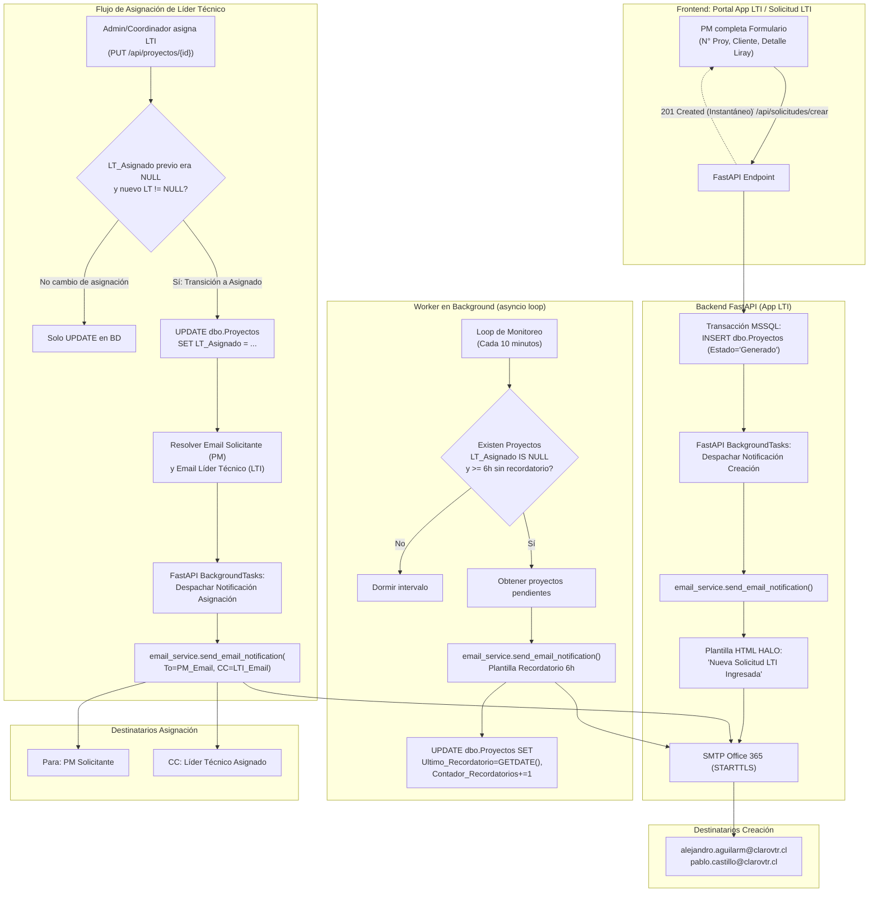
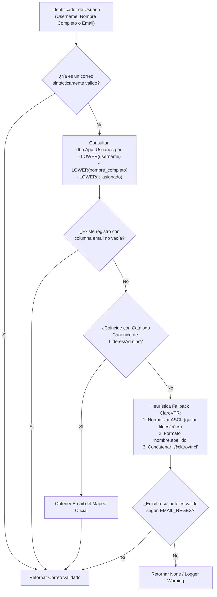

# ESPECIFICACIÓN TÉCNICA Y FUNCIONAL (SPECS)
## Módulo: "Notificaciones Automáticas y Recordatorios Periódicos por Correo para Solicitud LTI" — Portal App LTI (`app-lti`)

- **Documento:** SPECS-LTI-MOD-015
- **Versión:** 1.0.0
- **Fecha:** 2026-10-14
- **Autor:** Subagente 1 (Planificador y Diseñador de Specs)
- **Destinatario:** Subagente 2 (Coder e Implementador), Subagente Tester (QA) & Equipo de Arquitectura
- **Ubicación del Proyecto:** `/home/bobbasystem/Desarrollos/app-lti`

---

## CONTROL DE VERSIONES Y REGISTRO DE CAMBIOS

| Versión | Fecha | Autor | Descripción del Cambio |
|---|---|---|---|
| **1.0.0** | 2026-10-14 | Subagente 1 (Planificador) | Especificación técnica integral del sistema automatizado de notificaciones y recordatorios por correo para el módulo Solicitud LTI. Incluye:<br>1. Notificación inmediata al crear solicitud LTI a coordinadores (`alejandro.aguilarm@clarovtr.cl` y `pablo.castillo@clarovtr.cl`).<br>2. Worker asíncrono en segundo plano para recordatorios periódicos cada 6 horas para proyectos sin LTI asignado, con persistencia y control de idempotencia ante reinicios.<br>3. Notificación automática al asignar LTI al proyecto con destino al PM solicitante y copia (CC) al Líder Técnico asignado.<br>4. Estrategia unificada de resolución de correos de usuarios (PM y LTI) conectada con Portal Halo, aprovisionamiento JIT y `dbo.App_Usuarios`.<br>5. Diseño de plantillas HTML corporativas con la paleta de colores oficial HALO (`#B52217`, `#0097A9`, `#DA291C`, `#FDEDEA`).<br>6. Contratos REST, esquemas de base de datos DDL idempotentes, endpoints de control y batería de pruebas para QA. |

---

## 1. RESUMEN EJECUTIVO Y OBJETIVOS DE NEGOCIO

### 1.1. Contexto Operativo
En el flujo operativo de telecomunicaciones de ClaroVTR, los **Project Managers (PM)** y gestores de proyectos ingresan solicitudes de apoyo técnico a través del módulo **Solicitud LTI** de la plataforma **App LTI**. En la versión actual (v1.3.0), una nueva solicitud se persiste con estado inmutable `'Generado'` y sin Líder Técnico preasignado (`LT_Asignado = NULL`), posicionándose en la bandeja de *Pendientes de Asignar* del módulo *Seguimiento Proyectos*.

Sin embargo, hasta el momento el proceso dependía de la revisión manual y visual periódica por parte de los coordinadores y administradores, lo que podía ocasionar demoras en la asignación de líderes y potenciales fricciones en los tiempos de respuesta operativa hacia los clientes.

### 1.2. Objetivos Principales de la Solución
1. **Notificación Instantánea de Ingreso (Hito 1):**
   - En cuanto un PM genera una nueva solicitud, despachar de manera desatendida y asíncrona un correo formal a los dos coordinadores generales de Líderes TI:
     * `alejandro.aguilarm@clarovtr.cl`
     * `pablo.castillo@clarovtr.cl`
   - El correo debe contener la ficha completa del requerimiento ingresado (N° Proyecto, Cliente, Fecha de Solicitud, Solicitante PM, Tipo de Servicio 'Otros', Estado 'Generado' y el Detalle estructurado con Solots Liray).

2. **Monitoreo Continuo y Recordatorio Periódico cada 6 Horas (Hito 2):**
   - Garantizar que ninguna solicitud quede desatendida en la bandeja de entrada.
   - Un worker asíncrono en background verificará de forma periódica las solicitudes con `LT_Asignado IS NULL` (o en blanco/sin asignar).
   - Para toda solicitud que cumpla 6 horas o múltiplos de 6 horas desde su creación o desde su último recordatorio sin haber sido asignada, enviar un correo recordatorio a ambos coordinadores.
   - Implementar persistencia segura en MSSQL (`Ultimo_Recordatorio` y `Contador_Recordatorios` en `dbo.Proyectos`) para asegurar que reinicios del proceso FastAPI o mantenimiento de servidores no provoquen pérdida de tracking ni spam por duplicación de correos.

3. **Notificación de Asignación de Líder Técnico (Hito 3):**
   - En el momento en que un Administrador o Coordinador edita el proyecto y le asigna un Líder Técnico oficial (transición de `LT_Asignado = NULL` a un valor asignado):
     * Enviar automáticamente un correo al PM Solicitante informando que su requerimiento ya cuenta con Líder Técnico asignado y se encuentra en gestión.
     * Enviar copia con carbón (**CC**) al Líder Técnico asignado (`LT_Asignado`) para que tome conocimiento formal inmediato de la asignación.
     * El correo debe incluir el resumen completo del proyecto y los datos del líder a cargo.

4. **Resolución Robusta de Correos PM y LTI (Hito 4):**
   - Conectar la resolución de correos con la identidad corporativa de Portal Halo.
   - Sincronizar el campo `email` en `dbo.App_Usuarios` a través del aprovisionamiento Just-In-Time (JIT) al decodificar el token JWT de sesión del Portal.
   - Establecer un helper tolerante a fallos para resolver el correo institucional `@clarovtr.cl` tanto a partir del `username` (`nombre.apellido`) como del nombre completo (`nombre_completo` o `LT_Asignado`).

5. **Identidad Visual Corporativa HALO:**
   - Todas las notificaciones deben respetar los estándares estéticos y paleta corporativa de la suite HALO:
     * Cabecera institucional: Rojo oscuro Claro `#B52217`.
     * Acento de marca secundario: Teal tecnológico `#0097A9`.
     * Alertas y badges de destaque: Rojo vivo Claro `#DA291C` y fondo suave `#FDEDEA`.
     * Fondo contenedor: `#FFFFFF` sobre lienzo gris claro `#F4F5F7`.
     * Estilos CSS 100% inline con tablas anidadas y etiquetas semánticas estándar para garantizar renderizado perfecto en Microsoft Outlook (desktop y web), Gmail, Thunderbird y clientes móviles.

---

## 2. ARQUITECTURA GENERAL Y DIAGRAMAS DE FLUJO



---

## 3. ARQUITECTURA DE DATOS Y MIGRACIONES MSSQL

### 3.1. Modificaciones a la Tabla `dbo.Proyectos`
Para soportar el control del ciclo de recordatorios de 6 horas sin perder el estado ante reinicios del backend o de los workers asíncronos, se incorporan dos columnas operativas de auditoría:

| Columna | Tipo de Dato | Nullable | Valor por Defecto | Descripción |
|---|---|---|---|---|
| `Ultimo_Recordatorio` | `DATETIME` | **SÍ** | `NULL` | Fecha y hora en que se envió el último recordatorio de asignación. Si nunca se ha enviado recordatorio, su valor es `NULL`. |
| `Contador_Recordatorios` | `INT` | **NO** | `0` | Cantidad de recordatorios enviados sucesivamente para este proyecto mientras permanezca sin Líder Asignado. |

### 3.2. Modificaciones a la Tabla `dbo.App_Usuarios`
Para asegurar la resolución nativa de los correos de los usuarios locales y provistos vía SSO Portal de Acceso:

| Columna | Tipo de Dato | Nullable | Valor por Defecto | Descripción |
|---|---|---|---|---|
| `email` | `VARCHAR(150)` | **SÍ** | `NULL` | Correo electrónico institucional corporativo del usuario (`@clarovtr.cl` o equivalente). |

### 3.3. Script DDL Idempotente de Migración (T-SQL)
Este script debe ser ejecutado durante la inicialización de la base de datos en `init_auth_tables()` en `backend/db.py`:

```sql
-- =============================================================================
-- MIGRACIÓN IDEMPOTENTE: SOPORTE DE RECORDATORIOS Y CORREOS EN APP LTI
-- =============================================================================

-- 1. Asegurar columnas de tracking de recordatorios en dbo.Proyectos
IF NOT EXISTS (
    SELECT 1 FROM INFORMATION_SCHEMA.COLUMNS 
    WHERE TABLE_NAME = 'Proyectos' AND COLUMN_NAME = 'Ultimo_Recordatorio'
)
BEGIN
    ALTER TABLE dbo.Proyectos ADD Ultimo_Recordatorio DATETIME NULL;
    PRINT '[MIGRACION] Columna dbo.Proyectos.Ultimo_Recordatorio agregada exitosamente.';
END;

IF NOT EXISTS (
    SELECT 1 FROM INFORMATION_SCHEMA.COLUMNS 
    WHERE TABLE_NAME = 'Proyectos' AND COLUMN_NAME = 'Contador_Recordatorios'
)
BEGIN
    ALTER TABLE dbo.Proyectos ADD Contador_Recordatorios INT NOT NULL DEFAULT 0;
    PRINT '[MIGRACION] Columna dbo.Proyectos.Contador_Recordatorios agregada exitosamente.';
END;

-- 2. Asegurar columna email en dbo.App_Usuarios
IF NOT EXISTS (
    SELECT 1 FROM INFORMATION_SCHEMA.COLUMNS 
    WHERE TABLE_NAME = 'App_Usuarios' AND COLUMN_NAME = 'email'
)
BEGIN
    ALTER TABLE dbo.App_Usuarios ADD email VARCHAR(150) NULL;
    PRINT '[MIGRACION] Columna dbo.App_Usuarios.email agregada exitosamente.';
END;

-- 3. Crear índice para optimizar la consulta periódica del scheduler cada 6 horas
IF NOT EXISTS (
    SELECT 1 FROM sys.indexes 
    WHERE name = 'IX_Proyectos_LT_Asignado_Ultimo_Recordatorio' 
      AND object_id = OBJECT_ID('dbo.Proyectos')
)
BEGIN
    CREATE NONCLUSTERED INDEX IX_Proyectos_LT_Asignado_Ultimo_Recordatorio
    ON dbo.Proyectos (LT_Asignado, Estado, Creado, Ultimo_Recordatorio)
    INCLUDE (ID, Cliente, Numero_Proyecto, Solicitante);
    PRINT '[MIGRACION] Índice IX_Proyectos_LT_Asignado_Ultimo_Recordatorio creado exitosamente.';
END;
```

### 3.4. Poblado y Sincronización Inicial de Correos Canónicos (`backend/seed_users.py`)
Actualizar la matriz canónica `USERS_CANONICAL_SEED` para registrar los correos institucionales oficiales de los coordinadores y líderes técnicos:

```python
# Usuarios iniciales canónicos con email institucional corporativo
USERS_CANONICAL_SEED = [
    # (Nombre Completo, Rol, Username, LT_Asignado_Canonical, Email)
    ("Alejandro Aguilar", "ADMIN", "alejandro.aguilar", "Alejandro Aguilar", "alejandro.aguilarm@clarovtr.cl"),
    ("Pablo Castillo", "ADMIN", "pablo.castillo", None, "pablo.castillo@clarovtr.cl"),
    ("Erwin Sandoval", "LTI", "erwin.sandoval", "Erwin Sandoval", "erwin.sandoval@clarovtr.cl"),
    ("Juan Barrera", "LTI", "juan.barrera", "Juan Barrera", "juan.barrera@clarovtr.cl"),
    ("Samuel Paredes", "LTI", "samuel.paredes", "Samuel Paredes", "samuel.paredes@clarovtr.cl"),
    ("Solange Ortiz", "LTI", "solange.ortiz", "Solange Ortiz", "solange.ortiz@clarovtr.cl"),
]
```

---

## 4. ESTRATEGIA DE RESOLUCIÓN DE CORREOS PM Y LTI

Para enviar notificaciones tanto a los solicitantes (PM) como a los Líderes Técnicos (LTI), el sistema requiere una función de resolución de correos robusta, resiliente y de múltiples capas:



### 4.1. Helper de Resolución: `resolve_user_email`
Se debe implementar en `backend/email_service.py` (o `backend/db.py`):

```python
import re
import unicodedata
from typing import Optional

CANONICAL_EMAIL_MAP = {
    "alejandro aguilar": "alejandro.aguilarm@clarovtr.cl",
    "alejandro.aguilar": "alejandro.aguilarm@clarovtr.cl",
    "aaguilar": "alejandro.aguilarm@clarovtr.cl",
    "pablo castillo": "pablo.castillo@clarovtr.cl",
    "pablo.castillo": "pablo.castillo@clarovtr.cl",
    "erwin sandoval": "erwin.sandoval@clarovtr.cl",
    "erwin.sandoval": "erwin.sandoval@clarovtr.cl",
    "juan barrera": "juan.barrera@clarovtr.cl",
    "juan.barrera": "juan.barrera@clarovtr.cl",
    "samuel paredes": "samuel.paredes@clarovtr.cl",
    "samuel.paredes": "samuel.paredes@clarovtr.cl",
    "solange ortiz": "solange.ortiz@clarovtr.cl",
    "solange.ortiz": "solange.ortiz@clarovtr.cl",
}

EMAIL_REGEX = re.compile(r"^[a-zA-Z0-9_.+-]+@[a-zA-Z0-9-]+(?:\.[a-zA-Z0-9-]+)+$")

def normalize_text_for_username(text: str) -> str:
    if not text:
        return ""
    nfkd = unicodedata.normalize('NFKD', str(text))
    ascii_text = ''.join([c for c in nfkd if not unicodedata.combining(c)])
    clean = re.sub(r"[^a-zA-Z0-9.\s_-]", "", ascii_text).strip().lower()
    return re.sub(r"\s+", ".", clean)

def resolve_user_email(user_identifier: Optional[str]) -> Optional[str]:
    """
    Resuelve el correo institucional de un usuario (PM o LTI) a partir de:
    1. Si ya es un email válido -> lo retorna.
    2. Búsqueda en catálogo canónico institucional.
    3. Búsqueda en la tabla dbo.App_Usuarios (por username, nombre_completo o lt_asignado).
    4. Heurística empresarial normalizada (nombre.apellido@clarovtr.cl).
    """
    if not user_identifier:
        return None

    raw_ident = str(user_identifier).strip()
    if not raw_ident:
        return None

    # 1. Si ya es una dirección de correo válida
    if EMAIL_REGEX.match(raw_ident):
        return raw_ident.lower()

    # Normalizar identificador para búsquedas
    ident_clean = raw_ident.lower()
    ident_normalized = normalize_text_for_username(raw_ident)

    # 2. Catálogo canónico estático
    if ident_clean in CANONICAL_EMAIL_MAP:
        return CANONICAL_EMAIL_MAP[ident_clean]
    if ident_normalized in CANONICAL_EMAIL_MAP:
        return CANONICAL_EMAIL_MAP[ident_normalized]

    # 3. Consulta a base de datos local (dbo.App_Usuarios)
    try:
        from .db import get_db_connection
        conn = get_db_connection()
        try:
            with conn.cursor() as cursor:
                cursor.execute("""
                    SELECT TOP 1 email, username, nombre_completo 
                    FROM dbo.App_Usuarios 
                    WHERE (LOWER(username) = %s OR LOWER(nombre_completo) = %s OR LOWER(lt_asignado) = %s)
                      AND email IS NOT NULL AND LTRIM(RTRIM(email)) <> ''
                """, (ident_clean, ident_clean, ident_clean))
                row = cursor.fetchone()
                if row and row.get('email'):
                    found_email = row['email'].strip().lower()
                    if EMAIL_REGEX.match(found_email):
                        return found_email
        finally:
            conn.close()
    except Exception as e:
        logger.warning(f"Error consultando dbo.App_Usuarios para resolver email de '{raw_ident}': {e}")

    # 4. Heurística Corporativa Fallback (@clarovtr.cl)
    # Ejemplo: 'Juan Pérez' -> 'juan.perez@clarovtr.cl'
    parts = [p for p in ident_normalized.split('.') if p]
    if len(parts) >= 2:
        candidate_email = f"{parts[0]}.{parts[1]}@clarovtr.cl"
        if EMAIL_REGEX.match(candidate_email):
            return candidate_email
    elif len(parts) == 1 and len(parts[0]) > 2:
        candidate_email = f"{parts[0]}@clarovtr.cl"
        if EMAIL_REGEX.match(candidate_email):
            return candidate_email

    return None
```

### 4.2. Sincronización JIT de Email desde Token SSO (`backend/auth.py`)
Cuando un usuario inicia sesión en Portal Halo y accede a App LTI, el token JWT del portal puede contener `email` o `mail`. En `get_current_user` y `get_or_create_jit_user`, registrar o actualizar este valor en `dbo.App_Usuarios`:

```python
# En backend/auth.py -> get_current_user
user_email = payload.get("email") or payload.get("mail") or payload.get("correo")
user = get_or_create_jit_user(
    username, 
    nombre_completo=full_name, 
    default_rol=default_rol,
    email=user_email
)
```

---

## 5. DISEÑO DE PLANTILLAS DE CORREO HTML (DESIGN SYSTEM HALO)

### 5.1. Paleta de Colores y Tokens Visuales HALO
Para lograr la máxima fidelidad institucional con ClaroVTR y el portal HALO:

- **Cabecera Institucional (Primary Brand):** `#B52217` (Rojo Claro profundo)
- **Acento Tecnológico (Accent Teal):** `#0097A9` (Teal Corporativo)
- **Rojo Claro Primario (Alert Red):** `#DA291C` (Rojo vibrante Claro)
- **Fondo de Contenedor Principal:** `#FFFFFF` (Blanco puro)
- **Fondo de Lienzo de Correo:** `#F4F5F7` (Gris neutro suave)
- **Bordes y Divisores:** `#E2E8F0` (Gris sutil)
- **Tarjetas de Alerta / Destacado:** Fondo `#FDEDEA`, Borde `#DA291C` (Contraste visual suave)
- **Tipografía:** `-apple-system, BlinkMacSystemFont, 'Segoe UI', Roboto, Helvetica, Arial, sans-serif`
- **Títulos y Textos Principales:** `#1E293B` / Textos secundarios: `#64748B`

> [!IMPORTANT]
> **Compatibilidad Estricta de Clientes de Correo (Outlook Desktop / MSO):**
> Todos los estilos deben aplicarse como atributos **CSS inline** (`style="..."`). No se debe depender de clases `<style>` externas o en el `<head>`, ya que Microsoft Outlook las descarta. Las tablas deben contar con `border="0" cellpadding="0" cellspacing="0" width="100%"`.

---

### 5.2. Plantilla 1: Notificación de Nueva Solicitud LTI Ingresada
- **Destinatarios:** `alejandro.aguilarm@clarovtr.cl`, `pablo.castillo@clarovtr.cl`
- **Asunto Oficial:** `[HALO LTI] Nueva Solicitud de Proyecto Ingresada — Proyecto N° {numero_proyecto} ({cliente})`
- **Estructura Visual:**
  1. Header Rojo `#B52217` con logotipo **"HALO • Seguimiento Líderes TI"** y subtítulo "Nueva Solicitud de Asignación".
  2. Alerta destacada en `#FDEDEA` con borde `#DA291C`: *"Se ha ingresado una nueva solicitud de proyecto que requiere asignación de Líder Técnico"*.
  3. Tabla estructurada con los atributos clave:
     * **N° de Proyecto:** `000...`
     * **Cliente:** Nombre completo del cliente
     * **Solicitante (PM):** Nombre completo del PM
     * **Fecha de Solicitud:** `YYYY-MM-DD`
     * **Estado Inicial:** `<span style="...">Generado</span>` (Badge institucional)
     * **Tipo de Servicio:** `Otros`
  4. Bloque de **Detalle del Requerimiento / Solots Liray** renderizado con formato preservado (`white-space: pre-wrap; font-family: monospace; background: #F8FAFC;`).
  5. Botón de Llamada a la Acción (CTA): **"Acceder a App LTI y Asignar Proyecto"** apuntando a `https://200.14.222.162/app-lti/`.
  6. Footer corporativo institucional con disclaimer y timestamp.

---

### 5.3. Plantilla 2: Recordatorio Periódico (Cada 6 Horas)
- **Destinatarios:** `alejandro.aguilarm@clarovtr.cl`, `pablo.castillo@clarovtr.cl`
- **Asunto Oficial:** `[RECORDATORIO 6H] Solicitud LTI Pendiente de Asignación — Proyecto N° {numero_proyecto} ({cliente})`
- **Estructura Visual:**
  1. Header Rojo `#B52217` con acento superior Teal `#0097A9`.
  2. Banner de advertencia en `#FFFBEB` con borde `#F59E0B` (o `#FDEDEA` con borde `#DA291C`):
     *"⏰ Solicitud pendiente de Líder Técnico: Han transcurrido {horas_transcurridas} horas desde el ingreso de este requerimiento sin registrar Líder Técnico asignado."*
  3. Ficha resumen del proyecto (N° Proyecto, Cliente, Solicitante, Fecha de Creación, Recordatorio N° {contador}).
  4. Resumen compacto del requerimiento.
  5. Botón CTA directo para realizar la asignación inmediata en la plataforma.
  6. Footer corporativo indicando que este recordatorio se emite automáticamente cada 6 horas hasta que el proyecto sea asignado.

---

### 5.4. Plantilla 3: Notificación de Asignación de Líder Técnico
- **Destinatario Principal (Para):** Correo resuelto del PM Solicitante (`solicitante_email`)
- **Con Copia (CC):** Correo resuelto del Líder Técnico asignado (`lt_email`)
- **Asunto Oficial:** `[HALO LTI] Líder Técnico Asignado — Proyecto N° {numero_proyecto} ({cliente})`
- **Estructura Visual:**
  1. Header Rojo `#B52217` con distintivo de éxito: **"Líder Técnico Asignado Exitosamente"**.
  2. Banner informativo en verde suave `#ECFDF5` con borde `#10B981` y texto `#065F46`:
     *"Estimado(a) {solicitante}, le informamos que su solicitud para el proyecto ha sido asignada al Líder Técnico **{lt_asignado}**, quien coordinará las gestiones técnicas correspondientes."*
  3. Cuadro comparativo con el detalle del proyecto:
     * **Líder Técnico Asignado:** `{lt_asignado}` (Destacado en negrita con badge teal)
     * **N° Proyecto:** `{numero_proyecto}`
     * **Cliente:** `{cliente}`
     * **Estado del Proyecto:** `{estado}`
     * **Fecha de Asignación:** `{fecha_asignacion}`
  4. Caja con el detalle del requerimiento original y observaciones/comentarios si los hubiere.
  5. Botón CTA: **"Ver Proyecto en App LTI"**.
  6. Footer institucional indicando que este correo fue generado automáticamente por la plataforma HALO y copiado al Líder Técnico responsable.

---

## 6. WORKER ASÍNCRONO DE RECORDATORIOS (SCHEDULER EN BACKGROUND)

### 6.1. Ciclo de Vida y Ejecución en FastAPI (`lifespan`)
El worker debe implementarse como una corrutina asíncrona dentro del ciclo de vida (`lifespan`) de FastAPI en `backend/main.py`:

```python
import asyncio
from contextlib import asynccontextmanager

_reminder_task: Optional[asyncio.Task] = None

@asynccontextmanager
async def lifespan(app: FastAPI):
    # 1. Startup: Inicializar BD, tablas y usuarios canónicos
    try:
        init_auth_tables()
        seed_default_users()
    except Exception as e:
        logger.error(f"Error en startup de tablas/usuarios: {e}")

    # 2. Iniciar Worker de Recordatorios en background
    global _reminder_task
    _reminder_task = asyncio.create_task(reminder_scheduler_loop())
    logger.info("[SCHEDULER] Worker de recordatorios de Solicitud LTI iniciado exitosamente.")

    yield

    # 3. Shutdown: Cancelación limpia del worker
    if _reminder_task and not _reminder_task.done():
        logger.info("[SCHEDULER] Cancelando worker de recordatorios...")
        _reminder_task.cancel()
        try:
            await _reminder_task
        except asyncio.CancelledError:
            logger.info("[SCHEDULER] Worker de recordatorios finalizado correctamente.")
```

---

### 6.2. Algoritmo del Loop de Recordatorios: `reminder_scheduler_loop`
- **Frecuencia de Evaluación:** Cada 10 minutos (`CHECK_INTERVAL_SECONDS = 600`).
- **Intervalo de Recordatorio:** 6 horas = 360 minutos (`REMINDER_INTERVAL_MINUTES = 360`).
- **Criterio de Selección SQL:**
  Un proyecto requiere recordatorio si cumple **todas** las siguientes condiciones:
  1. `LT_Asignado IS NULL OR LTRIM(RTRIM(LT_Asignado)) = '' OR LOWER(LTRIM(RTRIM(LT_Asignado))) = 'sin asignar'`.
  2. `Estado <> 'Atendido'` (proyectos cerrados no se recuerdan).
  3. No tiene recordatorio previo (`Ultimo_Recordatorio IS NULL`) y han pasado $\ge 360$ minutos desde `Creado`.
  4. O ya tiene recordatorio previo (`Ultimo_Recordatorio IS NOT NULL`) y han pasado $\ge 360$ minutos desde `Ultimo_Recordatorio`.

```python
async def reminder_scheduler_loop():
    """Loop asíncrono continuo para verificar y despachar recordatorios cada 6 horas."""
    CHECK_INTERVAL_SECONDS = 600  # Revisar cada 10 minutos
    
    while True:
        try:
            logger.info("[SCHEDULER] Ejecutando ronda de chequeo de solicitudes LTI pendientes...")
            proyectos_pendientes = get_proyectos_pendientes_recordatorio(intervalo_minutos=360)
            
            if proyectos_pendientes:
                logger.info(f"[SCHEDULER] Se encontraron {len(proyectos_pendientes)} solicitudes pendientes de recordatorio.")
                for proy in proyectos_pendientes:
                    try:
                        # 1. Despachar correo de recordatorio
                        enviar_recordatorio_solicitud_lti(proy)
                        
                        # 2. Registrar timestamp de recordatorio en BD para asegurar idempotencia
                        registrar_recordatorio_enviado(proy['ID'])
                        logger.info(f"[SCHEDULER] Recordatorio despachado para Proyecto ID {proy['ID']} (N° {proy['Numero_Proyecto']}).")
                    except Exception as email_err:
                        logger.error(f"[SCHEDULER] Error al procesar recordatorio para proyecto ID {proy['ID']}: {email_err}")
            else:
                logger.debug("[SCHEDULER] No hay solicitudes que requieran recordatorio en este ciclo.")
                
        except asyncio.CancelledError:
            break
        except Exception as loop_err:
            logger.error(f"[SCHEDULER] Error inesperado en el ciclo del scheduler: {loop_err}")
            
        await asyncio.sleep(CHECK_INTERVAL_SECONDS)
```

---

### 6.3. Consulta SQL de Detección de Pendientes
```sql
SELECT 
    p.ID,
    p.Cliente,
    p.Numero_Proyecto,
    p.LT_Asignado,
    p.Estado,
    p.Detalle,
    p.Tipo_Servicio,
    p.Creado,
    p.Solicitante,
    p.Ultimo_Recordatorio,
    ISNULL(p.Contador_Recordatorios, 0) AS Contador_Recordatorios,
    DATEDIFF(MINUTE, p.Creado, GETDATE()) AS Minutos_Desde_Creacion,
    CASE 
        WHEN p.Ultimo_Recordatorio IS NULL THEN DATEDIFF(MINUTE, p.Creado, GETDATE())
        ELSE DATEDIFF(MINUTE, p.Ultimo_Recordatorio, GETDATE())
    END AS Minutos_Desde_Ultimo_Hito
FROM dbo.Proyectos p WITH (NOLOCK)
WHERE (p.LT_Asignado IS NULL OR LTRIM(RTRIM(p.LT_Asignado)) = '' OR LOWER(LTRIM(RTRIM(p.LT_Asignado))) = 'sin asignar')
  AND ISNULL(p.Estado, '') <> 'Atendido'
  AND (
      (p.Ultimo_Recordatorio IS NULL AND DATEDIFF(MINUTE, p.Creado, GETDATE()) >= 360)
      OR
      (p.Ultimo_Recordatorio IS NOT NULL AND DATEDIFF(MINUTE, p.Ultimo_Recordatorio, GETDATE()) >= 360)
  )
ORDER BY p.Creado ASC;
```

### 6.4. Actualización de Timestamp y Contador (`registrar_recordatorio_enviado`)
```sql
UPDATE dbo.Proyectos
SET 
    Ultimo_Recordatorio = GETDATE(),
    Contador_Recordatorios = ISNULL(Contador_Recordatorios, 0) + 1
WHERE ID = %s;
```

> [!TIP]
> **Garantía Anti-Spam y Resiliencia ante Reinicios:**
> Al actualizar `Ultimo_Recordatorio = GETDATE()` en la base de datos inmediatamente tras el envío, cualquier reinicio del servidor o recarga del backend no volverá a disparar el correo, ya que la condición SQL `DATEDIFF(MINUTE, Ultimo_Recordatorio, GETDATE()) >= 360` no se cumplirá hasta pasadas otras 6 horas exactas.

---

## 7. ESPECIFICACIÓN DE ENDPOINTS BACKEND (FastAPI)

### 7.1. Modificación de `POST /api/solicitudes/crear`
- **Ruta:** `/api/solicitudes/crear`
- **Método HTTP:** `POST`
- **Seguridad:** Requiere autenticación JWT (`Depends(get_current_user)`).
- **Comportamiento Asíncrono no Bloqueante:**
  El endpoint debe recibir la inyección de `BackgroundTasks` de FastAPI. Inmediatamente después de ejecutar con éxito `create_solicitud_lti(...)`, añade la tarea de notificación a las tareas en segundo plano y retorna de inmediato la respuesta `HTTP 201 Created` al navegador.

```python
@app.post("/api/solicitudes/crear", status_code=status.HTTP_201_CREATED)
def crear_solicitud(
    req: SolicitudCreacionRequest,
    background_tasks: BackgroundTasks,
    current_user: dict = Depends(get_current_user)
):
    # ... Validaciones existentes ...
    result = create_solicitud_lti(...)
    
    if not result.get("success"):
        # Manejo de error y duplicado existente...
        ...
        
    created_data = result.get("data")
    
    # Despachar notificación de creación en background (No bloquea la UI)
    background_tasks.add_task(
        notificar_creacion_solicitud_bg,
        proyecto_data=created_data,
        solicitante_user=current_user
    )
    
    return JSONResponse(
        status_code=status.HTTP_201_CREATED,
        content={
            "message": "Solicitud LTI creada exitosamente",
            "data": created_data
        }
    )
```

---

### 7.2. Modificación de `PUT /api/proyectos/{proyecto_id}`
- **Ruta:** `/api/proyectos/{proyecto_id}`
- **Método HTTP:** `PUT`
- **Seguridad:** Requiere rol LTI o ADMIN (`Depends(require_lti_or_admin)`).
- **Detección de Asignación y Notificación al PM:**
  Antes de actualizar el registro, se consulta el estado actual de `dbo.Proyectos` para obtener el valor previo de `LT_Asignado`.
  Si el valor previo era `NULL` / vacío / `'sin asignar'` y el nuevo valor `lt_asignado` es un Líder Técnico válido, se dispara la notificación al Solicitante con CC al Líder Técnico.

```python
@app.put("/api/proyectos/{proyecto_id}")
def actualizar_proyecto(
    proyecto_id: int,
    req: ProyectoUpdateRequest,
    background_tasks: BackgroundTasks,
    current_user: dict = Depends(require_lti_or_admin)
):
    # 1. Obtener proyecto previo para detectar transición de asignación
    prev_proy = get_proyecto_by_id(proyecto_id)
    if not prev_proy:
        raise HTTPException(status_code=status.HTTP_404_NOT_FOUND, detail="Proyecto no encontrado")
        
    prev_lt = prev_proy.get("LT_Asignado")
    new_lt = req.lt_asignado.strip() if req.lt_asignado and req.lt_asignado.strip() else None
    
    # 2. Ejecutar actualización estándar
    result = update_proyecto(
        proyecto_id=proyecto_id,
        cliente=req.cliente,
        lt_asignado=new_lt,
        estado=req.estado,
        detalle=req.detalle,
        tipo_servicio=req.tipo_servicio,
        comentario=req.comentario
    )
    
    if not result.get("success"):
        # Manejo de errores existente...
        ...
        
    updated_data = result.get("data")
    
    # 3. Detectar si pasó de sin asignar a asignado
    is_prev_unassigned = not prev_lt or prev_lt.lower().strip() in ('', 'sin asignar', 'none', 'null')
    is_new_assigned = bool(new_lt and new_lt.lower().strip() not in ('', 'sin asignar', 'none', 'null'))
    
    if is_prev_unassigned and is_new_assigned:
        logger.info(f"Detección de asignación para Proyecto ID {proyecto_id}: Asignado a '{new_lt}'")
        background_tasks.add_task(
            notificar_asignacion_lti_bg,
            proyecto_data=updated_data,
            prev_lt=prev_lt,
            new_lt=new_lt,
            actor_user=current_user
        )
        
    return {
        "message": "Proyecto actualizado exitosamente",
        "data": updated_data
    }
```

---

### 7.3. Nuevo Endpoint de Auditoría y Estado: `GET /api/solicitudes/recordatorios/estado`
Permite a los administradores conocer el estado del worker en segundo plano, la hora del último ciclo y la lista de proyectos en riesgo de recordatorio:

- **Método HTTP:** `GET`
- **Ruta:** `/api/solicitudes/recordatorios/estado`
- **Seguridad:** Requiere rol ADMIN (`Depends(require_admin)`).
- **Respuesta (200 OK):**
```json
{
  "scheduler_active": true,
  "check_interval_minutes": 10,
  "reminder_threshold_hours": 6,
  "total_proyectos_sin_asignar": 4,
  "total_proyectos_requieren_recordatorio": 1,
  "destinatarios_coordinadores": [
    "alejandro.aguilarm@clarovtr.cl",
    "pablo.castillo@clarovtr.cl"
  ],
  "proyectos_pendientes": [
    {
      "id": 142,
      "numero_proyecto": "0001004523",
      "cliente": "BANCO SANTANDER CHILE",
      "creado": "2026-10-14 08:30:00",
      "ultimo_recordatorio": null,
      "contador_recordatorios": 0,
      "minutos_desde_creacion": 395,
      "solicitante": "Rodrigo Morales"
    }
  ]
}
```

---

### 7.4. Nuevo Endpoint de Disparo Manual: `POST /api/solicitudes/recordatorios/ejecutar-manual`
Permite forzar una ronda de chequeo de recordatorios para verificación de QA o ejecución de contingencia sin esperar 6 horas:

- **Método HTTP:** `POST`
- **Ruta:** `/api/solicitudes/recordatorios/ejecutar-manual`
- **Seguridad:** Requiere rol ADMIN (`Depends(require_admin)`).
- **Respuesta (200 OK):**
```json
{
  "success": true,
  "message": "Chequeo manual de recordatorios ejecutado exitosamente",
  "recordatorios_enviados": 1,
  "detalles": [
    {
      "id": 142,
      "numero_proyecto": "0001004523",
      "cliente": "BANCO SANTANDER CHILE",
      "recordatorio_num": 1,
      "destinatarios": ["alejandro.aguilarm@clarovtr.cl", "pablo.castillo@clarovtr.cl"]
    }
  ]
}
```

---

## 8. ESPECIFICACIÓN DEL MÓDULO DE CORREO (`email_service.py`)

Se debe extender `backend/email_service.py` agregando la capacidad de envío de correos HTML multiparte (HTML enriquecido con fallback de texto plano), soporte de lista de copia (`Cc`) y las funciones generadoras de plantillas HALO.

### 8.1. Contrato de la Función `send_email_notification`
```python
def send_email_notification(
    to_emails: Union[str, List[str]],
    subject: str,
    html_body: str,
    text_body: Optional[str] = None,
    cc_emails: Optional[Union[str, List[str]]] = None,
    attachment_bytes: Optional[bytes] = None,
    attachment_filename: Optional[str] = None,
    attachment_content_type: Optional[str] = None,
    smtp_config_override: Optional[Dict[str, Any]] = None,
) -> Dict[str, Any]:
    """
    Envía un correo electrónico con soporte para:
    - Destinatarios múltiples (To)
    - Destinatarios en copia (Cc)
    - Cuerpo dual multipart/alternative (HTML enriquecido + Texto plano)
    - Archivo adjunto opcional
    - Sanitización de cabeceras CRLF
    - STARTTLS sobre Office 365
    """
```

### 8.2. Ensamblado MIME Multipart con Cabecera `Cc`
Para que los clientes de correo muestren correctamente a los destinatarios en copia y Office 365 despache a todos ellos:

```python
# Cabeceras MIME
msg = MIMEMultipart("mixed")
msg["From"] = clean_from
msg["To"] = ", ".join(clean_to_recipients)
if clean_cc_recipients:
    msg["Cc"] = ", ".join(clean_cc_recipients)
msg["Subject"] = clean_subject
msg["Date"] = formatdate(localtime=True)

# Contenido Alternativo (Texto Plano + HTML)
alt_part = MIMEMultipart("alternative")
if text_body:
    alt_part.attach(MIMEText(text_body, "plain", "utf-8"))
alt_part.attach(MIMEText(html_body, "html", "utf-8"))
msg.attach(alt_part)

# Adjuntos si los hubiese...

# Lista total de destinatarios para el envelope SMTP:
all_envelope_recipients = list(set(clean_to_recipients + clean_cc_recipients))
server.sendmail(smtp_from, all_envelope_recipients, msg.as_string())
```

---

## 9. BATERÍA DE CASOS DE PRUEBA PARA QA (TEST PLAN)

| ID Caso | Escenario / Prueba | Precondiciones | Datos de Entrada | Resultado Esperado |
|---|---|---|---|---|
| **TC-EML-001** | Creación de Solicitud LTI dispara correo a coordinadores | Backend activo, configuración SMTP configurada o mockeada. | Solicitud: Proyecto `00012345`, Cliente `FALABELLA`, PM `carlos.munoz`. | Se despacha correo a `alejandro.aguilarm@clarovtr.cl` y `pablo.castillo@clarovtr.cl`. Asunto incluye `00012345` y `FALABELLA`. Cuerpo HTML contiene todos los datos. Endpoint responde `201 Created` en < 200ms. |
| **TC-EML-002** | Asignación de LTI envía correo a PM con CC al Líder Técnico | Proyecto existente con `LT_Asignado = NULL` y `Solicitante = "Solange Ortiz PM"`. | `PUT /api/proyectos/{id}` con `lt_asignado = "Erwin Sandoval"`. | Se despacha correo al email del PM solicitante con copia (CC) a `erwin.sandoval@clarovtr.cl`. Cuerpo celebra la asignación e identifica a Erwin Sandoval. |
| **TC-EML-003** | Edición de Proyecto sin cambiar asignación no dispara correo | Proyecto ya tiene asignado a `Samuel Paredes`. | `PUT /api/proyectos/{id}` actualizando únicamente el campo `Detalle` o `Comentario`. | Se ejecuta el UPDATE en BD exitosamente pero NO se despacha correo de asignación. |
| **TC-EML-004** | Recordatorio cada 6 horas para proyectos no asignados | Proyecto con `LT_Asignado IS NULL` creado hace 361 minutos con `Ultimo_Recordatorio IS NULL`. | Ejecución del ciclo de worker o `POST /api/solicitudes/recordatorios/ejecutar-manual`. | Se despacha correo de recordatorio a los 2 coordinadores. `Ultimo_Recordatorio` se actualiza a `GETDATE()` y `Contador_Recordatorios` se incrementa a 1. |
| **TC-EML-005** | Idempotencia de Recordatorio tras reinicio | Proyecto con `Ultimo_Recordatorio` registrado hace 30 minutos. | Reinicio del servidor FastAPI y ejecución inmediata del worker. | La consulta SQL ignora el proyecto por no haber cumplido las 6 horas de lapso. CERO correos enviados. |
| **TC-EML-006** | Resolución de correo de PM por username y JIT | Usuario logueado con token que contiene `email = "pm.proyecto@clarovtr.cl"`. | Creación de solicitud y posterior asignación. | `resolve_user_email` retorna con precisión `pm.proyecto@clarovtr.cl` y se persiste en `dbo.App_Usuarios`. |
| **TC-EML-007** | Fallback de correo heurístico para usuarios nuevos | Solicitante `"María José López"` sin email explícito en BD. | Llamada a `resolve_user_email("María José López")`. | Retorna `maria.jose@clarovtr.cl` o `maria.lopez@clarovtr.cl` sanitizado sin caracteres inválidos. |
| **TC-EML-008** | Tolerancia a Fallos SMTP (Resiliencia) | Servidor SMTP no disponible (timeout o error de credenciales). | PM crea solicitud LTI en la plataforma. | El endpoint retorna `201 Created` exitosamente. El error SMTP es capturado y logueado en backend sin interrumpir la creación del proyecto ni generar pantalla de error al usuario. |
| **TC-EML-009** | Renderizado HTML en clientes de correo estrictos | Cliente de prueba Outlook / Webmail. | Visualización de plantillas generadas. | La cabecera `#B52217`, acentos `#0097A9` y tarjetas `#FDEDEA` se renderizan de forma idéntica sin distorsión de tablas. |

---

## 10. PLAN DETALLADO PASO A PASO PARA EL SUBAGENTE CODER

El Subagente Coder debe ejecutar las tareas en el siguiente orden secuencial riguroso:

### Paso 1: Migración de Base de Datos y Modelos MSSQL
1. Abrir `backend/db.py`:
   - En la función `init_auth_tables()`, incorporar la creación/validación idempotente de las columnas `Ultimo_Recordatorio` (`DATETIME NULL`) y `Contador_Recordatorios` (`INT NOT NULL DEFAULT 0`) en `dbo.Proyectos`.
   - Incorporar la creación/validación de la columna `email` (`VARCHAR(150) NULL`) en `dbo.App_Usuarios`.
   - Agregar el índice `IX_Proyectos_LT_Asignado_Ultimo_Recordatorio`.
2. Actualizar las funciones de consulta y persistencia en `backend/db.py`:
   - `get_proyectos_pendientes_recordatorio(intervalo_minutos=360)`
   - `registrar_recordatorio_enviado(proyecto_id)`
   - Extender `serialize_row` y `create_solicitud_lti` si corresponde.
3. Actualizar `backend/seed_users.py`:
   - Incluir los correos oficiales en `USERS_CANONICAL_SEED` y sincronizar la columna `email` en la sentencia `UPDATE/INSERT`.

### Paso 2: Resolución de Correos y Aprovisionamiento JIT
1. En `backend/db.py` o `backend/email_service.py`, implementar el helper `resolve_user_email(user_identifier)`.
2. En `backend/auth.py`:
   - Extraer `email` desde el payload del token JWT del Portal de Acceso (`payload.get("email")`).
   - Pasar el `email` a `get_or_create_jit_user` y actualizarlo si el usuario ya existe pero no tenía email cargado.

### Paso 3: Motor de Plantillas HTML HALO y Extensión de `email_service.py`
1. En `backend/email_service.py`:
   - Actualizar `build_mime_message` o crear `build_html_mime_message` para soportar cabecera `Cc:` y `MIMEMultipart("alternative")` con `text/plain` y `text/html`.
   - Implementar `send_email_notification` con soporte para listas de destinatarios (`to_emails`), copia (`cc_emails`) y configuración SMTP.
   - Diseñar las 3 funciones generadoras de HTML corporativo con estilos inline y paleta HALO:
     * `generate_solicitud_creada_html(proyecto_data, solicitante_nombre)`
     * `generate_recordatorio_6h_html(proyecto_data, horas_transcurridas, recordatorio_num)`
     * `generate_asignacion_lti_html(proyecto_data, lt_nombre, solicitante_nombre)`

### Paso 4: Tareas en Segundo Plano y Modificación de Endpoints en `backend/main.py`
1. En `backend/main.py`:
   - Inyectar `background_tasks: BackgroundTasks` en `POST /api/solicitudes/crear`.
   - Crear helper `notificar_creacion_solicitud_bg(proyecto_data, solicitante_user)` para despachar el correo a `alejandro.aguilarm@clarovtr.cl` y `pablo.castillo@clarovtr.cl`.
   - En `PUT /api/proyectos/{proyecto_id}`:
     * Detectar si el proyecto pasa de sin asignar a asignado (`is_prev_unassigned and is_new_assigned`).
     * Añadir tarea `notificar_asignacion_lti_bg(proyecto_data, prev_lt, new_lt, actor_user)` para despachar al PM Solicitante con CC al LTI.
   - Implementar los endpoints de auditoría:
     * `GET /api/solicitudes/recordatorios/estado`
     * `POST /api/solicitudes/recordatorios/ejecutar-manual`

### Paso 5: Implementación del Background Worker en `lifespan`
1. En `backend/main.py`:
   - Implementar `reminder_scheduler_loop()` con ciclo asíncrono cada 10 minutos.
   - Iniciar la tarea con `asyncio.create_task` en `lifespan` y manejar la cancelación limpia con `task.cancel()` en el shutdown.

### Paso 6: Suite de Pruebas Unitarias y Funcionales
1. Crear `tests/test_notificaciones_solicitud_lti.py` cubriendo:
   - Resolución de correos (`resolve_user_email`).
   - Construcción y renderizado de plantillas HTML HALO.
   - Mock de envío SMTP en `POST /api/solicitudes/crear` y `PUT /api/proyectos/{id}`.
   - Consulta y actualización de recordatorios cada 6 horas.
   - Ejecución manual de recordatorios vía endpoint.
2. Ejecutar `pytest` y verificar que la suite completa pase en verde (100% éxito).

---

## 11. MATRIZ DE CONFIGURACIÓN Y VARIABLES DE ENTORNO

| Variable | Tipo | Valor Recomendado | Obligatorio | Descripción |
|---|---|---|---|---|
| `SMTP_HOST` | String | `smtp.office365.com` | Sí | Host del servidor SMTP Office 365. |
| `SMTP_PORT` | Integer | `587` | Sí | Puerto STARTTLS. |
| `SMTP_USER` | String | `""` | Sí | Cuenta de servicio para autenticación Office 365. |
| `SMTP_PASS` | String | `""` | Sí | Contraseña o App Password de Office 365. |
| `SMTP_FROM` | String | `""` | No | Cabecera From (si está vacío, usa `SMTP_USER`). |
| `PORTAL_BASE_URL` | String | `https://200.14.222.162` | No | URL base de la suite HALO para generar enlaces directos en los correos. |
| `COORDINADORES_LTI_EMAILS` | String | `alejandro.aguilarm@clarovtr.cl,pablo.castillo@clarovtr.cl` | No | Lista delimitada de correos de los coordinadores para notificaciones y recordatorios. |
| `REMINDER_INTERVAL_HOURS` | Integer | `6` | No | Umbral de horas entre recordatorios sucesivos (por defecto 6). |
| `REMINDER_CHECK_SECONDS` | Integer | `600` | No | Frecuencia de chequeo del worker asíncrono en segundos (por defecto 10 min). |

---

## 12. CRITERIOS DE ACEPTACIÓN PARA PASE A PRODUCCIÓN

1. **Idempotencia de Base de Datos:**
   - La aplicación debe poder reiniciarse infinitas veces sin provocar errores de duplicación de columnas ni índices en MSSQL.
2. **Rendimiento de la UI:**
   - Ninguna llamada de envío de correo SMTP debe bloquear la respuesta HTTP al navegador. Toda notificación debe ejecutarse en `BackgroundTasks`.
3. **Control Anti-Spam de Recordatorios:**
   - Un proyecto pendiente debe recibir como máximo un correo cada 6 horas exactas, independientemente de cuántas veces se reinicie el servicio FastAPI.
4. **Resiliencia Operativa:**
   - Si la red externa o Microsoft Office 365 está caído, el backend no debe colapsar ni rechazar la creación/edición de proyectos; el error debe registrarse en los logs de auditoría.
5. **Exactitud de Destinatarios:**
   - En la asignación, el PM solicitante debe figurar en el campo `Para:` y el Líder Técnico en el campo `CC:`.
