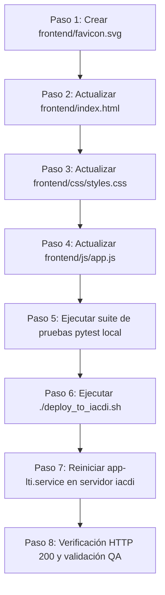

# Especificación Técnica: Rediseño e Homologación Visual HALO (Claro Chile) - App LTI

**Documento:** `SPECS_REDISENO_PORTAL_HALO.md`  
**Versión:** 1.0.0  
**Fecha:** 21 de Septiembre de 2026  
**Autor:** Subagente Planificador de Specs (Pipeline 5 Agentes)  
**Estado:** Aprobado para Implementación  
**Entornos Destino:** `bobbadeveloper` (Local) y `iacdi` (Producción)

---

## 1. Contexto, Objetivos y Justificación Visual

### 1.1 Contexto Institucional
El ecosistema de herramientas de Claro Chile opera sobre el **Portal de Acceso HALO** alojado en el servidor `iacdi` (IP `100.82.24.75` / `https://200.14.222.162`). Todas las aplicaciones satélites integradas (`provision-plataformas`, `asignacion-ingenieros-app`, `starlink-sync`, `ausencias`, `vlan-manager-v2`) han sido unificadas bajo el diseño de marca oficial **HALO** (Claro Chile), caracterizado por su cabecera institucional en color rojo corporativo (#B52217), isotipo oficial de anillo de 8 nodos con núcleo cuadrangular, tipografía limpia y paleta de acentos de alto contraste.

La **App LTI** (Portal de Seguimiento para Líderes TI) mantiene actualmente un diseño heredado con una cabecera azul (#0284c7) y elementos de navegación acoplados directamente en la misma línea del branding, lo que genera una desconexión visual al navegar entre el portal central y la aplicación.

### 1.2 Objetivos del Rediseño
1. **Identidad Institucional 100% Homologada**: Reemplazar la cabecera actual por el banner superior institucional `.app-header` estándar de HALO (fondo `#B52217`, isotipo SVG canónico, marca "HALO" y subtítulo "App Líderes TI" en teal corporativo `#0097A9`).
2. **Arquitectura de Interfaz Desacoplada (Sub-barra de Módulos)**: Separar la navegación de módulos de App LTI en una sub-barra elegante (`.nav-subbar`) ubicada inmediatamente debajo de la cabecera institucional. Esto preserva el 100% de la funcionalidad de la aplicación (Seguimiento de Proyectos, Búsqueda Directa, Generador de Tickets, Solicitud LTI, Mantenedor de Usuarios, conmutador de tema Claro/Oscuro y badge de rol) manteniendo la pureza de la identidad corporativa de HALO.
3. **Alineación Cromática de Marca Claro Chile**: Actualizar la paleta de tokens principales (`--primary`, hover, active tabs, botones principales, loaders) al rojo corporativo `#DA291C` (hover `#93190F`), detalles en teal `#0097A9`, fondos `#F4F5F7` y blanco cálido `#FDEDEA` para alto contraste.
4. **Soporte Dual Impecable (Modo Claro & Modo Oscuro)**: Mantener el banner institucional HALO (`#B52217`) uniforme e idéntico en ambos modos (garantía de marca uniforme), adaptando con alta legibilidad la sub-barra, tarjetas, modales y tablas para modo claro y modo oscuro.
5. **Pantalla SSO y Favicon Oficial**: Actualizar la vista previa de autenticación SSO (`#auth-view`) y crear el `favicon.svg` oficial de HALO bicolor.
6. **Despliegue Multi-Entorno**: Desplegar y validar en el servidor de desarrollo local `bobbadeveloper` y sincronizar mediante `./deploy_to_iacdi.sh` hacia producción `iacdi` con reinicio del servicio `systemctl --user restart app-lti`.

---

## 2. Tokens de Marca y Sistema de Diseño HALO

### 2.1 Paleta de Color Oficial (Claro Chile)
| Token Semántico | Valor Hex | Uso en la Interfaz |
| :--- | :--- | :--- |
| `HALO_HEADER_BG` | `#B52217` | Fondo exclusivo del banner superior institucional (`.app-header`). |
| `CLARO_RED_CTA` | `#DA291C` | Botones primarios (`.btn-primary`), tab activo, acento de enlaces e insignias destacadas. |
| `CLARO_RED_HOVER` | `#93190F` | Estado hover de botones primarios y acciones principales. |
| `CLARO_RED_SOFT` | `#FBE9E7` | Fondos de selección sutiles, pills activas y estados focus suaves en modo claro. |
| `CLARO_TEAL` | `#0097A9` | Subtítulo institucional (`.brand-sub`), acentos secundarios y enlaces de soporte. |
| `CLARO_WARM_WHITE` | `#FDEDEA` | Texto principal del header, avatar institucional y trazo del isotipo sobre fondo rojo. |
| `BG_APP_LIGHT` | `#F4F5F7` | Fondo general de la aplicación en Modo Claro. |
| `SURFACE_LIGHT` | `#FFFFFF` | Superficie de tarjetas, tablas, sub-barra y modales en Modo Claro. |
| `BORDER_LIGHT` | `#E3E6EB` | Bordes estándar y separadores en Modo Claro. |
| `BORDER_STRONG_LIGHT` | `#D3D7DE` | Bordes de inputs y botones secundarios en Modo Claro. |
| `TEXT_PRIMARY_LIGHT` | `#181B20` | Texto de alta jerarquía y títulos en Modo Claro. |
| `TEXT_MUTED_LIGHT` | `#666E7A` | Texto secundario y leyendas en Modo Claro. |
| `BG_APP_DARK` | `#0B0F17` | Fondo general de la aplicación en Modo Oscuro. |
| `SURFACE_DARK` | `#131B2E` | Superficie de tarjetas y modales en Modo Oscuro. |
| `SURFACE_SEC_DARK` | `#1E293B` | Superficie de sub-barra e inputs en Modo Oscuro. |
| `BORDER_DARK` | `#24324D` | Bordes de tarjetas y separadores en Modo Oscuro. |

### 2.2 Isotipo SVG Oficial de HALO
El isotipo oficial consta de un anillo de 8 nodos circulares y un cuadrado central con esquinas redondeadas:
- **Dimensiones**: `30x30` px, `viewBox="0 0 120 120"`.
- **Coordenadas de los 8 círculos (radio = 8)**:
  - (60, 16), (91, 29), (104, 60), (91, 91), (60, 104), (29, 91), (16, 60), (29, 29).
- **Cuadrado central**: `x="47" y="47" width="26" height="26" rx="8"`.
- **Variante en Header**: Relleno monocromático `#FDEDEA` tanto en el anillo como en el núcleo.
- **Variante en Favicon / Pantalla SSO**: Anillo en `#DA291C` y núcleo en `#0097A9`.

```xml
<!-- SVG Isotipo Header (.app-header) -->
<svg width="30" height="30" viewBox="0 0 120 120" role="img" aria-label="HALO">
  <g fill="#FDEDEA">
    <circle cx="60"  cy="16"  r="8"/>
    <circle cx="91"  cy="29"  r="8"/>
    <circle cx="104" cy="60"  r="8"/>
    <circle cx="91"  cy="91"  r="8"/>
    <circle cx="60"  cy="104" r="8"/>
    <circle cx="29"  cy="91"  r="8"/>
    <circle cx="16"  cy="60"  r="8"/>
    <circle cx="29"  cy="29"  r="8"/>
  </g>
  <rect x="47" y="47" width="26" height="26" rx="8" fill="#FDEDEA"/>
</svg>
```

```xml
<!-- SVG Favicon (frontend/favicon.svg) -->
<svg xmlns="http://www.w3.org/2000/svg" viewBox="0 0 120 120" width="32" height="32" role="img" aria-label="HALO">
  <g fill="#DA291C">
    <circle cx="60"  cy="16"  r="8"/>
    <circle cx="91"  cy="29"  r="8"/>
    <circle cx="104" cy="60"  r="8"/>
    <circle cx="91"  cy="91"  r="8"/>
    <circle cx="60"  cy="104" r="8"/>
    <circle cx="29"  cy="91"  r="8"/>
    <circle cx="16"  cy="60"  r="8"/>
    <circle cx="29"  cy="29"  r="8"/>
  </g>
  <rect x="47" y="47" width="26" height="26" rx="8" fill="#0097A9"/>
</svg>
```

---

## 3. Especificación Detallada de Cambios Frontend

### 3.1 Archivo: `frontend/favicon.svg` (Nuevo)
Se debe crear el archivo `frontend/favicon.svg` con el SVG oficial bicolor de HALO detallado en la sección 2.2.

### 3.2 Archivo: `frontend/index.html`
1. **Head**:
   - Agregar favicon SVG: `<link rel="icon" type="image/svg+xml" href="favicon.svg">`.
   - Modificar título a formato corporativo: `<title>HALO — App Líderes TI</title>`.
2. **Pantalla SSO (`#auth-view`)**:
   - Reemplazar el contenedor antiguo por una tarjeta corporativa estilizada con el logo HALO bicolor, spinner rojo `#DA291C` y texto "HALO · App Líderes TI".
3. **Banner Superior Institucional (`.app-header`)**:
   - Estructura pura idéntica a `provision-plataformas` y `portal-acceso`:
     ```html
     <header class="app-header">
       <div class="brand-inline">
         <svg width="30" height="30" viewBox="0 0 120 120" role="img" aria-label="HALO">
           <g fill="#FDEDEA">
             <circle cx="60"  cy="16"  r="8"/><circle cx="91"  cy="29"  r="8"/><circle cx="104" cy="60"  r="8"/>
             <circle cx="91"  cy="91"  r="8"/><circle cx="60"  cy="104" r="8"/><circle cx="29"  cy="91"  r="8"/>
             <circle cx="16"  cy="60"  r="8"/><circle cx="29"  cy="29"  r="8"/>
           </g>
           <rect x="47" y="47" width="26" height="26" rx="8" fill="#FDEDEA"/>
         </svg>
         <div class="brand-text">
           <h1 class="brand-name">HALO</h1>
           <p class="brand-sub">App Líderes TI</p>
         </div>
       </div>
       <div class="user-area">
         <div class="user-block">
           <span class="user-avatar" id="user-avatar">LT</span>
           <span class="user-name" id="user-display-name">Líder TI</span>
         </div>
         <button class="btn-logout" id="logout-btn" aria-label="Salir" title="Cerrar Sesión">
           <svg viewBox="0 0 24 24" fill="none" stroke="currentColor" stroke-width="1.8" stroke-linecap="round" stroke-linejoin="round">
             <path d="M9 21H5a2 2 0 0 1-2-2V5a2 2 0 0 1 2-2h4"/>
             <path d="M16 17l5-5-5-5"/>
             <path d="M21 12H9"/>
           </svg>
         </button>
       </div>
     </header>
     ```
4. **Sub-Barra de Navegación de Módulos (`.nav-subbar`)**:
   - Inmediatamente posterior al header:
     ```html
     <nav class="nav-subbar" aria-label="Navegación de módulos">
       <div class="nav-subbar-container">
         <div class="nav-modules">
           <button id="nav-btn-projects" class="nav-module-btn active" title="Seguimiento de Proyectos y Drill Down">
             📊 Seguimiento Proyectos
           </button>
           <button id="nav-btn-direct-search" class="nav-module-btn" title="Búsqueda directa en tablas completas">
             🔎 Búsqueda Directa
           </button>
           <button id="nav-btn-tickets" class="nav-module-btn" title="Generador Automatizado de Tickets">
             🤖 Generador de Tickets
           </button>
           <button id="nav-btn-solicitud-lti" class="nav-module-btn" title="Ingreso de Nueva Solicitud LTI">
             📝 Solicitud LTI
           </button>
           <button id="nav-btn-usuarios" class="nav-module-btn" title="Gestión de Usuarios del Sistema" style="display: none;">
             👥 Usuarios
           </button>
         </div>
         <div class="nav-subbar-actions">
           <span id="user-role-badge" class="badge badge-info">Líder</span>
           <button id="theme-toggle-btn" class="btn-icon-subbar" title="Cambiar Modo Claro / Oscuro" aria-label="Cambiar tema">
             <span id="theme-icon">🌙</span>
           </button>
         </div>
       </div>
     </nav>
     ```

### 3.3 Archivo: `frontend/css/styles.css`
1. **Actualización de Variables `:root`**:
   - `--primary: #DA291C;`
   - `--primary-hover: #93190F;`
   - `--primary-light: #FBE9E7;`
   - `--primary-text: #B52217;`
   - `--halo-header: #B52217;`
   - `--halo-teal: #0097A9;`
   - `--halo-contrast: #FDEDEA;`
   - `--bg-primary: #F4F5F7;` (Fondo homologado con portal y provision-plataformas).
   - `--border-color: #E3E6EB;`
2. **Actualización de Variables `[data-theme="dark"]`**:
   - `--primary: #E03B2F;`
   - `--primary-hover: #DA291C;`
   - `--primary-light: rgba(218, 41, 28, 0.18);`
   - `--primary-text: #FF6B5F;`
   - `--bg-primary: #0B0F17;`
   - `--bg-surface: #131B2E;`
   - `--bg-surface-secondary: #1E293B;`
   - `--border-color: #24324D;`
3. **Estilos Canónicos de `.app-header`**:
   ```css
   .app-header {
     display: flex;
     align-items: center;
     justify-content: space-between;
     padding: 12px 24px;
     background: #B52217 !important;
     flex-shrink: 0;
     border-bottom: 1px solid rgba(253, 237, 234, 0.22);
     position: relative;
     z-index: 50;
   }
   .app-header .brand-inline {
     display: flex;
     align-items: center;
     gap: 11px;
   }
   .app-header .brand-text {
     display: flex;
     flex-direction: column;
     line-height: 1.2;
   }
   .app-header .brand-name {
     font-size: 17px;
     font-weight: 700;
     letter-spacing: 1.5px;
     color: #FDEDEA;
     margin: 0;
   }
   .app-header .brand-sub {
     font-size: 11px;
     font-weight: 700;
     color: #0097A9;
     margin: 0;
   }
   .app-header .user-area {
     display: flex;
     align-items: center;
     gap: 14px;
     font-size: 13.5px;
     color: rgba(253, 237, 234, 0.86);
   }
   .app-header .user-block {
     display: flex;
     align-items: center;
     gap: 8px;
   }
   .app-header .user-avatar {
     width: 28px;
     height: 28px;
     border-radius: 50%;
     background: #FDEDEA;
     color: #B52217;
     display: flex;
     align-items: center;
     justify-content: center;
     font-size: 11px;
     font-weight: 700;
     flex-shrink: 0;
   }
   .app-header .user-name {
     font-size: 13px;
     font-weight: 700;
     color: #FDEDEA;
   }
   .app-header .btn-logout {
     display: inline-flex;
     align-items: center;
     justify-content: center;
     background: transparent;
     border: none;
     color: rgba(253, 237, 234, 0.86);
     padding: 6px;
     border-radius: 6px;
     cursor: pointer;
     transition: all 0.15s ease;
   }
   .app-header .btn-logout svg {
     width: 18px;
     height: 18px;
   }
   .app-header .btn-logout:hover {
     color: #FFFFFF;
     background: rgba(0, 0, 0, 0.2);
   }
   ```
4. **Estilos Canónicos de `.nav-subbar`**:
   ```css
   .nav-subbar {
     background-color: var(--bg-surface);
     border-bottom: 1px solid var(--border-color);
     position: sticky;
     top: 0;
     z-index: 45;
     box-shadow: 0 1px 3px rgba(0, 0, 0, 0.04);
     transition: background-color var(--transition-normal), border-color var(--transition-normal);
   }
   .nav-subbar-container {
     max-width: 1560px;
     margin: 0 auto;
     padding: 0.5rem 1.5rem;
     display: flex;
     justify-content: space-between;
     align-items: center;
     gap: 1rem;
   }
   .nav-modules {
     display: flex;
     align-items: center;
     gap: 0.5rem;
     background: var(--bg-surface-secondary);
     padding: 0.25rem 0.35rem;
     border-radius: var(--radius-md);
     border: 1px solid var(--border-color);
     overflow-x: auto;
   }
   .nav-module-btn {
     padding: 0.45rem 0.9rem;
     border: none;
     background: transparent;
     color: var(--text-secondary);
     font-size: 0.85rem;
     font-weight: 600;
     border-radius: var(--radius-sm);
     cursor: pointer;
     display: flex;
     align-items: center;
     gap: 0.4rem;
     white-space: nowrap;
     transition: all var(--transition-fast);
   }
   .nav-module-btn:hover {
     color: var(--text-primary);
     background: rgba(0, 0, 0, 0.03);
   }
   .nav-module-btn.active {
     background: var(--bg-surface);
     color: var(--primary);
     font-weight: 700;
     box-shadow: var(--shadow-sm);
     border-bottom: 2px solid var(--primary);
   }
   .nav-subbar-actions {
     display: flex;
     align-items: center;
     gap: 0.75rem;
     flex-shrink: 0;
   }
   .btn-icon-subbar {
     background: var(--bg-surface-secondary);
     border: 1px solid var(--border-color);
     color: var(--text-primary);
     width: 34px;
     height: 34px;
     border-radius: var(--radius-md);
     display: inline-flex;
     align-items: center;
     justify-content: center;
     cursor: pointer;
     transition: all var(--transition-fast);
   }
   .btn-icon-subbar:hover {
     background: var(--bg-surface-tertiary);
     color: var(--primary);
     border-color: var(--primary);
   }
   ```
5. **Alineación de Botones y Componentes**:
   - `.btn-primary`: Fondo `#DA291C`, color `#FFFFFF`. En hover: `#93190F`.
   - `.spinner-inline`: Borde superior/inferior en `var(--primary)`.

### 3.4 Archivo: `frontend/js/app.js`
- Verificar que las referencias del DOM funcionen transparentemente:
  * `document.getElementById('user-display-name')`: Actualiza el nombre completo o username.
  * `document.getElementById('user-avatar')`: Se asegura de inyectar las iniciales del usuario (ej. 'AA', 'LT') en el nuevo elemento `.user-avatar`.
  * `document.getElementById('user-role-badge')`: Actualiza la etiqueta de rol en la sub-barra.
  * `document.getElementById('logout-btn')`: Vincula el evento de salida a `Auth.logout()`.
  * `document.getElementById('theme-toggle-btn')`: Alterna el tema y el emoji sol/luna en `#theme-icon`.
  * Los botones de módulos (`nav-btn-projects`, etc.) continúan invocando `this.switchModule(...)` de forma íntegra.

---

## 4. Plan de Implementación Paso a Paso para el Coder



1. **Paso 1: Generar el Favicon Institucional**
   - Crear el archivo `frontend/favicon.svg` con el SVG oficial bicolor.
2. **Paso 2: Modificar `frontend/index.html`**
   - Incorporar etiqueta `<link rel="icon" ...>` en el `<head>`.
   - Reemplazar estructura de `#auth-view` con la tarjeta HALO y el logo SVG correspondiente.
   - Sustituir la cabecera `.app-header` por el estándar HALO `#B52217`.
   - Insertar la sub-barra `.nav-subbar` con los botones de módulos, badge y botón de cambio de tema.
3. **Paso 3: Modificar `frontend/css/styles.css`**
   - Actualizar tokens en `:root` y `[data-theme="dark"]` adoptando la paleta de Claro Chile.
   - Declarar las reglas de `.app-header` con `#B52217` fijo y `.nav-subbar` interactiva.
   - Asegurar que `.app-header` no sufra inversión de colores en Modo Oscuro.
4. **Paso 4: Ajustar `frontend/js/app.js`**
   - En `showAppView()`, calcular e inyectar las iniciales en `#user-avatar` (ej: "Juan Pérez" -> "JP", "Admin" -> "AD").
   - Confirmar listeners de eventos para `#logout-btn`, `#theme-toggle-btn` y `#nav-btn-*`.
5. **Paso 5: Validar Pruebas Locales en `bobbadeveloper`**
   - Ejecutar suite completa con el entorno virtual:
     `"/home/bobbasystem/Desarrollos/Carga Data SM/venv/bin/python3" -m pytest`
6. **Paso 6: Sincronizar a Servidor de Producción `iacdi`**
   - Ejecutar el script: `./deploy_to_iacdi.sh`
7. **Paso 7: Reiniciar Servicio de Producción**
   - Conectar vía SSH y reiniciar el servicio systemd de usuario:
     `ssh iacdi "systemctl --user restart app-lti"`
8. **Paso 8: Comprobación de Salud Remota**
   - Comprobar estado: `ssh iacdi "systemctl --user status app-lti"`
   - Verificar logs recientes: `ssh iacdi "journalctl --user -u app-lti -n 25 --no-pager"`
   - Verificar respuesta HTTP: `ssh iacdi "curl -s -o /dev/null -w '%{http_code}' http://localhost:8000/"` (debe retornar 200).

---

## 5. Matriz de Pruebas y Aseguramiento de Calidad (QA)

| ID | Caso de Prueba | Procedimiento | Resultado Esperado |
| :--- | :--- | :--- | :--- |
| **QA-01** | Visualización Header HALO | Cargar la aplicación autenticado. | Header con fondo `#B52217`, isotipo SVG HALO, marca 'HALO', subtítulo 'App Líderes TI' (#0097A9) y datos de usuario en blanco cálido. |
| **QA-02** | Sub-barra de Módulos | Verificar posición y contenido de `.nav-subbar`. | Sub-barra sticky justo debajo del header con los 5 botones de módulos, badge de rol y botón de tema. |
| **QA-03** | Navegación entre Módulos | Hacer clic en cada botón de módulo. | El tab activo recibe clase `.active` con borde inferior rojo `#DA291C`; el contenedor correspondiente se muestra sin parpadeo. |
| **QA-04** | Modo Oscuro / Claro | Pulsar el botón conmutador de tema (`#theme-toggle-btn`). | El header `#B52217` se mantiene idéntico. La sub-barra y fondo adaptan sus colores a paleta oscura/clara con alto contraste. |
| **QA-05** | Favicon Oficial | Abrir la pestaña en el navegador. | El favicon muestra el icono oficial HALO en formato SVG bicolor. |
| **QA-06** | Pantalla Inicial SSO | Acceder a `/` con sesión en comprobación. | La tarjeta de autenticación muestra logo HALO y spinner rojo (#DA291C). |
| **QA-07** | Salida Segura (Logout) | Hacer clic en el botón de logout SVG. | Se invoca `Auth.logout()` y redirige fluidamente al login del Portal de Acceso. |
| **QA-08** | Regresión de Backend y Tests | Ejecutar suite de pruebas pytest. | 100% de tests existentes pasan satisfactoriamente. |
| **QA-09** | Despliegue en Servidor IACDI | Ejecutar `./deploy_to_iacdi.sh` y reiniciar servicio. | Archivos sincronizados, servicio `app-lti.service` activo (running) y respuesta HTTP 200. |

---

## 6. Criterios de Aceptación (Definition of Done - DoD)

### Para el Coder (Desarrollador Fullstack):
- [ ] `frontend/favicon.svg` creado con el SVG canónico HALO.
- [ ] `frontend/index.html` actualizado con la cabecera HALO `#B52217` y la sub-barra de navegación `.nav-subbar`.
- [ ] `frontend/css/styles.css` actualizado con las variables de marca Claro Chile (`#DA291C`, `#B52217`, `#0097A9`, `#F4F5F7`, `#FDEDEA`) y soporte dual de temas.
- [ ] `frontend/js/app.js` actualizado para poblar iniciales de avatar y enlazar acciones de usuario sin warnings.
- [ ] Pruebas unitarias y de integración pasando exitosamente en local.
- [ ] Sincronización a `iacdi` y reinicio del servicio completados.

### Para el Revisor de Código:
- [ ] Estricto cumplimiento del principio de responsabilidad única en markup y CSS.
- [ ] Ninguna alteración o regresión en la lógica de negocio, endpoints FastAPI o RBAC.
- [ ] Código limpio, sin hardcodes innecesarios ni estilos `inline` desordenados.

### Para el QA Tester:
- [ ] Pruebas de QA-01 a QA-09 ejecutadas y documentadas.
- [ ] Ausencia total de errores de consola en herramientas de desarrollador.
- [ ] Validación de contraste visual y accesibilidad en desktop y responsive.

### Para el Validador / Integrador:
- [ ] Servicio `app-lti` verificado en `iacdi` con `systemctl --user status app-lti`.
- [ ] Integración perfecta con el SSO del Portal de Acceso.
