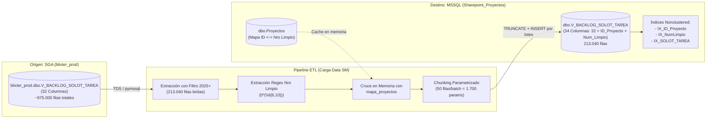

# ESPECIFICACIÓN TÉCNICA Y ARQUITECTÓNICA (SPECS)
## Módulo: "Replicación y Enriquecimiento de Datos ETL — Vista SGA V_BACKLOG_SOLOT_TAREA a MSSQL Sharepoint_Proyectos"

- **Documento:** SPECS-LTI-ETL-009
- **Versión:** 1.0.0
- **Fecha:** 2026-10-05
- **Autor:** Subagente 1 (Planificador & Diseñador de Specs)
- **Destinatario:** Subagente 2 (Codificador & Implementador), Subagente 3 (Auditor de Calidad / Code Reviewer), Subagente 4 (Tester QA), Subagente 5 (Desplegador / DevOps)
- **Ubicación del Proyecto:** `/home/bobbasystem/Desarrollos/app-lti` y `/home/bobbasystem/Desarrollos/Carga Data SM`

---

## CONTROL DE VERSIONES Y REGISTRO DE CAMBIOS

| Versión | Fecha | Autor | Descripción del Cambio |
|---|---|---|---|
| **1.0.0** | 2026-10-05 | Subagente 1 (Planificador) | **Especificación Técnica Inicial:**<br>1. Definición del requerimiento de replicación de `[blixter_prod].[dbo].[V_BACKLOG_SOLOT_TAREA]` (SGA) hacia `[Sharepoint_Proyectos].[dbo].[V_BACKLOG_SOLOT_TAREA]` (MSSQL destino).<br>2. Definición de DDL canónico de la tabla destino con 34 columnas (32 del origen + 2 de enriquecimiento: `ID_Proyecto` y `Numero_Proyecto_Limpio`).<br>3. Estrategia de filtrado de datos (criterio estándar del Backlog 2025+: `INICIO_PROY >= '2025-01-01' OR FEC_INICIO >= '2025-01-01' OR FEC_INICIO_SYS >= '2025-01-01'`) para ~213.040 registros.<br>4. Estrategia matemática de inserción por lotes (chunk_size = 50 rows = 1.700 parámetros) respetando el límite estricto de 2.100 parámetros de TDS SQL Server.<br>5. Integración en el cron de sincronización periódica (09:00 y 14:45) en `procesar_datos_ftp.py` y `ejecutar_y_notificar.py`.<br>6. Definición de índices de alto rendimiento para consultas futuras y cruces con Proyectos.<br>7. Regla estricta de alcance: aislamiento total respecto a la base de código de App LTI (cero modificaciones en `backend/` y `frontend/`). |

---

## 1. CONTEXTO Y JUSTIFICACIÓN DEL NEGOCIO

### 1.1. Antecedentes
En el ecosistema operacional de Claro Empresas y el equipo LTI, la gestión de proyectos de telecomunicaciones e infraestructura corporativa requiere visibilidad unificada de tres dimensiones clave:
1. **Gestión de Proyectos SharePoint**: Planificación, líderes asignados, hitos y datos comerciales (`dbo.Proyectos`).
2. **Operaciones de Soporte y Cambios (HPSM / Service Manager)**: Tickets e incidentes (`dbo.registrosRF_SD_SM`) y órdenes de cambio (`dbo.registrosSM_RFC`).
3. **Aprovisionamiento y Tareas Técnicas SGA**: Órdenes de trabajo, Solots y tareas operacionales. Actualmente se replica la tabla `dbo.CT_BACKLOG_OPERACIONES2`.

### 1.2. Necesidad Operativa
El usuario requiere disponibilizar en la base de datos de App LTI (`Sharepoint_Proyectos` en MSSQL Server) una nueva fuente de datos desde el servidor SGA de producción (`blixter_prod`): la vista/tabla **`[blixter_prod].[dbo].[V_BACKLOG_SOLOT_TAREA]`**.
Esta tabla desagrega las Solots a nivel de **Tarea individual**, registrando:
- Área responsable y usuario asignado (`TAREA_AREA_RESPONSABLE`, `TAREA_USUARIO_RESPONSABLE`, `USU_EJECUTOR_TAREA`).
- Estados granulares de cada tarea (`TAREA_ESTADO`).
- Tiempos de aprovisionamiento y compromisos (`TAREA_FECHA_INICIO`, `TAREA_FECHA_COMPROMISO`, `DIAS_PROVISION_TAREA`, `DIAS_COMPROMISO_TAREA`).
- Factores de detención, observaciones y direcciones geográficas (`FACTOR`, `OBSERVACION`, `DIRECCION`, `DISTRITO`, `VALORTXT`).

### 1.3. Regla Estricta de Alcance (Inmutabilidad de App LTI)
> [!IMPORTANT]
> **POLÍTICA DE ALCANCE CERRADO**:
> Esta especificación y su implementación subsiguiente tienen alcance **estrictamente acotado a la Base de Datos y al pipeline de ETL**.
> **NO se debe modificar ningún componente de la aplicación App LTI**:
> - Prohibido modificar archivos de backend: `backend/main.py`, `backend/auth.py`, `backend/db.py`, etc.
> - Prohibido modificar archivos de frontend: `frontend/index.html`, `frontend/js/app.js`, etc.
> La tabla se creará y mantendrá sincronizada en la base de datos como infraestructura habilitadora para futuros desarrollos.

---

## 2. ARQUITECTURA DE DATOS Y CONEXIONES



### 2.1. Credenciales y Parámetros de Origen (SGA)
- **Servidor:** `200.14.226.223` (Puerto 1433)
- **Base de Datos:** `blixter_prod`
- **Usuario:** `reportes`
- **Archivo de Configuración:** `/home/bobbasystem/Desarrollos/Carga Data SM/Conexion BD SGA`
- **Driver de Conexión:** `pymssql`
- **Timeout:** 30 segundos (login y queries de extracción)

### 2.2. Credenciales y Parámetros de Destino (MSSQL Sharepoint_Proyectos)
- **Servidor:** `192.168.10.6` (producción interna) o `200.14.222.162` (acceso público)
- **Puerto:** `1433`
- **Base de Datos:** `Sharepoint_Proyectos`
- **Usuario:** `sa`
- **Archivo de Configuración:** `/home/bobbasystem/Desarrollos/Carga Data SM/Conexion BD`

---

## 3. ESQUEMA DDL DETALLADO (TABLA DESTINO)

La tabla en la base de datos destino se denominará formalmente **`dbo.V_BACKLOG_SOLOT_TAREA`** (creada como tabla física de alto rendimiento para permitir indexación y consultas analíticas de sub-milisegundo).

### 3.1. DDL Completo de Creación
```sql
USE [Sharepoint_Proyectos];
GO

-- 1. Asegurar la creación de la tabla física si no existe
IF OBJECT_ID('dbo.V_BACKLOG_SOLOT_TAREA', 'U') IS NULL
BEGIN
    CREATE TABLE [dbo].[V_BACKLOG_SOLOT_TAREA] (
        -- 32 Columnas replicadas fielmente desde SGA blixter_prod
        [NRO_PROYECTO]              VARCHAR(100)    NULL,
        [CLI_CLIENTE]               VARCHAR(150)    NULL,
        [PRO_ING_PROYECTO]          VARCHAR(100)    NULL,
        [INICIO_PROY]               DATETIME2       NULL,
        [FECHA_COMPROMETIDA_SOLOT]  DATETIME2       NULL,
        [SOLOT_ID]                  BIGINT          NULL,
        [ESTADO_OTP]                VARCHAR(100)    NULL,
        [TIPO_SOLOT]                VARCHAR(200)    NULL,
        [TAREA_ID]                  BIGINT          NULL,
        [TAREA_TIPO]                VARCHAR(100)    NULL,
        [TAREA_AREA_RESPONSABLE]    VARCHAR(100)    NULL,
        [TAREA_USUARIO_RESPONSABLE] VARCHAR(100)    NULL,
        [TAREA_FECHA_INICIO]        DATETIME2       NULL,
        [TAREA_FECHA_COMPROMISO]    DATETIME2       NULL,
        [TAREA_ESTADO]              VARCHAR(30)     NULL,
        [FACTOR]                    VARCHAR(1000)   NULL,
        [FECHA_ACTUAL]              DATETIME2       NULL,
        [DIAS_PROVISION_TAREA]      INT             NULL,
        [DIAS_COMPROMISO_TAREA]     INT             NULL,
        [FEC_INICIO]                DATETIME2       NULL,
        [FEC_INICIO_SYS]            DATETIME2       NULL,
        [FEC_REALIZACION]           DATETIME2       NULL,
        [FEC_FIN_SYS]               DATETIME2       NULL,
        [USUARIO_CIERRE_SIS]        VARCHAR(1000)   NULL,
        [USU_EJECUTOR_TAREA]        VARCHAR(200)    NULL,
        [ASIGNADO_OTP]              VARCHAR(200)    NULL,
        [OBSERVACION]               VARCHAR(8000)   NULL,
        [USUARIO_MODIFICO]          VARCHAR(1000)   NULL,
        [DIRECCION]                 VARCHAR(1000)   NULL,
        [DISTRITO]                  VARCHAR(1000)   NULL,
        [VALORTXT]                  VARCHAR(MAX)    NULL,
        [id]                        INT             NULL,
        
        -- 2 Columnas añadidas para enriquecimiento analítico del ecosistema LTI
        [ID_Proyecto]               NUMERIC(18,0)   NULL,
        [Numero_Proyecto_Limpio]    VARCHAR(50)     NULL
    );
    
    PRINT 'Tabla dbo.V_BACKLOG_SOLOT_TAREA creada exitosamente.';
END
GO

-- 2. Creación de Índices de Alto Rendimiento para cruces y filtros
IF NOT EXISTS (SELECT 1 FROM sys.indexes WHERE name = 'IX_V_BACKLOG_SOLOT_TAREA_ID_Proyecto' AND object_id = OBJECT_ID('dbo.V_BACKLOG_SOLOT_TAREA'))
BEGIN
    CREATE NONCLUSTERED INDEX [IX_V_BACKLOG_SOLOT_TAREA_ID_Proyecto] 
    ON [dbo].[V_BACKLOG_SOLOT_TAREA] ([ID_Proyecto])
    WHERE [ID_Proyecto] IS NOT NULL;
    PRINT 'Índice IX_V_BACKLOG_SOLOT_TAREA_ID_Proyecto creado.';
END
GO

IF NOT EXISTS (SELECT 1 FROM sys.indexes WHERE name = 'IX_V_BACKLOG_SOLOT_TAREA_NumLimpio' AND object_id = OBJECT_ID('dbo.V_BACKLOG_SOLOT_TAREA'))
BEGIN
    CREATE NONCLUSTERED INDEX [IX_V_BACKLOG_SOLOT_TAREA_NumLimpio] 
    ON [dbo].[V_BACKLOG_SOLOT_TAREA] ([Numero_Proyecto_Limpio])
    WHERE [Numero_Proyecto_Limpio] IS NOT NULL;
    PRINT 'Índice IX_V_BACKLOG_SOLOT_TAREA_NumLimpio creado.';
END
GO

IF NOT EXISTS (SELECT 1 FROM sys.indexes WHERE name = 'IX_V_BACKLOG_SOLOT_TAREA_SOLOT_TAREA' AND object_id = OBJECT_ID('dbo.V_BACKLOG_SOLOT_TAREA'))
BEGIN
    CREATE NONCLUSTERED INDEX [IX_V_BACKLOG_SOLOT_TAREA_SOLOT_TAREA] 
    ON [dbo].[V_BACKLOG_SOLOT_TAREA] ([SOLOT_ID], [TAREA_ID]);
    PRINT 'Índice IX_V_BACKLOG_SOLOT_TAREA_SOLOT_TAREA creado.';
END
GO
```

### 3.2. Diccionario de Datos y Mapeo de Tipos

| # | Columna Origen / Destino | Tipo Origen (SGA) | Tipo Destino (MSSQL) | Descripción Funcional |
|---|---|---|---|---|
| 1 | `NRO_PROYECTO` | `varchar(100)` | `VARCHAR(100)` | Identificador del proyecto en SGA (ej. `'0001595247'`). |
| 2 | `CLI_CLIENTE` | `varchar(150)` | `VARCHAR(150)` | Nombre o razón social del cliente. |
| 3 | `PRO_ING_PROYECTO` | `varchar(100)` | `VARCHAR(100)` | Nombre del Ingeniero de Proyecto SGA asignado. |
| 4 | `INICIO_PROY` | `datetime2` | `DATETIME2` | Fecha de creación/inicio del proyecto en SGA. |
| 5 | `FECHA_COMPROMETIDA_SOLOT` | `datetime2` | `DATETIME2` | Fecha comprometida para el cierre de la Solot. |
| 6 | `SOLOT_ID` | `bigint` | `BIGINT` | Identificador único de la Solot en SGA. |
| 7 | `ESTADO_OTP` | `varchar(100)` | `VARCHAR(100)` | Estado general de la Orden de Trabajo / Proyecto. |
| 8 | `TIPO_SOLOT` | `varchar(200)` | `VARCHAR(200)` | Tipología de la Solot (Instalación, Desinstalación, etc.). |
| 9 | `TAREA_ID` | `bigint` | `BIGINT` | Identificador único de la tarea técnica en SGA. |
| 10 | `TAREA_TIPO` | `varchar(100)` | `VARCHAR(100)` | Categoría o tipo de tarea técnica. |
| 11 | `TAREA_AREA_RESPONSABLE` | `varchar(100)` | `VARCHAR(100)` | Área o unidad asignada a la tarea (ej. 'Instalaciones'). |
| 12 | `TAREA_USUARIO_RESPONSABLE`| `varchar(100)` | `VARCHAR(100)` | Persona o técnico responsable de la tarea. |
| 13 | `TAREA_FECHA_INICIO` | `datetime2` | `DATETIME2` | Fecha y hora en que la tarea inició su ciclo. |
| 14 | `TAREA_FECHA_COMPROMISO` | `datetime2` | `DATETIME2` | Fecha y hora de compromiso de culminación de la tarea. |
| 15 | `TAREA_ESTADO` | `varchar(30)` | `VARCHAR(30)` | Estado de la tarea (Cerrada, En Proceso, Pendiente). |
| 16 | `FACTOR` | `varchar(1000)` | `VARCHAR(1000)` | Factor o causal de demora / observación clave. |
| 17 | `FECHA_ACTUAL` | `datetime2` | `DATETIME2` | Marca de tiempo del snapshot en SGA. |
| 18 | `DIAS_PROVISION_TAREA` | `int` | `INT` | Días transcurridos en provisión técnica. |
| 19 | `DIAS_COMPROMISO_TAREA` | `int` | `INT` | Días de holgura o atraso respecto a la fecha compromiso. |
| 20 | `FEC_INICIO` | `datetime2` | `DATETIME2` | Fecha efectiva de inicio de la tarea/solot. |
| 21 | `FEC_INICIO_SYS` | `datetime2` | `DATETIME2` | Fecha de registro en el sistema informático SGA. |
| 22 | `FEC_REALIZACION` | `datetime2` | `DATETIME2` | Fecha efectiva de término o entrega técnica. |
| 23 | `FEC_FIN_SYS` | `datetime2` | `DATETIME2` | Fecha y hora de cierre formal en SGA. |
| 24 | `USUARIO_CIERRE_SIS` | `varchar(1000)` | `VARCHAR(1000)` | Usuario del sistema que procesó el cierre. |
| 25 | `USU_EJECUTOR_TAREA` | `varchar(200)` | `VARCHAR(200)` | Técnico que ejecutó la tarea en terreno. |
| 26 | `ASIGNADO_OTP` | `varchar(200)` | `VARCHAR(200)` | Asignación o sub-estado operativo de la OTP. |
| 27 | `OBSERVACION` | `varchar(8000)` | `VARCHAR(8000)` | Bitácora u observaciones detalladas del trabajo. |
| 28 | `USUARIO_MODIFICO` | `varchar(1000)` | `VARCHAR(1000)` | Último usuario que modificó el registro. |
| 29 | `DIRECCION` | `varchar(1000)` | `VARCHAR(1000)` | Dirección geográfica de instalación o servicio. |
| 30 | `DISTRITO` | `varchar(1000)` | `VARCHAR(1000)` | Comuna / Región / Distrito de instalación. |
| 31 | `VALORTXT` | `varchar(max)` | `VARCHAR(MAX)` | Información extendida o payload de detalle técnico. |
| 32 | `id` | `int` | `INT` | Identificador correlativo del registro en SGA. |
| 33 | `ID_Proyecto` | *No existe* | `NUMERIC(18,0)` | **Enriquecido**: Llave foránea lógica hacia `dbo.Proyectos(ID)`. |
| 34 | `Numero_Proyecto_Limpio`| *No existe* | `VARCHAR(50)` | **Enriquecido**: Número de proyecto sin ceros (ej. `'1595247'`). |

---

## 4. ESTRATEGIA DE EXTRACCIÓN, FILTRADO Y BATCHING

### 4.1. Filtro Estándar del Backlog (Vigencia 2025+)
El total de filas en `blixter_prod.dbo.V_BACKLOG_SOLOT_TAREA` asciende a **975.563 registros**. Replicar la totalidad del histórico histórico desde años 2015-2024 generaría:
- Transferencia de red excesiva e innecesaria (~250 MB comprimidos con campos de texto de 8.000 caracteres y MAX).
- Bloqueos de lectura prolongados sobre el servidor transaccional SGA (`200.14.226.223`).

**Criterio Oficial Ratificado**:
Se aplica el filtro estándar del Backlog vigente, conservando únicamente los registros cuyo año de inicio o registro en el sistema sea igual o superior a 2025:
```sql
WHERE INICIO_PROY >= '2025-01-01' 
   OR FEC_INICIO >= '2025-01-01' 
   OR FEC_INICIO_SYS >= '2025-01-01'
```
**Volumen Resultante**: Exactamente **213.040 registros**.

### 4.2. Algoritmo de Enriquecimiento LTI
El cruce se realiza en memoria utilizando el mapa de proyectos activos cargado desde `dbo.Proyectos`:

```python
def extraer_numero_proyecto_limpio(cadena):
    """
    Extrae y normaliza el número de proyecto de 6 a 10 dígitos, removiendo ceros a la izquierda.
    Ejemplo: '0001595247' -> '1595247'
    """
    if not cadena:
        return None
    match = re.search(r'\b0*(\d{6,10})\b', str(cadena))
    if match:
        return match.group(1)
    return None
```

Por cada registro extraído de SGA:
1. Se localiza el valor de `NRO_PROYECTO` (índice 0).
2. Se extrae `num_limpio = extraer_numero_proyecto_limpio(raw_nro)`.
3. Se consulta `id_proy = mapa_proyectos.get(num_limpio)`.
4. Se genera la tupla de 34 elementos: `fila_origen + (id_proy, num_limpio)`.

### 4.3. Matemática y Seguridad de Inserción por Lotes (Batching TDS)
El protocolo TDS (Tabular Data Stream) de Microsoft SQL Server impone un límite estricto de **2.100 parámetros por sentencia preparada**:
- Si una sentencia `INSERT INTO ... VALUES (?, ?, ...)` supera los 2.100 marcadores `%s`, SQL Server lanza el error irrecuperable:
  `MSSQLException: The incoming request has too many parameters. The server supports a maximum of 2100 parameters.`
- Con **34 columnas** por fila:
  $$\text{Parámetros por lote} = \text{chunk\_size} \times 34$$
  - Si $\text{chunk\_size} = 60 \implies 60 \times 34 = 2.040 \text{ parámetros}$ (margen de seguridad muy estrecho, solo 60 parámetros de holgura).
  - Si $\text{chunk\_size} = 50 \implies 50 \times 34 = 1.700 \text{ parámetros}$ (óptimo: 19% de margen respecto al límite de 2.100).

```text
CÁLCULO DEL CHUNKING SEGURO:
  34 Columnas x 50 Filas = 1.700 Parámetros  <  2.100 Límite TDS
  213.040 Filas / 50 = ~4.261 Sentencias INSERT
  Velocidad estimada: ~4.000 filas/segundo
  Tiempo de inserción estimado: 50 a 60 segundos
```

### 4.4. Transaccionalidad y Commits Periódicos
Para evitar que el log transaccional (`LDF`) de `Sharepoint_Proyectos` crezca desmedidamente durante la inserción de las 213.040 filas:
- Se realiza `conn.commit()` cada **200 sentencias** (equivalente a 10.000 filas procesadas).
- Se ejecuta un `conn.commit()` final al completar todos los chunks.

---

## 5. PLAN DE INTEGRACIÓN EN EL PIPELINE ETL

### 5.1. Arquitectura de Archivos en `Carga Data SM`
El script principal `/home/bobbasystem/Desarrollos/Carga Data SM/procesar_datos_ftp.py` se actualizará con funciones modulares específicas:

1. **`asegurar_tabla_backlog_solot_tarea_destino(cursor_target, cols_info)`**:
   - Comprueba si `OBJECT_ID('dbo.V_BACKLOG_SOLOT_TAREA')` existe en destino.
   - Si no existe, ejecuta el DDL dinámico basado en las columnas de origen + `[ID_Proyecto]` + `[Numero_Proyecto_Limpio]`.
   - Crea los 3 índices nonclustered de aceleración.

2. **`extraer_backlog_solot_tarea_sga(config_sga)`**:
   - Conecta a SGA con `pymssql`.
   - Lee los metadatos de columnas desde `INFORMATION_SCHEMA.COLUMNS`.
   - Ejecuta la consulta filtrada:
     ```sql
     SELECT * FROM V_BACKLOG_SOLOT_TAREA
     WHERE INICIO_PROY >= '2025-01-01' 
        OR FEC_INICIO >= '2025-01-01' 
        OR FEC_INICIO_SYS >= '2025-01-01'
     ```
   - Retorna `(cols_info, rows)`.

3. **Enriquecimiento e Inserción**:
   - Integrado en `main()` de `procesar_datos_ftp.py`:
     - Truncado de tabla: `TRUNCATE TABLE dbo.V_BACKLOG_SOLOT_TAREA;`.
     - Inserción por lotes con `chunk_size = 50`.
     - Depuración defensiva post-carga.

4. **Validación y Comparación Origen vs Destino (Tabla 4)**:
   - Se agrega al bloque final de validación:
     ```text
     Tabla 4 (dbo.V_BACKLOG_SOLOT_TAREA):
       - Registros en SGA (filtro 2025+): 213.040
       - Registros insertados en BD:      213.040
       - Registros enlazados a Proyectos: X.XXX
       - Coincidencia:                    ✅ CORRECTO (100% de datos sincronizados)
     ```

### 5.2. Automatización Diaria (Crontab Existente)
No se requiere modificar `crontab` ni `ejecutar_y_notificar.py` porque el cron ya invoca a las 09:00 y 14:45 el entorno virtual:
```bash
0 9 * * * /home/bobbasystem/Desarrollos/Carga\ Data\ SM/venv/bin/python3 "/home/bobbasystem/Desarrollos/Carga Data SM/ejecutar_y_notificar.py"
45 14 * * * /home/bobbasystem/Desarrollos/Carga\ Data\ SM/venv/bin/python3 "/home/bobbasystem/Desarrollos/Carga Data SM/ejecutar_y_notificar.py"
```
Al modificar `procesar_datos_ftp.py`, `ejecutar_y_notificar.py` ejecutará automáticamente el pipeline completo de 4 tablas, capturando su salida en `ejecucion.log` y reportando por correo Office 365 / SMTP.

### 5.3. Script Autónomo de Carga Inicial Inmediata
Para no esperar al cron ni interrumpir el ciclo actual, el Subagente Coder debe implementar un script de ejecución directa:
`/home/bobbasystem/Desarrollos/Carga Data SM/cargar_backlog_solot_tarea_inicial.py`
Este script:
- Se ejecutará con el entorno virtual `/home/bobbasystem/Desarrollos/Carga Data SM/venv/bin/python3`.
- Creará la tabla e índices en `Sharepoint_Proyectos`.
- Extraerá los ~213.040 registros desde SGA.
- Los enriquecerá con `ID_Proyecto` y `Numero_Proyecto_Limpio`.
- Los insertará en lotes de 50 filas.
- Imprimirá el resumen de validación final con conteos exactos.

---

## 6. CRITERIOS DE ACEPTACIÓN Y VALIDACIÓN (QA)

| Criterio | Condición de Éxito | Método de Verificación |
|---|---|---|
| **CA-01: Existencia de Tabla e Índices** | La tabla `dbo.V_BACKLOG_SOLOT_TAREA` existe en `Sharepoint_Proyectos` con 34 columnas exactas y 3 índices creados. | `SELECT COUNT(*) FROM INFORMATION_SCHEMA.COLUMNS WHERE TABLE_NAME='V_BACKLOG_SOLOT_TAREA'` = 34. |
| **CA-02: Filtro Estándar 2025+** | Solo se extraen y almacenan registros con fecha de inicio/sys >= '2025-01-01'. | `SELECT COUNT(*) FROM dbo.V_BACKLOG_SOLOT_TAREA WHERE INICIO_PROY < '2025-01-01' AND FEC_INICIO < '2025-01-01' AND FEC_INICIO_SYS < '2025-01-01'` = 0. |
| **CA-03: Paridad Numérica Origen vs Destino** | La cantidad de registros en destino coincide al 100% con los registros vigentes extraídos de SGA. | `COUNT(Destino) == COUNT(SGA_2025_plus)` (~213.040 filas). |
| **CA-04: Enriquecimiento de Proyectos** | Las columnas `ID_Proyecto` y `Numero_Proyecto_Limpio` se pueblan correctamente cuando `NRO_PROYECTO` coincide con `dbo.Proyectos`. | `SELECT COUNT(*) FROM dbo.V_BACKLOG_SOLOT_TAREA WHERE ID_Proyecto IS NOT NULL` > 0. |
| **CA-05: Inserción por Lotes sin Errores TDS** | Cero errores de parámetros TDS (<= 1.700 params por query). | Ejecución completa con código de salida 0. |
| **CA-06: Integración en Pipeline Diario** | `procesar_datos_ftp.py` ejecuta la carga de las 4 tablas en secuencia y finaliza con éxito. | Ejecución de prueba de `procesar_datos_ftp.py` con validación en `ejecucion.log`. |
| **CA-07: Inmutabilidad de App LTI** | Ningún archivo de `backend/` ni de `frontend/` de `app-lti` ha sido modificado. | `git status` en `/home/bobbasystem/Desarrollos/app-lti` muestra sólo archivos de SPECS y README.md. |

---

## 7. PLAN DE IMPLEMENTACIÓN PARA EL SUBAGENTE CODER

El Subagente 2 (Coder) deberá seguir rigurosamente los siguientes pasos secuenciales:

### Fase 1: Implementación del Script de Carga Inicial
1. Crear el script autónomo `/home/bobbasystem/Desarrollos/Carga Data SM/cargar_backlog_solot_tarea_inicial.py`.
2. Reutilizar la lógica de lectura de configuración desde `Conexion BD SGA` y `Conexion BD`.
3. Implementar DDL idempotente para `dbo.V_BACKLOG_SOLOT_TAREA` y sus 3 índices nonclustered.
4. Implementar extracción filtrada (2025+) con `cursor(as_dict=False)`.
5. Implementar carga de `mapa_proyectos` desde `dbo.Proyectos`.
6. Enriquecer tuplas con `(id_proy, num_limpio)`.
7. Ejecutar inserción en chunks de 50 filas (`chunk_size = 50`) con commits cada 200 statements.
8. Ejecutar script con el venv de python3 y verificar paridad numérica de 213.040 registros.

### Fase 2: Integración en `procesar_datos_ftp.py`
1. Incorporar la función `extraer_backlog_solot_tarea_sga(config_sga)`.
2. Incorporar la función `asegurar_tabla_backlog_solot_tarea_destino(cursor, cols_info)`.
3. Incorporar el procesamiento, truncado, inserción por lotes y validación de `dbo.V_BACKLOG_SOLOT_TAREA` en el flujo `main()` junto a `CT_BACKLOG_OPERACIONES2`.
4. Ejecutar prueba seca o ejecución completa de `procesar_datos_ftp.py` para asegurar que el pipeline diario corre sin discrepancias.

### Fase 3: Verificación de Aislamiento y No Regresión
1. Ejecutar `git status` en `/home/bobbasystem/Desarrollos/app-lti` para verificar que el código de la aplicación permanece intacto.
2. Comprobar que los tests existentes de `app-lti` siguen pasando (`pytest tests/`).

---

## 8. CONCLUSIÓN Y SIGUIENTES PASOS

Con la aprobación de esta especificación, la base de datos `Sharepoint_Proyectos` contará con la tabla física `dbo.V_BACKLOG_SOLOT_TAREA` completamente actualizada, enriquecida e integrada al pipeline diario de actualización de datos.
Queda todo preparado para que, en futuras sesiones y cuando el usuario lo solicite, se puedan diseñar e implementar componentes visuales o analíticos en App LTI aprovechando esta nueva dimensión de datos por tarea técnica.
