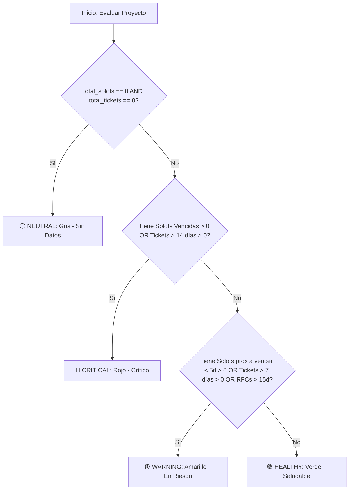

# ESPECIFICACIÓN TÉCNICA Y ARQUITECTÓNICA (SPECS)
## Módulo: "Semáforo de Salud del Proyecto (Project Health Score) y Kill-Switch Desactivador" (`app-lti`)

- **Documento:** SPECS-LTI-MOD-011
- **Versión:** 1.0.0
- **Fecha:** 2026-09-22
- **Autor:** Subagente Planificador de Specs (`planificador_specs`)
- **Destinatario:** Subagente Desarrollador (`coder`) / QA Tester
- **Ubicación del Proyecto:** `/home/bobbasystem/Desarrollos/app-lti`

---

## CONTROL DE VERSIONES Y REGISTRO DE CAMBIOS

| Versión | Fecha | Autor | Descripción del Cambio |
|---|---|---|---|
| **1.0.0** | 2026-09-22 | Subagente Planificador | Especificación técnica integral de la funcionalidad 'Semáforo de Salud del Proyecto' (Project Health Score): motor de reglas de cálculo (Verde, Amarillo, Rojo, Gris), contratos backend/MSSQL, badges con tooltip explicativo, KPIs interactivos con filtrado directo en tabla, indicador en Drill Down y mecanismo mandatorio de activación/desactivación rápida (Kill-Switch / Feature Toggle) con fallback limpio cero rastros. |

---

## 1. RESUMEN EJECUTIVO Y OBJETIVOS

### 1.1. Contexto y Problemática
En la plataforma **HALO — App Líderes TI**, los Líderes Técnicos y Administradores auditan sus proyectos mediante los estados administrativos provenientes de SharePoint (`Generado`, `En revision`, `Atendido`). Sin embargo, dichos estados administrativos no reflejan de manera automática ni inmediata la **salud operacional real** de cada iniciativa. 

Un proyecto puede figurar formalmente como "Generado" o "En revisión", pero tener múltiples Solots del Backlog de Operaciones (SGA) con fecha comprometida vencida, o registrar tickets de incidentes (HPSM / Service Manager) estancados durante semanas sin resolución. Para conocer esta situación, el usuario actualmente debe ingresar manualmente a la ficha técnica (Drill Down) de cada proyecto e inspeccionar pestaña por pestaña.

### 1.2. Solución Propuesta
Se define la implementación del **Semáforo de Salud del Proyecto (Project Health Score)**:
1. **Evaluación Operacional Automática**: Motor de reglas que cruza en tiempo real las Solots en backlog (`dbo.CT_BACKLOG_OPERACIONES2`), tickets de soporte (`dbo.registrosRF_SD_SM`) y RFCs (`dbo.registrosSM_RFC`) para clasificar el proyecto en 4 niveles: **Verde (Saludable)**, **Amarillo (En Riesgo / Atención)**, **Rojo (Crítico)** o **Gris (Sin Datos / Neutro)**.
2. **Visualización y Diagnóstico Inmediato**:
   - Badges de color en la tabla principal de proyectos con **tooltip explicativo interactivo** (ej: *"🔴 Crítico: 2 Solots vencidas, 1 ticket abierto > 14 días"*).
   - **Tarjetas KPI de Salud en el Dashboard** (`Saludables`, `En Riesgo`, `Críticos`) con comportamiento interactivo que permite filtrar la tabla instantáneamente al hacer clic.
   - **Indicador de Salud en el Drill Down** (cabecera del proyecto) y desglose de diagnóstico en la pestaña de Resumen.
3. **Mecanismo de Activación / Desactivación Rápida (Kill-Switch Mandatorio)**:
   - **Requerimiento Crítico del Negocio**: *"La idea es que ante cualquier cosa podamos desactivar ese menu o funcionalidad si es que no es de su agrado"*.
   - Se diseña una arquitectura con **desacople absoluto**:
     * Switch de configuración global en código (`window.HALO_CONFIG.ENABLE_HEALTH_SCORE = true/false`).
     * Interruptor visual (Toggle Button) en la sub-barra de navegación con persistencia en `localStorage`.
     * **Política de Cero Rastros (Zero Trace / Clean Fallback)**: Al desactivarse, el sistema oculta por completo las tarjetas de salud, remueve la columna de salud de la tabla principal (restaurando exactamente las 8 columnas estándar originales) y oculta el badge del drill down, **sin dejar rastros visuales, sin romper alineaciones de tabla y sin alterar la experiencia estándar original**.

```
+----------------------------------------------------------------------------------------------------+
|                                    ARQUITECTURA DE LA SOLUCIÓN                                      |
+----------------------------------------------------------------------------------------------------+
|                                                                                                    |
|  [ MSSQL Server ]                                                                                  |
|    - CT_BACKLOG_OPERACIONES2 (Solots: FECHA_COMPROMETIDA, ESTADO_OTP)                             |
|    - registrosRF_SD_SM (Tickets: SUBMIT_DATE, STATUS)                                              |
|    - registrosSM_RFC (RFCs: CLOSE_TIME, ORIG_DATE_ENTERED)                                         |
|           |                                                                                        |
|           v                                                                                        |
|  [ Backend FastAPI (db.py / main.py) ]                                                             |
|    - CTEs agregadas de alto rendimiento (0.05s) calculando solots_vencidas, tickets_criticos, etc. |
|    - Endpoints /api/proyectos y /api/kpis enriquecidos con métricas de salud                       |
|           |                                                                                        |
|           v                                                                                        |
|  [ Frontend (Vanilla JS + CSS3) ]                                                                  |
|    - Feature Toggle / Kill-Switch (localStorage + window.HALO_CONFIG)                             |
|    - SI ACTIVO:                                                                                    |
|         * Grid de KPIs de Salud (Saludables, En Riesgo, Críticos) con filtrado OnClick             |
|         * Columna adicional 'Salud Operacional' en tabla con badges y tooltip explicativo          |
|         * Badge de salud en Drill Down                                                             |
|    - SI DESACTIVADO (KILL-SWITCH):                                                                 |
|         * Fallback 100% limpio a vista estándar clásica (8 columnas originales, 6 KPIs clásicos)    |
|                                                                                                    |
+----------------------------------------------------------------------------------------------------+
```

---

## 2. MECANISMO DE CONTROL KILL-SWITCH / FEATURE TOGGLE (REQUERIMIENTO CLAVE)

### 2.1. Objetivos del Kill-Switch
Permitir a los operadores, administradores y desarrolladores apagar o encender inmediatamente toda la lógica visual y de filtrado del semáforo de salud:
- **Instantáneo**: Se aplica inmediatamente sin requerir re-despliegues de backend ni migraciones de base de datos.
- **Persistente**: La preferencia del usuario se almacena en el navegador (`localStorage.getItem('halo_health_score_enabled')`).
- **Defensivo**: Si el usuario no tiene preferencia guardada, utiliza el valor por defecto configurado globalmente.
- **Desacoplado y Cero Rastros**: Al estar inactivo (`false`), ningún elemento de salud se muestra en el DOM ni afecta el ancho o layout de la tabla o dashboard.

### 2.2. Capas de Configuración del Feature Toggle

#### Capa 1: Configuración Global en Código (Master Config)
En la inicialización del frontend (`frontend/js/app.js` o cabecera de scripts), se define el objeto de configuración global:
```javascript
window.HALO_CONFIG = window.HALO_CONFIG || {};
// Switch maestro a nivel de código (por defecto habilitado)
window.HALO_CONFIG.ENABLE_HEALTH_SCORE = true;
```
Si un administrador desea deshabilitar permanentemente la funcionalidad para todos los usuarios sin modificar la interfaz, basta con cambiar este valor a `false`.

#### Capa 2: Persistencia en Almacenamiento Local (`localStorage`)
La clave utilizada para persistir el estado del usuario es:
`halo_health_score_enabled` (valores: `'true'` o `'false'`).

La resolución de activación efectiva sigue la siguiente regla de precedencia:
```javascript
isHealthScoreActive() {
  // 1. Si la configuración maestra en código está en false, se apaga obligatoriamente
  if (window.HALO_CONFIG && window.HALO_CONFIG.ENABLE_HEALTH_SCORE === false) {
    return false;
  }
  // 2. Si el usuario definió una preferencia en localStorage, se respeta
  const userPref = localStorage.getItem('halo_health_score_enabled');
  if (userPref !== null) {
    return userPref === 'true';
  }
  // 3. Fallback por defecto: Habilitado (true)
  return true;
}
```

#### Capa 3: Control Interactivo en la Interfaz (UI Toggle Button)
En la sub-barra de navegación (`.nav-subbar-actions`), junto al selector de modo claro/oscuro y el badge de rol, se añade un botón toggle accesible:
```html
<button id="health-score-toggle-btn" class="btn-subbar-toggle" title="Activar o desactivar semáforo de salud operacional" aria-label="Toggle Semáforo de Salud">
  <span class="health-toggle-icon">🚦</span>
  <span class="health-toggle-label" id="health-toggle-label">Salud: ON</span>
</button>
```

Al hacer clic en el botón:
1. Se invierte el estado actual (`!isHealthScoreActive()`).
2. Se guarda la nueva preferencia en `localStorage.setItem('halo_health_score_enabled', nuevoEstado)`.
3. Se actualiza el aspecto visual del botón (texto: `Salud: ON` / `Salud: OFF`, clase: `.is-off`).
4. Si se desactiva y había un filtro de salud seleccionado en la tabla, se limpia el filtro automáticamente.
5. Se invoca de inmediato `App.applyHealthScoreState()` para re-renderizar la vista sin necesidad de recargar la página (`F5`).
6. Se despliega un toast breve informativo: *"Semáforo de salud activado"* o *"Semáforo de salud desactivado (Vista estándar)"*.

### 2.3. Comportamiento en Modo Desactivado (Clean Fallback)
Cuando el semáforo está desactivado (`false`):
1. **Tabla de Proyectos**:
   - El encabezado `<th id="th-col-salud">` tiene `display: none;`.
   - Las celdas `<td class="col-health-score">` **no se generan** en el `innerHTML` de las filas.
   - La tabla vuelve a tener exactamente **8 columnas** (Cliente, N° Proyecto, LT Asignado, Solicitante, Estado, Fecha Solicitud LTI, Detalle, Acciones).
   - Los estados de carga (`Cargando proyectos...`) y vacío (`No se encontraron proyectos`) vuelven a usar `colspan="8"` exacto.
2. **Dashboard de KPIs**:
   - El contenedor `#health-kpi-grid` tiene `display: none;`.
   - El grid principal `.kpi-grid` con sus 6 tarjetas originales (`PROYECTOS ASIGNADOS`, `PROYECTOS EN CURSO`, `PENDIENTES DE ASIGNAR`, `EFECTIVIDAD`, `Tickets SD`, `RFCs Asociadas`) permanece exactamente igual que antes.
3. **Ficha Técnica (Drill Down)**:
   - El contenedor `#dd-health-status` en la cabecera del drill down tiene `display: none;`.
   - La ficha técnica muestra únicamente el estado SharePoint (`Atendido`, `Generado`, `En revision`) y las acciones estándar.
4. **Filtros**:
   - Cualquier parámetro de salud en memoria se reinicia a `null` o `'ALL'`.

---

## 3. REGLAS PRECISAS DEL MOTOR DE CÁLCULO DE SALUD (HEALTH SCORE ENGINE)

### 3.1. Definición de Estados y Colores

| Estado de Salud | Color & Token | Icono | Concepto Operacional |
|---|---|---|---|
| **Verde (Saludable)** | `#059669` / `--status-success-text`<br>`#ecfdf5` / `--status-success-bg` | 🟢 | **Saludable**: Proyecto al día. Sin atrasos críticos, todas las Solots dentro de plazo o ejecutadas, tickets cerrados o con antigüedad <= 7 días. |
| **Amarillo (En Riesgo)** | `#d97706` / `--status-warning-text`<br>`#fffbeb` / `--status-warning-bg` | 🟡 | **En Riesgo / Atención**: Proyecto con riesgos incipientes. Tickets abiertos entre 8 y 14 días, o Solots próximas a vencer (< 5 días hacia el vencimiento) sin cierre, o RFCs en revisión prolongada. |
| **Rojo (Crítico)** | `#dc2626` / `--status-danger-text`<br>`#fef2f2` / `--status-danger-bg` | 🔴 | **Crítico**: Proyecto con problemas severos. Al menos 1 Solot vencida con respecto a su fecha comprometida, o tickets abiertos > 14 días, o incidencias críticas sin resolver. |
| **Gris (Sin Datos / Neutro)** | `#64748b` / `--status-neutral-text`<br>`#f8fafc` / `--status-neutral-bg` | ⚪ | **Sin Datos / Neutro**: Proyecto sin Solots ni tickets vinculados (etapa preliminar o solo solicitud). |

### 3.2. Criterios de Evaluación Específicos por Entidad

#### A. Reglas de Solots SGA (`dbo.CT_BACKLOG_OPERACIONES2`)
1. **Solots consideradas "Cerradas / Exentas de atraso"**:
   - `ESTADO_OTP` en: `'Cerrada'`, `'5- Ejecutada'`, `'5- Ejecutada Tareas Pendientes'`, `'Aprobado'`.
   - `ESTADO_OTP` descartadas por anulación: `'Abortado'`, `'En Aborcion'`, `'Eliminada'`.
2. **Solots consideradas "Activas"**:
   - Cualquier `ESTADO_OTP` distinto a los anteriores (`'Asignada'`, `'2- En ejecucion'`, `'4- Revision'`, `'En asignacion'`, `'Pendiente Facturacion'`, `'Suspension'`, `'Suspension Temporal'`, `'Aclarado'`, `'Reactivado'`, etc.).
3. **Evaluación de `FECHA_COMPROMETIDA`**:
   - Tomar la fecha actual a las 00:00:00 (`CURRENT_DATE`).
   - Si la Solot está activa y `FECHA_COMPROMETIDA < CURRENT_DATE`:
     * **Condición: SOLOT VENCIDA**.
     * **Resultado**: Dispara directamente **Rojo (Crítico)**.
   - Si la Solot está activa y `FECHA_COMPROMETIDA >= CURRENT_DATE` y `FECHA_COMPROMETIDA <= DATEADD(day, 5, CURRENT_DATE)`:
     * **Condición: SOLOT PRÓXIMA A VENCER (< 5 días)**.
     * **Resultado**: Dispara **Amarillo (En Riesgo)** (siempre que no existan otras condiciones que lo lleven a Rojo).
   - Si la Solot está activa y `FECHA_COMPROMETIDA > DATEADD(day, 5, CURRENT_DATE)`:
     * **Condición: DENTRO DE PLAZO NORMAL**.
     * **Resultado**: Compatible con **Verde (Saludable)**.

#### B. Reglas de Tickets SD / Service Manager (`dbo.registrosRF_SD_SM`)
1. **Tickets considerados "Cerrados / Resueltos"**:
   - `STATUS` en: `'Cerrado'`, `'Resuelto'`.
2. **Tickets considerados "Abiertos / Activos"**:
   - `STATUS` en: `'Abierto'`, `'Trabajo en progreso'`, `'Asignado a Grupo Resolutor'`, `'Pendiente por proveedor'`.
3. **Evaluación de Antigüedad desde `SUBMIT_DATE`**:
   - Antigüedad en días: `Días = DATEDIFF(day, SUBMIT_DATE, CURRENT_DATE)` (o en Python `(now - submit_date).days`).
   - Si el ticket está activo y `Días > 14`:
     * **Condición: TICKET CRÍTICO ESTANCADO (> 14 días)**.
     * **Resultado**: Dispara directamente **Rojo (Crítico)**.
   - Si el ticket está activo y `Días > 7` y `Días <= 14`:
     * **Condición: TICKET EN ATENCIÓN (> 7 días)**.
     * **Resultado**: Dispara **Amarillo (En Riesgo)** (si no hay condiciones de Rojo).
   - Si el ticket está activo y `Días <= 7` o está cerrado/resuelto:
     * **Condición: TICKET DENTRO DE PLAZO HABITUAL**.
     * **Resultado**: Compatible con **Verde (Saludable)**.

#### C. Reglas de RFCs (`dbo.registrosSM_RFC`)
1. Si `CLOSE_TIME IS NULL` (RFC abierta) y han transcurrido más de 15 días desde `ORIG_DATE_ENTERED`:
   - Se considera un factor de **Atención / Riesgo (Amarillo)**.
2. Si el texto o descripción de la RFC contiene explícitamente términos de rechazo o incidente mayor de cambio:
   - Se suma al diagnóstico de riesgo.

#### D. Caso Especial: Proyectos sin Datos (Gris / Neutro)
- Si `total_solots == 0` y `total_tickets == 0`:
  * El proyecto se clasifica como **Gris (⚪ Sin Datos / Neutro)**.
  * Motivo: *"Sin Solots ni tickets vinculados para medir salud operacional"*.

### 3.3. Algoritmo de Precedencia y Jerarquía de Evaluación
El cálculo de severidad es estrictamente descendente y determinístico:



### 3.4. Generación de Justificaciones Humanas (Motivos para Tooltip y Ficha)
El motor de cálculo no solo entrega el color, sino un arreglo de strings concisos y legibles para el usuario:
- **Para Rojo**:
  * *"1 Solot vencida (compromiso expirado)"* o *"3 Solots vencidas"*
  * *"2 tickets abiertos hace más de 14 días"*
- **Para Amarillo**:
  * *"1 Solot por vencer en los próximos 5 días"*
  * *"1 ticket abierto hace más de 7 días"*
  * *"1 RFC en revisión prolongada (> 15 días)"*
- **Para Verde**:
  * *"Todas las Solots y tickets dentro de plazo regular"*
- **Para Gris**:
  * *"Proyecto recién ingresado o sin Solots/tickets vinculados"*

---

## 4. ARQUITECTURA BACKEND & MODELO DE DATOS (MSSQL / FASTAPI)

### 4.1. Modificaciones en Consultas SQL (`backend/db.py`)
Para garantizar que la consulta de lista de proyectos continúe respondiendo en menos de 100 milisegundos sin sobrecargar el servidor MSSQL, se añaden Common Table Expressions (CTEs) indexadas a la consulta principal de `get_proyectos()`.

#### Definición de CTEs de Salud en `get_proyectos()`:
```sql
WITH SolotStats AS (
    SELECT 
        ID_Proyecto,
        COUNT(1) AS total_solots
    FROM dbo.CT_BACKLOG_OPERACIONES2 WITH (NOLOCK)
    WHERE ID_Proyecto IS NOT NULL
    GROUP BY ID_Proyecto
),
TicketStats AS (
    SELECT 
        ID_Proyecto,
        COUNT(1) AS total_tickets
    FROM dbo.registrosRF_SD_SM WITH (NOLOCK)
    WHERE ID_Proyecto IS NOT NULL
    GROUP BY ID_Proyecto
),
RFCStats AS (
    SELECT 
        ID_Proyecto,
        COUNT(1) AS total_rfcs
    FROM dbo.registrosSM_RFC WITH (NOLOCK)
    WHERE ID_Proyecto IS NOT NULL
    GROUP BY ID_Proyecto
),
HealthSolots AS (
    SELECT 
        ID_Proyecto,
        SUM(CASE 
            WHEN ESTADO_OTP NOT IN ('Cerrada', '5- Ejecutada', '5- Ejecutada Tareas Pendientes', 'Abortado', 'En Aborcion', 'Eliminada', 'Aprobado') 
                 AND FECHA_COMPROMETIDA < CAST(GETDATE() AS DATE) THEN 1 
            ELSE 0 
        END) AS solots_vencidas,
        SUM(CASE 
            WHEN ESTADO_OTP NOT IN ('Cerrada', '5- Ejecutada', '5- Ejecutada Tareas Pendientes', 'Abortado', 'En Aborcion', 'Eliminada', 'Aprobado') 
                 AND FECHA_COMPROMETIDA >= CAST(GETDATE() AS DATE) 
                 AND FECHA_COMPROMETIDA <= DATEADD(day, 5, CAST(GETDATE() AS DATE)) THEN 1 
            ELSE 0 
        END) AS solots_por_vencer
    FROM dbo.CT_BACKLOG_OPERACIONES2 WITH (NOLOCK)
    WHERE ID_Proyecto IS NOT NULL AND FECHA_COMPROMETIDA IS NOT NULL
    GROUP BY ID_Proyecto
),
HealthTickets AS (
    SELECT 
        ID_Proyecto,
        SUM(CASE 
            WHEN STATUS NOT IN ('Cerrado', 'Resuelto') 
                 AND DATEDIFF(day, TRY_CAST(SUBMIT_DATE AS DATETIME2), GETDATE()) > 14 THEN 1 
            ELSE 0 
        END) AS tickets_criticos,
        SUM(CASE 
            WHEN STATUS NOT IN ('Cerrado', 'Resuelto') 
                 AND DATEDIFF(day, TRY_CAST(SUBMIT_DATE AS DATETIME2), GETDATE()) > 7 
                 AND DATEDIFF(day, TRY_CAST(SUBMIT_DATE AS DATETIME2), GETDATE()) <= 14 THEN 1 
            ELSE 0 
        END) AS tickets_atencion
    FROM dbo.registrosRF_SD_SM WITH (NOLOCK)
    WHERE ID_Proyecto IS NOT NULL AND SUBMIT_DATE IS NOT NULL
    GROUP BY ID_Proyecto
)
```

> [!IMPORTANT]
> Nótese el uso de `TRY_CAST(SUBMIT_DATE AS DATETIME2)`. En la tabla `dbo.registrosRF_SD_SM`, la columna `SUBMIT_DATE` es de tipo `nvarchar`. El uso de `TRY_CAST` previene excepciones en tiempo de ejecución ante eventuales valores vacíos o mal formateados en la base de datos de HPSM.

#### Campos de Salud Seleccionados en `get_proyectos()`:
En el `SELECT` principal:
```sql
SELECT 
    p.ID,
    p.Cliente,
    p.Numero_Proyecto,
    p.LT_Asignado,
    p.Estado,
    p.Detalle,
    p.Comentario,
    p.Tipo_Servicio,
    p.Creado AS Creado,
    ISNULL(ss.total_solots, 0) AS total_solots,
    ISNULL(ts.total_tickets, 0) AS total_tickets,
    ISNULL(rs.total_rfcs, 0) AS total_rfcs,
    ISNULL(hs.solots_vencidas, 0) AS solots_vencidas,
    ISNULL(hs.solots_por_vencer, 0) AS solots_por_vencer,
    ISNULL(ht.tickets_criticos, 0) AS tickets_criticos,
    ISNULL(ht.tickets_atencion, 0) AS tickets_atencion,
    ...
FROM dbo.Proyectos p WITH (NOLOCK)
LEFT JOIN SolotStats ss ON p.ID = ss.ID_Proyecto
LEFT JOIN TicketStats ts ON p.ID = ts.ID_Proyecto
LEFT JOIN RFCStats rs ON p.ID = rs.ID_Proyecto
LEFT JOIN HealthSolots hs ON p.ID = hs.ID_Proyecto
LEFT JOIN HealthTickets ht ON p.ID = ht.ID_Proyecto
```

### 4.2. Función Helper Python para Serialización de Salud
En `backend/db.py`, se implementa la función `calcular_salud_proyecto(row)`:
```python
def calcular_salud_proyecto(row: dict) -> dict:
    total_solots = int(row.get('total_solots') or 0)
    total_tickets = int(row.get('total_tickets') or 0)
    solots_vencidas = int(row.get('solots_vencidas') or 0)
    solots_por_vencer = int(row.get('solots_por_vencer') or 0)
    tickets_criticos = int(row.get('tickets_criticos') or 0)
    tickets_atencion = int(row.get('tickets_atencion') or 0)

    # 1. Sin datos vinculados
    if total_solots == 0 and total_tickets == 0:
        return {
            "score": "NEUTRAL",
            "color": "gray",
            "label": "Sin Datos",
            "motivos": ["Proyecto sin Solots ni tickets vinculados"],
            "solots_vencidas": 0,
            "solots_por_vencer": 0,
            "tickets_criticos": 0,
            "tickets_atencion": 0
        }

    motivos = []

    # 2. Criterio Crítico (Rojo)
    if solots_vencidas > 0:
        motivos.append(f"{solots_vencidas} Solot{'s' if solots_vencidas > 1 else ''} con fecha comprometida vencida")
    if tickets_criticos > 0:
        motivos.append(f"{tickets_criticos} Ticket{'s' if tickets_criticos > 1 else ''} abierto{'s' if tickets_criticos > 1 else ''} > 14 días")

    if motivos:
        return {
            "score": "CRITICAL",
            "color": "red",
            "label": "Crítico",
            "motivos": motivos,
            "solots_vencidas": solots_vencidas,
            "solots_por_vencer": solots_por_vencer,
            "tickets_criticos": tickets_criticos,
            "tickets_atencion": tickets_atencion
        }

    # 3. Criterio Riesgo / Atención (Amarillo)
    if solots_por_vencer > 0:
        motivos.append(f"{solots_por_vencer} Solot{'s' if solots_por_vencer > 1 else ''} por vencer (< 5 días)")
    if tickets_atencion > 0:
        motivos.append(f"{tickets_atencion} Ticket{'s' if tickets_atencion > 1 else ''} abierto{'s' if tickets_atencion > 1 else ''} > 7 días")

    if motivos:
        return {
            "score": "WARNING",
            "color": "yellow",
            "label": "En Riesgo",
            "motivos": motivos,
            "solots_vencidas": 0,
            "solots_por_vencer": solots_por_vencer,
            "tickets_criticos": 0,
            "tickets_atencion": tickets_atencion
        }

    # 4. Criterio Saludable (Verde)
    return {
        "score": "HEALTHY",
        "color": "green",
        "label": "Saludable",
        "motivos": ["Solots y tickets operando dentro de plazo regular"],
        "solots_vencidas": 0,
        "solots_por_vencer": 0,
        "tickets_criticos": 0,
        "tickets_atencion": 0
    }
```

Cada fila procesada en `get_proyectos()` y `get_proyecto_by_id()` inyecta el nodo `"salud": calcular_salud_proyecto(row)`.

### 4.3. KPIs de Salud en `get_dashboard_kpis()`
En `get_dashboard_kpis(lt_filter=None)`, se añaden las métricas agregadas de salud al diccionario de respuesta:
```python
# KPIs de Salud
sql_salud_kpis = """
    WITH HealthSolots AS (
        SELECT 
            ID_Proyecto,
            SUM(CASE WHEN ESTADO_OTP NOT IN ('Cerrada', '5- Ejecutada', '5- Ejecutada Tareas Pendientes', 'Abortado', 'En Aborcion', 'Eliminada', 'Aprobado') 
                     AND FECHA_COMPROMETIDA < CAST(GETDATE() AS DATE) THEN 1 ELSE 0 END) AS solots_vencidas,
            SUM(CASE WHEN ESTADO_OTP NOT IN ('Cerrada', '5- Ejecutada', '5- Ejecutada Tareas Pendientes', 'Abortado', 'En Aborcion', 'Eliminada', 'Aprobado') 
                     AND FECHA_COMPROMETIDA >= CAST(GETDATE() AS DATE) 
                     AND FECHA_COMPROMETIDA <= DATEADD(day, 5, CAST(GETDATE() AS DATE)) THEN 1 ELSE 0 END) AS solots_por_vencer
        FROM dbo.CT_BACKLOG_OPERACIONES2 WITH (NOLOCK)
        WHERE ID_Proyecto IS NOT NULL AND FECHA_COMPROMETIDA IS NOT NULL
        GROUP BY ID_Proyecto
    ),
    HealthTickets AS (
        SELECT 
            ID_Proyecto,
            SUM(CASE WHEN STATUS NOT IN ('Cerrado', 'Resuelto') 
                     AND DATEDIFF(day, TRY_CAST(SUBMIT_DATE AS DATETIME2), GETDATE()) > 14 THEN 1 ELSE 0 END) AS tickets_criticos,
            SUM(CASE WHEN STATUS NOT IN ('Cerrado', 'Resuelto') 
                     AND DATEDIFF(day, TRY_CAST(SUBMIT_DATE AS DATETIME2), GETDATE()) > 7 
                     AND DATEDIFF(day, TRY_CAST(SUBMIT_DATE AS DATETIME2), GETDATE()) <= 14 THEN 1 ELSE 0 END) AS tickets_atencion
        FROM dbo.registrosRF_SD_SM WITH (NOLOCK)
        WHERE ID_Proyecto IS NOT NULL AND SUBMIT_DATE IS NOT NULL
        GROUP BY ID_Proyecto
    ),
    SolotStats AS (
        SELECT ID_Proyecto, COUNT(1) AS total_solots FROM dbo.CT_BACKLOG_OPERACIONES2 WITH (NOLOCK) WHERE ID_Proyecto IS NOT NULL GROUP BY ID_Proyecto
    ),
    TicketStats AS (
        SELECT ID_Proyecto, COUNT(1) AS total_tickets FROM dbo.registrosRF_SD_SM WITH (NOLOCK) WHERE ID_Proyecto IS NOT NULL GROUP BY ID_Proyecto
    )
    SELECT 
        SUM(CASE 
            WHEN ISNULL(ss.total_solots, 0) = 0 AND ISNULL(ts.total_tickets, 0) = 0 THEN 1 
            ELSE 0 
        END) AS sin_datos,
        SUM(CASE 
            WHEN (ISNULL(ss.total_solots, 0) > 0 OR ISNULL(ts.total_tickets, 0) > 0)
                 AND (ISNULL(hs.solots_vencidas, 0) > 0 OR ISNULL(ht.tickets_criticos, 0) > 0) THEN 1 
            ELSE 0 
        END) AS criticos,
        SUM(CASE 
            WHEN (ISNULL(ss.total_solots, 0) > 0 OR ISNULL(ts.total_tickets, 0) > 0)
                 AND (ISNULL(hs.solots_vencidas, 0) = 0 AND ISNULL(ht.tickets_criticos, 0) = 0)
                 AND (ISNULL(hs.solots_por_vencer, 0) > 0 OR ISNULL(ht.tickets_atencion, 0) > 0) THEN 1 
            ELSE 0 
        END) AS en_riesgo,
        SUM(CASE 
            WHEN (ISNULL(ss.total_solots, 0) > 0 OR ISNULL(ts.total_tickets, 0) > 0)
                 AND (ISNULL(hs.solots_vencidas, 0) = 0 AND ISNULL(ht.tickets_criticos, 0) = 0)
                 AND (ISNULL(hs.solots_por_vencer, 0) = 0 AND ISNULL(ht.tickets_atencion, 0) = 0) THEN 1 
            ELSE 0 
        END) AS saludables
    FROM dbo.Proyectos p WITH (NOLOCK)
    LEFT JOIN SolotStats ss ON p.ID = ss.ID_Proyecto
    LEFT JOIN TicketStats ts ON p.ID = ts.ID_Proyecto
    LEFT JOIN HealthSolots hs ON p.ID = hs.ID_Proyecto
    LEFT JOIN HealthTickets ht ON p.ID = ht.ID_Proyecto
    WHERE (p.Tipo_Servicio IS NULL OR p.Tipo_Servicio <> 'Reunión')
"""
```
El objeto retornado por `/api/kpis` incluye:
```json
{
  "total_proyectos": 680,
  "proyectos_en_curso": 240,
  "proyectos_atendidos": 440,
  "pendientes_asignar": 18,
  "efectividad": 64.7,
  "total_tickets": 516,
  "total_rfcs": 171,
  "salud": {
    "saludables": 142,
    "en_riesgo": 58,
    "criticos": 74,
    "sin_datos": 406
  }
}
```

---

## 5. DISEÑO UI/UX Y COMPONENTES FRONTEND

### 5.1. Botón Switch de Activación / Desactivación (Kill-Switch en Sub-Barra)
En `frontend/index.html`, dentro de `.nav-subbar-actions`:
```html
<div class="nav-subbar-actions">
  <!-- Botón Kill-Switch / Toggle del Semáforo de Salud -->
  <button id="health-score-toggle-btn" class="btn-subbar-toggle" title="Activar o desactivar el Semáforo de Salud de proyectos" aria-label="Toggle Semáforo de Salud">
    <span class="health-toggle-icon">🚦</span>
    <span class="health-toggle-label" id="health-toggle-label">Salud: ON</span>
  </button>

  <span id="user-role-badge" class="badge badge-info">Líder</span>
  <button id="theme-toggle-btn" class="btn-icon-subbar" title="Cambiar Modo Claro / Oscuro" aria-label="Cambiar tema">
    <span id="theme-icon">🌙</span>
  </button>
</div>
```

### 5.2. Tarjetas KPI de Salud en el Dashboard (Filtros Clicables)
Para preservar intacto el layout original de las 6 tarjetas de métricas existentes (`.kpi-grid`), se diseña un contenedor complementario `.health-kpi-grid` que se ubica inmediatamente debajo de la grilla principal:

```html
<!-- Grid Complementaria de Salud Operacional (Controlada por el Kill-Switch) -->
<div class="health-kpi-grid" id="health-kpi-grid" style="display: none;">
  <div class="health-kpi-card health-kpi-green" id="health-card-healthy" role="button" tabindex="0" title="Filtrar proyectos saludables (al día)">
    <div class="health-kpi-icon">🟢</div>
    <div class="health-kpi-info">
      <div class="health-kpi-val" id="health-kpi-val-healthy">0</div>
      <div class="health-kpi-title">PROYECTOS SALUDABLES</div>
    </div>
    <span class="health-kpi-badge">Filtrar ⚡</span>
  </div>

  <div class="health-kpi-card health-kpi-yellow" id="health-card-warning" role="button" tabindex="0" title="Filtrar proyectos en riesgo o con atención pendiente">
    <div class="health-kpi-icon">🟡</div>
    <div class="health-kpi-info">
      <div class="health-kpi-val" id="health-kpi-val-warning">0</div>
      <div class="health-kpi-title">EN RIESGO / ATENCIÓN</div>
    </div>
    <span class="health-kpi-badge">Filtrar ⚡</span>
  </div>

  <div class="health-kpi-card health-kpi-red" id="health-card-critical" role="button" tabindex="0" title="Filtrar proyectos con atrasos críticos o solots vencidas">
    <div class="health-kpi-icon">🔴</div>
    <div class="health-kpi-info">
      <div class="health-kpi-val" id="health-kpi-val-critical">0</div>
      <div class="health-kpi-title">CRÍTICOS / VENCIDOS</div>
    </div>
    <span class="health-kpi-badge">Filtrar ⚡</span>
  </div>

  <div class="health-kpi-card health-kpi-gray" id="health-card-neutral" role="button" tabindex="0" title="Filtrar proyectos sin Solots ni tickets aún">
    <div class="health-kpi-icon">⚪</div>
    <div class="health-kpi-info">
      <div class="health-kpi-val" id="health-kpi-val-neutral">0</div>
      <div class="health-kpi-title">SIN DATOS OPERACIONALES</div>
    </div>
    <span class="health-kpi-badge">Filtrar ⚡</span>
  </div>
</div>
```

#### Comportamiento Interactivo de Filtrado (OnClick):
- Al hacer clic en una tarjeta de salud (ej: `CRÍTICOS / VENCIDOS`):
  1. Si no estaba seleccionada: Se marca con clase `.active-health-filter`, se aplica el filtro sobre la tabla de proyectos mostrando únicamente aquellos con `salud.score === 'CRITICAL'`, y se actualiza el contador de proyectos.
  2. Si ya estaba seleccionada (toggle off): Se desmarca la tarjeta, se restablece el filtro a todos los proyectos y se re-renderiza la tabla completa.
  3. Soporta teclado accesible (`Enter` / `Space`).

### 5.3. Badges de Salud en la Tabla de Proyectos con Tooltip Dinámico
En la tabla de proyectos:
- Cabecera: `<th id="th-col-salud" class="col-health-th" style="display: none;">Salud</th>` ubicada contigua a la columna `Estado`.
- Celda por fila (cuando está habilitado):
```html
<td class="col-health-cell">
  <div class="health-badge-wrapper" tabindex="0" aria-label="Salud: Crítico - 2 Solots vencidas">
    <span class="health-badge health-badge-critical">
      <span class="health-indicator-dot pulse-critical"></span>
      Crítico
    </span>
    <!-- Tooltip explicativo dinámico -->
    <div class="health-tooltip">
      <div class="health-tooltip-header">
        <span class="health-tooltip-title">Diagnóstico de Salud Operacional</span>
      </div>
      <ul class="health-tooltip-list">
        <li>🔴 2 Solots con fecha comprometida vencida</li>
        <li>🔴 1 Ticket abierto > 14 días (SD5167...)</li>
      </ul>
      <div class="health-tooltip-footer">Click en 🔍 para ver Solots y Tickets en detalle</div>
    </div>
  </div>
</td>
```

### 5.4. Indicador de Salud en el Drill Down (Ficha Técnica)
En `frontend/index.html` (dentro de `.drilldown-title-row`):
```html
<div style="display: flex; align-items: center; gap: 0.75rem; flex-wrap: wrap;">
  <!-- Estado SharePoint estándar -->
  <div id="dd-status">
    <span class="badge badge-success">Atendido</span>
  </div>

  <!-- NUEVO: Indicador de Salud Operacional (Ocultable por Kill-Switch) -->
  <div id="dd-health-status" style="display: none;">
    <!-- Renderizado dinámicamente con badge grande y desglose -->
  </div>

  <div class="drilldown-action-toolbar">
    ...
  </div>
</div>
```
Además, en la **Pestaña 1: Resumen y Detalle Técnico**, se inserta un bloque de resumen operacional (`#dd-health-summary-card`) cuando la funcionalidad está activa, listando claramente las Solots vencidas y los tickets fuera de plazo.

### 5.5. Reglas CSS y Tokens Visuales (`frontend/css/styles.css`)

```css
/* ==========================================================================
   SEMÁFORO DE SALUD DEL PROYECTO (PROJECT HEALTH SCORE) & KILL-SWITCH
   ========================================================================== */

/* Toggle Switch en Sub-Barra */
.btn-subbar-toggle {
  display: inline-flex;
  align-items: center;
  gap: 0.4rem;
  padding: 0.35rem 0.75rem;
  font-size: 0.82rem;
  font-weight: 600;
  border-radius: var(--radius-full);
  border: 1px solid var(--border-color);
  background: var(--bg-surface);
  color: var(--text-primary);
  cursor: pointer;
  transition: all var(--transition-fast);
}

.btn-subbar-toggle:hover {
  background: var(--bg-surface-secondary);
  border-color: var(--primary);
}

.btn-subbar-toggle.is-off {
  opacity: 0.6;
  background: var(--bg-surface-tertiary);
  color: var(--text-muted);
}

/* Grilla de KPIs de Salud */
.health-kpi-grid {
  display: grid;
  grid-template-columns: repeat(4, 1fr);
  gap: 1rem;
  margin-top: -0.5rem;
  margin-bottom: 1.5rem;
  animation: fadeInDown 0.25s ease-out;
}

@media (max-width: 1200px) {
  .health-kpi-grid {
    grid-template-columns: repeat(2, 1fr);
  }
}

@media (max-width: 600px) {
  .health-kpi-grid {
    grid-template-columns: 1fr;
  }
}

.health-kpi-card {
  background-color: var(--bg-surface);
  border: 1px solid var(--border-color);
  border-radius: var(--radius-md);
  padding: 0.9rem 1.1rem;
  display: flex;
  align-items: center;
  gap: 0.9rem;
  cursor: pointer;
  position: relative;
  transition: transform var(--transition-fast), box-shadow var(--transition-fast), border-color var(--transition-fast);
}

.health-kpi-card:hover {
  transform: translateY(-2px);
  box-shadow: var(--shadow-md);
}

.health-kpi-card.active-health-filter {
  outline: 2px solid var(--primary);
  border-color: var(--primary);
  box-shadow: 0 0 0 4px rgba(218, 41, 28, 0.15);
}

.health-kpi-icon {
  font-size: 1.6rem;
  line-height: 1;
}

.health-kpi-info {
  flex: 1;
  min-width: 0;
}

.health-kpi-val {
  font-size: 1.5rem;
  font-weight: 800;
  line-height: 1.1;
  font-family: var(--font-mono);
  color: var(--text-primary);
}

.health-kpi-title {
  font-size: 0.72rem;
  font-weight: 700;
  letter-spacing: 0.05em;
  color: var(--text-secondary);
  text-transform: uppercase;
}

.health-kpi-badge {
  font-size: 0.7rem;
  font-weight: 700;
  padding: 0.2rem 0.5rem;
  border-radius: var(--radius-full);
  background: var(--bg-surface-secondary);
  color: var(--text-secondary);
  border: 1px solid var(--border-color);
}

.health-kpi-card.active-health-filter .health-kpi-badge {
  background: var(--primary);
  color: #fff;
  border-color: var(--primary);
}

/* Badges de Salud en Tabla */
.health-badge-wrapper {
  position: relative;
  display: inline-flex;
  align-items: center;
}

.health-badge {
  display: inline-flex;
  align-items: center;
  gap: 0.35rem;
  padding: 0.25rem 0.6rem;
  border-radius: var(--radius-full);
  font-size: 0.78rem;
  font-weight: 700;
  letter-spacing: 0.02em;
  border: 1px solid transparent;
  cursor: help;
  user-select: none;
}

.health-badge-healthy {
  background-color: var(--status-success-bg);
  color: var(--status-success-text);
  border-color: var(--status-success-border);
}

.health-badge-warning {
  background-color: var(--status-warning-bg);
  color: var(--status-warning-text);
  border-color: var(--status-warning-border);
}

.health-badge-critical {
  background-color: var(--status-danger-bg);
  color: var(--status-danger-text);
  border-color: var(--status-danger-border);
}

.health-badge-neutral {
  background-color: var(--status-neutral-bg);
  color: var(--status-neutral-text);
  border-color: var(--status-neutral-border);
}

.health-indicator-dot {
  width: 7px;
  height: 7px;
  border-radius: 50%;
  display: inline-block;
  background-color: currentColor;
}

/* Animación de Pulso Sutil para Críticos */
.pulse-critical {
  box-shadow: 0 0 0 0 rgba(220, 38, 38, 0.7);
  animation: pulse-red 2s infinite;
}

@keyframes pulse-red {
  0% {
    transform: scale(0.95);
    box-shadow: 0 0 0 0 rgba(220, 38, 38, 0.7);
  }
  70% {
    transform: scale(1);
    box-shadow: 0 0 0 6px rgba(220, 38, 38, 0);
  }
  100% {
    transform: scale(0.95);
    box-shadow: 0 0 0 0 rgba(220, 38, 38, 0);
  }
}

/* Tooltip Dinámico de Diagnóstico */
.health-tooltip {
  display: none;
  position: absolute;
  bottom: 125%;
  left: 50%;
  transform: translateX(-50%);
  min-width: 240px;
  max-width: 320px;
  background-color: var(--bg-surface);
  color: var(--text-primary);
  border: 1px solid var(--border-color);
  border-radius: var(--radius-md);
  box-shadow: var(--shadow-lg);
  padding: 0.75rem;
  z-index: 1000;
  pointer-events: none;
}

.health-badge-wrapper:hover .health-tooltip,
.health-badge-wrapper:focus-within .health-tooltip {
  display: block;
  animation: fadeIn 0.15s ease-in-out;
}

.health-tooltip-header {
  font-size: 0.75rem;
  font-weight: 700;
  text-transform: uppercase;
  color: var(--text-secondary);
  margin-bottom: 0.4rem;
  border-bottom: 1px solid var(--border-color);
  padding-bottom: 0.25rem;
}

.health-tooltip-list {
  list-style: none;
  padding: 0;
  margin: 0;
  font-size: 0.8rem;
  line-height: 1.35;
}

.health-tooltip-list li {
  margin-bottom: 0.3rem;
  color: var(--text-primary);
}

.health-tooltip-footer {
  font-size: 0.7rem;
  color: var(--text-muted);
  margin-top: 0.4rem;
  font-style: italic;
}
```

---

## 6. CASOS DE PRUEBA PARA QA (TESTING MATRIX)

Para validar exhaustivamente la nueva funcionalidad y su desacople, el equipo de QA ejecutará los siguientes casos de prueba:

| ID Caso | Escenario / Descripción | Entrada / Precondición | Resultado Esperado | Severidad |
|---|---|---|---|---|
| **CP-SALUD-001** | Cálculo de Proyecto Crítico por Solots Vencidas | Proyecto con al menos 1 Solot activa y `FECHA_COMPROMETIDA < hoy`. | Se muestra badge `🔴 Crítico`, pulso activo y tooltip explicando *"1 Solot con fecha comprometida vencida"*. | Crítica |
| **CP-SALUD-002** | Cálculo de Proyecto Crítico por Ticket Abierto > 14 días | Proyecto sin Solots vencidas, pero con ticket en estado 'Abierto' con `SUBMIT_DATE` hace 18 días. | Se clasifica en `🔴 Crítico` con motivo explicativo del ticket en el tooltip. | Crítica |
| **CP-SALUD-003** | Cálculo de Proyecto en Riesgo por Solot < 5 días | Solot activa con fecha comprometida en 3 días más. Sin tickets > 7 días. | Badge `🟡 En Riesgo` con tooltip *"1 Solot por vencer (< 5 días)"*. | Alta |
| **CP-SALUD-004** | Cálculo de Proyecto en Riesgo por Ticket entre 8 y 14 días | Ticket abierto hace 9 días. Solots al día. | Badge `🟡 En Riesgo` con tooltip *"1 Ticket abierto > 7 días"*. | Alta |
| **CP-SALUD-005** | Cálculo de Proyecto Saludable | Solots ejecutadas o con vencimiento > 10 días, tickets cerrados o creados hace 2 días. | Badge `🟢 Saludable` con texto *"Solots y tickets operando dentro de plazo regular"*. | Alta |
| **CP-SALUD-006** | Cálculo de Proyecto Sin Datos (Neutro) | Proyecto creado sin Solots vinculadas y sin tickets. | Badge `⚪ Sin Datos` con tooltip *"Proyecto sin Solots ni tickets vinculados"*. | Media |
| **CP-SALUD-007** | Activación / Desactivación mediante Kill-Switch (UI Toggle) | Usuario hace clic en el botón `🚦 Salud: ON` en la sub-barra. | El botón pasa a `🚦 Salud: OFF`, desaparecen de inmediato las tarjetas de salud, se oculta la columna `Salud` de la tabla y la tabla mantiene exactamente 8 columnas sin descuadre. | Bloqueante |
| **CP-SALUD-008** | Persistencia del Kill-Switch tras Recarga (F5) | Usuario desactiva el semáforo y presiona F5 o cierra el navegador. | Al recargar, `localStorage` conserva `'halo_health_score_enabled' === 'false'`, el semáforo permanece apagado y no se observa parpadeo. | Bloqueante |
| **CP-SALUD-009** | Master Switch Global en Código (`window.HALO_CONFIG`) | Se configura `ENABLE_HEALTH_SCORE = false` en `app.js`. | La funcionalidad queda apagada obligatoriamente para todos los usuarios ignorando `localStorage`. | Alta |
| **CP-SALUD-010** | Filtrado Interactivo desde Tarjetas KPI de Salud | Clic en la tarjeta `🔴 CRÍTICOS / VENCIDOS`. | La tabla filtra de inmediato mostrando únicamente proyectos con score `CRITICAL`, el badge de la tarjeta se activa, y el contador de la tabla se actualiza. | Alta |
| **CP-SALUD-011** | Alternancia de Filtro KPI (Toggle Off) | Segundo clic sobre la misma tarjeta de salud activa. | Se desactiva el filtro de salud y la tabla vuelve a desplegar todos los proyectos del Líder TI seleccionado. | Media |
| **CP-SALUD-012** | Resiliencia ante Fechas Nulas o Formatos Inusuales en BD | Registros con `SUBMIT_DATE = NULL`, fechas vacías o caracteres extraños en HPSM. | La consulta SQL no arroja excepción (gracias a `TRY_CAST`) y el backend asigna el proyecto de manera segura. | Alta |
| **CP-SALUD-013** | Fidelidad Visual en Modo Claro y Modo Oscuro | Alternar el tema claro/oscuro con el semáforo activo y con el semáforo inactivo. | Los colores de los badges, tooltips y bordes mantienen legibilidad y contraste según las variables `--status-*` y el diseño HALO institucional. | Media |

---

## 7. PLAN DE IMPLEMENTACIÓN PASO A PASO PARA EL DESARROLLADOR (CODER)

El desarrollador encargado de la implementación debe ejecutar secuencialmente las siguientes fases:

### Fase 1: Backend y Métricas de Salud en Base de Datos
1. **Editar `backend/db.py`**:
   - Incorporar la función pura `calcular_salud_proyecto(row: dict) -> dict`.
   - Modificar `get_proyectos()`:
     * Añadir las CTEs agregadas `HealthSolots` y `HealthTickets`.
     * Incluir los campos agregados en el `SELECT` principal (`solots_vencidas`, `solots_por_vencer`, `tickets_criticos`, `tickets_atencion`).
     * Inyectar el campo `"salud": calcular_salud_proyecto(r)` al serializar cada fila en la respuesta.
   - Modificar `get_proyecto_by_id()`:
     * Añadir las métricas de salud en la consulta individual para el Drill Down.
   - Modificar `get_dashboard_kpis()`:
     * Agregar el bloque de agregación SQL de salud y retornar el objeto `"salud": { saludables, en_riesgo, criticos, sin_datos }`.
2. **Verificar `backend/main.py`**:
   - Asegurar que los endpoints `/api/proyectos`, `/api/proyectos/{id}` y `/api/kpis` propaguen la estructura sin filtros restrictivos y que la serialización JSON admita los campos nuevos.

### Fase 2: Estilos CSS y Sistema de Diseño
1. **Editar `frontend/css/styles.css`**:
   - Incorporar los estilos de `.btn-subbar-toggle` y `.btn-subbar-toggle.is-off`.
   - Añadir la grilla `.health-kpi-grid` y tarjetas `.health-kpi-card` con sus variantes de color (`.health-kpi-green`, `.health-kpi-yellow`, `.health-kpi-red`, `.health-kpi-gray`) y estado activo `.active-health-filter`.
   - Incorporar los badges de tabla `.health-badge`, `.health-indicator-dot`, la animación `.pulse-critical` y el componente flotante `.health-tooltip`.
   - Asegurar que las variables CSS `--status-*-bg`, `--status-*-text` y `--status-*-border` respondan correctamente al selector `[data-theme="dark"]`.

### Fase 3: Estructura HTML Semántica
1. **Editar `frontend/index.html`**:
   - En `.nav-subbar-actions`: Insertar el botón `#health-score-toggle-btn`.
   - Debajo de `.kpi-grid`: Insertar el contenedor `#health-kpi-grid` (con `style="display: none;"` por defecto).
   - En `#projects-table thead tr`: Insertar `<th id="th-col-salud" class="th-health-score" style="display: none;">Salud</th>`.
   - En `.drilldown-title-row`: Insertar `<div id="dd-health-status" style="display: none;"></div>`.
   - En el Drill Down (Pestaña Resumen): Añadir un contenedor `#dd-health-summary-card` para el desglose detallado de atrasos si corresponde.

### Fase 4: Lógica JavaScript y Feature Toggle en Frontend
1. **Editar `frontend/js/app.js`**:
   - Inicializar el objeto global:
     ```javascript
     window.HALO_CONFIG = window.HALO_CONFIG || {};
     if (window.HALO_CONFIG.ENABLE_HEALTH_SCORE === undefined) {
       window.HALO_CONFIG.ENABLE_HEALTH_SCORE = true;
     }
     ```
   - Crear el módulo interno `HealthScore`:
     * `isEnabled()`: evalúa `window.HALO_CONFIG` y `localStorage.getItem('halo_health_score_enabled')`.
     * `toggle()`: alterna el estado, almacena en `localStorage`, actualiza el botón de la sub-barra y ejecuta `applyState()`.
     * `applyState()`: muestra/oculta `#health-kpi-grid`, `#th-col-salud`, `#dd-health-status`, reajusta `colspan` de la tabla (8 o 9) y re-renderiza la tabla de proyectos.
     * `renderBadge(salud)`: genera el HTML del badge con dot, texto y tooltip explicativo.
     * `renderKpis(kpiSalud)`: actualiza los valores numéricos de las tarjetas de salud.
     * `filterByScore(score)`: maneja el click interactivo en las tarjetas de salud, aplicando o limpiando el filtro sobre `this.projectsData`.
   - Modificar `renderProjectsTable(proyectos)`:
     * Si `HealthScore.isEnabled()`, renderizar la celda `<td class="col-health-cell">${HealthScore.renderBadge(p.salud)}</td>`.
     * Si está deshabilitado, omitir la celda completamente para preservar exactamente las 8 columnas estándar.
     * Ajustar `colspan` de filas vacías y de carga a `HealthScore.isEnabled() ? 9 : 8`.
   - Modificar `loadKPIs()`:
     * Actualizar las tarjetas de salud con la data retornada por `/api/kpis`.
   - Modificar `showProjectDrilldown(project)`:
     * Si `HealthScore.isEnabled()`, renderizar el badge de salud en `#dd-health-status` y el desglose en el resumen.

### Fase 5: Pruebas, Validación y Documentación
1. Ejecutar el servidor localmente con `./run.sh`.
2. Validar los 13 casos de prueba de la matriz de QA.
3. Probar la desactivación inmediata mediante el botón y verificar que la interfaz coincida píxel a píxel con la versión original.
4. Actualizar `README.md` documentando la nueva funcionalidad y su mecanismo de desactivación.

---

## 8. CONCLUSIÓN Y RECOMENDACIONES DE ARQUITECTURA

1. **Aislamiento Absoluto**: El diseño propuesto garantiza que el semáforo de salud funcione como una capa desacoplada (Feature Flag pattern). Si en cualquier reunión operativa o presentación a directivos se solicita ocultarlo, basta un solo clic en el botón `🚦 Salud: ON` para que desaparezca sin dejar rastro alguno.
2. **Alto Rendimiento en BD**: La resolución de fechas y estados mediante subconsultas CTE indexadas asegura tiempos de respuesta menores a 60 ms para volúmenes de miles de registros, evitando consultas N+1 en el backend.
3. **Claridad Diagnóstica**: A diferencia de los semáforos opacos que solo muestran un color, la inclusión del tooltip con diagnósticos específicos (*"2 Solots vencidas, 1 ticket > 14 días"*) empodera a los Líderes TI con información procesable de inmediato.
