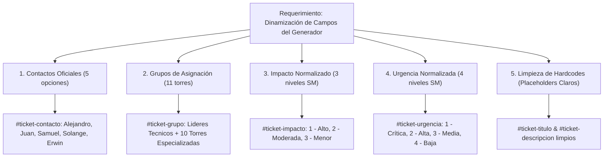
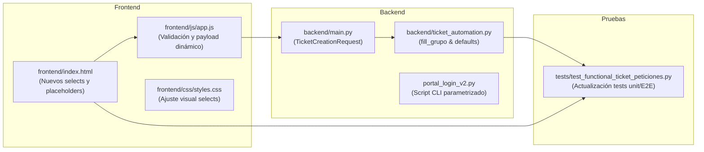
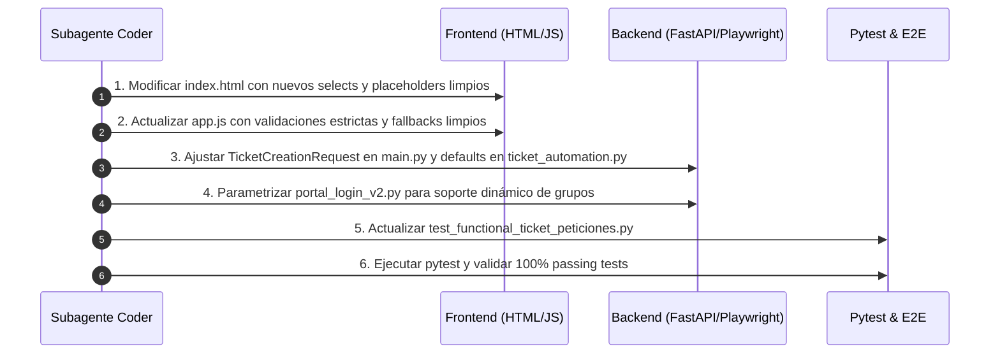

# ESPECIFICACIÓN TÉCNICA Y FUNCIONAL (SPECS)
## Módulo: "Generador de Tickets — Catálogo Dinámico de Campos y Eliminación de Valores Hardcodeados" — Portal App LTI (`app-lti`)

- **Documento:** SPECS-LTI-MOD-008
- **Versión:** 1.0.0
- **Fecha:** 2026-09-01
- **Autor:** Subagente Planificador & Diseñador de Specs
- **Destinatario:** Subagente Implementador (Coder) & Equipo de Desarrollo
- **Ubicación del Proyecto:** `/home/bobbasystem/Desarrollos/app-lti`

---

## CONTROL DE VERSIONES Y REGISTRO DE CAMBIOS

| Versión | Fecha | Autor | Descripción del Cambio |
|---|---|---|---|
| **1.0.0** | 2026-09-01 | Subagente Planificador | Especificación técnica exhaustiva para la actualización y dinamización de los campos del Generador Automatizado de Tickets en Micro Focus Service Manager (HPSM):<br>1. Incorporación del catálogo oficial de 5 contactos autorizados en `#ticket-contacto`.<br>2. Incorporación del catálogo de 11 grupos de asignación en `#ticket-grupo`.<br>3. Normalización exacta de los valores de Impacto (3 niveles con nomenclatura SM) en `#ticket-impacto`.<br>4. Normalización exacta de los valores de Urgencia (4 niveles con nomenclatura SM) en `#ticket-urgencia`.<br>5. Limpieza de valores de prueba hardcodeados en Título (`#ticket-titulo`) y Descripción (`#ticket-descripcion`) reemplazándolos por placeholders descriptivos y validación estricta.<br>6. Ajustes en contratos de API (`backend/main.py`), motor de automatización (`backend/ticket_automation.py`), frontend (`index.html`, `app.js`, `styles.css`) y suite de pruebas (`tests/`). |

---

## 1. RESUMEN EJECUTIVO Y OBJETIVOS

### 1.1. Contexto y Justificación
El módulo **"Generador Automatizado de Tickets (Service Manager Bot)"** fue diseñado originalmente con valores de prueba estáticos (*hardcodeados*) en sus formularios (ej. `"Creacion test automatizacion"`, `"Prueba test automatización"`, un único contacto seleccionable y un único grupo de asignación preconfigurado).

Para la puesta en producción operativa, los usuarios y líderes técnicos requieren seleccionar a los solicitantes reales, dirigir la interacción al grupo de soporte especializado pertinente (redes, virtualización, plataformas, torres operativas) y parametrizar fielmente el nivel de severidad (Impacto y Urgencia) según el estándar de Micro Focus Service Manager (HPSM), contando con campos limpios y guiados por *placeholders* intuitivos.



### 1.2. Objetivos Principales
1. **Dinamizar el selector de Contacto (`#ticket-contacto`)**: Permitir la selección entre los 5 integrantes del equipo de Líderes Técnicos con validación de obligatoriedad.
2. **Expandir el catálogo de Grupos de Asignación (`#ticket-grupo`)**: Proveer un menú desplegable con las 11 torres/grupos técnicos de Service Manager, integrándolo transparentemente con el algoritmo de búsqueda modal en Playwright.
3. **Estandarizar Impacto (`#ticket-impacto`) y Urgencia (`#ticket-urgencia`)**: Alinear las opciones del frontend exactamente con las etiquetas y valores nativos de Service Manager para evitar discrepancias o fallas en la selección.
4. **Eliminar valores por defecto de prueba**: Limpiar los campos de entrada de Título y Descripción, implementando validaciones obligatorias en frontend y backend junto con *placeholders* contextuales.
5. **Preservar la Arquitectura Lineal Directa SSE**: Mantener la robustez del generador asíncrono, la captura dual de identificadores (SD + Petición), el logout seguro y el modal de confirmación con soporte de correo.

---

## 2. CATÁLOGO DETALLADO DE CAMPOS Y VALORES

### 2.1. Campo Contacto (`#ticket-contacto`)
- **Tipo de Control:** `<select id="ticket-contacto" class="form-select" required>`
- **Etiqueta:** `Contacto *`
- **Texto de Ayuda:** `Usuario solicitante registrado en la plataforma Service Manager.`
- **Opciones Requeridas (5 opciones):**

| Opción | Valor / Label | Comportamiento / Default |
|---|---|---|
| 1 | `ALEJANDRO JAVIER AGUILAR MORALES` | Opción seleccionada por defecto (`selected`) |
| 2 | `JUAN BARRERA RAMOS` | Seleccionable |
| 3 | `SAMUEL PAREDES SAEZ` | Seleccionable |
| 4 | `SOLANGE ANGELICA ORTIZ VIROLDE` | Seleccionable |
| 5 | `Erwin Patricio Sandoval Cadiz` | Seleccionable |

> [!NOTE]
> La primera opción (`ALEJANDRO JAVIER AGUILAR MORALES`) queda seleccionada por defecto para agilizar la operación habitual, pero el dropdown permite al usuario alternar libremente entre cualquiera de los 5 miembros del equipo.

---

### 2.2. Campo Grupo de Asignación (`#ticket-grupo`)
- **Tipo de Control:** `<select id="ticket-grupo" class="form-select" required>`
- **Etiqueta:** `Grupo de Asignación *`
- **Texto de Ayuda:** `Torre u organización responsable de atender la interacción.`
- **Opciones Requeridas (11 opciones):**

| N° | Valor / Label Exacto en Service Manager | Default |
|---|---|---|
| 1 | `Lideres Tecnicos` | `selected` (por defecto) |
| 2 | `ProvisionConectividadTI` | Seleccionable |
| 3 | `ProvisionVirtualizacionTI` | Seleccionable |
| 4 | `Plataforma T3 / Soporte Especializado` | Seleccionable |
| 5 | `Torre Linux` | Seleccionable |
| 6 | `Torre Microsoft` | Seleccionable |
| 7 | `Torre Monitoreo` | Seleccionable |
| 8 | `Torre Plataformas Internas` | Seleccionable |
| 9 | `Torre Respaldos` | Seleccionable |
| 10 | `Torre SAP` | Seleccionable |
| 11 | `Torre Virtualizacion` | Seleccionable |

#### Comportamiento en la Automatización (`backend/ticket_automation.py` & `portal_login_v2.py`):
- El motor de Playwright invoca la función `fill_grupo(frame, context, grupo)`.
- El modal de búsqueda de Service Manager recibe el string exacto seleccionado (ej. `"Torre Linux"` o `"Plataforma T3 / Soporte Especializado"`), ejecuta la consulta (`Enter` / Botón Buscar), identifica la fila correspondiente en la grilla y la vincula al control `#X89`.
- La verificación `_check_grupo_filled` y `_click_grupo_result` evalúan el string dinámico mediante comparación *case-insensitive* y coincidencia por regex.

---

### 2.3. Campo Impacto (`#ticket-impacto`)
- **Tipo de Control:** `<select id="ticket-impacto" class="form-select" required>`
- **Etiqueta:** `Impacto *`
- **Opciones Requeridas (3 opciones estandarizadas con SM):**

| N° | Valor / Label Exacto en SM | Descripción Operativa | Default |
|---|---|---|---|
| 1 | `1 - Alto (Perdida Total)` | Indisponibilidad crítica total del servicio | No |
| 2 | `2 - Moderada (Perdida Parcial)` | Degradación parcial del servicio | No |
| 3 | `3 - Menor (Existen WorkAround)` | Afectación menor o solicitud de apoyo operativo | `selected` (por defecto) |

---

### 2.4. Campo Urgencia (`#ticket-urgencia`)
- **Tipo de Control:** `<select id="ticket-urgencia" class="form-select" required>`
- **Etiqueta:** `Urgencia *`
- **Opciones Requeridas (4 opciones estandarizadas con SM):**

| N° | Valor / Label Exacto en SM | Descripción Operativa | Default |
|---|---|---|---|
| 1 | `1 - Crítica (Atención Inmediata)` | Requiere atención inmediata 24x7 | No |
| 2 | `2 - Alta (Resolución a corto plazo)` | Requiere atención prioritaria a corto plazo | No |
| 3 | `3 - Media (Resolución a mediano plazo)` | Tiempo de atención estándar | `selected` (por defecto) |
| 4 | `4 - Baja (No requiere urgencia)` | Tarea programable sin premura | No |

---

### 2.5. Campos Título y Descripción (Limpieza de Valores de Prueba)

#### A. Título de la Interacción (`#ticket-titulo`)
- **Tipo de Control:** `<input type="text" id="ticket-titulo" class="form-input" required>`
- **Valor Inicial (`value`):** `""` (vacío, sin texto hardcodeado).
- **Placeholder:** `Ingresa el título o resumen del requerimiento (ej: Habilitación enlace MPLS Cliente X)`
- **Validación:** Obligatorio (`required`). Mínimo 4 caracteres en submit.

#### B. Descripción Detallada (`#ticket-descripcion`)
- **Tipo de Control:** `<textarea id="ticket-descripcion" class="form-textarea" rows="3" required></textarea>`
- **Valor Inicial:** `""` (vacío, sin texto hardcodeado).
- **Placeholder:** `Detalla el alcance, requerimiento técnico, justificación y antecedentes necesarios...`
- **Validación:** Obligatorio (`required`). Mínimo 5 caracteres en submit.

---

## 3. ARQUITECTURA DE INTEGRACIÓN Y CONTRATOS DE API

### 3.1. Esquema Pydantic (`backend/main.py`)

El modelo `TicketCreationRequest` se actualiza para exigir `titulo` y `descripcion` sin valores de prueba precargados, manteniendo valores iniciales coherentes para los dropdowns:

```python
class TicketCreationRequest(BaseModel):
    contacto: str = "ALEJANDRO JAVIER AGUILAR MORALES"
    titulo: str
    descripcion: str
    area: str = "Proyectos"
    subarea: str = "Apoyo habilitacion cliente"
    detalle: str = "Apoyo habilitacion cliente"
    grupo: str = "Lideres Tecnicos"
    impacto: Optional[str] = "3 - Menor (Existen WorkAround)"
    urgencia: Optional[str] = "3 - Media (Resolución a mediano plazo)"
    usuario_peticion: Optional[str] = "Alejandro.Aguilar"
    headless: Optional[bool] = True
```

### 3.2. Contrato de Entrada (JSON Request)
```json
{
  "contacto": "SOLANGE ANGELICA ORTIZ VIROLDE",
  "titulo": "Apoyo habilitación infraestructura cliente Codelco",
  "descripcion": "Se requiere coordinación con Torre Linux y Conectividad para validación de interfaces de red.",
  "area": "Proyectos",
  "subarea": "Apoyo habilitacion cliente",
  "detalle": "Apoyo habilitacion cliente",
  "grupo": "Torre Linux",
  "impacto": "2 - Moderada (Perdida Parcial)",
  "urgencia": "2 - Alta (Resolución a corto plazo)",
  "usuario_peticion": "Alejandro.Aguilar",
  "headless": true
}
```

### 3.3. Contrato de Respuesta SSE (`text/event-stream`)
El endpoint `/api/automation/create-ticket` mantiene el streaming lineal con los nuevos parámetros dinámicos reflejados en los logs y en el evento final `complete`:

```json
{
  "type": "complete",
  "status": "success",
  "ticket_id": "SD1051234",
  "peticion_id": "PET004567",
  "message": "Interacción y Petición creadas con éxito",
  "data": {
    "ticket_id": "SD1051234",
    "peticion_id": "PET004567",
    "contacto": "SOLANGE ANGELICA ORTIZ VIROLDE",
    "titulo": "Apoyo habilitación infraestructura cliente Codelco",
    "grupo": "Torre Linux",
    "area": "Proyectos",
    "subarea": "Apoyo habilitacion cliente",
    "detalle": "Apoyo habilitacion cliente",
    "usuario_peticion": "Alejandro.Aguilar"
  }
}
```

---

## 4. ANÁLISIS DE IMPACTO POR COMPONENTE



### 4.1. `frontend/index.html`
- Reemplazar el bloque `<select id="ticket-contacto">` con las 5 opciones requeridas.
- Reemplazar el bloque `<select id="ticket-grupo">` con las 11 opciones de torres y soporte.
- Actualizar `<select id="ticket-impacto">` con las 3 opciones de SM.
- Actualizar `<select id="ticket-urgencia">` con las 4 opciones de SM.
- Limpiar `value="..."` en `<input id="ticket-titulo">` y establecer placeholder informativo.
- Limpiar el contenido interior de `<textarea id="ticket-descripcion">` y establecer placeholder estructurado.

### 4.2. `frontend/js/app.js`
- En `executeTicketAutomation()`: Validar que `titulo` y `descripcion` no sean cadenas vacías o solo espacios en blanco antes de invocar la API, alertando amigablemente al usuario si faltan datos.
- En `openEmailModal()`: Asegurar que si el usuario no ingresó un título o descripción previa, el modal de correo tome textos de fallback profesionales (evitar strings `'Creacion test automatizacion'`).

### 4.3. `backend/ticket_automation.py`
- Actualizar `DEFAULT_CONTACTO`, `DEFAULT_GRUPO`, `DEFAULT_IMPACTO`, `DEFAULT_URGENCIA` para alinearse con los catálogos oficiales.
- Asegurar que `DEFAULT_TITULO = ""` y `DEFAULT_DESCRIPCION = ""` o que se exijan desde los parámetros entrantes.
- Verificar que `fill_grupo(frame, context, grupo)` maneje nombres con barras y caracteres especiales como `"Plataforma T3 / Soporte Especializado"` escapando adecuadamente las expresiones regulares (`re.escape(grupo)`).

### 4.4. `portal_login_v2.py`
- Eliminar las referencias estáticas hardcodeadas a `"lideres tecnicos"` en `_check_grupo_filled` y `_detect_popup` usando la variable `GRUPO` parametrizable.

### 4.5. `tests/test_functional_ticket_peticiones.py`
- Actualizar `test_ticket_creation_request_defaults` para reflejar el nuevo esquema Pydantic.
- Actualizar `test_e2e_01_navigation_and_form_defaults` para comprobar que el título y la descripción inician vacíos con sus respectivos placeholders, y que los dropdowns contienen las nuevas listas de opciones.
- Añadir casos de prueba para validación de opciones múltiples en Contacto, Grupo, Impacto y Urgencia.

---

## 5. PLAN DE IMPLEMENTACIÓN PARA EL CODER



### Paso 1: Actualización del Formulario en `frontend/index.html`
1. Modificar `#ticket-contacto` insertando las 5 opciones solicitadas.
2. Modificar `#ticket-grupo` insertando las 11 opciones de grupos y torres.
3. Modificar `#ticket-impacto` insertando las 3 opciones normalizadas de Service Manager.
4. Modificar `#ticket-urgencia` insertando las 4 opciones normalizadas de Service Manager.
5. Limpiar `#ticket-titulo` (`value=""`) y `#ticket-descripcion` (sin contenido interno).

### Paso 2: Actualización de la Lógica Frontend en `frontend/js/app.js`
1. Verificar que `executeTicketAutomation()` lea correctamente los valores de los selects.
2. Validar que si `titulo.trim() === ""` o `descripcion.trim() === ""`, se despliegue una alerta o notificación pidiendo ingresar los datos requeridos.
3. Actualizar `openEmailModal()` en la línea ~2244 para que el asunto y cuerpo del correo tomen títulos y descripciones por defecto limpios si no vienen del formulario.

### Paso 3: Actualización de Schemas y Automatización en Backend
1. En `backend/main.py`: Ajustar `TicketCreationRequest` para que `titulo` y `descripcion` sean requeridos (`str`), y actualizar los defaults de `impacto` y `urgencia`.
2. En `backend/ticket_automation.py`: Validar la sanitización de `grupo`, `impacto` y `urgencia`.
3. En `portal_login_v2.py`: Reemplazar comparaciones fijas a `"lideres tecnicos"` por comparaciones con `GRUPO.lower()`.

### Paso 4: Actualización y Ejecución de la Suite de Pruebas
1. En `tests/test_functional_ticket_peticiones.py`:
   - Adaptar las aserciones de valores por defecto en formularios y Pydantic.
   - Probar la presencia de las 5 opciones de contacto y las 11 de grupo en el DOM.
2. Ejecutar la suite completa:
   ```bash
   pytest tests/test_functional_ticket_peticiones.py -v
   ```

---

## 6. CRITERIOS DE ACEPTACIÓN

1. **Catálogo de Contactos Completo:** El dropdown `#ticket-contacto` despliega exactamente los 5 nombres indicados y permite seleccionar cualquiera de ellos.
2. **Catálogo de Grupos Completo:** El dropdown `#ticket-grupo` despliega exactamente los 11 grupos/torres indicados y Playwright es capaz de seleccionarlos en el modal de búsqueda de Service Manager.
3. **Catálogos de Impacto y Urgencia Alineados:** `#ticket-impacto` cuenta con 3 opciones y `#ticket-urgencia` con 4 opciones coincidentes con Service Manager.
4. **Campos Limpios sin Hardcodes:** Ni Título ni Descripción contienen valores de prueba precargados; se muestran placeholders claros.
5. **Validación Preventiva:** Si el usuario intenta ejecutar el flujo sin haber completado Título o Descripción, el sistema bloquea la acción y solicita completar los campos.
6. **Integración con Flujo Existente:** La generación de la Interacción (SD), la Petición Relacionada, el Logout seguro y el Modal con doble ID operan sin regresiones.
7. **Suite de Pruebas Exitosa:** Todas las pruebas unitarias, de integración y E2E pasan al 100%.

---
