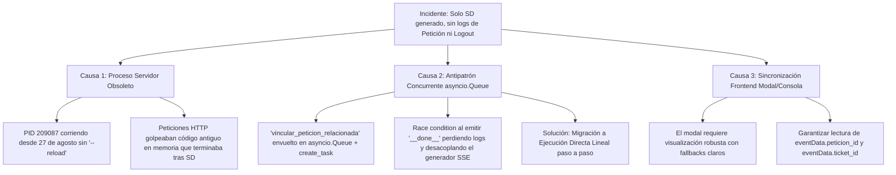
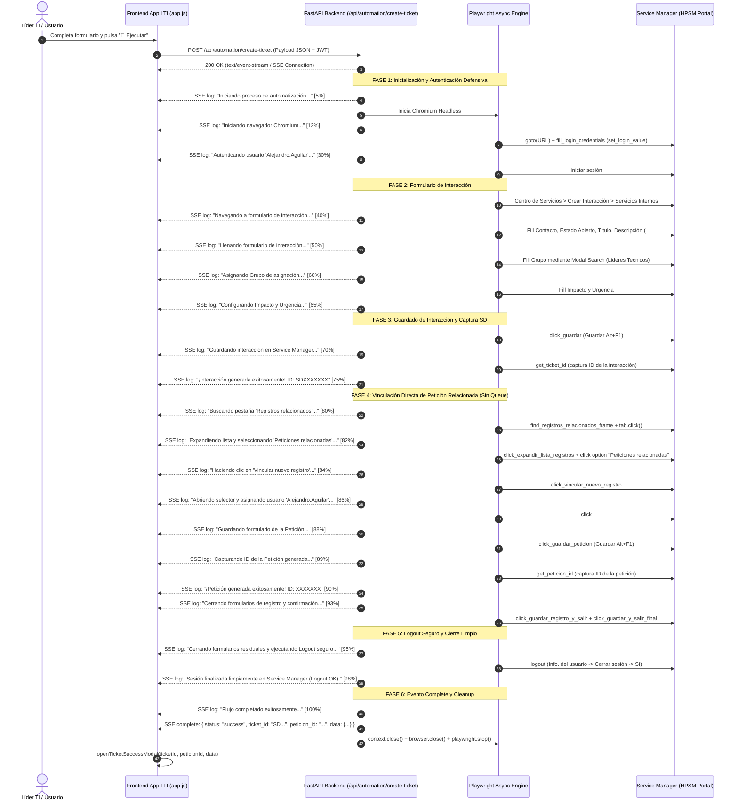

# ESPECIFICACIÓN TÉCNICA Y FUNCIONAL (SPECS)
## Módulo: "Generador Automatizado de Tickets y Peticiones Relacionadas con Cierre de Sesión Seguro" — Portal App LTI (`app-lti`)

- **Documento:** SPECS-LTI-MOD-007
- **Versión:** 1.1.0
- **Fecha:** 2026-08-28
- **Autor:** Subagente Planificador & Diseñador de Specs
- **Destinatario:** Subagente Implementador (Coder) & Equipo de Desarrollo
- **Ubicación del Proyecto:** `/home/bobbasystem/Desarrollos/app-lti`

---

## CONTROL DE VERSIONES Y REGISTRO DE CAMBIOS

| Versión | Fecha | Autor | Descripción del Cambio |
|---|---|---|---|
| **1.0.0** | 2026-08-28 | Subagente Planificador | Especificación técnica inicial para la integración del flujo extendido de creación de tickets en Micro Focus Service Manager (HPSM): Interacción (SD), vinculación de Petición Relacionada, selección de usuario (`Alejandro.Aguilar`), captura de ID de Petición, guardado en cascada y cierre de sesión seguro (`Info. del usuario` &rarr; `Cerrar sesión` &rarr; `Sí`), streaming en vivo vía Server-Sent Events (SSE) y nuevo modal de éxito con soporte para doble ID (SD + Petición). |
| **1.1.0** | 2026-08-28 | Subagente Planificador | **Diagnóstico y Corrección Arquitectónica de Ejecución Directa:**<br>1. Diagnóstico de causa raíz por proceso Uvicorn desactualizado en puerto 8000 (PID 209087) sin `--reload` reteniendo código antiguo en memoria.<br>2. Rediseño arquitectónico del generador `stream_ticket_creation` en `backend/ticket_automation.py` eliminando el antipatrón de colas concurrentes `asyncio.Queue` / `create_task` en favor de una **ejecución lineal directa** con `yield format_sse(...)` paso a paso garantizado.<br>3. Protocolo de gestión del ciclo de vida del servidor y reinicio limpio con recarga automática.<br>4. Resiliencia en frontend (`app.js` e `index.html`) para procesar estados intermedios y fallbacks de `peticion_id`.<br>5. Plan detallado de implementación y verificación para el subagente Coder. |

---

## 1. RESUMEN EJECUTIVO Y ANÁLISIS DE CAUSAS RAÍZ

### 1.1. Incidente Reportado por el Usuario
Durante una prueba funcional en vivo desde la interfaz web de la aplicación:
1. **Solo se generó y capturó el ID de interacción (SD).**
2. **La consola en vivo no ejecutó ni emitió los logs correspondientes a la vinculación de petición ni al cierre de sesión (logout).**
3. **El popup modal de éxito no mostró el identificador de la petición generada.**

### 1.2. Análisis Exhaustivo de Causas Raíz



1. **Causa Raíz 1 (Proceso Servidor Obsoleto en Memoria):**
   - El proceso Uvicorn en el puerto 8000 (`PID 209087`) se encontraba en ejecución continua en segundo plano desde el 27 de agosto sin el parámetro `--reload`.
   - En consecuencia, todas las solicitudes POST a `/api/automation/create-ticket` eran despachadas por la versión previa del código Python en memoria, la cual finalizaba inmediatamente tras la captura del ID de interacción (SD) y no contenía el subflujo de petición ni de logout.

2. **Causa Raíz 2 (Antipatrón Concurrente con `asyncio.Queue` en un Generador Asíncrono):**
   - En `backend/ticket_automation.py`, `stream_ticket_creation` delegaba la ejecución de `vincular_peticion_relacionada` a una subtarea `asyncio.create_task` desacoplada a través de un `asyncio.Queue` con sondeo por `asyncio.wait_for(queue.get(), timeout=0.2)`.
   - Este esquema introduce complejidad innecesaria, condiciones de carrera (si `__done__` es recibido antes de vaciar los logs en cola), latencia artificial y dificultad de depuración.
   - **Solución Arquitectónica:** Dado que `stream_ticket_creation` ya es un generador asíncrono (`AsyncGenerator`), todo el flujo debe ejecutarse de manera **100% secuencial y directa**, emitiendo cada log mediante `yield format_sse(...)` inmediatamente antes y después de cada acción de Playwright.

3. **Causa Raíz 3 (Sincronización Frontend y Resiliencia en el Modal):**
   - Asegurar que `frontend/js/app.js` reciba y procese fluidamente todos los niveles de log (`info`, `step`, `warn`, `success`, `error`), avance la barra de progreso del 0% al 100%, y al recibir `complete` extraiga tanto `ticket_id` como `peticion_id` mostrando los botones de copiado y badges de estado correspondientes.

---

## 2. ARQUITECTURA DE EJECUCIÓN DIRECTA LINEAL (SSE)

### 2.1. Diagrama de Secuencia de Ejecución Directa



---

## 3. PROTOCOLO DEL CICLO DE VIDA DEL SERVIDOR Y GESTIÓN DE PROCESOS

### 3.1. Diagnóstico de Procesos Activos en Puerto 8000
Antes de cualquier prueba funcional o despliegue, es mandatorio verificar si existe un proceso anterior escuchando en el puerto 8000:

```bash
# 1. Identificar PIDs en el puerto 8000
ss -tulpn | grep 8000
# o
lsof -i :8000
# o
ps aux | grep -E "uvicorn.*8000" | grep -v grep
```

### 3.2. Terminación Limpia de Procesos Obsoletos
Si se detecta un proceso obsoleto (por ejemplo `PID 209087`), debe terminarse de forma segura:

```bash
# Terminar proceso por PID
kill -15 <PID> 2>/dev/null || kill -9 <PID>

# O terminar de forma forzada por puerto
fuser -k 8000/tcp 2>/dev/null || true
```

### 3.3. Arranque del Servidor con Modo Recarga Automática (`--reload`)
El servidor debe ejecutarse siempre utilizando el entorno virtual adecuado con la bandera `--reload`:

```bash
cd /home/bobbasystem/Desarrollos/app-lti
PYTHONPATH="/home/bobbasystem/Desarrollos/app-lti" \
"/home/bobbasystem/Desarrollos/Carga Data SM/venv/bin/uvicorn" \
backend.main:app --host 0.0.0.0 --port 8000 --reload
```

---

## 4. ESPECIFICACIÓN DE DETALLE EN `backend/ticket_automation.py`

### 4.1. Refactorización de `stream_ticket_creation` (Eliminación de `asyncio.Queue`)

El generador principal `stream_ticket_creation` debe orquestar el flujo completo de forma estrictamente secuencial:

```python
async def stream_ticket_creation(params: Dict[str, Any]) -> AsyncGenerator[str, None]:
    """
    Generador asíncrono para Server-Sent Events (SSE).
    Ejecuta el ciclo de vida completo de automatización en Service Manager de forma lineal:
    - Autenticación defensiva
    - Apertura de Interacción (SD) con 7 estrategias en descripción y modal search en grupo
    - Guardado y captura del ID de interacción (SD)
    - Vinculación directa de Petición Relacionada con asignación a Alejandro.Aguilar
    - Guardado y captura del ID de petición
    - Cierre en cascada de formularios y Logout seguro con confirmación
    - Cleanup estricto en bloque finally
    """
    # 1. Extracción de parámetros con defaults
    url = params.get("url") or params.get("portal_url") or PORTAL_URL
    username = params.get("username") or params.get("portal_user") or PORTAL_USER
    password = params.get("password") or params.get("portal_pass") or PORTAL_PASS
    headless = params.get("headless", True)
    contacto = params.get("contacto") or DEFAULT_CONTACTO
    titulo = params.get("titulo") or DEFAULT_TITULO
    descripcion = params.get("descripcion") or DEFAULT_DESCRIPCION
    area = params.get("area") or DEFAULT_AREA
    subarea = params.get("subarea") or DEFAULT_SUBAREA
    detalle = params.get("detalle") or DEFAULT_DETALLE
    grupo = params.get("grupo") or DEFAULT_GRUPO
    impacto = params.get("impacto") or DEFAULT_IMPACTO
    urgencia = params.get("urgencia") or DEFAULT_URGENCIA

    playwright = None
    browser = None
    context = None
    page = None
    ticket_id = None
    peticion_id = None

    try:
        # FASE 1: Inicio de Chromium y Conexión
        yield format_sse({"type": "log", "message": "Iniciando proceso de automatización de ticket y petición...", "level": "info", "progress": 5})
        yield format_sse({"type": "log", "message": f"Iniciando navegador Chromium (headless={headless})...", "level": "info", "progress": 12})
        
        playwright = await async_playwright().start()
        browser = await playwright.chromium.launch(
            headless=headless,
            args=["--no-sandbox", "--disable-setuid-sandbox", "--disable-dev-shm-usage"]
        )
        context = await browser.new_context()

        async def _handle_dialog(dialog: Any):
            try:
                if hasattr(dialog, "accept"):
                    res = dialog.accept()
                    if asyncio.iscoroutine(res):
                        await res
            except Exception:
                pass
        context.on("dialog", lambda d: asyncio.create_task(_handle_dialog(d)))

        page = await context.new_page()

        yield format_sse({"type": "log", "message": f"Conectando a portal Service Manager: {url}...", "level": "step", "progress": 22})
        await page.goto(url, timeout=TIMEOUT, wait_until="domcontentloaded")

        yield format_sse({"type": "log", "message": f"Autenticando usuario '{username}' (modo defensivo contra robo de foco)...", "level": "step", "progress": 30})
        await fill_login_credentials(page, username, password, timeout_ms=TIMEOUT)
        await page.get_by_role("button", name="Iniciar sesión").click()

        # FASE 2: Navegación y Llenado de Interacción
        yield format_sse({"type": "log", "message": "Navegando a 'Centro de Servicios' > 'Crear nueva interacción'...", "level": "step", "progress": 40})
        await page.get_by_text("Centro de Servicios").click(timeout=TIMEOUT)
        await page.get_by_role("treeitem", name="Crear nueva interacción").click(timeout=TIMEOUT)

        yield format_sse({"type": "log", "message": "Abriendo sección 'Servicios Internos'...", "level": "step", "progress": 45})
        frame = await click_servicios_internos(context, page)

        yield format_sse({"type": "log", "message": f"Ingresando Contacto: '{contacto}'...", "level": "step", "progress": 48})
        try:
            await frame.get_by_role("textbox", name="Contacto:", exact=True).fill(contacto)
            await frame.get_by_role("img", name="Rellenar campo Contacto").click(timeout=10_000)
            await frame.wait_for_timeout(1500)
        except Exception:
            pass

        yield format_sse({"type": "log", "message": "Estableciendo Estado: 'Abierto'...", "level": "step", "progress": 50})
        try:
            await frame.locator("#X23Border a").click()
            await frame.get_by_role("option", name="Abierto").click()
        except Exception:
            pass

        yield format_sse({"type": "log", "message": f"Ingresando Título: '{titulo}'...", "level": "step", "progress": 52})
        await frame.get_by_role("textbox", name="Título:").fill(titulo)

        yield format_sse({"type": "log", "message": "Ingresando Descripción (aplicando cascada de 7 estrategias)...", "level": "step", "progress": 55})
        await fill_descripcion(frame, descripcion)

        yield format_sse({"type": "log", "message": f"Configurando Clasificación: Área='{area}', Sub-área='{subarea}', Detalle='{detalle}'...", "level": "step", "progress": 58})
        await fill_by_label(frame, "^Área", area)
        await fill_by_label(frame, "^Sub-área", subarea)
        await fill_by_label(frame, "^Detalle", detalle)

        yield format_sse({"type": "log", "message": f"Asignando Grupo mediante modal: '{grupo}'...", "level": "step", "progress": 60})
        await fill_grupo(frame, context, grupo)

        yield format_sse({"type": "log", "message": f"Configurando Impacto='{impacto}' y Urgencia='{urgencia}'...", "level": "step", "progress": 65})
        try:
            await frame.locator("#X71ButtonDiv > .image-link").click()
            await frame.get_by_role("option", name=impacto).click()
        except Exception:
            pass
        try:
            await frame.locator("#X78ButtonDiv > .image-link").click()
            await frame.get_by_role("option", name=urgencia).click()
        except Exception:
            pass

        # FASE 3: Guardado de Interacción y Captura SD
        yield format_sse({"type": "log", "message": "Formulario completado. Guardando interacción (Guardar Alt+F1)...", "level": "step", "progress": 70})
        await click_guardar(page, context)

        yield format_sse({"type": "log", "message": "Esperando generación y captura de ID de Interacción (SD)...", "level": "step", "progress": 72})
        ticket_id = await get_ticket_id(context, timeout_ms=35_000)

        yield format_sse({"type": "log", "message": f"¡Interacción generada exitosamente! ID: {ticket_id}", "level": "success", "progress": 75})

        # FASE 4: Vinculación Directa de Petición Relacionada (Secuencial y Lineal)
        yield format_sse({"type": "log", "message": "Buscando pestaña 'Registros relacionados'...", "level": "step", "progress": 80})
        frame, tab = await find_registros_relacionados_frame(context)
        await tab.click(timeout=10_000, force=True)
        await frame.wait_for_timeout(1500)

        yield format_sse({"type": "log", "message": "Expandiendo lista y seleccionando 'Peticiones relacionadas'...", "level": "step", "progress": 82})
        frame, _ = await find_registros_relacionados_frame(context, timeout_ms=10_000)
        await click_expandir_lista_registros(frame)
        await frame.get_by_role("option", name="Peticiones relacionadas").click(timeout=10_000, force=True)
        await wait_context(context, 1000)

        yield format_sse({"type": "log", "message": "Haciendo clic en 'Vincular nuevo registro'...", "level": "step", "progress": 84})
        await click_vincular_nuevo_registro(context)

        yield format_sse({"type": "log", "message": "Abriendo selector de usuario y asignando 'Alejandro.Aguilar'...", "level": "step", "progress": 86})
        user_btn_clicked = False
        for p in list(context.pages):
            for f in p.frames:
                try:
                    loc = f.locator("#X59ButtonDiv > .image-link, #X59ButtonDiv img, img[alt*='Rellenar campo Usuario'], img[title*='Rellenar campo Usuario']").first
                    if await loc.count() > 0:
                        await loc.click(timeout=8_000, force=True)
                        user_btn_clicked = True
                        break
                except Exception:
                    continue
            if user_btn_clicked:
                break
        if not user_btn_clicked:
            try:
                await frame.locator("#X59ButtonDiv > .image-link").click(timeout=8_000, force=True)
            except Exception:
                pass
        await wait_context(context, 1000)
        await click_alejandro_aguilar_option(context)

        yield format_sse({"type": "log", "message": "Guardando formulario de la Petición (Guardar Alt+F1)...", "level": "step", "progress": 88})
        await click_guardar_peticion(context)

        yield format_sse({"type": "log", "message": "Capturando ID de la Petición generada...", "level": "step", "progress": 89})
        peticion_id = await get_peticion_id(context)

        yield format_sse({"type": "log", "message": f"¡Petición generada exitosamente! ID: {peticion_id}", "level": "success", "progress": 90})

        yield format_sse({"type": "log", "message": "Cerrando formularios de registro y confirmación...", "level": "step", "progress": 93})
        await click_guardar_registro_y_salir(context)
        await click_guardar_y_salir_final(context)

        # FASE 5: Logout Seguro
        yield format_sse({"type": "log", "message": "Cerrando formularios residuales y ejecutando Logout seguro...", "level": "step", "progress": 95})
        try:
            await logout(page, context)
            yield format_sse({"type": "log", "message": "Sesión finalizada limpiamente en Service Manager (Logout OK).", "level": "success", "progress": 98})
        except Exception as exc:
            yield format_sse({"type": "log", "message": f"Aviso durante el cierre de sesión: {exc}", "level": "warn", "progress": 98})

        # FASE 6: Eventos Finales de Completitud
        yield format_sse({"type": "log", "message": f"Flujo completado exitosamente. Interacción: {ticket_id} | Petición: {peticion_id}", "level": "success", "progress": 100})
        yield format_sse({
            "type": "complete",
            "status": "success",
            "ticket_id": ticket_id,
            "peticion_id": peticion_id,
            "message": "Interacción y Petición creadas con éxito",
            "data": {
                "ticket_id": ticket_id,
                "peticion_id": peticion_id,
                "contacto": contacto,
                "titulo": titulo,
                "grupo": grupo,
                "area": area,
                "subarea": subarea,
                "detalle": detalle
            }
        })

    except Exception as exc:
        err_msg = str(exc)
        logger.exception("Error durante la automatización de ticket y petición")
        yield format_sse({"type": "log", "message": f"Error en la automatización: {err_msg}", "level": "error", "progress": 0})
        yield format_sse({
            "type": "error",
            "message": err_msg,
            "ticket_id": ticket_id,
            "peticion_id": peticion_id
        })

    finally:
        if context:
            try:
                await context.close()
            except Exception:
                pass
        if browser:
            try:
                await browser.close()
            except Exception:
                pass
        if playwright:
            try:
                await playwright.stop()
            except Exception:
                pass
```

---

## 5. ESPECIFICACIÓN DE COMPONENTES FRONTEND

### 5.1. Modal de Éxito (`frontend/index.html`)

El modal `#ticket-success-modal` estructura ambas tarjetas en una cuadrícula clara y responsiva:

```html
<div id="ticket-success-modal" class="modal-backdrop" style="display: none;" role="dialog" aria-modal="true" aria-labelledby="modal-success-title" tabindex="-1">
  <div class="modal-dialog modal-dialog-lg">
    <div class="modal-header">
      <div class="modal-header-brand">
        <div class="modal-icon-success">🎉</div>
        <div>
          <h3 id="modal-success-title" class="modal-title">¡Ticket y Petición Creados con Éxito!</h3>
          <p class="modal-subtitle">Registros generados en Micro Focus Service Manager</p>
        </div>
      </div>
      <button type="button" class="modal-close-btn" id="btn-close-modal-icon" aria-label="Cerrar modal">&times;</button>
    </div>

    <div class="modal-body">
      <p class="modal-description">
        La automatización completó satisfactoriamente el ciclo completo de creación en Service Manager, vinculando la petición relacionada y cerrando la sesión de forma segura:
      </p>

      <!-- Cuadrícula Dual de Identificadores (SD + Petición) -->
      <div class="ticket-dual-id-grid">
        <!-- Tarjeta Interacción SD -->
        <div class="ticket-id-display-box">
          <span class="ticket-id-label">N° Interacción (SD)</span>
          <div class="ticket-id-value-container">
            <span id="ticket-success-id" class="ticket-id-value">SD0000000</span>
            <button type="button" id="btn-copy-ticket-id" class="btn btn-primary btn-sm" title="Copiar ID de la Interacción al portapapeles">
              <span id="copy-ticket-btn-text">📋 Copiar SD</span>
            </button>
          </div>
          <div id="ticket-copy-feedback" class="copy-feedback-msg" style="display: none;">
            ✓ ¡Interacción copiada!
          </div>
        </div>

        <!-- Tarjeta Petición Relacionada -->
        <div class="ticket-id-display-box ticket-id-box-peticion">
          <span class="ticket-id-label">N° Petición Relacionada</span>
          <div class="ticket-id-value-container">
            <span id="peticion-success-id" class="ticket-id-value peticion-value">PET0000000</span>
            <button type="button" id="btn-copy-peticion-id" class="btn btn-accent btn-sm" title="Copiar ID de la Petición al portapapeles">
              <span id="copy-peticion-btn-text">📋 Copiar Petición</span>
            </button>
          </div>
          <div id="peticion-copy-feedback" class="copy-feedback-msg" style="display: none;">
            ✓ ¡Petición copiada!
          </div>
        </div>
      </div>

      <!-- Resumen Estructurado -->
      <div class="modal-summary-box">
        <div class="modal-summary-row">
          <span class="modal-summary-label">Contacto / Solicitante:</span>
          <span id="modal-summary-contacto" class="modal-summary-val">ALEJANDRO JAVIER AGUILAR MORALES</span>
        </div>
        <div class="modal-summary-row">
          <span class="modal-summary-label">Título:</span>
          <span id="modal-summary-titulo" class="modal-summary-val">Creacion test automatizacion</span>
        </div>
        <div class="modal-summary-row">
          <span class="modal-summary-label">Grupo Asignado:</span>
          <span id="modal-summary-grupo" class="modal-summary-val">Lideres Tecnicos</span>
        </div>
        <div class="modal-summary-row">
          <span class="modal-summary-label">Área / Subárea:</span>
          <span id="modal-summary-area" class="modal-summary-val">Proyectos / Apoyo habilitacion cliente</span>
        </div>
        <div class="modal-summary-row">
          <span class="modal-summary-label">Usuario Petición:</span>
          <span id="modal-summary-usuario-peticion" class="modal-summary-val">Alejandro.Aguilar</span>
        </div>
        <div class="modal-summary-row">
          <span class="modal-summary-label">Estado de Cierre:</span>
          <span id="modal-summary-logout-status" class="modal-summary-val" style="color: var(--status-success-text); font-weight: 700;">
            ✓ Sesión Finalizada Limpiamente (Logout OK)
          </span>
        </div>
      </div>
    </div>

    <div class="modal-footer" style="display: flex; justify-content: space-between; align-items: center;">
      <button type="button" id="btn-copy-both-ids" class="btn btn-secondary" title="Copiar resumen completo con ambos IDs">
        📋 Copiar Resumen Completo
      </button>
      <button type="button" id="btn-close-success-modal" class="btn btn-primary">
        Aceptar y Cerrar
      </button>
    </div>
  </div>
</div>
```

### 5.2. Manejo de Eventos en `frontend/js/app.js`

1. **`handleTicketSSEEvent(eventData, formData)`:**
   - Interpretar eventos `type: "log"` actualizando el porcentaje de progreso (`eventData.progress`) y el estado en vivo.
   - Interpretar eventos `type: "complete"`:
     * Extraer `eventData.ticket_id` (fallback a `'SD0000000'`).
     * Extraer `eventData.peticion_id` (fallback a `'-'`).
     * Invocar `this.openTicketSuccessModal(ticketId, peticionId, eventData.data || formData)`.
   - Interpretar eventos `type: "error"`: invocar `this.handleTicketError(eventData.message)`.

2. **`openTicketSuccessModal(ticketId, peticionId, formData)`:**
   - Inyectar `ticketId` en `#ticket-success-id`.
   - Inyectar `peticionId` en `#peticion-success-id`.
   - Llenar campos `#modal-summary-contacto`, `#modal-summary-titulo`, `#modal-summary-grupo`, `#modal-summary-area`.
   - Mostrar modal con `modal.style.display = 'flex'`.

3. **Copiado al Portapapeles:**
   - `#btn-copy-ticket-id` &rarr; Copia solo el `ticketId` y cambia temporalmente el texto a *"✓ ¡Copiado!"*.
   - `#btn-copy-peticion-id` &rarr; Copia solo el `peticionId` y cambia temporalmente el texto a *"✓ ¡Copiado!"*.
   - `#btn-copy-both-ids` &rarr; Copia el bloque estructurado con ambos identificadores y los datos de la solicitud.

---

## 6. PLAN DE ACCIÓN DETALLADO PARA EL SUBAGENTE CODER

El subagente Coder debe proceder siguiendo estas 5 etapas ordenadas:

### Etapa 1: Refactorización de `backend/ticket_automation.py`
1. Reemplazar la sección de `stream_ticket_creation` eliminando completamente `asyncio.Queue` y `asyncio.create_task`.
2. Implementar la emisión lineal directa de cada log (`yield format_sse(...)`) en cada fase (Chromium, login, interacción, guardado SD, Registros relacionados, Peticiones relacionadas, Vincular nuevo registro, Alejandro.Aguilar, guardado Petición, captura Petición ID, guardado y salida, logout y complete).
3. Asegurar que `vincular_peticion_relacionada` también pueda ser invocada de forma directa si se requiere como función auxiliar o mantenerla alineada con la ejecución síncrona de `portal_login_v2.py`.

### Etapa 2: Verificación de Frontend (`frontend/js/app.js` & `frontend/index.html`)
1. Verificar que `frontend/index.html` contenga el modal dual ID `#ticket-success-modal`.
2. Verificar que `frontend/js/app.js` maneje `complete` pasando `ticketId` y `peticionId` a `openTicketSuccessModal`.
3. Validar que los botones de copiado y cierre funcionen sin excepciones JS en consola.

### Etapa 3: Gestión de Procesos y Reinicio del Servidor Uvicorn
1. Detectar y terminar cualquier proceso obsoleto en el puerto 8000 (ej. `PID 209087`):
   ```bash
   kill -9 209087 2>/dev/null || fuser -k 8000/tcp 2>/dev/null || true
   ```
2. Iniciar Uvicorn con `--reload` en segundo plano utilizando el entorno virtual:
   ```bash
   PYTHONPATH="/home/bobbasystem/Desarrollos/app-lti" "/home/bobbasystem/Desarrollos/Carga Data SM/venv/bin/uvicorn" backend.main:app --host 0.0.0.0 --port 8000 --reload &
   ```
3. Validar mediante `curl` que el endpoint `/api/auth/me` o `/` responda correctamente (HTTP 200/401).

### Etapa 4: Ejecución de la Suite de Pruebas
1. Ejecutar las pruebas automatizadas de backend y streaming:
   ```bash
   pytest tests/test_functional_ticket_peticiones.py -v
   ```
2. Validar que todos los tests pasen al 100% sin advertencias.

### Etapa 5: Documentación y Reporte Final
1. Comprobar la integridad de `README.md`.
2. Reportar al Planificador y al agente principal los resultados del refactor y validación.

---

## 7. CRITERIOS DE ACEPTACIÓN (DoD - DEFINITION OF DONE)

1. **Flujo Lineal 100% Asíncrono Directo:** Ningún log ni paso de la creación de interacción, petición o logout se pierde por race conditions en colas.
2. **Generación de Doble ID:** Al finalizar la ejecución, el evento `complete` contiene tanto `ticket_id` (ej. `SD1049281`) como `peticion_id` (ej. `PET001234`).
3. **Consola en Vivo Fluida:** Todos los pasos aparecen en tiempo real con sus badges (`INFO`, `PASO`, `ÉXITO`) y la barra de progreso avanza suavemente de 0% a 100%.
4. **Modal de Éxito con Doble Tarjeta:** El modal despliega claramente el ID de Interacción y el ID de Petición con botones de copiado independientes y botón para copiar resumen consolidado.
5. **Logout Seguro y Limpio:** La automatización siempre ejecuta el cierre de formularios y el logout en Micro Focus Service Manager (`Info. del usuario` &rarr; `Cerrar sesión` &rarr; `Sí`).
6. **Proceso Uvicorn Actualizado:** El servidor se encuentra activo en el puerto 8000 corriendo el código actualizado con `--reload`.
7. **Pruebas Automatizadas Exitosas:** 100% de los tests unitarios, de API y E2E pasan en verde.
