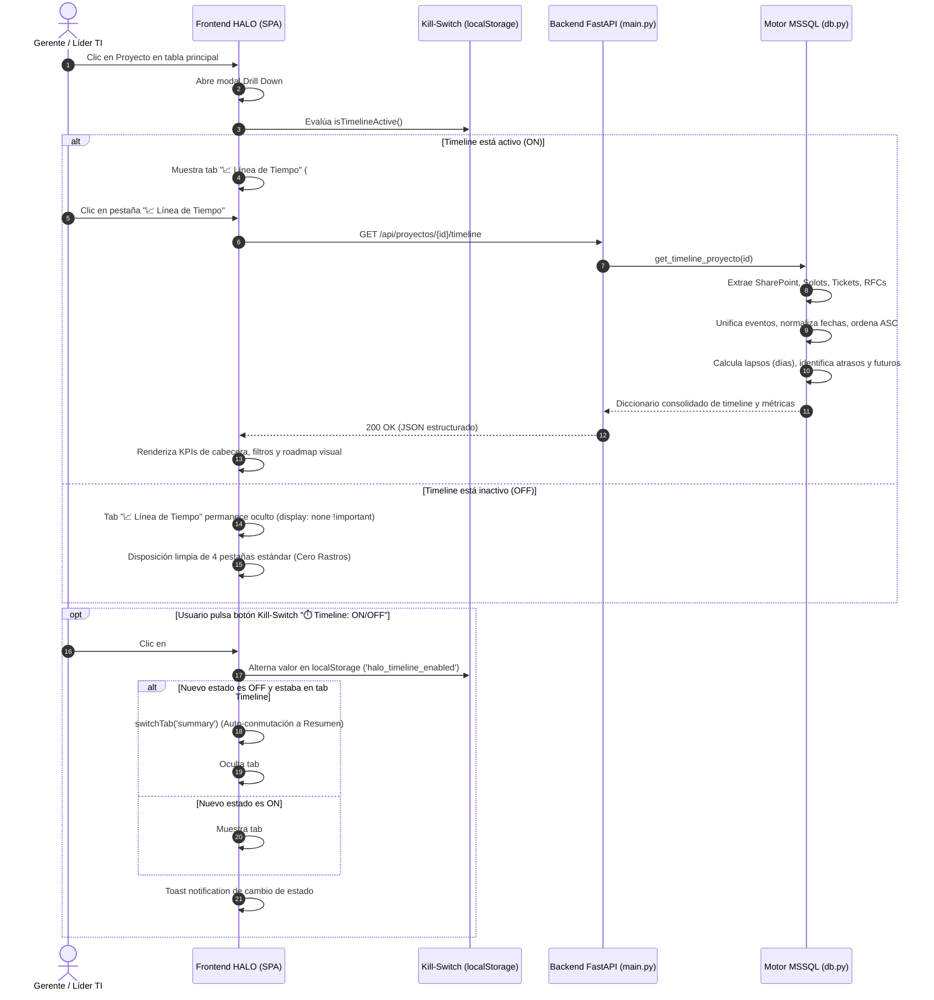

# ESPECIFICACIÓN TÉCNICA Y ARQUITECTÓNICA (SPECS)
## Módulo: "Timeline / Línea de Tiempo Visual del Proyecto (Visual Roadmap) & Kill-Switch" (`app-lti`)

- **Documento:** SPECS-LTI-MOD-014
- **Versión:** 1.0.0
- **Fecha:** 2026-09-23
- **Autor:** Subagente Planificador de Specs (`planificador_specs`)
- **Destinatario:** Subagente Desarrollador (`coder`) / QA Tester
- **Ubicación del Proyecto:** `/home/bobbasystem/Desarrollos/app-lti`
- **Entornos de Despliegue:** Desarrollo (`bobbadeveloper`, localhost:8000) & Producción (`iacdi`, Tailscale 100.82.24.75 / https://200.14.222.162/app-lti/)

---

## CONTROL DE VERSIONES Y REGISTRO DE CAMBIOS

| Versión | Fecha | Autor | Descripción del Cambio |
|---|---|---|---|
| **1.0.0** | 2026-09-23 | Subagente Planificador | Especificación técnica integral de la Funcionalidad 4: Timeline / Línea de Tiempo Visual del Proyecto (Visual Roadmap) en Drill Down. Arquitectura cliente-servidor con endpoint REST `GET /api/proyectos/{id}/timeline`, unificación cronológica de 4 subsistemas (SharePoint, SGA Solots, Tickets HPSM, RFCs), motor de cálculo de lapsos temporales (lead time total y días entre hitos consecutivos), tarjetas KPI ejecutivas en cabecera de pestaña, barra de filtros rápidos por categoría, visualización de hitos futuros y compromisos atrasados con alertas visuales corporativas Claro HALO (`#B52217`, `#0097A9`), soporte completo Modo Claro/Oscuro, Kill-Switch mandatorio en sub-barra (`⏱️ Timeline: ON / OFF`) con política de Cero Rastros y auto-switch a Resumen, matriz de pruebas unitarias/funcionales y plan de ejecución detallado para el Subagente Coder. |

---

## 1. RESUMEN EJECUTIVO Y OBJETIVOS DEL NEGOCIO

### 1.1. Contexto Operacional y Problemática
En **HALO — App Líderes TI**, los proyectos de telecomunicaciones, datacenter y servicios TI atraviesan un ciclo de vida complejo y multifacético que involucra hasta 4 fuentes maestras heterogéneas:
1. **SharePoint / Portal LTI** (`dbo.Proyectos`): Ingreso de la solicitud de Líder TI, asignación de responsables y cambios de estado administrativo (`Generado`, `En revision`, `Atendido`).
2. **Backlog de Operaciones SGA** (`dbo.CT_BACKLOG_OPERACIONES2`): Apertura de órdenes de trabajo (Solots), asignación a cuadrillas/áreas, compromisos de entrega y fechas de realización física/lógica.
3. **Mesa de Ayuda Service Manager HPSM** (`dbo.registrosRF_SD_SM`): Tickets de interacción/incidente reportados durante la implementación, asignados a torres de soporte (`Torre Linux`, `ProvisionConectividadTI`, etc.) y sus correspondientes fases de cierre.
4. **Gestión de Cambios Service Manager RFC** (`dbo.registrosSM_RFC`): Solicitudes de cambio planificadas en ventanas de mantenimiento para ejecución en infraestructura de producción.

**El Problema Actual:**  
Actualmente, el Drill Down de un proyecto presenta estos datos fragmentados en pestañas individuales desconectadas (`📋 Resumen`, `⚡ Solot`, `🎫 Tickets SD`, `🔄 RFCs`).  
Para que un Gerente de Operaciones o un Líder TI pueda comprender la historia cronológica del proyecto, debe:
- Abrir pestaña por pestaña.
- Comparar mentalmente fechas de dispersión (`FECHA_INSERT` de Solots vs `SUBMIT_DATE` de Tickets vs `ORIG_DATE_ENTERED` de RFCs).
- Calcular manualmente cuánto tiempo transcurrió entre que se solicitó el proyecto y se abrió la primera Solot, o cuántos días se detuvo el avance por un ticket crítico en una torre técnica.
- Identificar a ciegas si existen compromisos a futuro o hitos ya vencidos.

### 1.2. Solución Propuesta: "Timeline Visual del Proyecto (Visual Roadmap)"
Implementar una **nueva pestaña interactiva en el Drill Down (`📈 Línea de Tiempo` / `data-tab="timeline"`)** que unifique cronológicamente de principio a fin todo el ciclo de vida del proyecto en una vista de roadmap visual de alta fidelidad:
- **Agregación Cronológica Unificada**: Todos los eventos clave ordenados por fecha ascendente con trazabilidad de origen (SharePoint, Solots SGA, Tickets HPSM, RFCs).
- **Cálculo Automático de Lapsos Temporales**: Medición visual de los días transcurridos entre hitos consecutivos (`⏱️ +X días`), permitiendo visualizar de inmediato dónde ocurrieron las mayores pausas o cuellos de botella.
- **Métricas Ejecutivas en Cabecera**:
  * Total de eventos registrados.
  * Lead Time Total (días transcurridos desde la creación del proyecto).
  * Hito más reciente registrado (última actividad).
  * Próximo Compromiso / Alerta Crítica (indicando compromisos futuros o días de atraso de compromisos vencidos).
- **Filtros Rápidos por Categoría**: Botones tipo píldora (`[🌟 Todos]`, `[📁 SharePoint]`, `[⚡ SGA Solots]`, `[🎫 Tickets SD]`, `[🔄 RFCs]`) que filtran la cronología en caliente sin recargar la página.
- **Diseño Corporativo Claro HALO**: Estilo visual homologado con paleta oficial (`#B52217`, `#0097A9`), soporte para Modo Claro y Modo Oscuro (`[data-theme="dark"]`).
- **Mecanismo Mandatorio Kill-Switch & Política de Cero Rastros**:
  * Botón en sub-barra superior: `⏱️ Timeline: ON / OFF` (`#timeline-toggle-btn`).
  * Switch maestro `window.HALO_CONFIG.ENABLE_TIMELINE` y persistencia en `localStorage.getItem('halo_timeline_enabled')`.
  * Si se apaga (`OFF`), la pestaña `📈 Línea de Tiempo` se oculta completamente sin dejar espacios vacíos. Si el usuario estaba visualizando la línea de tiempo, conmuta automáticamente a la pestaña `📋 Resumen`.

---

## 2. ARQUITECTURA TÉCNICA Y FLUJO DE DATOS

### 2.1. Diagrama de Secuencia y Arquitectura



---

## 3. ESPECIFICACIÓN TÉCNICA BACKEND (FASTAPI & MSSQL)

### 3.1. Endpoint REST de Timeline

```http
GET /api/proyectos/{proyecto_id}/timeline
```

- **Autenticación:** Requiere sesión JWT activa mediante Portal de Acceso SSO (`require_lti_or_admin`).
- **Parámetros de Ruta:** `proyecto_id: int` (ID numérico del proyecto en `dbo.Proyectos`).
- **Códigos de Respuesta:**
  * `200 OK`: Retorna estructura JSON completa con métricas, eventos ordenados cronológicamente y metadatos.
  * `401 UNAUTHORIZED`: Si no hay cookie `access_token` válida.
  * `403 FORBIDDEN`: Si el usuario no cuenta con rol autorizado (LTI o ADMIN).
  * `404 NOT FOUND`: Si el `proyecto_id` no existe en la base de datos.
  * `500 INTERNAL SERVER ERROR`: Si ocurre un error inesperado al consultar la base de datos.

### 3.2. Contrato JSON de Salida

```json
{
  "proyecto_id": 12,
  "numero_proyecto": "0000108920",
  "cliente": "BANCO DE CHILE",
  "lt_asignado": "ALEJANDRO JAVIER AGUILAR MORALES",
  "lead_time_total_dias": 85,
  "metricas": {
    "total_eventos": 14,
    "eventos_sharepoint": 2,
    "eventos_solot": 6,
    "eventos_ticket": 4,
    "eventos_rfc": 2,
    "compromisos_pendientes": 1,
    "compromisos_vencidos": 1,
    "ultimo_hito": {
      "titulo": "Cierre Solot SGA #104889",
      "categoria": "solot",
      "fecha": "2026-09-18T12:00:00",
      "fecha_formateada": "18/09/2026"
    },
    "proximo_compromiso": {
      "titulo": "Fecha Compromiso Solot #105001",
      "categoria": "solot",
      "fecha": "2026-09-28T00:00:00",
      "fecha_formateada": "28/09/2026",
      "dias_restantes": 5,
      "es_atrasado": false
    }
  },
  "eventos": [
    {
      "id": "sp-creacion",
      "categoria": "sharepoint",
      "categoria_label": "SharePoint",
      "tipo_evento": "creacion",
      "titulo": "Creación de Proyecto / Solicitud LTI",
      "descripcion": "Solicitud ingresada para BANCO DE CHILE por CARLOS PEREZ GOMEZ",
      "fecha": "2026-06-30T10:00:00",
      "fecha_formateada": "30/06/2026",
      "estado": "Generado",
      "es_futuro": false,
      "es_atrasado": false,
      "lapso_dias": 0,
      "icono": "📁",
      "color_tipo": "#B52217",
      "metadata": {
        "solicitante": "CARLOS PEREZ GOMEZ",
        "tipo_servicio": "Cloud & Conectividad"
      }
    },
    {
      "id": "solot-insert-104880",
      "categoria": "solot",
      "categoria_label": "SGA Solots",
      "tipo_evento": "creacion",
      "titulo": "Apertura Solot SGA #104880",
      "descripcion": "Instalación Enlace Principal Fibra Óptica 1Gbps",
      "fecha": "2026-07-05T09:30:00",
      "fecha_formateada": "05/07/2026",
      "estado": "4- En curso",
      "es_futuro": false,
      "es_atrasado": false,
      "lapso_dias": 5,
      "icono": "⚡",
      "color_tipo": "#0097A9",
      "metadata": {
        "id_otp": 104880,
        "grupo_asignado": "Operaciones Redes Metro",
        "asignado": "Juan Perez"
      }
    },
    {
      "id": "solot-comp-104880",
      "categoria": "solot",
      "categoria_label": "SGA Solots",
      "tipo_evento": "compromiso",
      "titulo": "Compromiso Solot SGA #104880",
      "descripcion": "Fecha de entrega comprometida con el cliente",
      "fecha": "2026-08-15T00:00:00",
      "fecha_formateada": "15/08/2026",
      "estado": "Vencido",
      "es_futuro": false,
      "es_atrasado": true,
      "dias_atraso": 39,
      "lapso_dias": 41,
      "icono": "⚠️",
      "color_tipo": "#DC2626",
      "metadata": {
        "id_otp": 104880
      }
    }
  ]
}
```

### 3.3. Algoritmo de Agregación y Normalización en `backend/db.py`

Función principal: `get_timeline_proyecto(proyecto_id: int) -> dict | None`:

```python
def get_timeline_proyecto(proyecto_id: int) -> dict | None:
    """
    Consolida, unifica y ordena cronológicamente todos los hitos del proyecto
    a partir de dbo.Proyectos, dbo.CT_BACKLOG_OPERACIONES2, dbo.registrosRF_SD_SM
    y dbo.registrosSM_RFC.
    """
    proyecto = get_proyecto_by_id(proyecto_id)
    if not proyecto:
        return None

    numero_proyecto = proyecto.get("Numero_Proyecto")
    solots = get_solots_by_proyecto(proyecto_id, numero_proyecto)
    tickets = get_tickets_by_proyecto(proyecto_id, numero_proyecto)
    rfcs = get_rfcs_by_proyecto(proyecto_id, numero_proyecto)
    
    hoy = datetime.date.today()
    eventos = []

    # 1. Extracción de Hitos de SharePoint (dbo.Proyectos)
    # 1.1 Creación / Solicitud LTI
    fecha_creacion = _parse_date(proyecto.get("fecha_solicitud_lti") or proyecto.get("Creado"))
    if fecha_creacion:
        eventos.append({
            "id": f"sp-creacion-{proyecto_id}",
            "categoria": "sharepoint",
            "categoria_label": "SharePoint",
            "tipo_evento": "creacion",
            "titulo": "Ingreso de Proyecto / Solicitud LTI",
            "descripcion": f"Solicitud ingresada para {proyecto.get('Cliente', 'Sin Cliente')} por {proyecto.get('Solicitante') or 'Usuario LTI'}",
            "fecha": fecha_creacion.isoformat(),
            "estado": proyecto.get("Estado", "Generado"),
            "icono": "📁",
            "color_tipo": "#B52217",
            "metadata": {
                "tipo_servicio": proyecto.get("Tipo_Servicio"),
                "lt_asignado": proyecto.get("LT_Asignado")
            }
        })

    # 1.2 Modificación de SharePoint (si es posterior y existe)
    fecha_mod = _parse_date(proyecto.get("Modificado"))
    if fecha_mod and fecha_creacion and fecha_mod.date() > fecha_creacion.date():
        eventos.append({
            "id": f"sp-mod-{proyecto_id}",
            "categoria": "sharepoint",
            "categoria_label": "SharePoint",
            "tipo_evento": "actualizacion",
            "titulo": "Actualización en SharePoint",
            "descripcion": f"Última modificación registrada. Estado: {proyecto.get('Estado')}",
            "fecha": fecha_mod.isoformat(),
            "estado": proyecto.get("Estado", "En revision"),
            "icono": "📝",
            "color_tipo": "#64748B",
            "metadata": {}
        })

    # 2. Extracción de Hitos de Solots SGA (dbo.CT_BACKLOG_OPERACIONES2)
    estados_cerrados_solot = {
        'cerrada', '5- ejecutada', '5- ejecutada tareas pendientes',
        'abortado', 'en aborcion', 'eliminada', 'aprobado'
    }
    
    for s in solots:
        otp_id = s.get("ID_OTP")
        descr = s.get("DESCR_OTP") or f"Solot {otp_id}"
        estado_otp = (s.get("ESTADO_OTP") or "").strip()
        is_cerrada = estado_otp.lower() in estados_cerrados_solot

        # 2.1 Apertura / Inserción Solot
        dt_insert = _parse_date(s.get("FECHA_INSERT"))
        if dt_insert:
            eventos.append({
                "id": f"solot-insert-{otp_id}",
                "categoria": "solot",
                "categoria_label": "SGA Solots",
                "tipo_evento": "creacion",
                "titulo": f"Apertura Solot SGA #{otp_id}",
                "descripcion": descr,
                "fecha": dt_insert.isoformat(),
                "estado": estado_otp or "Ingresada",
                "icono": "⚡",
                "color_tipo": "#0097A9",
                "metadata": {
                    "id_otp": otp_id,
                    "servicio": s.get("SERVICIO"),
                    "producto": s.get("PRODUCTO"),
                    "grupo_asignado": s.get("GRUPO_ASIGNADO_OTP")
                }
            })

        # 2.2 Fecha Compromiso Solot
        dt_comp = _parse_date(s.get("FECHA_COMPROMETIDA"))
        if dt_comp:
            es_atrasado = (not is_cerrada) and (dt_comp.date() < hoy)
            es_futuro = dt_comp.date() >= hoy
            dias_atraso = (hoy - dt_comp.date()).days if es_atrasado else 0
            dias_restantes = (dt_comp.date() - hoy).days if es_futuro else 0

            eventos.append({
                "id": f"solot-comp-{otp_id}",
                "categoria": "solot",
                "categoria_label": "SGA Solots",
                "tipo_evento": "compromiso",
                "titulo": f"Compromiso Solot SGA #{otp_id}",
                "descripcion": f"Fecha comprometida: {descr}",
                "fecha": dt_comp.isoformat(),
                "estado": "Vencido" if es_atrasado else ("Pendiente" if not is_cerrada else "Cumplido"),
                "es_atrasado": es_atrasado,
                "es_futuro": es_futuro,
                "dias_atraso": dias_atraso,
                "dias_restantes": dias_restantes,
                "icono": "⚠️" if es_atrasado else ("⏳" if es_futuro else "📅"),
                "color_tipo": "#DC2626" if es_atrasado else ("#D97706" if es_futuro else "#0097A9"),
                "metadata": {
                    "id_otp": otp_id
                }
            })

        # 2.3 Fecha Realización / Cierre Solot
        dt_realiz = _parse_date(s.get("FECHA_REALIZACION"))
        if dt_realiz:
            eventos.append({
                "id": f"solot-cierre-{otp_id}",
                "categoria": "solot",
                "categoria_label": "SGA Solots",
                "tipo_evento": "cierre",
                "titulo": f"Cierre / Realización Solot #{otp_id}",
                "descripcion": descr,
                "fecha": dt_realiz.isoformat(),
                "estado": estado_otp or "Cerrada",
                "icono": "✅",
                "color_tipo": "#10B981",
                "metadata": {
                    "id_otp": otp_id
                }
            })

    # 3. Extracción de Hitos de Tickets HPSM / SD (dbo.registrosRF_SD_SM)
    estados_cerrados_tickets = {'closed', 'resolved', 'cerrado', 'resuelto'}
    for t in tickets:
        inc_id = t.get("CC_INCIDENT_ID") or t.get("RF_ID") or "SD"
        titulo_t = t.get("BRIEF_DESCRIPTION") or f"Incidente {inc_id}"
        estado_t = (t.get("STATUS") or "").strip()
        is_cerrado_t = estado_t.lower() in estados_cerrados_tickets

        # 3.1 Apertura / Reporte del Ticket
        dt_submit = _parse_date(t.get("SUBMIT_DATE"))
        if dt_submit:
            eventos.append({
                "id": f"ticket-submit-{inc_id}",
                "categoria": "ticket",
                "categoria_label": "Tickets SD",
                "tipo_evento": "creacion",
                "titulo": f"Reporte Ticket SD #{inc_id}",
                "descripcion": f"{titulo_t} (Grupo: {t.get('ASSIGNED_GROUP') or 'Sin Grupo'})",
                "fecha": dt_submit.isoformat(),
                "estado": estado_t or "Open",
                "icono": "🎫",
                "color_tipo": "#3B82F6",
                "metadata": {
                    "incident_id": inc_id,
                    "grupo_asignado": t.get("ASSIGNED_GROUP"),
                    "solicitante": t.get("REQUESTOR_NAME"),
                    "categoria": t.get("CATEGORY")
                }
            })

        # 3.2 Cierre del Ticket
        dt_close = _parse_date(t.get("CLOSE_DATE"))
        if dt_close:
            eventos.append({
                "id": f"ticket-close-{inc_id}",
                "categoria": "ticket",
                "categoria_label": "Tickets SD",
                "tipo_evento": "cierre",
                "titulo": f"Resolución Ticket SD #{inc_id}",
                "descripcion": titulo_t,
                "fecha": dt_close.isoformat(),
                "estado": estado_t or "Closed",
                "icono": "✅",
                "color_tipo": "#10B981",
                "metadata": {
                    "incident_id": inc_id
                }
            })

    # 4. Extracción de Hitos de RFCs (dbo.registrosSM_RFC)
    for r in rfcs:
        rfc_num = r.get("NUMBER") or "RFC"
        rfc_desc = r.get("BRIEF_DESCRIPTION") or r.get("DESCRIPTION") or f"Cambio {rfc_num}"

        # 4.1 Creación RFC
        dt_rfc_enter = _parse_date(r.get("ORIG_DATE_ENTERED"))
        if dt_rfc_enter:
            eventos.append({
                "id": f"rfc-create-{rfc_num}",
                "categoria": "rfc",
                "categoria_label": "RFCs",
                "tipo_evento": "creacion",
                "titulo": f"Creación RFC #{rfc_num}",
                "descripcion": f"{rfc_desc} (Depto: {r.get('ASSIGN_DEPT') or 'Sin Depto'})",
                "fecha": dt_rfc_enter.isoformat(),
                "estado": "Ingresada",
                "icono": "🔄",
                "color_tipo": "#8B5CF6",
                "metadata": {
                    "rfc_number": rfc_num,
                    "depto": r.get("ASSIGN_DEPT"),
                    "solicitante": r.get("REQUESTED_BY")
                }
            })

        # 4.2 Cierre RFC
        dt_rfc_close = _parse_date(r.get("CLOSE_TIME"))
        if dt_rfc_close:
            eventos.append({
                "id": f"rfc-close-{rfc_num}",
                "categoria": "rfc",
                "categoria_label": "RFCs",
                "tipo_evento": "cierre",
                "titulo": f"Cierre / Implementación RFC #{rfc_num}",
                "descripcion": rfc_desc,
                "fecha": dt_rfc_close.isoformat(),
                "estado": "Cerrada",
                "icono": "✅",
                "color_tipo": "#10B981",
                "metadata": {
                    "rfc_number": rfc_num
                }
            })

    # 5. Ordenamiento Cronológico Estricto (Fecha Ascendente)
    def sort_key(ev):
        raw_dt = _parse_date(ev["fecha"])
        return raw_dt or datetime.datetime.min

    eventos.sort(key=sort_key)

    # 6. Cálculo de Lapsos Temporales entre Hitos Consecutivos y Formateo DMY
    prev_dt = None
    first_dt = None
    last_dt = None

    for idx, ev in enumerate(eventos):
        ev_dt = _parse_date(ev["fecha"])
        if ev_dt:
            if first_dt is None:
                first_dt = ev_dt
            last_dt = ev_dt

            # Formateo DD/MM/YYYY
            ev["fecha_formateada"] = ev_dt.strftime("%d/%m/%Y")
            
            # Cálculo de lapso con el hito anterior
            if prev_dt is not None:
                dias_diff = max(0, (ev_dt.date() - prev_dt.date()).days)
                ev["lapso_dias"] = dias_diff
            else:
                ev["lapso_dias"] = 0
            
            prev_dt = ev_dt
        else:
            ev["fecha_formateada"] = "Fecha no disponible"
            ev["lapso_dias"] = 0

    # 7. Cálculo de Lead Time Total
    lead_time_total_dias = 0
    if first_dt:
        lead_time_total_dias = max(0, (hoy - first_dt.date()).days)

    # 8. Consolidación de Métricas de Cabecera
    total_eventos = len(eventos)
    ev_sp = sum(1 for e in eventos if e["categoria"] == "sharepoint")
    ev_solot = sum(1 for e in eventos if e["categoria"] == "solot")
    ev_ticket = sum(1 for e in eventos if e["categoria"] == "ticket")
    ev_rfc = sum(1 for e in eventos if e["categoria"] == "rfc")
    
    comp_vencidos = sum(1 for e in eventos if e.get("es_atrasado"))
    comp_pendientes = sum(1 for e in eventos if e.get("es_futuro"))

    # Último hito pasado registrado
    hitos_pasados = [e for e in eventos if not e.get("es_futuro")]
    ultimo_hito = hitos_pasados[-1] if hitos_pasados else (eventos[-1] if eventos else None)

    # Próximo compromiso futuro o el más vencido
    hitos_vencidos = [e for e in eventos if e.get("es_atrasado")]
    hitos_futuros = [e for e in eventos if e.get("es_futuro")]

    proximo_compromiso = None
    if hitos_vencidos:
        # Priorizar alerta del compromiso con mayor atraso
        hitos_vencidos.sort(key=lambda x: x.get("dias_atraso", 0), reverse=True)
        critico = hitos_vencidos[0]
        proximo_compromiso = {
            "titulo": critico["titulo"],
            "categoria": critico["categoria"],
            "fecha": critico["fecha"],
            "fecha_formateada": critico["fecha_formateada"],
            "dias_atraso": critico.get("dias_atraso", 0),
            "es_atrasado": True
        }
    elif hitos_futuros:
        proximo_compromiso = {
            "titulo": hitos_futuros[0]["titulo"],
            "categoria": hitos_futuros[0]["categoria"],
            "fecha": hitos_futuros[0]["fecha"],
            "fecha_formateada": hitos_futuros[0]["fecha_formateada"],
            "dias_restantes": hitos_futuros[0].get("dias_restantes", 0),
            "es_atrasado": False
        }

    return {
        "proyecto_id": proyecto_id,
        "numero_proyecto": numero_proyecto,
        "cliente": proyecto.get("Cliente", "Sin Cliente"),
        "lt_asignado": proyecto.get("LT_Asignado", "Sin Asignar"),
        "lead_time_total_dias": lead_time_total_dias,
        "metricas": {
            "total_eventos": total_eventos,
            "eventos_sharepoint": ev_sp,
            "eventos_solot": ev_solot,
            "eventos_ticket": ev_ticket,
            "eventos_rfc": ev_rfc,
            "compromisos_pendientes": comp_pendientes,
            "compromisos_vencidos": comp_vencidos,
            "ultimo_hito": ultimo_hito,
            "proximo_compromiso": proximo_compromiso
        },
        "eventos": eventos
    }
```

---

## 4. ESPECIFICACIÓN TÉCNICA FRONTEND (SPA JS & CSS)

### 4.1. Integración en `frontend/index.html`

#### 4.1.1. Botón Toggle en la Sub-Barra de Navegación
En el contenedor `.nav-subbar-actions` (adyacente al botón de Exportación a PDF):

```html
<!-- Botón Kill-Switch / Toggle de Timeline Visual -->
<button id="timeline-toggle-btn" class="btn-subbar-toggle" title="Activar o desactivar Línea de Tiempo Visual del Proyecto" aria-label="Toggle Timeline Visual" aria-pressed="true">
  <span class="timeline-toggle-icon">⏱️</span>
  <span class="timeline-toggle-label" id="timeline-toggle-label">Timeline: ON</span>
</button>
```

#### 4.1.2. Pestaña en el Drill Down (`.tabs-header`)
Ubicada entre `📋 Resumen del Proyecto` y `⚡ Solot`:

```html
<div class="tabs-header">
  <button class="tab-btn active" data-tab="summary">
    📋 Resumen del Proyecto
  </button>
  <button class="tab-btn" data-tab="timeline" id="tab-btn-timeline">
    📈 Línea de Tiempo <span class="tab-badge" id="tab-count-timeline">0</span>
  </button>
  <button class="tab-btn" data-tab="solots">
    ⚡ Solot (Backlog Operaciones) <span class="tab-badge" id="tab-count-solots">0</span>
  </button>
  <button class="tab-btn" data-tab="tickets">
    🎫 Tickets SD <span class="tab-badge" id="tab-count-tickets">0</span>
  </button>
  <button class="tab-btn" data-tab="rfcs">
    🔄 RFCs <span class="tab-badge" id="tab-count-rfcs">0</span>
  </button>
</div>
```

#### 4.1.3. Contenedor de la Pestaña (`#tab-pane-timeline`)

```html
<!-- Tab: Línea de Tiempo Visual (Visual Roadmap) -->
<div id="tab-pane-timeline" class="tab-pane" style="display: none;">
  <!-- Cabecera Ejecutiva de Métricas del Timeline -->
  <div class="timeline-kpi-grid" id="timeline-kpi-grid">
    <div class="timeline-kpi-card">
      <div class="timeline-kpi-icon">📊</div>
      <div>
        <div class="timeline-kpi-val" id="timeline-metric-total">0</div>
        <div class="timeline-kpi-title">TOTAL HITOS</div>
      </div>
    </div>
    <div class="timeline-kpi-card">
      <div class="timeline-kpi-icon">⏱️</div>
      <div>
        <div class="timeline-kpi-val" id="timeline-metric-leadtime">0 días</div>
        <div class="timeline-kpi-title">LEAD TIME TOTAL</div>
      </div>
    </div>
    <div class="timeline-kpi-card">
      <div class="timeline-kpi-icon">📍</div>
      <div>
        <div class="timeline-kpi-val-text" id="timeline-metric-ultimo">—</div>
        <div class="timeline-kpi-title">ÚLTIMO HITO</div>
      </div>
    </div>
    <div class="timeline-kpi-card" id="timeline-card-compromiso">
      <div class="timeline-kpi-icon" id="timeline-icon-compromiso">📅</div>
      <div>
        <div class="timeline-kpi-val-text" id="timeline-metric-compromiso">—</div>
        <div class="timeline-kpi-title" id="timeline-title-compromiso">PRÓXIMO COMPROMISO</div>
      </div>
    </div>
  </div>

  <!-- Barra de Filtros Rápidos por Categoría -->
  <div class="timeline-filters-bar">
    <div class="timeline-filters-label">Filtrar por:</div>
    <div class="timeline-pills-group">
      <button class="timeline-pill-btn active" data-timeline-filter="all">
        🌟 Todos <span class="pill-count" id="pill-count-all">0</span>
      </button>
      <button class="timeline-pill-btn" data-timeline-filter="sharepoint">
        📁 SharePoint <span class="pill-count" id="pill-count-sp">0</span>
      </button>
      <button class="timeline-pill-btn" data-timeline-filter="solot">
        ⚡ SGA Solots <span class="pill-count" id="pill-count-solot">0</span>
      </button>
      <button class="timeline-pill-btn" data-timeline-filter="ticket">
        🎫 Tickets SD <span class="pill-count" id="pill-count-ticket">0</span>
      </button>
      <button class="timeline-pill-btn" data-timeline-filter="rfc">
        🔄 RFCs <span class="pill-count" id="pill-count-rfc">0</span>
      </button>
    </div>
  </div>

  <!-- Contenedor del Roadmap Visual -->
  <div class="timeline-visual-roadmap" id="timeline-visual-roadmap">
    <div class="timeline-loading-state" id="timeline-loading-state">
      <div class="spinner"></div>
      <p>Cargando cronología del proyecto...</p>
    </div>
    <div class="timeline-roadmap-track" id="timeline-roadmap-track" style="display: none;">
      <!-- Nodos inyectados dinámicamente -->
    </div>
    <div class="timeline-empty-state" id="timeline-empty-state" style="display: none;">
      <div class="empty-icon">📭</div>
      <h3>No hay eventos registrados</h3>
      <p>No se encontraron hitos cronológicos para los filtros seleccionados.</p>
    </div>
  </div>
</div>
```

---

### 4.2. Lógica JavaScript en `frontend/js/app.js`

#### 4.2.1. Gestión del Kill-Switch y Configuración Global

```javascript
// En App (halo_app):

isTimelineActive() {
  // 1. Configuración maestra en runtime
  if (window.HALO_CONFIG && window.HALO_CONFIG.ENABLE_TIMELINE === false) {
    return false;
  }
  // 2. Preferencia de usuario persistida
  const pref = localStorage.getItem('halo_timeline_enabled');
  if (pref !== null) {
    return pref === 'true';
  }
  // 3. Fallback por defecto: Habilitado (true)
  return true;
},

toggleTimeline() {
  const current = this.isTimelineActive();
  const next = !current;
  localStorage.setItem('halo_timeline_enabled', next ? 'true' : 'false');
  this.applyTimelineState(true);
  const msg = next ? '⏱️ Línea de Tiempo activada' : '⏱️ Línea de Tiempo desactivada';
  this.showToast(msg, 'info');
},

applyTimelineState(triggerTabSwitch = true) {
  const active = this.isTimelineActive();
  const toggleBtn = document.getElementById('timeline-toggle-btn');
  const toggleLabel = document.getElementById('timeline-toggle-label');
  const tabBtn = document.getElementById('tab-btn-timeline');
  const tabPane = document.getElementById('tab-pane-timeline');

  if (toggleBtn) {
    toggleBtn.setAttribute('aria-pressed', active ? 'true' : 'false');
    if (active) {
      toggleBtn.classList.remove('is-off');
      toggleBtn.title = 'Desactivar Línea de Tiempo Visual';
      if (toggleLabel) toggleLabel.textContent = 'Timeline: ON';
    } else {
      toggleBtn.classList.add('is-off');
      toggleBtn.title = 'Activar Línea de Tiempo Visual';
      if (toggleLabel) toggleLabel.textContent = 'Timeline: OFF';
    }
  }

  // Política estricta de Cero Rastros
  if (tabBtn) {
    tabBtn.style.setProperty('display', active ? 'inline-flex' : 'none', 'important');
  }

  // Si se apaga mientras el usuario estaba en la pestaña de Timeline, conmutar a Resumen
  if (!active && this.activeTab === 'timeline') {
    this.switchTab('summary');
  }
}
```

#### 4.2.2. Carga y Renderizado del Timeline

```javascript
async loadTimeline(projectId) {
  if (!this.isTimelineActive()) return;

  const loading = document.getElementById('timeline-loading-state');
  const track = document.getElementById('timeline-roadmap-track');
  const empty = document.getElementById('timeline-empty-state');
  const badge = document.getElementById('tab-count-timeline');

  if (loading) loading.style.display = 'flex';
  if (track) track.style.display = 'none';
  if (empty) empty.style.display = 'none';

  try {
    const res = await fetch(`/api/proyectos/${projectId}/timeline`, {
      headers: { 'Accept': 'application/json' }
    });

    if (!res.ok) {
      throw new Error(`HTTP ${res.status}`);
    }

    const data = await res.json();
    this.currentTimelineData = data;

    // Actualizar badge de conteo en la pestaña
    if (badge) {
      badge.textContent = data.metricas?.total_eventos || 0;
    }

    // Renderizar métricas de cabecera
    this.renderTimelineMetrics(data);

    // Actualizar contadores de las píldoras de filtro
    this.updateTimelinePillCounts(data.metricas);

    // Renderizar eventos con el filtro activo actual (default: 'all')
    this.renderTimelineEvents(this.currentTimelineFilter || 'all');

  } catch (err) {
    console.error('Error al cargar timeline:', err);
    if (loading) loading.style.display = 'none';
    if (empty) {
      empty.style.display = 'block';
      empty.querySelector('p').textContent = 'No se pudo cargar la línea de tiempo del proyecto.';
    }
  } finally {
    if (loading) loading.style.display = 'none';
  }
},

renderTimelineMetrics(data) {
  const m = data.metricas || {};
  
  const elTotal = document.getElementById('timeline-metric-total');
  const elLead = document.getElementById('timeline-metric-leadtime');
  const elUltimo = document.getElementById('timeline-metric-ultimo');
  const elComp = document.getElementById('timeline-metric-compromiso');
  const cardComp = document.getElementById('timeline-card-compromiso');
  const iconComp = document.getElementById('timeline-icon-compromiso');
  const titleComp = document.getElementById('timeline-title-compromiso');

  if (elTotal) elTotal.textContent = m.total_eventos || 0;
  if (elLead) elLead.textContent = `${data.lead_time_total_dias || 0} días`;

  if (elUltimo) {
    if (m.ultimo_hito) {
      elUltimo.textContent = `${m.ultimo_hito.titulo} (${m.ultimo_hito.fecha_formateada})`;
      elUltimo.title = m.ultimo_hito.titulo;
    } else {
      elUltimo.textContent = 'Sin eventos';
    }
  }

  if (elComp && cardComp) {
    if (m.proximo_compromiso) {
      const pc = m.proximo_compromiso;
      if (pc.es_atrasado) {
        cardComp.classList.add('is-critical');
        cardComp.classList.remove('is-future');
        if (iconComp) iconComp.textContent = '🚨';
        if (titleComp) titleComp.textContent = 'COMPROMISO ATRASADO';
        elComp.textContent = `${pc.titulo} (+${pc.dias_atraso}d de atraso)`;
        elComp.title = `${pc.titulo} vencido el ${pc.fecha_formateada}`;
      } else {
        cardComp.classList.remove('is-critical');
        cardComp.classList.add('is-future');
        if (iconComp) iconComp.textContent = '📅';
        if (titleComp) titleComp.textContent = 'PRÓXIMO COMPROMISO';
        const labelRest = pc.dias_restantes === 0 ? 'hoy' : (pc.dias_restantes === 1 ? 'en 1 día' : `en ${pc.dias_restantes} días`);
        elComp.textContent = `${pc.titulo} (${pc.fecha_formateada} - ${labelRest})`;
        elComp.title = `${pc.titulo} el ${pc.fecha_formateada}`;
      }
    } else {
      cardComp.classList.remove('is-critical', 'is-future');
      if (iconComp) iconComp.textContent = '✅';
      if (titleComp) titleComp.textContent = 'COMPROMISOS';
      elComp.textContent = 'Todos al día / Completados';
    }
  }
},

renderTimelineEvents(filterCategory = 'all') {
  this.currentTimelineFilter = filterCategory;
  const track = document.getElementById('timeline-roadmap-track');
  const empty = document.getElementById('timeline-empty-state');
  if (!track || !this.currentTimelineData) return;

  const rawEvents = this.currentTimelineData.eventos || [];
  const filteredEvents = filterCategory === 'all'
    ? rawEvents
    : rawEvents.filter(e => e.categoria === filterCategory);

  if (filteredEvents.length === 0) {
    track.style.display = 'none';
    if (empty) empty.style.display = 'block';
    return;
  }

  if (empty) empty.style.display = 'none';
  track.style.display = 'flex';

  let html = '';
  for (let i = 0; i < filteredEvents.length; i++) {
    const ev = filteredEvents[i];
    const isOverdue = ev.es_atrasado;
    const isFuture = ev.es_futuro;

    // Conector con cálculo de lapso respecto al evento visible anterior
    if (i > 0) {
      const prevEv = filteredEvents[i - 1];
      const d1 = new Date(prevEv.fecha);
      const d2 = new Date(ev.fecha);
      let diffDays = 0;
      if (!isNaN(d1) && !isNaN(d2)) {
        diffDays = Math.max(0, Math.round((d2 - d1) / (1000 * 60 * 60 * 24)));
      }
      const lapseText = diffDays === 0 ? 'Mismo día' : `+${diffDays} d`;

      html += `
        <div class="roadmap-connector">
          <div class="roadmap-spine-line"></div>
          <div class="roadmap-lapse-badge" title="Tiempo transcurrido desde el hito anterior: ${diffDays} días">
            ⏱️ ${lapseText}
          </div>
        </div>
      `;
    }

    // Nodo y tarjeta del hito
    html += `
      <div class="roadmap-item ${isOverdue ? 'item-overdue' : ''} ${isFuture ? 'item-future' : ''} cat-${ev.categoria}">
        <div class="roadmap-node-dot" style="--node-accent: ${ev.color_tipo || '#0097A9'}">
          <span class="node-icon">${ev.icono || '📍'}</span>
        </div>
        <div class="roadmap-card">
          <div class="roadmap-card-header">
            <span class="badge-cat badge-cat-${ev.categoria}">${this.escapeHtml(ev.categoria_label)}</span>
            <span class="badge-date">📅 ${ev.fecha_formateada}</span>
            ${isOverdue ? `<span class="badge-alert-overdue">⚠️ Vencido (+${ev.dias_atraso}d)</span>` : ''}
            ${isFuture ? `<span class="badge-future-pending">⏳ Programado</span>` : ''}
            <span class="badge-status">${this.escapeHtml(ev.estado)}</span>
          </div>
          <div class="roadmap-card-title">${this.escapeHtml(ev.titulo)}</div>
          <div class="roadmap-card-desc">${this.escapeHtml(ev.descripcion || '')}</div>
          ${this.renderTimelineMetadata(ev.metadata)}
        </div>
      </div>
    `;
  }

  track.innerHTML = html;
}
```

---

### 4.3. Estilos CSS Institucionales (`frontend/css/styles.css`)

```css
/* ==========================================================================
   TIMELINE / LÍNEA DE TIEMPO VISUAL DEL PROYECTO (VISUAL ROADMAP)
   ========================================================================== */

/* Sub-Barra Toggle State */
#timeline-toggle-btn.is-off {
  opacity: 0.65;
  background: var(--bg-surface-tertiary);
  color: var(--text-muted);
  border-color: var(--border-color);
}

#timeline-toggle-btn.is-off:hover {
  opacity: 0.9;
  color: var(--text-primary);
}

/* Grilla de Métricas de Cabecera */
.timeline-kpi-grid {
  display: grid;
  grid-template-columns: repeat(4, 1fr);
  gap: 1rem;
  margin-bottom: 1.25rem;
}

.timeline-kpi-card {
  background: var(--bg-surface);
  border: 1px solid var(--border-color);
  border-radius: var(--radius-lg);
  padding: 0.85rem 1rem;
  display: flex;
  align-items: center;
  gap: 0.85rem;
  box-shadow: var(--shadow-sm);
  transition: all var(--transition-fast);
}

.timeline-kpi-card:hover {
  border-color: var(--primary);
  transform: translateY(-2px);
  box-shadow: var(--shadow-md);
}

.timeline-kpi-card.is-critical {
  border-color: #B52217;
  background: rgba(181, 34, 23, 0.05);
}

[data-theme="dark"] .timeline-kpi-card.is-critical {
  background: rgba(181, 34, 23, 0.15);
}

.timeline-kpi-card.is-future {
  border-color: #0097A9;
  background: rgba(0, 151, 169, 0.05);
}

.timeline-kpi-icon {
  font-size: 1.5rem;
  flex-shrink: 0;
}

.timeline-kpi-val {
  font-size: 1.25rem;
  font-weight: 700;
  color: var(--text-primary);
}

.timeline-kpi-val-text {
  font-size: 0.85rem;
  font-weight: 600;
  color: var(--text-primary);
  white-space: nowrap;
  overflow: hidden;
  text-overflow: ellipsis;
  max-width: 180px;
}

.timeline-kpi-title {
  font-size: 0.72rem;
  font-weight: 700;
  letter-spacing: 0.05em;
  color: var(--text-muted);
  text-transform: uppercase;
}

/* Barra de Filtros Rápidos (Píldoras) */
.timeline-filters-bar {
  display: flex;
  align-items: center;
  gap: 0.75rem;
  padding: 0.65rem 1rem;
  background: var(--bg-surface-secondary);
  border: 1px solid var(--border-color);
  border-radius: var(--radius-md);
  margin-bottom: 1.5rem;
}

.timeline-filters-label {
  font-size: 0.8rem;
  font-weight: 700;
  color: var(--text-muted);
  text-transform: uppercase;
  letter-spacing: 0.04em;
}

.timeline-pills-group {
  display: flex;
  flex-wrap: wrap;
  gap: 0.5rem;
}

.timeline-pill-btn {
  background: var(--bg-surface);
  border: 1px solid var(--border-color);
  border-radius: var(--radius-full);
  padding: 0.3rem 0.75rem;
  font-size: 0.8rem;
  font-weight: 600;
  color: var(--text-primary);
  cursor: pointer;
  display: inline-flex;
  align-items: center;
  gap: 0.35rem;
  transition: all var(--transition-fast);
}

.timeline-pill-btn:hover {
  border-color: var(--primary);
  background: var(--bg-surface-tertiary);
}

.timeline-pill-btn.active {
  background: var(--primary);
  color: #ffffff;
  border-color: var(--primary);
}

.timeline-pill-btn.active .pill-count {
  background: rgba(255, 255, 255, 0.25);
  color: #ffffff;
}

.pill-count {
  background: var(--bg-surface-secondary);
  color: var(--text-muted);
  border-radius: var(--radius-full);
  padding: 0.1rem 0.45rem;
  font-size: 0.72rem;
  font-weight: 700;
}

/* Roadmap Visual Vertical con Columna Espinal */
.timeline-visual-roadmap {
  position: relative;
  padding: 1rem 0.5rem;
}

.timeline-roadmap-track {
  display: flex;
  flex-direction: column;
  position: relative;
}

.roadmap-item {
  display: flex;
  align-items: flex-start;
  gap: 1rem;
  position: relative;
  margin-bottom: 0.5rem;
}

/* Punto Espinal / Nodo */
.roadmap-node-dot {
  width: 36px;
  height: 36px;
  border-radius: 50%;
  background: var(--bg-surface);
  border: 2px solid var(--node-accent, var(--primary));
  display: flex;
  align-items: center;
  justify-content: center;
  font-size: 1rem;
  box-shadow: 0 0 0 4px rgba(0, 151, 169, 0.1);
  flex-shrink: 0;
  z-index: 2;
  transition: all var(--transition-fast);
}

.roadmap-item:hover .roadmap-node-dot {
  transform: scale(1.15);
  box-shadow: 0 0 0 6px rgba(0, 151, 169, 0.2);
}

.roadmap-item.item-overdue .roadmap-node-dot {
  border-color: #B52217;
  box-shadow: 0 0 0 4px rgba(181, 34, 23, 0.2);
  animation: pulse-border-red 2s infinite;
}

/* Conector Vertical con Badge de Lapso */
.roadmap-connector {
  position: relative;
  margin-left: 17px;
  padding: 0.75rem 0 0.75rem 1.75rem;
  display: flex;
  align-items: center;
}

.roadmap-spine-line {
  position: absolute;
  left: 0;
  top: 0;
  bottom: 0;
  width: 2px;
  background: var(--border-color);
}

.roadmap-lapse-badge {
  background: var(--bg-surface-secondary);
  border: 1px dashed var(--border-color);
  border-radius: var(--radius-full);
  padding: 0.15rem 0.5rem;
  font-size: 0.72rem;
  font-weight: 600;
  color: var(--text-muted);
  display: inline-flex;
  align-items: center;
  gap: 0.25rem;
}

/* Tarjeta del Hito */
.roadmap-card {
  flex: 1;
  background: var(--bg-surface);
  border: 1px solid var(--border-color);
  border-radius: var(--radius-md);
  padding: 0.75rem 1rem;
  box-shadow: var(--shadow-sm);
  transition: all var(--transition-fast);
}

.roadmap-item:hover .roadmap-card {
  border-color: var(--primary);
  box-shadow: var(--shadow-md);
}

.roadmap-item.item-overdue .roadmap-card {
  border-left: 4px solid #B52217;
  background: rgba(181, 34, 23, 0.02);
}

[data-theme="dark"] .roadmap-item.item-overdue .roadmap-card {
  background: rgba(181, 34, 23, 0.08);
}

.roadmap-card-header {
  display: flex;
  align-items: center;
  flex-wrap: wrap;
  gap: 0.5rem;
  margin-bottom: 0.4rem;
}

.badge-cat {
  padding: 0.15rem 0.45rem;
  border-radius: var(--radius-sm);
  font-size: 0.72rem;
  font-weight: 700;
  text-transform: uppercase;
}

.badge-cat-sharepoint { background: rgba(181, 34, 23, 0.1); color: #B52217; }
.badge-cat-solot { background: rgba(0, 151, 169, 0.1); color: #0097A9; }
.badge-cat-ticket { background: rgba(59, 130, 246, 0.1); color: #2563EB; }
.badge-cat-rfc { background: rgba(139, 92, 246, 0.1); color: #7C3AED; }

.badge-date {
  font-size: 0.75rem;
  font-weight: 600;
  color: var(--text-secondary);
}

.badge-alert-overdue {
  background: #B52217;
  color: #ffffff;
  padding: 0.15rem 0.45rem;
  border-radius: var(--radius-sm);
  font-size: 0.72rem;
  font-weight: 700;
}

.badge-future-pending {
  background: #D97706;
  color: #ffffff;
  padding: 0.15rem 0.45rem;
  border-radius: var(--radius-sm);
  font-size: 0.72rem;
  font-weight: 700;
}

.badge-status {
  margin-left: auto;
  font-size: 0.75rem;
  font-weight: 600;
  color: var(--text-muted);
}

.roadmap-card-title {
  font-size: 0.92rem;
  font-weight: 700;
  color: var(--text-primary);
  margin-bottom: 0.25rem;
}

.roadmap-card-desc {
  font-size: 0.82rem;
  color: var(--text-secondary);
  line-height: 1.4;
}

/* Metadatos adicionales compactos */
.roadmap-metadata-row {
  margin-top: 0.45rem;
  display: flex;
  flex-wrap: wrap;
  gap: 0.75rem;
  font-size: 0.75rem;
  color: var(--text-muted);
  border-top: 1px solid var(--border-color);
  padding-top: 0.35rem;
}

.roadmap-meta-item strong {
  color: var(--text-secondary);
}

/* Responsivo para pantallas pequeñas */
@media (max-width: 768px) {
  .timeline-kpi-grid {
    grid-template-columns: repeat(2, 1fr);
  }
  .roadmap-card-header {
    gap: 0.3rem;
  }
}
```

---

## 5. REGLAS DE NEGOCIO, RESILIENCIA Y MANEJO DE ERRORES

### 5.1. Jerarquía de Fechas y Fallbacks Defensivos
1. **Fechas Nulas o Vacías**:
   - Si un hito carece de fecha válida (`None`, `""`, `"Invalid Date"`), se ignora de la ordenación temporal activa para evitar saltos o divisiones por cero.
   - En caso de que un proyecto carezca totalmente de fechas asociadas, el endpoint retorna un arreglo vacío de eventos y métricas con valores neutros (`lead_time_total_dias: 0`, `total_eventos: 0`).
2. **Normalización UTC y Formatos Heterogéneos**:
   - Soporte para formatos ISO (`2026-09-23T15:30:00`), formato con espacio (`2026-09-23 15:30:00`), fechas puras (`2026-09-23`) e instancias nativas de `datetime.datetime` / `datetime.date`.
3. **Consistencia Atómica de Lapsos**:
   - Si dos eventos ocurren en la misma fecha calendario, el lapso entre ellos se calcula como `0 días` (`Mismo día`).
   - El orden de desempate en la misma fecha prioriza el ciclo de vida natural:
     `SharePoint creación` ➔ `SGA Solots apertura` ➔ `Ticket reporte` ➔ `RFC creación` ➔ `Compromisos` ➔ `Realizaciones / Cierres`.

### 5.2. Política Estricta de Cero Rastros (Kill-Switch)
- Cuando el Kill-Switch está en `OFF` (`localStorage.getItem('halo_timeline_enabled') === 'false'`):
  * El botón del tab `#tab-btn-timeline` se oculta mediante `style.setProperty('display', 'none', 'important')`.
  * El contenedor `#tab-pane-timeline` se oculta mediante `style.setProperty('display', 'none', 'important')`.
  * La sub-barra refleja el estado inactivo con la clase `.is-off` y el texto `Timeline: OFF`.
  * No quedan márgenes residuales, separadores flotantes ni huecos visuales entre las pestañas `📋 Resumen`, `⚡ Solot`, `🎫 Tickets SD` y `🔄 RFCs`.
  * Si el usuario se encontraba visualizando la pestaña `📈 Línea de Tiempo` en el momento de accionar el Kill-Switch, la aplicación conmuta de inmediato y de forma transparente a la pestaña `📋 Resumen` (`this.switchTab('summary')`).

---

## 6. MATRIZ DE CASOS DE PRUEBA REQUERIDOS

### 6.1. Pruebas Unitarias Backend (`tests/test_timeline_visual.py`)

| ID | Nombre de la Prueba | Descripción y Aserciones |
|---|---|---|
| **UT-TL-01** | `test_get_timeline_proyecto_estructura` | Valida que `get_timeline_proyecto` retorne un diccionario con `proyecto_id`, `numero_proyecto`, `cliente`, `lead_time_total_dias`, `metricas` y `eventos`. |
| **UT-TL-02** | `test_get_timeline_orden_cronologico` | Valida que los eventos estén estrictamente ordenados de menor a mayor por fecha (`ev[i].fecha <= ev[i+1].fecha`). |
| **UT-TL-03** | `test_calculo_lapsos_entre_hitos` | Valida que el campo `lapso_dias` refleje con exactitud la diferencia en días naturales entre el hito actual y el hito cronológico anterior. |
| **UT-TL-04** | `test_clasificacion_hitos_futuros_y_vencidos` | Valida que un compromiso con fecha pasada y Solot no cerrada se marque como `es_atrasado=True` con cálculo correcto de `dias_atraso`, y fechas futuras como `es_futuro=True`. |
| **UT-TL-05** | `test_endpoint_api_timeline_auth_admin` | Valida que `GET /api/proyectos/{id}/timeline` retorne HTTP 200 para usuarios con rol `ADMIN`. |
| **UT-TL-06** | `test_endpoint_api_timeline_auth_lti` | Valida que `GET /api/proyectos/{id}/timeline` retorne HTTP 200 para usuarios con rol `LTI`. |
| **UT-TL-07** | `test_endpoint_api_timeline_no_auth` | Valida que `GET /api/proyectos/{id}/timeline` retorne HTTP 401 si no se envía cookie de sesión SSO. |
| **UT-TL-08** | `test_endpoint_api_timeline_proyecto_inexistente` | Valida que `GET /api/proyectos/999999/timeline` retorne HTTP 404 con mensaje estructurado. |
| **UT-TL-09** | `test_resiliencia_fechas_nulas_o_corruptas` | Valida que registros con fechas `None`, vacías o malformadas no provoquen errores 500 y se omitan elegantemente. |
| **UT-TL-10** | `test_metricas_agregadas_cabecera` | Valida la exactitud del cálculo de conteos por categoría (`eventos_sharepoint`, `eventos_solot`, `eventos_ticket`, `eventos_rfc`) y `lead_time_total_dias`. |

### 6.2. Pruebas Funcionales y de UI con Playwright (`tests/test_functional_timeline_visual.py`)

| ID | Nombre de la Prueba | Descripción y Aserciones |
|---|---|---|
| **FT-TL-01** | `test_kill_switch_timeline_default_on` | Valida que al cargar la página por primera vez, `#timeline-toggle-btn` esté en `Timeline: ON` y `#tab-btn-timeline` esté presente. |
| **FT-TL-02** | `test_kill_switch_timeline_toggle_off_cero_rastros` | Valida que al pulsar `#timeline-toggle-btn`, cambie a `Timeline: OFF` y `#tab-btn-timeline` desaparezca completamente (`display: none`). |
| **FT-TL-03** | `test_kill_switch_auto_switch_a_resumen` | Valida que si el usuario está en el tab `timeline` y apaga el switch, el sistema conmute automáticamente a `tab-pane-summary`. |
| **FT-TL-04** | `test_renderizado_tarjetas_kpi_timeline` | Valida que al abrir la pestaña `📈 Línea de Tiempo`, se visualicen las 4 tarjetas KPI con valores coherentes. |
| **FT-TL-05** | `test_filtros_rapidos_por_categoria` | Valida que al hacer clic en `[⚡ SGA Solots]`, sólo se muestren elementos con clase `.cat-solot` y se oculte el resto. |
| **FT-TL-06** | `test_lapsos_visuales_y_alertas_atraso` | Valida la presencia de badges `⏱️ +X d` y de badges `⚠️ Vencido` en hitos fuera de plazo. |
| **FT-TL-07** | `test_persistencia_localstorage_y_recarga` | Valida que el estado `halo_timeline_enabled=false` se mantenga tras un `reload()` de la página. |
| **FT-TL-08** | `test_regresion_no_afecta_pestanas_adyacentes` | Valida que las pestañas `📋 Resumen`, `⚡ Solot`, `🎫 Tickets SD` y `🔄 RFCs` sigan funcionando y mostrando sus tablas correctamente. |

---

## 7. PLAN DE IMPLEMENTACIÓN DETALLADO PARA EL SUBAGENTE CODER

El Subagente Desarrollador (`coder`) debe seguir este orden estricto de pasos:

### Paso 1: Backend & Motor de Datos
1. En `backend/db.py`:
   - Implementar la función `get_timeline_proyecto(proyecto_id: int) -> dict | None` según el algoritmo documentado en la Sección 3.3.
   - Reutilizar la función auxiliar `_parse_date` ya existente en `backend/db.py`.
   - Exportar `get_timeline_proyecto` en `__all__` o a nivel de módulo.
2. En `backend/main.py`:
   - Crear la ruta `@app.get("/api/proyectos/{proyecto_id}/timeline")` protegida por `require_lti_or_admin`.
   - Manejar HTTP 404 si el proyecto no existe.
3. Crear suite de pruebas unitarias en `tests/test_timeline_visual.py` y validar con pytest:
   ```bash
   PYTHONPATH=. "/home/bobbasystem/Desarrollos/Carga Data SM/venv/bin/pytest" tests/test_timeline_visual.py -v
   ```

### Paso 2: Interfaz de Usuario HTML & Sub-Barra
1. En `frontend/index.html`:
   - Agregar el botón `#timeline-toggle-btn` en `.nav-subbar-actions` (al lado de `#pdf-export-toggle-btn`).
   - Agregar el botón de pestaña `<button class="tab-btn" data-tab="timeline" id="tab-btn-timeline">📈 Línea de Tiempo <span class="tab-badge" id="tab-count-timeline">0</span></button>`.
   - Agregar el panel `#tab-pane-timeline` con la grilla de métricas KPI, la barra de filtros por categoría y el contenedor `#timeline-roadmap-track`.

### Paso 3: Estilos CSS Institucionales
1. En `frontend/css/styles.css`:
   - Incorporar las reglas de estilos documentadas en la Sección 4.3.
   - Garantizar el soporte de Modo Claro y Modo Oscuro (`[data-theme="dark"]`).
   - Asegurar que el Kill-Switch aplique `display: none !important;` al desactivarse.

### Paso 4: Lógica JavaScript en SPA
1. En `frontend/js/app.js`:
   - Inicializar el estado del Kill-Switch en el ciclo de arranque (`init()`).
   - Conectar los eventos `click` de `#timeline-toggle-btn` con `toggleTimeline()`.
   - Conectar los eventos `click` de las píldoras de filtro en `timeline-pill-btn`.
   - Modificar `loadProjectDetails(projectId)` para invocar `loadTimeline(projectId)`.
   - Implementar `renderTimelineEvents(filterCategory)` con cálculo dinámico de lapsos y badges de atraso.
   - Asegurar la política de Cero Rastros y conmutación automática a `summary` si el tab activo es `timeline` al apagar el switch.

### Paso 5: Pruebas Funcionales, E2E y Regresión
1. Crear `tests/test_functional_timeline_visual.py` con Playwright.
2. Ejecutar la suite completa:
   ```bash
   PYTHONPATH=. "/home/bobbasystem/Desarrollos/Carga Data SM/venv/bin/pytest" tests/test_functional_timeline_visual.py -v
   ```
3. Ejecutar pruebas de regresión de todos los módulos anteriores:
   ```bash
   PYTHONPATH=. "/home/bobbasystem/Desarrollos/Carga Data SM/venv/bin/pytest" tests/test_ficha_ejecutiva_pdf.py tests/test_functional_ficha_ejecutiva_pdf.py -v
   ```

---

## 8. DEFINITION OF DONE (DoD)

La Funcionalidad 4 se considerará completada únicamente cuando se cumplan las siguientes condiciones:
- [ ] Endpoint `GET /api/proyectos/{id}/timeline` respondiendo 200 OK con estructura validada.
- [ ] Tab `📈 Línea de Tiempo` operativo en Drill Down con contadores y métricas ejecutivas.
- [ ] Roadmap visual con spine continua, nodos cromáticos Claro HALO, tarjetas detalladas y cálculo de lapsos temporales (`⏱️ +X d`).
- [ ] Filtros por categoría (`Todos`, `SharePoint`, `SGA Solots`, `Tickets SD`, `RFCs`) filtrando instantáneamente sin recargas.
- [ ] Kill-Switch en sub-barra (`⏱️ Timeline: ON / OFF`) funcionando con persistencia en `localStorage` y política estricta de Cero Rastros (auto-conmutación a `📋 Resumen` si estaba activo).
- [ ] 100% de pruebas unitarias (`test_timeline_visual.py`) y funcionales (`test_functional_timeline_visual.py`) aprobadas.
- [ ] Cero regresiones en funcionalidades previas (Semáforo de Salud, Diagnóstico Ejecutivo, Ficha Ejecutiva PDF).
- [ ] Archivos `README.md` y `PENDIENTES_PROXIMA_SESION.md` actualizados.
